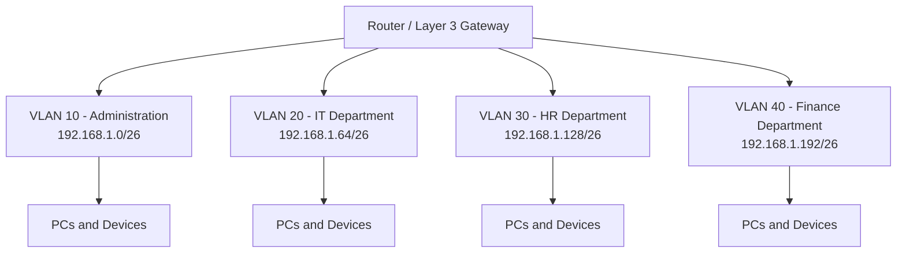
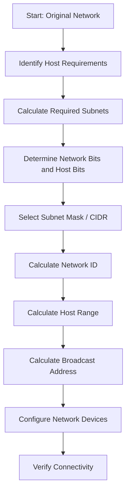
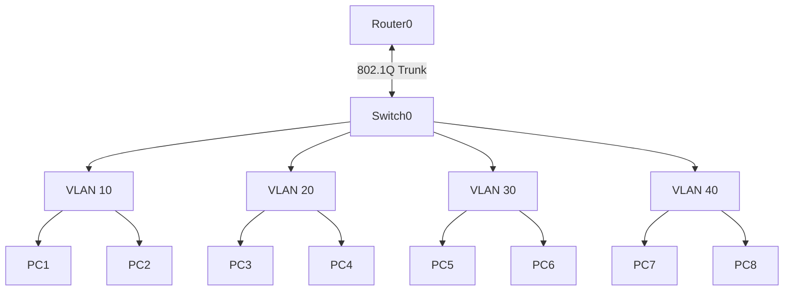

# 🌐 IPv4 Subnetting – Complete Networking Guide & Practical Lab

<p align="center">
  
  
  
  
</p>

<p align="center">
  <b>A Complete Practical Guide to IPv4 Subnetting, CIDR, VLSM, Address Planning, and Network Configuration.</b>
</p>

---

## 📌 Project Overview

**Subnetting** is a fundamental networking technique used to divide a large IP network into smaller logical networks called **subnets**. It improves IP address utilization, network organization, routing efficiency, and network management.

This project provides a structured, practical guide to understanding and implementing IPv4 subnetting, from basic binary calculations to advanced **CIDR** and **VLSM** concepts.

It also includes worked examples, subnetting tables, Cisco IOS configurations, verification commands, and practical lab exercises using **Cisco Packet Tracer**.

### 🎯 Project Objectives

- Understand IPv4 addressing and subnet masks.
- Learn binary-to-decimal and decimal-to-binary conversion.
- Calculate network IDs and broadcast addresses.
- Identify usable host ranges.
- Understand CIDR notation and prefix lengths.
- Divide networks into multiple subnets.
- Perform Fixed-Length Subnet Masking (FLSM).
- Implement Variable-Length Subnet Masking (VLSM).
- Design efficient IP addressing schemes.
- Configure and test subnetted networks in Cisco Packet Tracer.
- Troubleshoot common subnetting and connectivity problems.

---

## 📑 Table of Contents

1. [Introduction to Subnetting](#1-introduction-to-subnetting)
2. [Understanding IPv4 Addressing](#2-understanding-ipv4-addressing)
3. [Binary Number System](#3-binary-number-system)
4. [IP Address and Subnet Mask](#4-ip-address-and-subnet-mask)
5. [CIDR Notation](#5-cidr-notation)
6. [Network ID and Broadcast Address](#6-network-id-and-broadcast-address)
7. [Subnetting Formulas](#7-subnetting-formulas)
8. [Subnet Mask Reference Table](#8-subnet-mask-reference-table)
9. [Subnetting Calculation Methods](#9-subnetting-calculation-methods)
10. [Practical Subnetting Examples](#10-practical-subnetting-examples)
11. [Fixed-Length Subnet Masking (FLSM)](#11-fixed-length-subnet-masking-flsm)
12. [Variable-Length Subnet Masking (VLSM)](#12-variable-length-subnet-masking-vlsm)
13. [Private and Public IP Addresses](#13-private-and-public-ip-addresses)
14. [Classful and Classless Addressing](#14-classful-and-classless-addressing)
15. [Subnetting Network Diagram](#15-subnetting-network-diagram)
16. [Cisco Packet Tracer Practical Lab](#16-cisco-packet-tracer-practical-lab)
17. [Cisco Router Configuration](#17-cisco-router-configuration)
18. [Verification Commands](#18-verification-commands)
19. [Common Subnetting Mistakes](#19-common-subnetting-mistakes)
20. [Subnetting Troubleshooting](#20-subnetting-troubleshooting)
21. [IPv4 vs IPv6 Subnetting](#21-ipv4-vs-ipv6-subnetting)
22. [Best Practices](#22-best-practices)
23. [Practice Questions](#23-practice-questions)
24. [Quick Revision Cheat Sheet](#24-quick-revision-cheat-sheet)
25. [Learning Outcomes](#25-learning-outcomes)
26. [References](#26-references)

---

## 1. Introduction to Subnetting

### What is Subnetting?

**Subnetting** is the process of dividing one large IP network into multiple smaller networks.

Each smaller network is called a **subnet**. Every subnet has its own:

- Network ID
- Subnet mask
- Usable IP address range
- Broadcast address

For example, a network:

`192.168.1.0/24`

Can be divided into four smaller subnets:

- `192.168.1.0/26`
- `192.168.1.64/26`
- `192.168.1.128/26`
- `192.168.1.192/26`

Each subnet contains 64 total addresses, normally providing 62 usable host addresses.

### Why is Subnetting Important?

| Benefit | Explanation |
|---|---|
| IP Management | Organizes IP addresses into smaller networks. |
| Network Security | Helps separate departments and devices. |
| Network Performance | Reduces unnecessary broadcast traffic within each subnet. |
| Scalability | Makes it easier to expand network infrastructure. |
| Efficient Addressing | Reduces unnecessary IP address allocation. |
| Network Organization | Separates departments, servers, and users logically. |

### Real-World Example

An organization has four departments:

- Administration
- IT Department
- Human Resources
- Finance

Instead of placing every device in one large network, the administrator can assign a separate subnet to each department.

---

## 2. Understanding IPv4 Addressing

**IPv4 (Internet Protocol Version 4)** is a network addressing system that uses 32-bit addresses.

An IPv4 address contains four octets separated by dots.

Example:

`192.168.1.10`

Each octet contains 8 bits.

Therefore:

`8 + 8 + 8 + 8 = 32 bits`

### IPv4 Address Structure

| Octet | Decimal Value | Binary |
|---|---:|---|
| 1st | 192 | 11000000 |
| 2nd | 168 | 10101000 |
| 3rd | 1 | 00000001 |
| 4th | 10 | 00001010 |

Complete binary representation:

`11000000.10101000.00000001.00001010`

### IPv4 Address Range

- Minimum: `0.0.0.0`
- Maximum: `255.255.255.255`
- Total address combinations: `2^32`
- Total IPv4 addresses: **4,294,967,296**

---

## 3. Binary Number System

Subnetting requires understanding the binary number system because computers process network addresses in binary.

Each IPv4 octet contains eight bits.

### Binary Place Values

| Bit Position | Value |
|---|---:|
| Bit 1 | 128 |
| Bit 2 | 64 |
| Bit 3 | 32 |
| Bit 4 | 16 |
| Bit 5 | 8 |
| Bit 6 | 4 |
| Bit 7 | 2 |
| Bit 8 | 1 |

### Example: Convert 192 into Binary

192 = 128 + 64

Therefore:

`192 = 11000000`

### Example: Convert 168 into Binary

168 = 128 + 32 + 8

Therefore:

`168 = 10101000`

### Binary to Decimal Example

`11000000`

= 128 + 64

= **192**

### Decimal to Binary Example

`10`

= 8 + 2

= **00001010**

Understanding binary conversion makes subnet calculations much easier.

---

## 4. IP Address and Subnet Mask

A subnet mask identifies which bits of an IP address represent the network portion and which bits represent the host portion.

Example:

**IP Address:** `192.168.1.10`

**Subnet Mask:** `255.255.255.0`

**CIDR:** `/24`

### Network and Host Portions

In a `/24` network:

- Network bits: 24
- Host bits: 8

Binary subnet mask:

`11111111.11111111.11111111.00000000`

| Component | Value |
|---|---|
| IP Address | 192.168.1.10 |
| Subnet Mask | 255.255.255.0 |
| Network Bits | 24 |
| Host Bits | 8 |
| Network ID | 192.168.1.0 |
| Broadcast Address | 192.168.1.255 |
| First Usable IP | 192.168.1.1 |
| Last Usable IP | 192.168.1.254 |

---

## 5. CIDR Notation

**CIDR (Classless Inter-Domain Routing)** represents an IP network using a slash followed by the number of network bits.

Example:

`192.168.1.0/24`

Here, `/24` means that the first 24 bits belong to the network portion.

### Common CIDR Examples

| CIDR | Subnet Mask | Network Bits |
|---|---|---:|
| /8 | 255.0.0.0 | 8 |
| /16 | 255.255.0.0 | 16 |
| /24 | 255.255.255.0 | 24 |
| /25 | 255.255.255.128 | 25 |
| /26 | 255.255.255.192 | 26 |
| /27 | 255.255.255.224 | 27 |
| /28 | 255.255.255.240 | 28 |
| /29 | 255.255.255.248 | 29 |
| /30 | 255.255.255.252 | 30 |

**Important:** A larger prefix length means a smaller subnet with fewer host addresses.

---

## 6. Network ID and Broadcast Address

### Network ID

The **Network ID** identifies the subnet itself. It is the first address in a conventional IPv4 subnet.

Example:

`192.168.1.0/24`

Network ID:

`192.168.1.0`

### Broadcast Address

The **Broadcast Address** is the final address in a conventional IPv4 subnet. It is used to send traffic to all hosts on that subnet.

Example:

`192.168.1.255`

### Usable Host Range

The usable host range contains the addresses available for devices in a conventional IPv4 subnet.

For `192.168.1.0/24`:

| Address Type | IP Address |
|---|---|
| Network ID | 192.168.1.0 |
| First Usable IP | 192.168.1.1 |
| Last Usable IP | 192.168.1.254 |
| Broadcast Address | 192.168.1.255 |

---

## 7. Subnetting Formulas

These formulas are essential for subnetting calculations.

### Formula 1: Number of Subnets

`2^n`

Where:

- `n` = Number of borrowed host bits.

Example:

If 2 bits are borrowed:

`2^2 = 4 subnets`

### Formula 2: Total IP Addresses

`2^h`

Where:

- `h` = Number of remaining host bits.

Example:

If 6 host bits remain:

`2^6 = 64 total addresses`

### Formula 3: Usable Host Addresses

For ordinary IPv4 subnets:

`2^h - 2`

Example:

`2^6 - 2 = 62 usable hosts`

The two excluded addresses are normally the network and broadcast addresses.

**Special cases:**

- `/31` can provide two usable endpoint addresses on supported point-to-point links.
- `/32` represents one individual IPv4 address, commonly used as a host route.

### Formula 4: Block Size

`256 - Subnet Mask Value`

Example:

For `/26`, the subnet mask is:

`255.255.255.192`

Block size:

`256 - 192 = 64`

Therefore, subnet boundaries occur at:

`0, 64, 128, 192`

---

## 8. Subnet Mask Reference Table

The following table provides commonly used IPv4 subnet masks and their address capacities.

| CIDR | Subnet Mask | Total IPs | Usable Hosts* |
|---|---|---:|---:|
| /16 | 255.255.0.0 | 65,536 | 65,534 |
| /17 | 255.255.128.0 | 32,768 | 32,766 |
| /18 | 255.255.192.0 | 16,384 | 16,382 |
| /19 | 255.255.224.0 | 8,192 | 8,190 |
| /20 | 255.255.240.0 | 4,096 | 4,094 |
| /21 | 255.255.248.0 | 2,048 | 2,046 |
| /22 | 255.255.252.0 | 1,024 | 1,022 |
| /23 | 255.255.254.0 | 512 | 510 |
| /24 | 255.255.255.0 | 256 | 254 |
| /25 | 255.255.255.128 | 128 | 126 |
| /26 | 255.255.255.192 | 64 | 62 |
| /27 | 255.255.255.224 | 32 | 30 |
| /28 | 255.255.255.240 | 16 | 14 |
| /29 | 255.255.255.248 | 8 | 6 |
| /30 | 255.255.255.252 | 4 | 2 |
| /31 | 255.255.255.254 | 2 | 2** |
| /32 | 255.255.255.255 | 1 | 1*** |

\* Usable host counts use the conventional network/broadcast exclusion.

\** `/31` supports two endpoint addresses on suitable point-to-point links.

\*** `/32` represents one host address, not a conventional multi-host subnet.

---

## 9. Subnetting Calculation Methods

### Method 1: Identify the Prefix

Example:

`192.168.1.0/26`

The `/26` prefix means:

- 26 network bits
- 6 host bits

### Method 2: Calculate Total Addresses

`2^6 = 64`

### Method 3: Calculate Usable Hosts

`64 - 2 = 62`

### Method 4: Calculate the Subnet Mask

`/26 = 255.255.255.192`

### Method 5: Calculate Block Size

`256 - 192 = 64`

### Method 6: Identify Subnet Boundaries

The subnet boundaries are:

- 192.168.1.0
- 192.168.1.64
- 192.168.1.128
- 192.168.1.192

---

## 10. Practical Subnetting Examples

### Example 1: Divide a /24 Network into Four Subnets

Original network:

`192.168.1.0/24`

Required subnets:

`4`

Borrowed bits:

`2^2 = 4`

New prefix:

`/24 + 2 = /26`

New subnet mask:

`255.255.255.192`

Each subnet contains 64 total addresses and 62 conventional usable host addresses.

| Subnet | Network ID | First Host | Last Host | Broadcast |
|---|---|---|---|---|
| 1 | 192.168.1.0/26 | .1 | .62 | .63 |
| 2 | 192.168.1.64/26 | .65 | .126 | .127 |
| 3 | 192.168.1.128/26 | .129 | .190 | .191 |
| 4 | 192.168.1.192/26 | .193 | .254 | .255 |

All four subnets use:

`255.255.255.192`

### Subnetting Diagram


*Illustrative subnet division diagram. See the original image source in the references.*

### Example 2: Find the Network Information

Given:

`192.168.10.77/26`

Subnet mask:

`255.255.255.192`

Block size:

`256 - 192 = 64`

Subnet ranges:

- 192.168.10.0 – 192.168.10.63
- 192.168.10.64 – 192.168.10.127
- 192.168.10.128 – 192.168.10.191
- 192.168.10.192 – 192.168.10.255

The IP `192.168.10.77` belongs to the second subnet.

| Component | Result |
|---|---|
| Given IP | 192.168.10.77 |
| CIDR | /26 |
| Subnet Mask | 255.255.255.192 |
| Network ID | 192.168.10.64 |
| First Usable IP | 192.168.10.65 |
| Last Usable IP | 192.168.10.126 |
| Broadcast Address | 192.168.10.127 |
| Total Addresses | 64 |
| Usable Hosts | 62 |

---

## 11. Fixed-Length Subnet Masking (FLSM)

**FLSM** divides a network into subnets that all use the same subnet mask.

Every subnet has an equal number of IP addresses.

### Example

Original network:

`192.168.1.0/24`

Divide it into four equal subnets.

New prefix:

`/26`

| Subnet | Network | Usable Hosts |
|---|---|---:|
| Subnet 1 | 192.168.1.0/26 | 62 |
| Subnet 2 | 192.168.1.64/26 | 62 |
| Subnet 3 | 192.168.1.128/26 | 62 |
| Subnet 4 | 192.168.1.192/26 | 62 |

### Advantages

- Simple IP address planning.
- Easy to configure.
- Easy to understand and manage.
- Suitable when subnet requirements are similar.

### Disadvantages

- Can waste IP addresses.
- Does not efficiently support departments with very different host requirements.

---

## 12. Variable-Length Subnet Masking (VLSM)

**VLSM** allows a network administrator to use different subnet masks within the same overall network.

It allocates IP addresses according to the actual number of hosts required by each subnet.

### Why Use VLSM?

Consider an organization with four networks:

- Department A: 60 hosts
- Department B: 30 hosts
- Department C: 12 hosts
- WAN Link: 2 endpoints

Using the same subnet size for every department would waste addresses.

VLSM solves this problem by assigning different subnet sizes.

### VLSM Calculation Example

Original network:

`192.168.10.0/24`

Required host counts:

| Network | Required Hosts |
|---|---:|
| Department A | 60 |
| Department B | 30 |
| Department C | 12 |
| WAN Link | 2 |

**Step 1: Arrange Networks from Largest to Smallest**

Always allocate the largest network first.

**Step 2: Select the Appropriate Prefix**

| Network | Required Hosts | Selected CIDR | Total IPs |
|---|---:|---|---:|
| Department A | 60 | /26 | 64 |
| Department B | 30 | /27 | 32 |
| Department C | 12 | /28 | 16 |
| WAN Link | 2 | /30 | 4 |

**Step 3: Allocate IP Address Ranges**

| Network | Network ID | Usable Range | Broadcast |
|---|---|---|---|
| Department A | 192.168.10.0/26 | .1 – .62 | .63 |
| Department B | 192.168.10.64/27 | .65 – .94 | .95 |
| Department C | 192.168.10.96/28 | .97 – .110 | .111 |
| WAN Link | 192.168.10.112/30 | .113 – .114 | .115 |

### VLSM Diagram

```text
Original Network: 192.168.10.0/24
              |
              +-- Department A
              |   192.168.10.0/26
              |   64 addresses
              |
              +-- Department B
              |   192.168.10.64/27
              |   32 addresses
              |
              +-- Department C
              |   192.168.10.96/28
              |   16 addresses
              |
              +-- WAN Link
                  192.168.10.112/30
                  4 addresses
```

### Advantages of VLSM

- Efficient IP address utilization.
- Supports different network sizes.
- Reduces address wastage.
- Supports scalable network design.
- Useful for enterprise networks.

---

## 13. Private and Public IP Addresses

IPv4 addresses are commonly categorized as private and public addresses.

### Private IPv4 Address Ranges

Private IP addresses are reserved for internal networks and are not globally routed across the public Internet.

| Private Range | CIDR | Address Range |
|---|---|---|
| Class A private block | 10.0.0.0/8 | 10.0.0.0 – 10.255.255.255 |
| Class B private block | 172.16.0.0/12 | 172.16.0.0 – 172.31.255.255 |
| Class C private block | 192.168.0.0/16 | 192.168.0.0 – 192.168.255.255 |

### Public IP Address

A public IP address is globally routable and is used for communication across the Internet.

### Private vs Public IP

| Feature | Private IP | Public IP |
|---|---|---|
| Internet Routing | Not globally routable | Globally routable |
| Usage | Internal networks | Internet communication |
| Allocation | RFC1918 ranges | Public address allocation |
| Example | 192.168.1.10 | 8.8.8.8 |

**Important:** A private IP address generally requires NAT or another suitable gateway mechanism to communicate with public Internet destinations.

---

## 14. Classful and Classless Addressing

### Classful Addressing

Traditional IPv4 addressing divided addresses into classes.

| Class | First Octet Range | Default Prefix | Default Mask |
|---|---|---|---|
| A | 1–126 | /8 | 255.0.0.0 |
| B | 128–191 | /16 | 255.255.0.0 |
| C | 192–223 | /24 | 255.255.255.0 |
| D | 224–239 | Multicast | Not applicable |
| E | 240–255 | Reserved | Not applicable |

Some ranges have special purposes, so these class boundaries are historical concepts rather than modern subnet allocation rules.

### Classless Addressing

**CIDR** allows flexible network prefix lengths.

Example:

- `192.168.1.0/25`
- `192.168.1.0/26`
- `192.168.1.0/27`

Modern IP routing uses classless addressing.

---

## 15. Subnetting Network Diagram

### Basic Network Segmentation

The following example demonstrates four departments using four separate subnets.



### Subnetting Process Flow



---

## 16. Cisco Packet Tracer Practical Lab

### Lab Title

**IPv4 Subnetting and Network Segmentation Using Cisco Packet Tracer**

### Lab Objectives

- Create multiple subnets from one network.
- Connect PCs using switches.
- Configure VLANs.
- Configure router-on-a-stick.
- Assign IP addresses and default gateways.
- Test communication between different subnets.

### Required Devices

| Device | Quantity |
|---|---:|
| Cisco Router | 1 |
| Cisco Switch | 1 |
| PCs | 8 |
| Copper Straight-Through Cables | As Required |

### Network Addressing Plan

Original network:

`192.168.1.0/24`

Divide into four `/26` subnets.

| VLAN | Department | Network | Gateway |
|---|---|---|---|
| 10 | Administration | 192.168.1.0/26 | 192.168.1.1 |
| 20 | IT | 192.168.1.64/26 | 192.168.1.65 |
| 30 | HR | 192.168.1.128/26 | 192.168.1.129 |
| 40 | Finance | 192.168.1.192/26 | 192.168.1.193 |

### PC Addressing Table

| Device | VLAN | IP Address | Subnet Mask | Default Gateway |
|---|---:|---|---|---|
| PC1 | 10 | 192.168.1.2 | 255.255.255.192 | 192.168.1.1 |
| PC2 | 10 | 192.168.1.3 | 255.255.255.192 | 192.168.1.1 |
| PC3 | 20 | 192.168.1.66 | 255.255.255.192 | 192.168.1.65 |
| PC4 | 20 | 192.168.1.67 | 255.255.255.192 | 192.168.1.65 |
| PC5 | 30 | 192.168.1.130 | 255.255.255.192 | 192.168.1.129 |
| PC6 | 30 | 192.168.1.131 | 255.255.255.192 | 192.168.1.129 |
| PC7 | 40 | 192.168.1.194 | 255.255.255.192 | 192.168.1.193 |
| PC8 | 40 | 192.168.1.195 | 255.255.255.192 | 192.168.1.193 |

### Lab Topology



### Lab Implementation Steps

1. Open Cisco Packet Tracer.
2. Add one router and one switch.
3. Add eight PCs.
4. Connect the router to the switch using a suitable Ethernet connection.
5. Connect all PCs to switch access ports.
6. Create VLANs 10, 20, 30, and 40.
7. Assign switch ports to the correct VLANs.
8. Configure the switch-to-router connection as a trunk.
9. Configure router subinterfaces.
10. Assign IP addresses to all PCs.
11. Configure default gateways.
12. Test connectivity using `ping`.

---

## 17. Cisco Router Configuration

The following configuration uses router-on-a-stick to provide inter-VLAN routing.

**Note:** The interface names and port numbers may vary depending on your Packet Tracer router model.

### Router Configuration

```cisco
enable
configure terminal

hostname R1

interface gigabitEthernet 0/0
no shutdown
exit

interface gigabitEthernet 0/0.10
encapsulation dot1Q 10
ip address 192.168.1.1 255.255.255.192
exit

interface gigabitEthernet 0/0.20
encapsulation dot1Q 20
ip address 192.168.1.65 255.255.255.192
exit

interface gigabitEthernet 0/0.30
encapsulation dot1Q 30
ip address 192.168.1.129 255.255.255.192
exit

interface gigabitEthernet 0/0.40
encapsulation dot1Q 40
ip address 192.168.1.193 255.255.255.192
exit

end
write memory
```

### Switch Configuration

```cisco
enable
configure terminal

hostname SW1

vlan 10
name ADMINISTRATION
exit

vlan 20
name IT
exit

vlan 30
name HR
exit

vlan 40
name FINANCE
exit

interface range fastEthernet 0/1-2
switchport mode access
switchport access vlan 10
exit

interface range fastEthernet 0/3-4
switchport mode access
switchport access vlan 20
exit

interface range fastEthernet 0/5-6
switchport mode access
switchport access vlan 30
exit

interface range fastEthernet 0/7-8
switchport mode access
switchport access vlan 40
exit

interface gigabitEthernet 0/1
switchport mode trunk
exit

end
write memory
```

**Important:** This example assumes the router connects to switch port `GigabitEthernet 0/1`, and the PCs connect to `FastEthernet 0/1–0/8`. Adjust the commands to match your actual device ports.

---

## 18. Verification Commands

After configuring the network, use the following commands to verify the configuration and connectivity.

### Windows Commands

| Command | Purpose |
|---|---|
| `ipconfig` | Displays IP configuration. |
| `ipconfig /all` | Displays detailed network information. |
| `ping` | Tests connectivity to another device. |
| `tracert` | Shows the route to a destination. |
| `arp -a` | Displays the ARP table. |
| `route print` | Displays the Windows routing table. |

### Cisco IOS Commands

| Command | Purpose |
|---|---|
| `show ip interface brief` | Displays interface status and IP addresses. |
| `show running-config` | Displays active configuration. |
| `show ip route` | Displays the routing table. |
| `show vlan brief` | Displays VLAN information. |
| `show interfaces trunk` | Displays trunk interfaces. |
| `show interfaces` | Displays interface details. |
| `show ip interface` | Displays IP interface information. |

### Connectivity Test

From PC1, test the gateway:

```bash
ping 192.168.1.1
```

Test a device in another subnet:

```bash
ping 192.168.1.66
```

If the router, VLANs, trunk, addressing, and gateways are correctly configured, communication between the VLANs should work.

---

## 19. Common Subnetting Mistakes

| Mistake | Explanation |
|---|---|
| Incorrect Subnet Mask | Devices may calculate different network boundaries. |
| Wrong Network ID | IP addresses may be assigned to the wrong subnet. |
| Incorrect Broadcast Address | The final address may be mistakenly assigned to a host. |
| Wrong Default Gateway | Devices cannot reach other networks. |
| Overlapping Subnets | Two network definitions may cover the same addresses. |
| Incorrect CIDR | The subnet may contain too many or too few addresses. |
| Wrong Block Size | Subnet boundaries are calculated incorrectly. |
| Duplicate IP Addresses | Two devices use the same IP address. |
| VLAN Mismatch | Devices may be placed in the wrong logical network. |

---

## 20. Subnetting Troubleshooting

### Problem 1: Devices Cannot Communicate

**Possible Causes:**

- Incorrect IP address.
- Incorrect subnet mask.
- Wrong default gateway.
- Physical connectivity issue.

**Solution:**

Check the IP configuration and test the local gateway using `ping`.

### Problem 2: Different Subnets Cannot Communicate

**Possible Causes:**

- Router interface is down.
- Missing router subinterface.
- Incorrect VLAN tagging.
- Trunk port misconfiguration.
- Missing route.

**Solution:**

Use:

```cisco
show ip interface brief
show ip route
show interfaces trunk
```

### Problem 3: Duplicate IP Address

**Possible Causes:**

- Manual IP assignment conflicts with another device.
- DHCP pool overlaps with manually assigned addresses.

**Solution:**

Review the IP addressing plan and DHCP scope.

### Problem 4: Incorrect Subnet Boundaries

**Possible Causes:**

- Incorrect block size.
- Incorrect prefix calculation.
- Wrong subnet mask.

**Solution:**

Recalculate the block size using:

`256 - Interesting Octet`

---

## 21. IPv4 vs IPv6 Subnetting

IPv6 uses a 128-bit addressing system, unlike IPv4, which uses 32 bits.

| Feature | IPv4 | IPv6 |
|---|---|---|
| Address Size | 32 bits | 128 bits |
| Representation | Decimal | Hexadecimal |
| Example | 192.168.1.10 | 2001:db8::10 |
| Prefix Notation | /24 | /64 |
| Broadcast | Supported | Not used |
| Address Space | 2^32 | 2^128 |
| Address Discovery | ARP | Neighbor Discovery |

### IPv6 Subnetting Basics

- IPv6 uses prefix lengths to identify network portions.
- `/64` is commonly used for ordinary IPv6 LAN subnets.
- IPv6 does not use broadcast addresses.
- IPv6 uses multicast and Neighbor Discovery mechanisms.
- IPv4's conventional `2^h - 2` host calculation should not be applied to IPv6 in the same way.

---

## 22. Best Practices

1. **Plan Before Allocation:** Identify the number of hosts and subnets required.
2. **Use VLSM:** Allocate address space according to actual network requirements.
3. **Avoid Overlapping Networks:** Keep subnet boundaries separate.
4. **Document IP Addresses:** Maintain an updated addressing table.
5. **Reserve Gateway Addresses:** Use a consistent gateway assignment strategy.
6. **Use VLAN Segmentation:** Separate departments and device groups logically.
7. **Verify Configurations:** Test every subnet after configuration.
8. **Plan for Growth:** Keep sufficient address space for future expansion.
9. **Use Appropriate Prefixes:** Avoid unnecessarily large subnets.
10. **Apply Security Controls:** Use ACLs and firewall rules where required; subnetting alone does not provide security.

---

## 23. Practice Questions

Test your understanding with these practical subnetting questions.

### Beginner Level

**Q1.** How many bits are in an IPv4 address?

**Q2.** What is the subnet mask of `/24`?

**Q3.** How many usable hosts are available in a `/26` subnet?

**Q4.** What is the total number of addresses in a `/28` subnet?

**Q5.** What is the block size of `/27`?

### Intermediate Level

**Q6.** Divide `192.168.1.0/24` into four equal subnets.

**Q7.** Find the network ID and broadcast address of `192.168.10.77/26`.

**Q8.** How many subnets can be created by borrowing 3 bits?

**Q9.** What is the subnet mask of `/28`?

**Q10.** Find the usable host range of `10.0.0.0/30`.

### Advanced Level

**Q11.** Design a VLSM addressing plan for an organization requiring 100, 50, 20, and 10 hosts from `192.168.20.0/24`.

**Q12.** Explain the difference between FLSM and VLSM with practical examples.

**Q13.** A device has IP `172.16.5.130/25`. Identify its network ID, broadcast address, and usable host range.

**Q14.** Explain why two devices with different subnet masks may fail to communicate correctly.

**Q15.** Design four VLAN-based subnets for an enterprise network and identify their gateways.

### Answer Key

| Question | Answer |
|---|---|
| Q1 | 32 bits |
| Q2 | 255.255.255.0 |
| Q3 | 62 usable hosts |
| Q4 | 16 total addresses |
| Q5 | 32 |
| Q6 | Four `/26` subnets |
| Q7 | Network: 192.168.10.64; Broadcast: 192.168.10.127 |
| Q8 | 8 subnets |
| Q9 | 255.255.255.240 |
| Q10 | 10.0.0.1 – 10.0.0.2 |

**Advanced Answer Q11:**

Allocate largest networks first:

| Network | Hosts Required | CIDR | Network ID | Broadcast |
|---|---:|---|---|---|
| A | 100 | /25 | 192.168.20.0 | 192.168.20.127 |
| B | 50 | /26 | 192.168.20.128 | 192.168.20.191 |
| C | 20 | /27 | 192.168.20.192 | 192.168.20.223 |
| D | 10 | /28 | 192.168.20.224 | 192.168.20.239 |

---

## 24. Quick Revision Cheat Sheet

| Concept | Formula / Information |
|---|---|
| IPv4 Address Size | 32 bits |
| Total IPv4 Addresses | 2^32 |
| Number of Subnets | 2^n |
| Total Addresses per Subnet | 2^h |
| Conventional Usable Hosts | 2^h - 2 |
| Block Size | 256 - Interesting Octet |
| /24 Subnet Mask | 255.255.255.0 |
| /25 Subnet Mask | 255.255.255.128 |
| /26 Subnet Mask | 255.255.255.192 |
| /27 Subnet Mask | 255.255.255.224 |
| /28 Subnet Mask | 255.255.255.240 |
| /29 Subnet Mask | 255.255.255.248 |
| /30 Subnet Mask | 255.255.255.252 |
| /31 | Two endpoint addresses on supported point-to-point links |
| /32 | Single-host route |

### Important Subnetting Values

| Prefix | Block Size | Usable Hosts |
|---|---:|---:|
| /24 | 256 | 254 |
| /25 | 128 | 126 |
| /26 | 64 | 62 |
| /27 | 32 | 30 |
| /28 | 16 | 14 |
| /29 | 8 | 6 |
| /30 | 4 | 2 |

---

## 25. Learning Outcomes

After completing this project, learners should be able to:

- Explain IPv4 addressing and subnetting fundamentals.
- Convert IPv4 addresses between binary and decimal.
- Calculate subnet masks and CIDR prefixes.
- Identify network IDs and broadcast addresses.
- Calculate usable host ranges.
- Divide networks using FLSM.
- Design efficient addressing plans using VLSM.
- Understand private and public IP address ranges.
- Configure VLANs and router-on-a-stick.
- Implement subnetting in Cisco Packet Tracer.
- Verify network configurations using Cisco IOS commands.
- Troubleshoot common IP addressing and connectivity problems.

---

## 26. References

The following resources provide additional technical information and practical subnetting guidance.

1. **RFC 4632 – Classless Inter-domain Routing (CIDR):**  
   https://www.rfc-editor.org/rfc/rfc4632.html

2. **RFC 1918 – Address Allocation for Private Internets:**  
   https://www.rfc-editor.org/rfc/rfc1918.html

3. **RFC 3021 – Using 31-Bit Prefixes on IPv4 Point-to-Point Links:**  
   https://www.rfc-editor.org/rfc/rfc3021.html

4. **Cisco – Variable Length Subnet Masking:**  
   https://www.cisco.com/c/en/us/support/docs/ip/routing-information-protocol-rip/13788-3.html

5. **DigitalOcean – Understanding IP Addresses, Subnets, and CIDR:**  
   https://www.digitalocean.com/community/tutorials/understanding-ip-addresses-subnets-and-cidr-notation-for-networking

6. **Cisco Networking Academy:**  
   https://www.netacad.com/

---

## 👨‍💻 Author

**Sanawar Imran**

Cybersecurity | Networking | Security Engineering

**Project:** IPv4 Subnetting – Complete Networking Guide & Practical Lab

---

<p align="center">
  <b>Learn • Configure • Test • Troubleshoot</b>
  <br>
  <i>Building practical networking knowledge, one subnet at a time.</i>
</p>
