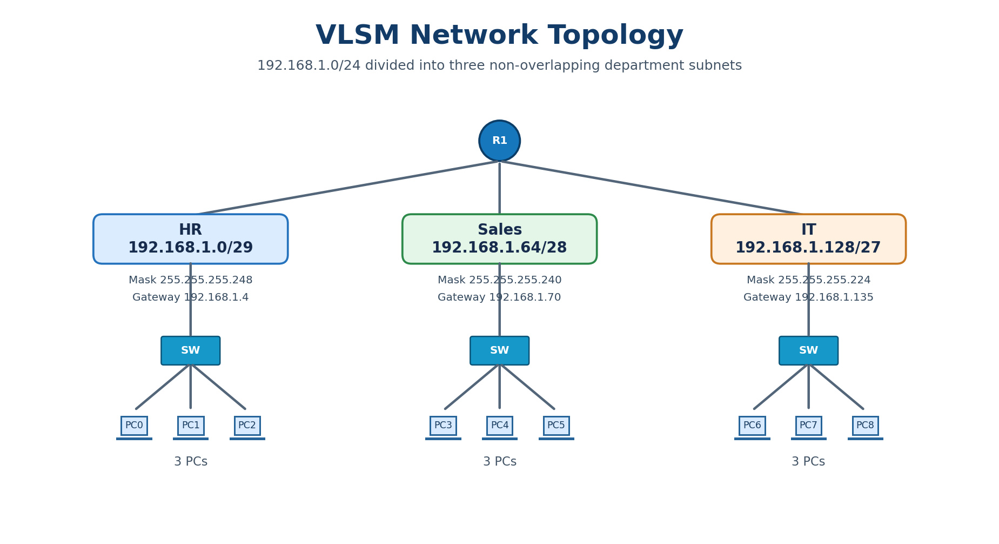
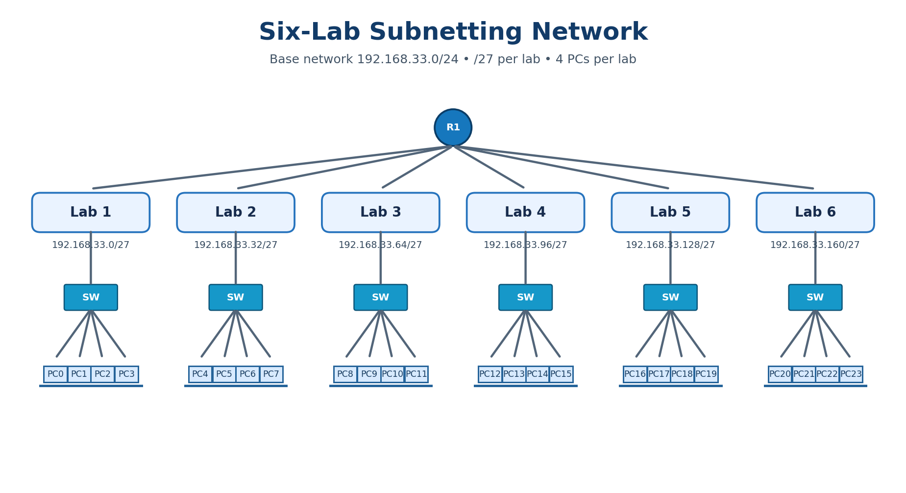
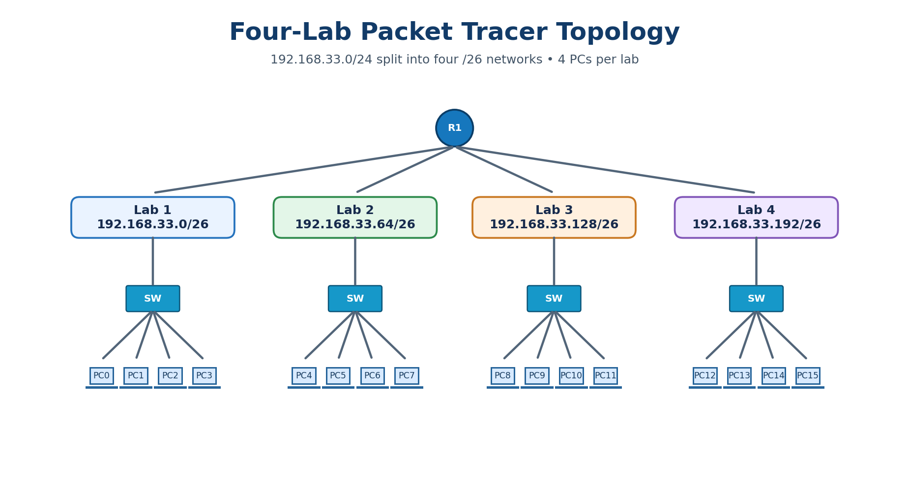
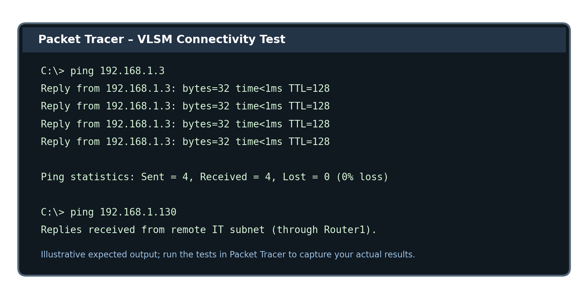
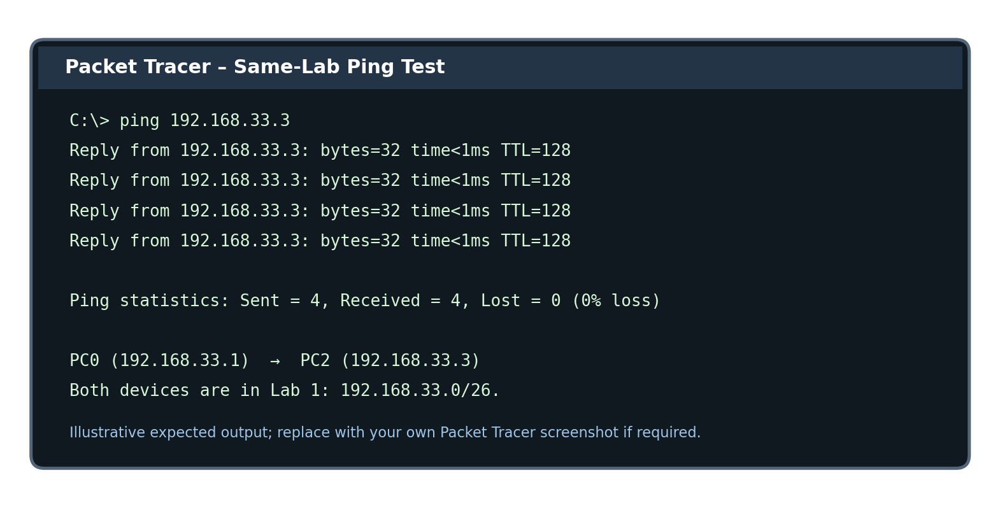

<div align="center">

# CCNA Enterprise Networking Labs

### IPv4 Subnetting, VLSM & Cisco Packet Tracer

<p>
  
</p>

**A practical networking guide covering subnet calculations, IP addressing, router configuration and connectivity testing.**

</div>

<p align="center">
  
  
  
  
</p>

---

## About This Repository

This repository brings together the practical work from **two subnetting lab documents** into one structured reference. It explains how to divide IPv4 networks into smaller subnets, assign addresses to network devices, configure router interfaces, and test communication between devices in Cisco Packet Tracer.

The documentation contains three scenarios. They use different network requirements and must be configured **independently**:

| Scenario | Network | Subnetting method | Main purpose |
|---|---|---|---|
| Lab 1 – Department VLSM | `192.168.1.0/24` | `/29`, `/28`, `/27` | Separate HR, Sales and IT |
| Lab 2 – Six labs | `192.168.33.0/24` | `/27` | Calculate six lab subnets |
| Lab 3 – Four-lab implementation | `192.168.33.0/24` | `/26` | Build and test four lab networks |

> **Important:** Lab 2 and Lab 3 are separate designs. Do not mix their subnet masks, network ranges, or router configurations. Lab 2 uses `/27`; Lab 3 uses `/26`.

## Lab Diagrams & Visual Reference

The following diagrams are stored in the repository's `images` folder and are referenced directly by this README.

| Diagram | Image file |
|---|---|
| HR, Sales and IT VLSM topology | `images/vlsm_hr_sales_it_topology.png` |
| Six-lab network sketch | `images/six_lab_network_sketch.png` |
| Four-lab Packet Tracer topology | `images/four_lab_packet_tracer_topology.png` |
| VLSM ping-test example | `images/vlsm_ping_test_results.png` |
| Four-lab ping-test example | `images/four_lab_ping_test.png` |

<p align="center">
  
  
</p>

<p align="center">
  
  
</p>

<sub>Note: The ping illustrations show example/expected command output for documentation. Run the tests in Packet Tracer to produce and capture your own live results.</sub>

## Contents

- [About This Repository](#about-this-repository)
- [Lab Diagrams & Visual Reference](#lab-diagrams--visual-reference)
- [Tools and Requirements](#tools-and-requirements)
- [Lab 1 – VLSM for HR, Sales and IT](#lab-1--vlsm-for-hr-sales-and-it)
- [Lab 2 – Roll-number-based subnetting for six labs](#lab-2--roll-number-based-subnetting-for-six-labs)
- [Lab 3 – Four-lab Packet Tracer implementation](#lab-3--four-lab-packet-tracer-implementation)
- [Verification and Troubleshooting](#verification-and-troubleshooting)
- [Subnetting Formulas](#subnetting-formulas)
- [Project Structure](#project-structure)
- [Learning Outcomes](#learning-outcomes)

## Tools and Requirements

- **Cisco Packet Tracer** – to create the network topologies and test connectivity.
- **Cisco router** – the model must provide the required physical interfaces, or a compatible interface module must be installed.
- **Cisco 2960 switches** – Layer 2 connectivity for PCs.
- **PC end devices** – to configure IPv4 settings and run ping tests.
- **Basic IOS CLI knowledge** – `enable`, `configure terminal`, `interface`, `ip address`, `no shutdown`, and `show` commands.

### Before You Start

1. Choose the lab scenario you want to implement.
2. Check its subnet table and use only the addresses from that scenario.
3. Confirm the router interface names available on your Packet Tracer device.
4. Configure router interfaces and PC default gateways consistently.
5. Save the Packet Tracer project and router configuration after testing.

---

# Lab 1 – VLSM for HR, Sales and IT

## 1. Objective

Divide the Class C network `192.168.1.0/24` into three different-sized subnets for the Human Resources (HR), Sales and IT departments. A Cisco 2911 router connects the three networks so that devices can communicate across subnets.

### Requirements

- One Cisco 2911 router (Router1)
- Three Cisco 2960-24TT switches
- Nine PCs (three per department)
- Three different subnet sizes using VLSM
- Inter-subnet connectivity verified with `ping`

## 2. VLSM subnet calculation

Each department has three PCs and one router interface, so at least four usable IP addresses are required. The lab assigns a different subnet size to each department.

| Department | Network / Prefix | Subnet mask | Usable hosts | Network address | Usable range | Broadcast |
|---|---|---|---:|---|---|---|
| HR | `192.168.1.0/29` | `255.255.255.248` | 6 | `192.168.1.0` | `192.168.1.1–192.168.1.6` | `192.168.1.7` |
| Sales | `192.168.1.64/28` | `255.255.255.240` | 14 | `192.168.1.64` | `192.168.1.65–192.168.1.78` | `192.168.1.79` |
| IT | `192.168.1.128/27` | `255.255.255.224` | 30 | `192.168.1.128` | `192.168.1.129–192.168.1.158` | `192.168.1.159` |

The subnet blocks do not overlap. The unused address ranges remain available for future expansion.

## 3. Topology and cabling

<p align="center">
  
</p>

| Router connection | Switch | Department | PCs |
|---|---|---|---|
| Router1 `Gi0/0` | Switch0 | HR | PC0, PC1, PC2 |
| Router1 `Gi0/1` | Switch1 | Sales | PC3, PC4, PC5 |
| Router1 `Gi0/2` | Switch2 | IT | PC6, PC7, PC8 |

Use **Copper Straight-Through** cables for router-to-switch and switch-to-PC connections. If your router uses different interface names, use the actual ports shown in Packet Tracer and adjust the commands below.

## 4. IP addressing plan

| Device | Interface / Department | IPv4 address | Subnet mask | Default gateway |
|---|---|---|---|---|
| Router1 | `Gi0/0` – HR | `192.168.1.4` | `255.255.255.248` | — |
| PC0 | HR | `192.168.1.1` | `255.255.255.248` | `192.168.1.4` |
| PC1 | HR | `192.168.1.2` | `255.255.255.248` | `192.168.1.4` |
| PC2 | HR | `192.168.1.3` | `255.255.255.248` | `192.168.1.4` |
| Router1 | `Gi0/1` – Sales | `192.168.1.70` | `255.255.255.240` | — |
| PC3 | Sales | `192.168.1.66` | `255.255.255.240` | `192.168.1.70` |
| PC4 | Sales | `192.168.1.67` | `255.255.255.240` | `192.168.1.70` |
| PC5 | Sales | `192.168.1.68` | `255.255.255.240` | `192.168.1.70` |
| Router1 | `Gi0/2` – IT | `192.168.1.135` | `255.255.255.224` | — |
| PC6 | IT | `192.168.1.130` | `255.255.255.224` | `192.168.1.135` |
| PC7 | IT | `192.168.1.131` | `255.255.255.224` | `192.168.1.135` |
| PC8 | IT | `192.168.1.132` | `255.255.255.224` | `192.168.1.135` |

## 5. Packet Tracer build steps

1. Add one **2911 router**, three **2960-24TT switches**, and nine PCs.
2. Connect `Gi0/0` to Switch0, `Gi0/1` to Switch1, and `Gi0/2` to Switch2.
3. Connect three PCs to each department switch.
4. Use straight-through cables for all connections.
5. On each PC, open **Desktop → IP Configuration → Static**.
6. Enter the IP address, subnet mask and default gateway from the addressing table.

## 6. Complete router configuration

Open Router1 → **CLI**, then enter:

```text
enable
configure terminal
hostname Router1

interface GigabitEthernet0/0
 description HR Department
 ip address 192.168.1.4 255.255.255.248
 no shutdown
 exit

interface GigabitEthernet0/1
 description Sales Department
 ip address 192.168.1.70 255.255.255.240
 no shutdown
 exit

interface GigabitEthernet0/2
 description IT Department
 ip address 192.168.1.135 255.255.255.224
 no shutdown
 exit

end
write memory
```

The three networks are directly connected to Router1. The router automatically adds them to its routing table; a static route or dynamic routing protocol is not required for this topology.

### Switch configuration

The three 2960 switches can use their default Layer 2 configuration for this design. No VLAN configuration is required because each department has its own switch. Optional switch hostnames:

```text
enable
configure terminal
hostname Switch0
end
write memory
```

Use `Switch1` and `Switch2` as the hostnames on the other switches.

## 7. PC configuration example

For PC0 (HR), select **Desktop → IP Configuration → Static** and enter:

- IPv4 Address: `192.168.1.1`
- Subnet Mask: `255.255.255.248`
- Default Gateway: `192.168.1.4`

Repeat for every PC using the addressing table. Do not leave the default `/24` mask in place.

## 8. Verification

On Router1, run:

```text
show ip interface brief
show ip route connected
show running-config
```

The three router interfaces should show **up/up**. The connected routes should include:

- `192.168.1.0/29`
- `192.168.1.64/28`
- `192.168.1.128/27`

From a PC, open **Desktop → Command Prompt** and test:

| Source | Destination | Purpose |
|---|---|---|
| PC0 | `192.168.1.3` | Same-subnet test (HR) |
| PC0 | `192.168.1.66` | Inter-subnet test (Sales) |
| PC0 | `192.168.1.130` | Inter-subnet test (IT) |
| PC3 | `192.168.1.130` | Sales-to-IT test |
| Any PC | Its configured gateway | Default-gateway test |

Example:

```text
ping 192.168.1.66
ping 192.168.1.130
```

<p align="center">
  
</p>

A same-subnet ping normally has TTL 128. A ping routed through the router normally has TTL 127. The first ping can time out while ARP resolves; repeat the test to confirm connectivity.

---

# Lab 2 – Roll-number-based subnetting for six labs

## 1. Objective and addressing rule

This scenario uses the last two digits of the roll number as the third octet of the Class C network.

- Roll number used in the source guide: `243633`
- Last two digits: `33`
- Base network: `192.168.33.0/24`
- Labs required: 6
- PCs per lab: 4

For another roll number, replace `33` in the third octet with the last two digits of that roll number.

## 2. Calculate the subnet bits

A `/24` network has 8 host bits. Six labs require at least six subnets:

- Borrowing 2 bits gives `2² = 4` subnets, which is insufficient.
- Borrowing 3 bits gives `2³ = 8` subnets, which is enough.
- New prefix: `24 + 3 = /27`
- Subnet mask: `255.255.255.224`
- Host bits remaining: `8 − 3 = 5`
- Addresses per subnet: `2⁵ = 32`
- Usable hosts per subnet: `32 − 2 = 30`
- Block size: `256 − 224 = 32`

## 3. Six-lab network sketch

Each lab has one switch and four PCs. The six switches connect to one router.

<p align="center">
  
</p>

## 4. Subnet and broadcast address table

| Subnet | Network address | Broadcast address | Use |
|---|---|---|---|
| 1 | `192.168.33.0/27` | `192.168.33.31` | Lab 1 |
| 2 | `192.168.33.32/27` | `192.168.33.63` | Lab 2 |
| 3 | `192.168.33.64/27` | `192.168.33.95` | Lab 3 |
| 4 | `192.168.33.96/27` | `192.168.33.127` | Lab 4 |
| 5 | `192.168.33.128/27` | `192.168.33.159` | Lab 5 |
| 6 | `192.168.33.160/27` | `192.168.33.191` | Lab 6 |
| 7 | `192.168.33.192/27` | `192.168.33.223` | Spare |
| 8 | `192.168.33.224/27` | `192.168.33.255` | Spare |

### Usable host ranges

| Subnet | First usable host | Last usable host |
|---|---|---|
| 1 | `192.168.33.1` | `192.168.33.30` |
| 2 | `192.168.33.33` | `192.168.33.62` |
| 3 | `192.168.33.65` | `192.168.33.94` |
| 4 | `192.168.33.97` | `192.168.33.126` |
| 5 | `192.168.33.129` | `192.168.33.158` |
| 6 | `192.168.33.161` | `192.168.33.190` |
| 7 | `192.168.33.193` | `192.168.33.222` |
| 8 | `192.168.33.225` | `192.168.33.254` |

**Subnet 3 answer:** The valid host range is `192.168.33.65` to `192.168.33.94`; its network address is `192.168.33.64` and broadcast address is `192.168.33.95`.

## 5. Why subnetting is used

- **Less broadcast traffic:** Broadcasts stay within their own subnet.
- **Better security:** Labs or departments can be separated and controlled through router policies.
- **Efficient IP use:** Smaller networks can be allocated according to host requirements.
- **Easier troubleshooting:** Network issues can be isolated to a subnet.
- **Room to grow:** The two spare subnets can be assigned to future labs.

> This six-lab section documents the subnet calculations and addressing answers. The Packet Tracer implementation in the supplied guide is the separate four-lab design in the next section.

---

# Lab 3 – Four-lab Packet Tracer implementation

## 1. Objective

Build the Packet Tracer topology for four labs using the same base network `192.168.33.0/24`.

- Four labs
- Four PCs per lab (16 PCs total)
- One router
- Four Cisco 2960-24TT switches
- One `/26` subnet per lab

Four subnets require 2 borrowed bits because `2² = 4`.

## 2. Four-lab subnet calculation

- Subnet bits: `2`
- Prefix: `/26`
- Subnet mask: `255.255.255.192`
- Host bits: `6`
- Addresses per subnet: `2⁶ = 64`
- Usable hosts: `64 − 2 = 62`
- Block size: `256 − 192 = 64`

| Lab | Network address | First usable | Last usable | Broadcast |
|---|---|---|---|---|
| Lab 1 | `192.168.33.0/26` | `192.168.33.1` | `192.168.33.62` | `192.168.33.63` |
| Lab 2 | `192.168.33.64/26` | `192.168.33.65` | `192.168.33.126` | `192.168.33.127` |
| Lab 3 | `192.168.33.128/26` | `192.168.33.129` | `192.168.33.190` | `192.168.33.191` |
| Lab 4 | `192.168.33.192/26` | `192.168.33.193` | `192.168.33.254` | `192.168.33.255` |

**Subnet 3 answer for this four-lab design:** `192.168.33.129` to `192.168.33.190`; broadcast `192.168.33.191`.

## 3. Packet Tracer topology

<p align="center">
  
</p>

The topology contains one router connected to four switches. Each switch connects to four PCs.

## 4. IP addressing plan

The last usable IP address of each subnet is assigned to the router interface as that lab's default gateway. The PCs use the first four usable addresses.

| Lab | Switch | PCs | PC IP addresses | Subnet mask | Default gateway |
|---|---|---|---|---|---|
| Lab 1 | Switch0 | PC0–PC3 | `192.168.33.1`–`.4` | `255.255.255.192` | `192.168.33.62` |
| Lab 2 | Switch1 | PC4–PC7 | `192.168.33.65`–`.68` | `255.255.255.192` | `192.168.33.126` |
| Lab 3 | Switch2 | PC8–PC11 | `192.168.33.129`–`.132` | `255.255.255.192` | `192.168.33.190` |
| Lab 4 | Switch3 | PC12–PC15 | `192.168.33.193`–`.196` | `255.255.255.192` | `192.168.33.254` |

### Router interface plan

| Router interface | Lab | Gateway IP |
|---|---|---|
| `FastEthernet0/0` | Lab 1 | `192.168.33.62/26` |
| `FastEthernet0/1` | Lab 2 | `192.168.33.126/26` |
| `FastEthernet1/0` | Lab 3 | `192.168.33.190/26` |
| `FastEthernet1/1` | Lab 4 | `192.168.33.254/26` |

**Hardware note:** The source guide uses four FastEthernet interfaces. Some Packet Tracer router models do not have these four ports by default. Select a router with enough interfaces or install a compatible network module, then adjust interface names to match the actual device.

## 5. Build the four-lab topology

1. Add one router, four `2960-24TT` switches and sixteen PCs.
2. Connect each switch to its own router interface.
3. Connect four PCs to each switch.
4. Use Copper Straight-Through cables.
5. On every PC, open **Desktop → IP Configuration → Static**.
6. Enter the correct IP address, mask `255.255.255.192`, and gateway from the addressing plan.

## 6. Complete router configuration

The following commands use the four interface names shown in the source guide. If your router has different ports, replace the interface names with the ports you actually used.

```text
enable
configure terminal
hostname Router1

interface FastEthernet0/0
 description Lab 1
 ip address 192.168.33.62 255.255.255.192
 no shutdown
 exit

interface FastEthernet0/1
 description Lab 2
 ip address 192.168.33.126 255.255.255.192
 no shutdown
 exit

interface FastEthernet1/0
 description Lab 3
 ip address 192.168.33.190 255.255.255.192
 no shutdown
 exit

interface FastEthernet1/1
 description Lab 4
 ip address 192.168.33.254 255.255.255.192
 no shutdown
 exit

end
write memory
```

All four subnets are directly connected to the router, so no static routes are needed. The switches can use their default Layer 2 configuration for this separate-switch design.

## 7. PC configuration examples

For PC0 (Lab 1):

- IPv4 Address: `192.168.33.1`
- Subnet Mask: `255.255.255.192`
- Default Gateway: `192.168.33.62`

For PC8 (Lab 3):

- IPv4 Address: `192.168.33.129`
- Subnet Mask: `255.255.255.192`
- Default Gateway: `192.168.33.190`

Use the addressing table for all remaining PCs. Ensure each PC has a unique address.

## 8. Verification and ping tests

On a PC, open **Desktop → Command Prompt**.

Same-lab test from PC0 to PC2:

```text
ping 192.168.33.3
```

<p align="center">
  
</p>

Expected same-subnet result: four replies, zero percent packet loss. TTL 128 indicates that the packet stayed within the local subnet and did not cross the router.

### Connectivity test plan

| Source | Destination | Test type | Expected result |
|---|---|---|---|
| PC0 (Lab 1) | `192.168.33.3` (PC2) | Same subnet | Success, normally TTL 128 |
| PC0 (Lab 1) | `192.168.33.62` (gateway) | Gateway | Success |
| PC0 (Lab 1) | `192.168.33.65` (PC4, Lab 2) | Inter-subnet | Success, normally TTL 127 |
| PC0 (Lab 1) | `192.168.33.193` (PC12, Lab 4) | Inter-subnet | Success, normally TTL 127 |

The inter-subnet tests require the router interfaces and PC default gateways to be configured correctly. The first ping can time out while ARP resolves; repeat the ping.

### Router verification commands

```text
show ip interface brief
show ip route connected
show running-config
```

Confirm that all four interfaces are **up/up** and that the routing table includes these connected networks:

- `192.168.33.0/26`
- `192.168.33.64/26`
- `192.168.33.128/26`
- `192.168.33.192/26`

---

# Verification and troubleshooting

| Problem | Likely cause | What to check |
|---|---|---|
| Link is red / no green link indicator | Wrong cable, wrong port, or interface is shut down | Use straight-through cable and run `no shutdown` on the router interface |
| PC cannot ping its own gateway | Incorrect PC IP, subnet mask or gateway | Recheck the relevant IP addressing table |
| Same-subnet ping works but inter-subnet ping fails | Incorrect default gateway or subnet mask | Check the PC gateway and router interface configuration |
| Destination host unreachable | Router interface is down or has an incorrect IP/mask | Run `show ip interface brief` |
| Every ping attempt times out | Wrong subnet, duplicate IP, or disconnected link | Check IP range, cabling and device status |
| Only the first ping fails | ARP address resolution delay | Repeat the ping |
| Router rejects an IP address | Address overlaps another interface or is invalid for the subnet | Compare the address and mask with the subnet table |

## Optional: Router-on-a-Stick for the VLSM HR/Sales/IT design

This is an **alternative** to the three-physical-interface VLSM topology in Lab 1. It uses one router link and VLAN sub-interfaces. Do not combine this configuration with the three separate physical router links.

### Router sub-interface configuration

```text
enable
configure terminal
hostname Router1

interface GigabitEthernet0/0
 no shutdown
 exit

interface GigabitEthernet0/0.10
 encapsulation dot1Q 10
 ip address 192.168.1.4 255.255.255.248
 exit

interface GigabitEthernet0/0.20
 encapsulation dot1Q 20
 ip address 192.168.1.70 255.255.255.240
 exit

interface GigabitEthernet0/0.30
 encapsulation dot1Q 30
 ip address 192.168.1.135 255.255.255.224
 exit

end
write memory
```

### Switch VLAN and trunk configuration

This alternative uses one shared switch. Assign the PC-facing ports to the correct VLANs and configure the router-facing port as a trunk. Adjust port numbers to match your cabling.

```text
enable
configure terminal

vlan 10
 name HR
 exit

vlan 20
 name Sales
 exit

vlan 30
 name IT
 exit

interface range FastEthernet0/1 - 3
 switchport mode access
 switchport access vlan 10
 exit

interface range FastEthernet0/4 - 6
 switchport mode access
 switchport access vlan 20
 exit

interface range FastEthernet0/7 - 9
 switchport mode access
 switchport access vlan 30
 exit

interface GigabitEthernet0/1
 switchport mode trunk
 exit

end
write memory
```

---

# Subnetting formulas

| Item | Formula / meaning |
|---|---|
| Usable hosts | `2^h − 2`, where `h` is the number of host bits |
| Number of subnets | `2^s`, where `s` is the number of borrowed bits |
| New prefix from a `/24` | `24 + s` |
| Host bits remaining | `8 − s` |
| Block size | `256 − interesting octet of the subnet mask` |
| Network address | First address in the subnet block |
| Broadcast address | Last address in the subnet block |
| Usable host range | Network address + 1 through broadcast address − 1 |
| Wildcard mask | `255.255.255.255 − subnet mask` |

### Common Class C subnet masks

| Prefix | Subnet mask | Host bits | Block size | Usable hosts |
|---|---|---:|---:|---:|
| `/25` | `255.255.255.128` | 7 | 128 | 126 |
| `/26` | `255.255.255.192` | 6 | 64 | 62 |
| `/27` | `255.255.255.224` | 5 | 32 | 30 |
| `/28` | `255.255.255.240` | 4 | 16 | 14 |
| `/29` | `255.255.255.248` | 3 | 8 | 6 |
| `/30` | `255.255.255.252` | 2 | 4 | 2 |

## Final checklist

- [ ] Selected the correct scenario and base network.
- [ ] Calculated the subnet mask, network address and broadcast address.
- [ ] Used only valid host addresses and avoided duplicate IPs.
- [ ] Connected the router, switches and PCs using the correct cables.
- [ ] Configured every router interface and entered `no shutdown`.
- [ ] Configured each PC's IP address, subnet mask and default gateway.
- [ ] Verified router interfaces using `show ip interface brief`.
- [ ] Tested same-subnet and inter-subnet connectivity using `ping`.
- [ ] Saved the router configuration using `write memory`.

---

**Prepared by:** Sanawar Imran  
**Roll Number:** 243633  
**Course:** Computer Networks (CS260L)  
**Tool:** Cisco Packet Tracer

---

## Project Structure

Keep the README and its image assets in the same lab directory so that all relative image paths resolve correctly on GitHub.

```text
Lab 01-IP-Subnetting/
│
├── README.md
│
└── images/
    ├── vlsm_hr_sales_it_topology.png
    ├── six_lab_network_sketch.png
    ├── four_lab_packet_tracer_topology.png
    ├── vlsm_ping_test_results.png
    └── four_lab_ping_test.png
```

## Learning Outcomes

After completing these exercises, you should be able to:

- Calculate subnet masks, network addresses, broadcast addresses and usable host ranges.
- Apply VLSM to allocate different subnet sizes within a larger IPv4 network.
- Determine how many subnet bits and host bits are required for a given design.
- Create network topologies using routers, switches and PCs in Cisco Packet Tracer.
- Configure router interfaces and end-device IPv4 settings.
- Understand the role of default gateways in communication between subnets.
- Verify connectivity using `ping` and router inspection commands.
- Identify common subnetting, addressing, cabling and interface-configuration errors.

## Author & Lab Information

| Field | Details |
|---|---|
| Prepared by | **Sanawar Imran** |
| Roll number | `243633` |
| Course | Computer Networks (CS260L) |
| Practical tool | Cisco Packet Tracer |
| Topic | IPv4 Subnetting and VLSM |

---

<div align="center">

**CCNA Enterprise Networking Labs**

*Learn • Configure • Test • Troubleshoot*

</div>
