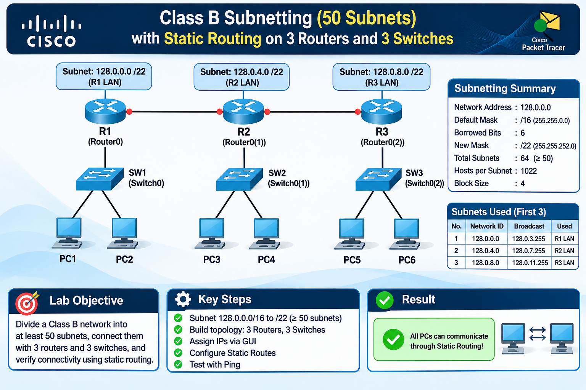
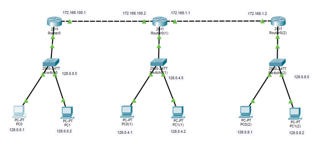
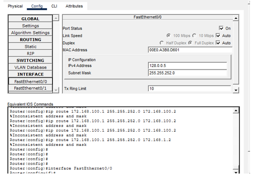
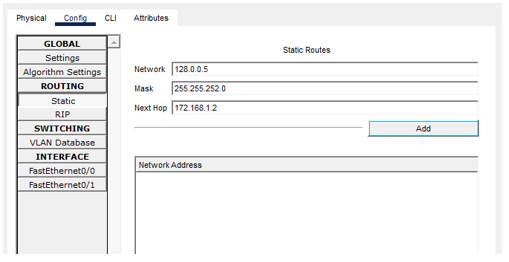
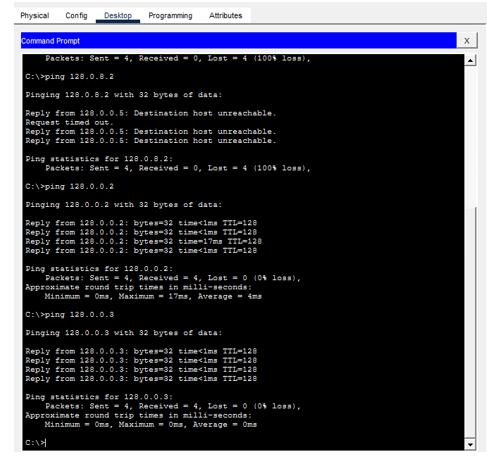
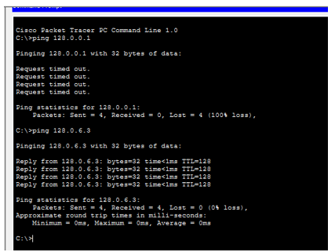

# Class B Subnetting (50 Subnets)

### Static Routing with 3 Routers and 3 Switches



**Cisco Packet Tracer · GUI-Based Configuration · Networking Lab**

[Overview](#-overview) · [Subnetting](#-subnetting-calculation) ·
[Topology](#-network-topology) · [Configuration](#-configuration) ·
[Verification](#-verification) ·
[Troubleshooting](#-problems-found-and-corrections)

------------------------------------------------------------------------

## 📖 Overview

This repository documents a Class B subnetting lab created in **Cisco
Packet Tracer**. The network `128.0.0.0/16` is divided into at least 50
subnets by borrowing six host bits and applying a `/22` subnet mask. The
topology uses three Cisco 2811 routers, three Cisco 2960 switches, and
six PCs. Static routes are configured on all routers to provide paths
between the LAN subnets.

The configuration procedure in this lab uses the Packet Tracer
**Config** and **Desktop** tabs. Router CLI commands are included as
equivalent IOS references shown by Packet Tracer; the documented
configuration workflow is GUI-based.

### Lab information

  Field          Information
  -------------- -----------------------------------------------------
  Student        Sanawar Imran
  Roll Number    243633
  Submitted To   Sir Azam
  Network        `128.0.0.0/16`, subnetted to `/22`
  Software       Cisco Packet Tracer
  Lab            Class B Subnetting (50 Subnets) with Static Routing

## 🎯 Objectives

-   Subnet the Class B network `128.0.0.0/16` into at least 50 subnets.
-   Build a topology using 3 Cisco 2811 routers and 3 Cisco 2960
    switches.
-   Connect two PCs to each switch.
-   Assign IP addresses to router interfaces and PCs through the GUI.
-   Configure static routes on every router using **Config → Routing →
    Static**.
-   Verify network connectivity using ping and document the results.

## 🧰 Requirements

  -----------------------------------------------------------------------
  Component                           Requirement
  ----------------------------------- -----------------------------------
  Routers                             3 × Cisco 2811 (`Router0`,
                                      `Router0(1)`, `Router0(2)`)

  Switches                            3 × Cisco 2960-24TT (`Switch0`,
                                      `Switch0(1)`, `Switch0(2)`)

  End devices                         6 × PC-PT (2 per switch)

  Cables                              Copper straight-through for
                                      PC--Switch and Switch--Router
                                      connections; router backbone links
                                      as used in the lab

  Software                            Cisco Packet Tracer
  -----------------------------------------------------------------------

------------------------------------------------------------------------

## 🔢 Subnetting Calculation

### Given

-   Original network: `128.0.0.0`
-   Default Class B prefix: `/16`
-   Default subnet mask: `255.255.0.0`
-   Required subnets: at least `50`

### Calculation

1.  **Bits to borrow:** (2\^5 = 32), which is not enough. (2\^6 = 64),
    which is sufficient. Therefore, borrow 6 bits.
2.  **New prefix:** `/16 + 6 = /22`.
3.  **New subnet mask:** `255.255.252.0`.
4.  **Number of subnets:** (2\^6 = 64) subnets.
5.  **Host bits:** `32 − 22 = 10`.
6.  **Usable hosts per subnet:** (2\^{10} - 2 = 1022).
7.  **Block size:** `256 − 252 = 4`; the third octet increases in steps
    of 4.

### Subnetting summary

  Parameter                  Value
  -------------------------- -----------------
  Original network           `128.0.0.0/16`
  Borrowed bits              6
  New prefix                 `/22`
  New subnet mask            `255.255.252.0`
  Total subnets              64
  Required subnets           50
  Spare subnets              14
  Usable hosts per subnet    1022
  Block size (third octet)   4

### First seven subnets

The lab documentation specifies the first seven subnets. The topology
uses the first three, one for each router LAN.

  ------------------------------------------------------------------------------------------
             No. Network ID     First Host     Last Host        Broadcast        Usage
  -------------- -------------- -------------- ---------------- ---------------- -----------
               1 `128.0.0.0`    `128.0.0.1`    `128.0.3.254`    `128.0.3.255`    R1 LAN

               2 `128.0.4.0`    `128.0.4.1`    `128.0.7.254`    `128.0.7.255`    R2 LAN

               3 `128.0.8.0`    `128.0.8.1`    `128.0.11.254`   `128.0.11.255`   R3 LAN

               4 `128.0.12.0`   `128.0.12.1`   `128.0.15.254`   `128.0.15.255`   Spare

               5 `128.0.16.0`   `128.0.16.1`   `128.0.19.254`   `128.0.19.255`   Spare

               6 `128.0.20.0`   `128.0.20.1`   `128.0.23.254`   `128.0.23.255`   Spare

               7 `128.0.24.0`   `128.0.24.1`   `128.0.27.254`   `128.0.27.255`   Spare
  ------------------------------------------------------------------------------------------

------------------------------------------------------------------------

## 🌐 Network Topology

Three routers are connected in a line:

-   R1 (`Router0`) connects to R2 (`Router0(1)`).
-   R2 connects to R3 (`Router0(2)`).
-   Each router connects to one LAN switch.
-   Each switch connects to two PCs.

### Topology diagram



*Figure 1: Three-router topology with three LAN switches and six PCs in
Cisco Packet Tracer.*

### Device roles

  Short Name   Packet Tracer Device   Role
  ------------ ---------------------- -----------------------------------
  R1           `Router0`              Left router; LAN `128.0.0.0/22`
  R2           `Router0(1)`           Middle router; LAN `128.0.4.0/22`
  R3           `Router0(2)`           Right router; LAN `128.0.8.0/22`

## 🗺️ IP Addressing Plan

### Router interfaces

  Router   Interface / Connection   IP Address        Subnet Mask
  -------- ------------------------ ----------------- -------------------------
  R1       LAN (Switch0)            `128.0.0.5`       `255.255.252.0`
  R1       Link to R2               `172.168.100.1`   `255.255.255.252 (/30)`
  R2       LAN (Switch0(1))         `128.0.4.5`       `255.255.252.0`
  R2       Link to R1               `172.168.100.2`   `255.255.255.252 (/30)`
  R2       Link to R3               `172.168.1.1`     `255.255.255.252 (/30)`
  R3       LAN (Switch0(2))         `128.0.8.5`       `255.255.252.0`
  R3       Link to R2               `172.168.1.2`     `255.255.255.252 (/30)`

**Router note:** A Cisco 2811 router has two built-in FastEthernet
ports. R2 requires three interfaces, so an additional interface module
is required in Packet Tracer. The `/30` mask is used for the
point-to-point router links.

### PC addressing

  PC       Switch       IP Address    Subnet Mask       Default Gateway
  -------- ------------ ------------- ----------------- -----------------
  PC0      Switch0      `128.0.0.1`   `255.255.252.0`   `128.0.0.5`
  PC1      Switch0      `128.0.0.2`   `255.255.252.0`   `128.0.0.5`
  PC0(1)   Switch0(1)   `128.0.4.1`   `255.255.252.0`   `128.0.4.5`
  PC1(1)   Switch0(1)   `128.0.4.2`   `255.255.252.0`   `128.0.4.5`
  PC0(2)   Switch0(2)   `128.0.8.1`   `255.255.252.0`   `128.0.8.5`
  PC1(2)   Switch0(2)   `128.0.8.2`   `255.255.252.0`   `128.0.8.5`

### Point-to-point links

  Link       Network              Side A            Side B
  ---------- -------------------- ----------------- -----------------
  R1 to R2   `172.168.100.0/30`   `172.168.100.1`   `172.168.100.2`
  R2 to R3   `172.168.1.0/30`     `172.168.1.1`     `172.168.1.2`

------------------------------------------------------------------------

## ⚙️ Configuration

All router interface, PC IP, and static-route settings described below
are entered through the Packet Tracer GUI.

### Step 1 --- Build the topology

1.  Place 3 × Cisco 2811 routers, 3 × Cisco 2960 switches, and 6 PCs.
2.  Connect each PC to its switch.
3.  Connect each switch to its router using copper straight-through
    cables.
4.  Connect R1 to R2 and R2 to R3 to create the router backbone.
5.  Wait for the link indicators to become green.

### Step 2 --- Configure router interfaces

For each router:

1.  Open the router.
2.  Select the **Config** tab.
3.  Select the required interface under **INTERFACE**.
4.  Enter the IPv4 address and subnet mask from the router addressing
    table.
5.  Set **Port Status** to **On**.
6.  Repeat for every LAN and router-to-router interface.



*Figure 2: Router interface configuration in Packet Tracer, showing the
interface settings and equivalent IOS commands.*

### Step 3 --- Configure PC IP settings

For each PC:

1.  Open the PC.
2.  Select **Desktop → IP Configuration**.
3.  Choose **Static**.
4.  Enter the IP address, subnet mask, and default gateway from the PC
    addressing table.

Example for PC0:

  Field             Value
  ----------------- -----------------
  IP Address        `128.0.0.1`
  Subnet Mask       `255.255.252.0`
  Default Gateway   `128.0.0.5`



*Figure 3: PC IP configuration window used to enter the static address,
subnet mask, and default gateway.*

### Step 4 --- Configure static routes

On each router:

1.  Open the router and select **Config**.
2.  Go to **ROUTING → Static**.
3.  Enter the destination **Network**, **Mask**, and **Next Hop**.
4.  Click **Add**.
5.  Add every required route listed below.

**Important:** Enter the remote subnet's network ID, not an individual
host or router interface address. The next-hop address must belong to a
directly connected link.

#### R1 --- Router0

  Destination Network   Mask                Next Hop
  --------------------- ------------------- -----------------
  `128.0.4.0`           `255.255.252.0`     `172.168.100.2`
  `128.0.8.0`           `255.255.252.0`     `172.168.100.2`
  `172.168.1.0`         `255.255.255.252`   `172.168.100.2`

#### R2 --- Router0(1)

  Destination Network   Mask              Next Hop
  --------------------- ----------------- -----------------
  `128.0.0.0`           `255.255.252.0`   `172.168.100.1`
  `128.0.8.0`           `255.255.252.0`   `172.168.1.2`

#### R3 --- Router0(2)

  Destination Network   Mask                Next Hop
  --------------------- ------------------- ---------------
  `128.0.0.0`           `255.255.252.0`     `172.168.1.1`
  `128.0.4.0`           `255.255.252.0`     `172.168.1.1`
  `172.168.100.0`       `255.255.255.252`   `172.168.1.1`



*Figure 4: Static routing configuration page in the router Config tab.*

### Equivalent IOS commands

Packet Tracer displays equivalent IOS commands when routes are added
through the GUI. The following commands correspond to the route tables
above.

``` cisco
! R1 — Router0
ip route 128.0.4.0 255.255.252.0 172.168.100.2
ip route 128.0.8.0 255.255.252.0 172.168.100.2
ip route 172.168.1.0 255.255.255.252 172.168.100.2

! R2 — Router0(1)
ip route 128.0.0.0 255.255.252.0 172.168.100.1
ip route 128.0.8.0 255.255.252.0 172.168.1.2

! R3 — Router0(2)
ip route 128.0.0.0 255.255.252.0 172.168.1.1
ip route 128.0.4.0 255.255.252.0 172.168.1.1
ip route 172.168.100.0 255.255.255.252 172.168.1.1
```

------------------------------------------------------------------------

## 🧪 Verification

Connectivity is tested from **PC → Desktop → Command Prompt** using the
`ping` command.

### Recorded ping results



*Figure 5: Ping test output recorded in the lab. The results show both
successful and unsuccessful connectivity tests.*

The lab report records the following observations:

  -----------------------------------------------------------------------
  Test                    Recorded Result         Meaning in the lab
                                                  report
  ----------------------- ----------------------- -----------------------
  Ping within the same    Success --- 4/4         PC IPs, mask, and
  subnet (`128.0.0.2`,    replies, 0% loss        switch are working for
  `128.0.0.3`)                                    this test

  Ping to `128.0.8.2`     Destination host        The local router
  from the first subnet   unreachable             `128.0.0.5` had no
                                                  valid route to
                                                  `128.0.8.0/22` at test
                                                  time

  Ping to `128.0.6.3`     Success --- 4/4         Host reachable on its
                          replies, 0% loss, TTL   LAN, as recorded
                          128                     

  Ping to `128.0.0.1`     Timed out --- all four  No path, address, or
  from the second test    attempts                gateway mismatch was
                                                  indicated
  -----------------------------------------------------------------------

> **Verification status:** The supplied report records successful
> same-subnet communication, but it also records failed tests between
> some addresses. The static-route corrections below are documented as
> the required fix. End-to-end success after re-testing should only be
> claimed after the corrected configuration has been tested.

------------------------------------------------------------------------

## 🛠️ Problems Found and Corrections

The lab screenshots and report identify two configuration problems.

### Problem 1 --- Invalid static routes

The Equivalent IOS Commands area showed errors such as:

``` text
%Inconsistent address and mask
```

An example of an invalid route used a router interface/host address as
the destination with a `/22` mask. A static route destination must be
the correct network ID for the selected mask.

**Correction:**

Use the network ID `128.0.0.0` with mask `255.255.252.0`, rather than
using the host/interface address `128.0.0.5` as the destination network.
Apply the correct destination network and mask from the static-route
tables on each router.

### Problem 2 --- Remote subnets were unreachable

Because valid routes were not present, routers knew only their directly
connected networks. Traffic to remote LANs therefore failed with
**Destination host unreachable**.

**Correction:**

Add the static routes listed for R1, R2, and R3. Ensure that forward and
return paths are configured so replies can travel back to the source
network.

### Checklist before re-testing

-   [ ] All router interfaces have **Port Status: On**.
-   [ ] Router-to-router and LAN links show green link indicators.
-   [ ] Each PC has the correct IP address and `/22` subnet mask.
-   [ ] Each PC's default gateway matches its router LAN interface.
-   [ ] Static routes use valid destination network IDs and masks.
-   [ ] Every next hop is on a directly connected link.
-   [ ] Routes are present on all routers for the required remote
    networks.
-   [ ] Test PC0 to PC0(1), PC0 to PC0(2), and PC1(2) to PC1.

------------------------------------------------------------------------

## 📊 Results Summary

-   The original Class B network `128.0.0.0/16` was divided into 64
    subnets using `/22`.
-   Each subnet provides 1022 usable host addresses.
-   Three LAN subnets were assigned to the three-router topology.
-   Two `/30` point-to-point networks connect the routers.
-   Same-subnet ping communication was successful in the recorded test.
-   The report identified invalid static routes as the reason for
    remote-subnet failures and documented the corrected routes to apply.

## 🎓 What I Learned

-   How to calculate the number of borrowed bits for a required number
    of subnets.
-   How to calculate a new subnet mask, usable host range, broadcast
    address, and block size.
-   How to build a multi-router topology in Cisco Packet Tracer.
-   How to configure router interfaces and PC addressing through the
    GUI.
-   How to add static routes using destination networks, subnet masks,
    and next-hop addresses.
-   How to use ping to test connectivity.
-   How incorrect network IDs and masks can cause static-route errors
    and prevent remote communication.

## 🚀 How to Use This Repository

1.  Clone or download this repository.
2.  Open the `.pkt` Packet Tracer project file if it has been included
    in the repository.
3.  Review the network topology and IP addressing tables in this README.
4.  Re-create the topology in Cisco Packet Tracer if the project file is
    not included.
5.  Configure router interfaces and PC IP settings using the GUI.
6.  Add the static routes to all three routers.
7.  Run the ping tests and compare your results with the documented
    observations.

### Clone the repository

Replace `your-username` with your GitHub username and use the actual
repository name:

``` bash
git clone https://github.com/your-username/Class-B-Subnetting-Lab.git
cd Class-B-Subnetting-Lab
```

## 📁 Suggested Repository Structure

Keep the image filenames and folder names exactly as shown below so that
the README images display correctly on GitHub.

``` text
Class-B-Subnetting-Lab/
│
├── README.md
├── images/
│   ├── ai.png
│   ├── Screenshot_1.png
│   ├── Screenshot_2.png
│   ├── Screenshot_3.png
│   ├── Screenshot_4.png
│   └── Screenshot_5.png
│
└── Class_B_Subnetting_Lab.pkt   (optional, if available)
```

## 📌 Important Notes

-   The README image links are relative paths. Upload the banner and
    screenshots into the repository's `images` folder.
-   GitHub filenames are case-sensitive. Keep names such as
    `Screenshot_1.png` exactly the same as in the README.
-   The supplied lab documentation does not establish that every remote
    ping succeeded after the corrections. Run the re-tests before
    marking full end-to-end connectivity as successful.
-   The Packet Tracer `.pkt` file is optional and should only be added
    if you have the actual project file.

## 📄 License

This lab documentation is prepared for educational and learning
purposes. You may adapt the topology and configuration for practice,
while giving appropriate credit to the original work.

------------------------------------------------------------------------

::: {align="center"}
**Class B Subnetting Lab · Cisco Packet Tracer**

Made for networking practice and learning.
:::
