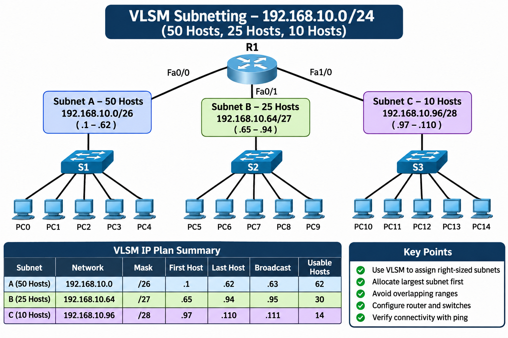
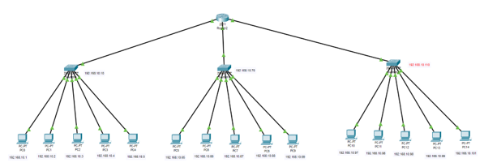
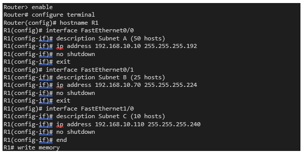
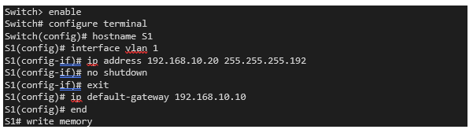
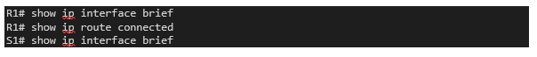
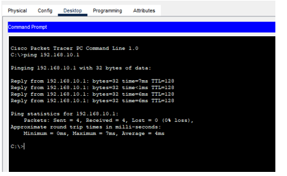

# 🌐 VLSM Subnetting - Complete Implementation Guide
 
<p align="center">
  
</p>
<p align="center"><b>Designing and Configuring Three Subnets (50, 25 and 10 Hosts) from 192.168.10.0/24</b></p>
<p align="center">
  
  
  
</p>
<p align="center">
  <a href="#-overview">📖 Overview</a> •
  <a href="#-vlsm-concepts">🧠 Concepts</a> •
  <a href="#-vlsm-design-step-by-step">📐 Design</a> •
  <a href="#️-network-topology">🗺️ Topology</a> •
  <a href="#-ip-addressing-plan">📋 IP Plan</a> •
  <a href="#️-step-by-step-configuration">⚙️ Configuration</a> •
  <a href="#-verification">✅ Verification</a> •
  <a href="#️-troubleshooting">🛠️ Troubleshooting</a>
</p>
---
 
## 📖 Overview
 
A single network block, **192.168.10.0/24**, must be divided into three subnets using **VLSM (Variable Length Subnet Masking)**. The subnets have different host requirements, so each one gets a mask that fits its size. This saves IP addresses compared with giving every subnet the same size.
 
### Lab Details:
 
| Detail | Information |
|--------|-------------|
| **Prepared by** | Sanawar Imran |
| **Roll number** | 243633 |
| **Network block** | 192.168.10.0/24 |
| **Technique** | Variable Length Subnet Masking (VLSM) |
| **Tool** | Cisco Packet Tracer |
| **Date** | 8 November 2026 |
 
### Requirements:
 
| Item | Requirement |
|------|-------------|
| **Network block** | 192.168.10.0/24 |
| **Subnet A** | 50 hosts |
| **Subnet B** | 25 hosts |
| **Subnet C** | 10 hosts |
| **Devices** | Router R1 and switches S1 to S3 (one switch per subnet) |
| **Deliverables** | VLSM design, IP assignment, router and switch configuration, ping verification between different subnets |
 
### 🎯 What You Will Do:
- ✅ Choose the right mask for each subnet from its host count
- ✅ Allocate the address blocks from largest to smallest without overlap
- ✅ Assign addresses to the router, switches and PCs
- ✅ Configure the router and switches
- ✅ Test connectivity inside and between subnets
---
 
## 📚 Table of Contents
 
- [🧠 VLSM Concepts](#-vlsm-concepts)
- [📐 VLSM Design, Step by Step](#-vlsm-design-step-by-step)
- [🗺️ Network Topology](#️-network-topology)
- [📋 IP Addressing Plan](#-ip-addressing-plan)
- [⚙️ Step-by-Step Configuration](#️-step-by-step-configuration)
- [✅ Verification](#-verification)
- [🛠️ Troubleshooting](#️-troubleshooting)
- [📝 Summary and Checklist](#-summary-and-checklist)
---
 
## 🧠 VLSM Concepts
 
### Fixed-Length vs VLSM
 
```
Fixed-length subnetting:
Every subnet gets the same mask.
Largest subnet needs 50 hosts → all subnets become /26 (62 hosts each)
Result: the 10-host subnet wastes 52 addresses ❌
 
VLSM:
Each subnet gets its own mask, sized to the need.
50 hosts → /26    25 hosts → /27    10 hosts → /28
Result: very little waste ✅
```
 
### 🔑 Three Rules for VLSM
 
| # | Rule | Meaning |
|---|------|---------|
| 1 | **Sort by size** | Start with the subnet that needs the most hosts, then work down |
| 2 | **Pick the smallest block that fits** | Usable hosts = 2^h - 2 (h = host bits). The 2 removed are the network and broadcast addresses |
| 3 | **Place blocks one after another** | Each subnet starts at the first address after the previous block ends, so nothing overlaps |
 
### Mask Cheat Sheet
 
| Prefix | Mask | Host bits | Block size | Usable hosts | Fits |
|--------|------|-----------|------------|--------------|------|
| /25 | 255.255.255.128 | 7 | 128 | 126 | |
| /26 | 255.255.255.192 | 6 | 64 | 62 | **A (50)** |
| /27 | 255.255.255.224 | 5 | 32 | 30 | **B (25)** |
| /28 | 255.255.255.240 | 4 | 16 | 14 | **C (10)** |
| /29 | 255.255.255.248 | 3 | 8 | 6 | |
 
---
 
## 📐 VLSM Design, Step by Step
 
### Step 1: Find the Host Bits for Each Subnet
 
| Subnet | Hosts needed | Smallest 2^h - 2 that fits | Host bits (h) | Prefix |
|--------|--------------|----------------------------|---------------|--------|
| **A** | 50 | 2^6 - 2 = 62 | 6 | /26 |
| **B** | 25 | 2^5 - 2 = 30 | 5 | /27 |
| **C** | 10 | 2^4 - 2 = 14 | 4 | /28 |
 
**Why not smaller?**
```
/27 gives only 30 hosts  → cannot hold 50
/28 gives only 14 hosts  → cannot hold 25
/29 gives only 6 hosts   → cannot hold 10
```
 
---
 
### Step 2: Allocate the Blocks, Largest First
 
| Subnet | Network address | Block size | Block runs from / to | Next free address |
|--------|-----------------|------------|----------------------|-------------------|
| **A** | 192.168.10.0/26 | 64 | .0 to .63 | .64 |
| **B** | 192.168.10.64/27 | 32 | .64 to .95 | .96 |
| **C** | 192.168.10.96/28 | 16 | .96 to .111 | .112 |
 
```
Subnet A starts at .0   → uses 64 → ends at .63
Subnet B starts at .64  → uses 32 → ends at .95
Subnet C starts at .96  → uses 16 → ends at .111
```
 
---
 
### Step 3: Complete Subnet Table
 
| Subnet | Network | Mask | First host | Last host | Broadcast | Usable |
|--------|---------|------|------------|-----------|-----------|--------|
| **A** | 192.168.10.0/26 | 255.255.255.192 | .1 | .62 | .63 | 62 |
| **B** | 192.168.10.64/27 | 255.255.255.224 | .65 | .94 | .95 | 30 |
| **C** | 192.168.10.96/28 | 255.255.255.240 | .97 | .110 | .111 | 14 |
 
---
 
### 🧮 Worked Example: Subnet C (/28)
 
```
Mask 255.255.255.240 → 28 network bits + 4 host bits (last octet 11110000)
 
Block size    = 256 - 240 = 16
Block range   = 96 + 16 - 1 = 111 (broadcast address)
Usable hosts  = .97 to .110 → 2^4 - 2 = 14 addresses
Need = 10     → 4 addresses spare
Wildcard mask = 255 - 240 = 15 → 0.0.0.15
```
 
---
 
### Step 4: Check the Efficiency
 
| Item | VLSM | Same-size /26 for all |
|------|------|-----------------------|
| **Addresses used by the three subnets** | 64 + 32 + 16 = 112 | 64 x 3 = 192 |
| **Addresses left free in the /24** | 144 (.112 to .255) | 64 (one more /26) |
| **Wasted inside subnets** | (62-50)+(30-25)+(14-10) = **21** | 12 + 37 + 52 = **101** |
 
**Result:** ✅ VLSM wastes about 5 times fewer addresses
 
---
 
## 🗺️ Network Topology
 
One router connects three switches, one per subnet. Five PCs are connected to each switch.
 
<p align="center">
  
</p>
<p align="center"><i>Figure 1: Packet Tracer topology with the VLSM addresses</i></p>
### Devices and Cabling
 
| Device | Subnet | Router interface | Connected PCs |
|--------|--------|------------------|---------------|
| **Switch S1 (Switch0)** | A | FastEthernet0/0 | PC0 to PC4 |
| **Switch S2 (Switch1)** | B | FastEthernet0/1 | PC5 to PC9 |
| **Switch S3 (Switch2)** | C | FastEthernet1/0 | PC10 to PC14 |
 
> 📝 **Notes on the picture:**
> 1. The screenshot names the router "Router2" and the switches "Switch0 to Switch2". This guide uses **R1** and **S1 to S3**; rename the devices in Packet Tracer to match.
> 2. A 2811 router has two built-in ports, so the third interface needs an added module. Use your own port names if they differ.
> 3. Every PC must have a **unique** address (Subnet C uses .97, .98, .99, .100 and .101 for PC10 to PC14).
 
---
 
## 📋 IP Addressing Plan
 
The addresses shown beside each switch in the topology (**.10**, **.70** and **.110**) are used as the router interface addresses, and each PC uses the router address of its own subnet as the default gateway. Each switch gets a management address so it can be configured and pinged.
 
| Device | Subnet | IP address | Subnet mask | Default gateway |
|--------|--------|------------|-------------|-----------------|
| **R1 Fa0/0** | A | 192.168.10.10 | 255.255.255.192 | n/a |
| **S1 (VLAN 1)** | A | 192.168.10.20 | 255.255.255.192 | 192.168.10.10 |
| **PC0** | A | 192.168.10.1 | 255.255.255.192 | 192.168.10.10 |
| **PC1** | A | 192.168.10.2 | 255.255.255.192 | 192.168.10.10 |
| **PC2** | A | 192.168.10.3 | 255.255.255.192 | 192.168.10.10 |
| **PC3** | A | 192.168.10.4 | 255.255.255.192 | 192.168.10.10 |
| **PC4** | A | 192.168.10.5 | 255.255.255.192 | 192.168.10.10 |
| **R1 Fa0/1** | B | 192.168.10.70 | 255.255.255.224 | n/a |
| **S2 (VLAN 1)** | B | 192.168.10.80 | 255.255.255.224 | 192.168.10.70 |
| **PC5** | B | 192.168.10.65 | 255.255.255.224 | 192.168.10.70 |
| **PC6** | B | 192.168.10.66 | 255.255.255.224 | 192.168.10.70 |
| **PC7** | B | 192.168.10.67 | 255.255.255.224 | 192.168.10.70 |
| **PC8** | B | 192.168.10.68 | 255.255.255.224 | 192.168.10.70 |
| **PC9** | B | 192.168.10.69 | 255.255.255.224 | 192.168.10.70 |
| **R1 Fa1/0** | C | 192.168.10.110 | 255.255.255.240 | n/a |
| **S3 (VLAN 1)** | C | 192.168.10.105 | 255.255.255.240 | 192.168.10.110 |
| **PC10** | C | 192.168.10.97 | 255.255.255.240 | 192.168.10.110 |
| **PC11** | C | 192.168.10.98 | 255.255.255.240 | 192.168.10.110 |
| **PC12** | C | 192.168.10.99 | 255.255.255.240 | 192.168.10.110 |
| **PC13** | C | 192.168.10.100 | 255.255.255.240 | 192.168.10.110 |
| **PC14** | C | 192.168.10.101 | 255.255.255.240 | 192.168.10.110 |
 
✅ Every address is inside its subnet's usable range, is not a network or broadcast address, and is used only once.
 
---
 
## ⚙️ Step-by-Step Configuration
 
### 6.1 Build the Topology
 
1. Add one **2811 router**, three **2960-24TT switches** and **fifteen PCs**
2. Connect S1 to R1 Fa0/0, S2 to Fa0/1 and S3 to Fa1/0 with **straight-through** cables
3. Connect PC0 to PC4 to S1, PC5 to PC9 to S2, and PC10 to PC14 to S3
4. Rename the devices R1, S1, S2 and S3, and add Subnet A, B and C labels
---
 
### 6.2 Configure Router R1
 
Open R1 → **CLI** tab:
 
```cisco
Router> enable
Router# configure terminal
Router(config)# hostname R1
 
R1(config)# interface FastEthernet0/0
R1(config-if)# description Subnet A (50 hosts)
R1(config-if)# ip address 192.168.10.10 255.255.255.192
R1(config-if)# no shutdown
R1(config-if)# exit
 
R1(config)# interface FastEthernet0/1
R1(config-if)# description Subnet B (25 hosts)
R1(config-if)# ip address 192.168.10.70 255.255.255.224
R1(config-if)# no shutdown
R1(config-if)# exit
 
R1(config)# interface FastEthernet1/0
R1(config-if)# description Subnet C (10 hosts)
R1(config-if)# ip address 192.168.10.110 255.255.255.240
R1(config-if)# no shutdown
R1(config-if)# end
 
R1# write memory
```
 
<p align="center">
  
</p>
<p align="center"><i>Figure 2: Router R1 configuration</i></p>
💡 All three subnets are **directly connected** to R1, so it adds them to the routing table automatically. No static routes or routing protocol are needed.
 
---
 
### 6.3 Configure the Switches
 
**Switch S1 (Subnet A).** The management address goes on VLAN 1, and the default gateway lets the switch be reached from other subnets:
 
```cisco
Switch> enable
Switch# configure terminal
Switch(config)# hostname S1
 
S1(config)# interface vlan 1
S1(config-if)# ip address 192.168.10.20 255.255.255.192
S1(config-if)# no shutdown
S1(config-if)# exit
 
S1(config)# ip default-gateway 192.168.10.10
S1(config)# end
S1# write memory
```
 
<p align="center">
  
</p>
<p align="center"><i>Figure 3: Switch management address and default gateway</i></p>
**Repeat the same commands on the other two switches with these values:**
 
| Switch | Hostname | VLAN 1 address and mask | Default gateway |
|--------|----------|-------------------------|-----------------|
| **Subnet B** | S2 | 192.168.10.80 255.255.255.224 | 192.168.10.70 |
| **Subnet C** | S3 | 192.168.10.105 255.255.255.240 | 192.168.10.110 |
 
---
 
### 6.4 Configure the PCs
 
1. Click the PC → **Desktop** → **IP Configuration**
2. Select **Static**
3. Enter the IP address, subnet mask and default gateway from the [IP plan](#-ip-addressing-plan)
4. Close the window (settings are saved automatically)
**Example: PC5 (Subnet B)**
 
| Field | Value |
|-------|-------|
| **IPv4 Address** | 192.168.10.65 |
| **Subnet Mask** | 255.255.255.224 |
| **Default Gateway** | 192.168.10.70 |
 
⚠️ **Mask warning:** Packet Tracer fills in `255.255.255.0` automatically. Change it to the subnet's own mask (.192, .224 or .240). A wrong /24 mask makes the PC think other subnets are local, and inter-subnet pings fail.
 
---
 
## ✅ Verification
 
### 7.1 Check the Router and Switches
 
```cisco
R1# show ip interface brief
R1# show ip route connected
S1# show ip interface brief
```
 
<p align="center">
  
</p>
<p align="center"><i>Figure 4: Interface and routing verification</i></p>
**Expected result:**
```
✓ Three router interfaces up/up: 192.168.10.10, .70 and .110
✓ Routing table lists three connected networks:
    192.168.10.0/26
    192.168.10.64/27
    192.168.10.96/28
✓ On each switch, Vlan1 shows its management address
```
 
---
 
### 7.2 Ping Test Plan
 
| # | From | Ping | Type | Expected |
|---|------|------|------|----------|
| 1 | PC1 (A) | 192.168.10.1 (PC0) | Same subnet | Success, TTL 128 |
| 2 | PC0 (A) | 192.168.10.10 (R1) | Gateway | Success |
| 3 | PC0 (A) | 192.168.10.65 (PC5, B) | Inter-subnet | Success, TTL 127 |
| 4 | PC0 (A) | 192.168.10.97 (PC10, C) | Inter-subnet | Success, TTL 127 |
| 5 | PC5 (B) | 192.168.10.100 (PC13, C) | Inter-subnet | Success, TTL 127 |
| 6 | PC0 (A) | 192.168.10.20 (S1) | Switch | Success |
 
---
 
### Results - Ping Test
 
#### ✅ Ping Inside Subnet A:
 
<p align="center">
  
</p>
<p align="center"><i>Figure 5: Ping to 192.168.10.1 from a PC in Subnet A, 4 of 4 replies</i></p>
**Reading the result:**
```
Packets sent:     4
Packets received: 4
Loss:             0%
TTL = 128 → packet stayed inside the subnet (did not cross the router)
```
 
**Result:** ✅ Same-subnet communication works
 
💡 For inter-subnet pings (tests 3 to 5) the TTL is **127** because the packet crossed R1. The first ping may show one "Request timed out" while ARP resolves; ping again for 4 of 4.
 
---
 
## 🛠️ Troubleshooting
 
| Symptom | Likely cause | Fix |
|---------|--------------|-----|
| Red link light / no connection | Wrong cable or port shut down | Use straight-through cable; `no shutdown` |
| Ping fails inside a subnet | Wrong IP or mask on a PC | Recheck the IP plan and subnet mask |
| Ping works in a subnet but not between subnets | Missing gateway, or router interface down | Set the PC gateway; run `show ip interface brief` on R1 |
| "Destination host unreachable" | Router interface down or wrong address | Correct the interface address and mask |
| IP conflict warning | Two devices share one address | Give every device a unique address |
| Switch cannot be pinged from another subnet | No default gateway on the switch | Add `ip default-gateway` on the switch |
| Only the first ping fails | ARP delay | Normal; ping again |
 
---
 
## 📝 Summary and Checklist
 
The block **192.168.10.0/24** was divided with VLSM into:
 
| Subnet | Network / prefix | Mask | Usable range | Broadcast |
|--------|------------------|------|--------------|-----------|
| **A** (50 hosts) | 192.168.10.0/26 | 255.255.255.192 | .1 to .62 | 192.168.10.63 |
| **B** (25 hosts) | 192.168.10.64/27 | 255.255.255.224 | .65 to .94 | 192.168.10.95 |
| **C** (10 hosts) | 192.168.10.96/28 | 255.255.255.240 | .97 to .110 | 192.168.10.111 |
 
Router R1 connects the subnets, and ping tests prove communication.
 
### ✔️ Final Checklist
 
- [x] Subnets allocated largest first, with no overlap
- [x] Each mask fits its host requirement
- [x] Router interfaces are up with the correct masks
- [x] Switches have management addresses and a default gateway
- [x] Every PC has a unique address, the right mask and the right gateway
- [x] Same-subnet and different-subnet pings succeed
- [x] Configuration saved with `write memory`
---
 
## 📝 Quick Reference
 
### VLSM Formulas
 
```
Usable hosts   = 2^h - 2         (h = host bits)
Block size     = 256 - mask octet
Broadcast      = next network - 1
Wildcard mask  = 255 - mask octet
```
 
### Verification Commands
 
```cisco
show ip interface brief
show ip route connected
show running-config
ping 192.168.10.65
```
 
---
 
## 🎓 What I Learned
 
✅ Why VLSM saves addresses compared with fixed-length subnetting  
✅ How to pick the smallest mask that fits a host requirement  
✅ Allocating blocks largest first without overlap  
✅ Calculating network, first host, last host and broadcast addresses  
✅ Configuring router interfaces and switch management addresses  
✅ Setting the correct mask and gateway on PCs  
✅ Verifying with `show` commands and same-subnet / inter-subnet pings  
 
---
 
## 🚀 How to Use This Repository
 
1. **Clone the repository:**
```bash
   git clone https://github.com/your-username/VLSM-Subnetting.git
```
 
2. **Study the guide:**
   - Understand the VLSM rules
   - Follow the design steps
   - Review the screenshots
3. **Repeat the lab with your own numbers:**
   - Change the host counts (for example 100, 40 and 12)
   - Redo the allocation largest first
   - Rebuild and test in Packet Tracer
---
 
## 📞 Connect With Me
 
<p align="center">
  <a href="mailto:your-email@gmail.com"></a>
  <a href="https://www.linkedin.com/in/your-linkedin"></a>
  <a href="https://github.com/your-username"></a>
</p>
<p align="center"><b>💬 Questions? Need Packet Tracer files? Feel free to reach out!</b></p>
---
 
## 📄 License
 
This project is created for **educational purposes** and is open-source.
 
---
 
<h3 align="center">⭐ If you found this helpful, please give it a star!</h3>
 
<p align="center"><b>Made with 💙 by SANAWAR IMRAN</b></p>
<p align="center"><i>Last Updated: November 2026</i></p>
 
