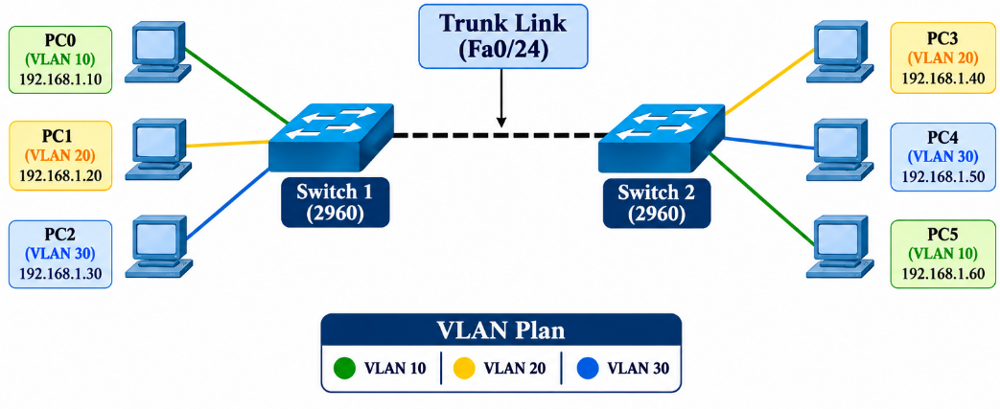
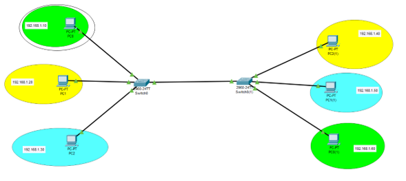
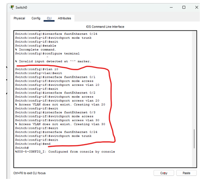
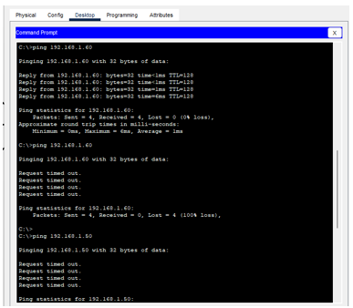

# 🔀 VLAN Segmentation Using Two Switches

<p align="center">
  
</p>

<h3 align="center">VLAN Configuration, Trunking, Connectivity Testing and MAC Address Table Analysis</h3>

<p align="center">
  
  
  
  
</p>

<p align="center">
  <a href="#-overview">Overview</a> ·
  <a href="#-objectives">Objectives</a> ·
  <a href="#-requirements">Requirements</a> ·
  <a href="#-topology">Topology</a> ·
  <a href="#-ip-and-vlan-plan">IP and VLAN Plan</a> ·
  <a href="#-configuration">Configuration</a> ·
  <a href="#-verification">Verification</a> ·
  <a href="#-connectivity-test">Connectivity</a> ·
  <a href="#-mac-address-table">MAC Table</a> ·
  <a href="#-result-and-conclusion">Conclusion</a>
</p>

## 📌 Overview

This lab connects **two Cisco 2960 switches** and **six PCs**, then uses **VLANs** to split the single physical network into separate broadcast domains. The switches are joined by an **802.1Q trunk** so that PCs in the same VLAN can talk across both switches, while PCs in different VLANs stay isolated.

| | |
|:--|:--|
| 👤 **Name** | Sanawar Imran |
| 🧪 **Lab** | Data Link Layer Lab Task |

### 🎨 VLAN Colour Key

Colours match the topology figure.

| VLAN | Colour | PCs |
|:----:|:------:|-----|
| **10** | 🟩 Green | PC0, PC5 |
| **20** | 🟨 Yellow | PC1, PC3 |
| **30** | 🟦 Blue | PC2, PC4 |


## 🎯 Objectives

- [x] Connect the devices with the correct cables and ports
- [x] Assign static IPv4 addresses to all six PCs
- [x] Create VLANs and assign access ports on both switches
- [x] Configure the inter-switch link as a trunk
- [x] Verify connectivity with ping and observe VLAN isolation
- [x] Inspect the switch MAC address tables


## 🧰 Requirements

| Item | Details |
|------|---------|
| **Software** | Cisco Packet Tracer |
| **Switches** | 2 × Cisco Catalyst 2960-24TT |
| **End devices** | 6 × PC (PC-PT) |
| **Cables** | Copper straight-through (PC to switch), trunk link on FastEthernet 0/24 |


## 🔌 Topology

Three PCs connect to each switch, and the two switches are joined by a trunk on **FastEthernet 0/24**.

<p align="center">
  
</p>

<p align="center"><i>Figure 1: Network topology in Cisco Packet Tracer</i></p>


### Cabling Plan

| PC | Switch | Switch Port | Packet Tracer Label |
|----|--------|-------------|---------------------|
| PC0 | Switch 1 | FastEthernet 0/1 | PC0 |
| PC1 | Switch 1 | FastEthernet 0/2 | PC1 |
| PC2 | Switch 1 | FastEthernet 0/3 | PC2 |
| PC3 | Switch 2 | FastEthernet 0/1 | PC2(1) |
| PC4 | Switch 2 | FastEthernet 0/2 | PC1(1) |
| PC5 | Switch 2 | FastEthernet 0/3 | PC0(1) |
| Switch 1 ↔ Switch 2 | | FastEthernet 0/24 (trunk) | Switch0 to Switch0(1) |


## 🧮 IP and VLAN Plan

All PCs use addresses from **192.168.1.0/24** with mask **255.255.255.0**.

> [!NOTE]
> No default gateway is configured because there is no router in this lab.

| PC | IP Address | Subnet Mask | VLAN | Switch / Port |
|----|------------|-------------|:----:|---------------|
| PC0 | 192.168.1.10 | 255.255.255.0 | 🟩 10 | Switch 1 / Fa0/1 |
| PC1 | 192.168.1.20 | 255.255.255.0 | 🟨 20 | Switch 1 / Fa0/2 |
| PC2 | 192.168.1.30 | 255.255.255.0 | 🟦 30 | Switch 1 / Fa0/3 |
| PC3 | 192.168.1.40 | 255.255.255.0 | 🟨 20 | Switch 2 / Fa0/1 |
| PC4 | 192.168.1.50 | 255.255.255.0 | 🟦 30 | Switch 2 / Fa0/2 |
| PC5 | 192.168.1.60 | 255.255.255.0 | 🟩 10 | Switch 2 / Fa0/3 |

Each VLAN has one PC on each switch: **VLAN 10** (PC0, PC5), **VLAN 20** (PC1, PC3) and **VLAN 30** (PC2, PC4).

## 🔧 Configuration

### Step 1: Assign IP Addresses to the PCs

On each PC: **Desktop** → **IP Configuration** → select **Static** → enter the IP address and subnet mask from the table above.

### Step 2: Configure Switch 1 (Switch0)

Creates VLANs 10, 20 and 30, assigns the three access ports and sets Fa0/24 as a trunk.

<details open>
<summary><b>Switch 1 commands</b></summary>

```cisco
enable
configure terminal
vlan 10
 exit
vlan 20
 exit
vlan 30
 exit
interface fastEthernet 0/1
 switchport mode access
 switchport access vlan 10
 exit
interface fastEthernet 0/2
 switchport mode access
 switchport access vlan 20
 exit
interface fastEthernet 0/3
 switchport mode access
 switchport access vlan 30
 exit
interface fastEthernet 0/24
 switchport mode trunk
 exit
end
```

</details>

<p align="center">
  
</p>

<p align="center"><i>Figure 2: VLAN and trunk configuration on Switch0 (Packet Tracer CLI)</i></p>

### Step 3: Configure Switch 2 (Switch0(1))

The same three VLANs are created. The access ports are mapped differently so each PC joins the VLAN in the plan.

<details open>
<summary><b>Switch 2 commands</b></summary>

```cisco
enable
configure terminal
vlan 10
 exit
vlan 20
 exit
vlan 30
 exit
interface fastEthernet 0/1
 switchport mode access
 switchport access vlan 20
 exit
interface fastEthernet 0/2
 switchport mode access
 switchport access vlan 30
 exit
interface fastEthernet 0/3
 switchport mode access
 switchport access vlan 10
 exit
interface fastEthernet 0/24
 switchport mode trunk
 exit
end
```

</details>

> [!IMPORTANT]
> The port-to-VLAN mapping is **different** on the two switches (Fa0/1 is VLAN 10 on Switch 1 but VLAN 20 on Switch 2). Follow the IP and VLAN Plan, not the port order.

> [!TIP]
> Save the configuration on both switches with `write memory` so it survives a reload.


## 🔍 Verification

Run these on **both switches**:

```cisco
show vlan brief
show interfaces trunk
```

| Command | What you should see |
|---------|---------------------|
| `show vlan brief` | VLANs 10, 20 and 30, with Fa0/1, Fa0/2 and Fa0/3 in their assigned VLANs |
| `show interfaces trunk` | Fa0/24 in **trunking** mode, carrying VLANs 1 to 1005 |


## 📡 Connectivity Test

Devices in the **same VLAN** should reach each other across the trunk. Devices in **different VLANs** should not, because there is no router or Layer 3 switch for inter-VLAN routing.

| Source | Destination | Relationship | Expected Result |
|--------|-------------|--------------|-----------------|
| PC0 (VLAN 10) | 192.168.1.60 (PC5) | Same VLAN | ✅ Success |
| PC0 (VLAN 10) | 192.168.1.50 (PC4) | Different VLAN | ❌ Fail (timed out) |
| PC1 (VLAN 20) | 192.168.1.40 (PC3) | Same VLAN | ✅ Success |
| PC2 (VLAN 30) | 192.168.1.50 (PC4) | Same VLAN | ✅ Success |
| PC0 (VLAN 10) | 192.168.1.20 (PC1) | Different VLAN | ❌ Fail (timed out) |

### Result: Ping from PC0

<p align="center">
  
</p>

<p align="center"><i>Figure 3: Ping results from PC0 (same-VLAN success and cross-VLAN failure)</i></p>

```
Ping 192.168.1.60 (PC5, same VLAN)       → 4 replies, 0% loss   ✅
Ping 192.168.1.50 (PC4, different VLAN)  → Request timed out    ❌  VLAN isolation confirmed
```


## 🧾 MAC Address Table

A switch learns the **source MAC address** of each frame and records it with the VLAN and port it arrived on. On each switch run:

```cisco
show mac address-table
```

| Entry | Learned on |
|-------|------------|
| The three local PCs | Fa0/1, Fa0/2 and Fa0/3, in their own VLANs |
| PCs on the other switch | Trunk port **Fa0/24** |

<!-- Add screenshots here: images/mac_switch1.png and images/mac_switch2.png -->

<p align="center"><i>Figure 4: MAC address tables of Switch 1 and Switch 2</i></p>


## 🏁 Result and Conclusion

Two Cisco 2960 switches and six PCs were connected, addressed and configured with three VLANs (10, 20 and 30) joined by an **802.1Q trunk** on FastEthernet 0/24. PCs in the same VLAN communicated across both switches, while pings between different VLANs failed.

This shows that VLANs separate one physical network into isolated broadcast domains at **Layer 2**, and that communication between VLANs needs a **Layer 3** device such as a router or Layer 3 switch.

### ✔️ Final Checklist

- [x] All six PCs have static IPs in 192.168.1.0/24
- [x] VLANs 10, 20 and 30 created on both switches
- [x] Access ports mapped correctly on each switch
- [x] Fa0/24 configured as a trunk on both switches
- [x] Same-VLAN pings succeed across the trunk
- [x] Cross-VLAN pings time out
- [x] MAC address tables inspected


## 🩺 Troubleshooting

| Symptom | Likely cause | Fix |
|---------|--------------|-----|
| Same-VLAN ping fails across switches | Trunk not up, or VLAN missing on one switch | `show interfaces trunk`; create the VLAN on both switches |
| Same-VLAN ping fails on one switch | Port in wrong VLAN | `show vlan brief`; correct `switchport access vlan` |
| Link light stays red | Wrong cable or port | Use straight-through for PC to switch; check Fa0/24 on both ends |
| First ping times out | ARP delay | Normal; ping again |
| Cross-VLAN ping succeeds unexpectedly | PCs actually in the same VLAN | Recheck the port mapping on each switch |


## 🎓 What I Learned

✅ Creating VLANs and assigning access ports  
✅ Configuring an 802.1Q trunk between switches  
✅ Why same-VLAN traffic crosses the trunk but cross-VLAN traffic does not  
✅ How VLANs create separate broadcast domains at Layer 2  
✅ Why inter-VLAN communication needs a Layer 3 device  
✅ Reading the switch MAC address table  


## 🚀 How to Use This Repository

```bash
git clone https://github.com/your-username/VLAN-Segmentation.git
```

1. Read the plan and rebuild the topology in Packet Tracer
2. Paste the switch configurations
3. Run the verification commands and ping tests
4. Try changing a port's VLAN and watch which pings stop working


## 📞 Connect With Me

<p align="center">
  <a href="mailto:your-email@gmail.com"></a>
  <a href="https://www.linkedin.com/in/your-linkedin"></a>
  <a href="https://github.com/your-username"></a>
</p>

## 📄 License

This project is created for **educational purposes** and is open-source.


<h3 align="center">⭐ If you found this helpful, please give it a star!</h3>

<p align="center"><b>Made with 🧡 by SANAWAR IMRAN</b></p>

<p align="center"><i>Last Updated: November 2026</i></p>
