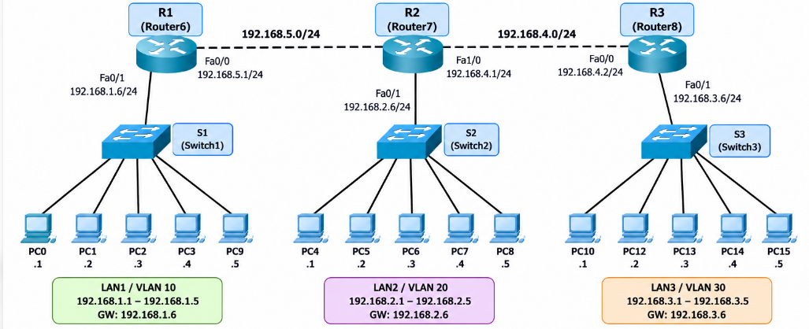
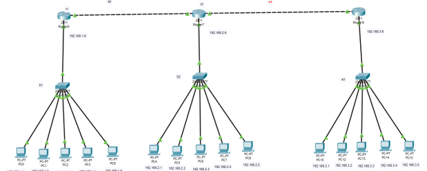
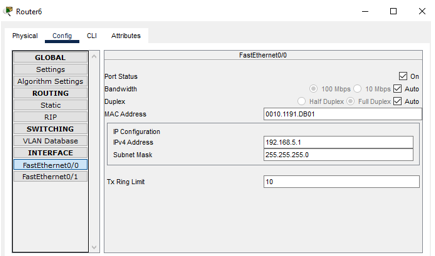
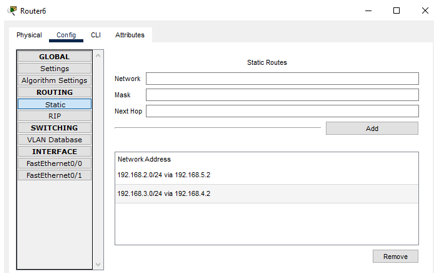
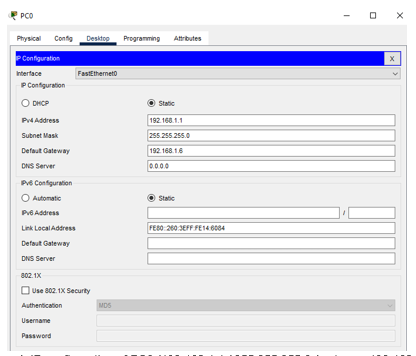
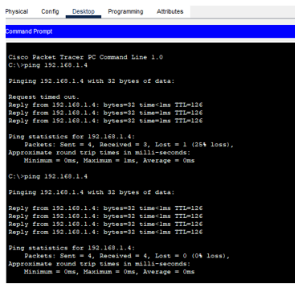
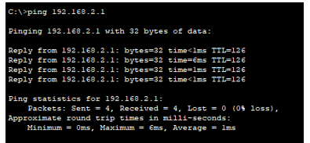

# 🧭 Static Routing Lab - Complete Guidance

<p align="center">
  
</p>

<p align="center"><b>3 Routers (2811) · 3 Switches (2960) · 15 PCs · Cisco Packet Tracer</b></p>

<p align="center">
  
  
  
  
</p>

<p align="center">
  <a href="#-overview">Overview</a> |
  <a href="#-network-topology">Topology</a> |
  <a href="#-ip-addressing-plan">IP Plan</a> |
  <a href="#-configuration">Configuration</a> |
  <a href="#-verification">Verification</a> |
  <a href="#-ping-tests">Ping Tests</a> |
  <a href="#-optional-efficient-subnetting">Subnetting</a> |
  <a href="#-challenges-and-solutions">Challenges</a> |
  <a href="#-conclusion">Conclusion</a>
</p>

## 📋 Overview

A network of **three routers, three switches and fifteen PCs** where every PC can reach every other PC using **only static routes**. The lab also covers IP addressing, VLANs on the switches, default gateways on the PCs, and testing with ping.


### 🎨 LAN Colour Key

| LAN | VLAN | Network | Gateway |
|-----|:----:|---------|---------|
| 🟥 **LAN1** | 10 | 192.168.1.0/24 | 192.168.1.6 (R1) |
| 🟧 **LAN2** | 20 | 192.168.2.0/24 | 192.168.2.6 (R2) |
| 🟨 **LAN3** | 30 | 192.168.3.0/24 | 192.168.3.6 (R3) |

## 🎯 Objective

Build and test a network where every PC reaches every other PC using only static routes.

### ✅ Requirements Checklist

| # | Lab requirement | Covered in |
|:-:|-----------------|------------|
| 1 | Topology with 3 routers, 3 switches, 15 PCs | [Topology](#-network-topology) |
| 2 | IP addresses on every router interface and every PC | [IP Plan](#-ip-addressing-plan) |
| 3 | Static routes on all routers, verify routing tables | [Static Routes](#step-4-configure-static-routes), [Verification](#-verification) |
| 4 | VLANs on Switch1, Switch2, Switch3 | [Step 2](#step-2-configure-the-switches-vlans) |
| 5 | PC IP, subnet mask and default gateway | [Step 5](#step-5-configure-the-pcs) |
| 6 | Ping PC1 to PC15 and back | [Ping Tests](#-ping-tests) |

## 🌐 Network Topology

The network is a **chain of three routers**. Each router has one LAN switch behind it with five PCs. The links between routers are point-to-point networks of their own.

<p align="center">
  
</p>

<p align="center"><i>Figure 1: Network topology in Packet Tracer</i></p>


### Cabling Plan

| From | To | Cable type | Network |
|------|----|------------|---------|
| R1 Fa0/0 | R2 Fa0/0 | Copper Cross-Over | 192.168.5.0 |
| R2 Fa1/0 | R3 Fa0/0 | Copper Cross-Over | 192.168.4.0 |
| R1 Fa0/1 | S1 Fa0/24 | Copper Straight-Through | 192.168.1.0 |
| R2 Fa0/1 | S2 Fa0/24 | Copper Straight-Through | 192.168.2.0 |
| R3 Fa0/1 | S3 Fa0/24 | Copper Straight-Through | 192.168.3.0 |
| Switch Fa0/1 to Fa0/5 | PCs (FastEthernet0) | Copper Straight-Through | LAN of that switch |

> [!IMPORTANT]
> A 2811 router has only two built-in FastEthernet ports (Fa0/0 and Fa0/1). **R2** needs three connections (R1, R3 and its switch), so it needs an extra module. See Step 1.

## 🧮 IP Addressing Plan

One /24 network per LAN, with the router gateway on **.6** and the five PCs on **.1 to .5**. The router-to-router links use 192.168.5.0/24 and 192.168.4.0/24.

### Router Interfaces

| Router | Interface | IP address | Subnet mask | Connected to |
|--------|-----------|------------|-------------|--------------|
| R1 (Router6) | Fa0/0 | 192.168.5.1 | 255.255.255.0 | R2 |
| R1 (Router6) | Fa0/1 | 192.168.1.6 | 255.255.255.0 | 🟥 Switch S1 (LAN1) |
| R2 (Router7) | Fa0/0 | 192.168.5.2 | 255.255.255.0 | R1 |
| R2 (Router7) | Fa1/0 | 192.168.4.1 | 255.255.255.0 | R3 |
| R2 (Router7) | Fa0/1 | 192.168.2.6 | 255.255.255.0 | 🟧 Switch S2 (LAN2) |
| R3 (Router8) | Fa0/0 | 192.168.4.2 | 255.255.255.0 | R2 |
| R3 (Router8) | Fa0/1 | 192.168.3.6 | 255.255.255.0 | 🟨 Switch S3 (LAN3) |

### PC Addresses

| LAN / VLAN | PCs (as in the topology) | IP addresses | Mask | Default gateway |
|------------|--------------------------|--------------|------|-----------------|
| 🟥 LAN1 / VLAN 10 | PC0, PC1, PC2, PC3, PC9 | 192.168.1.1 to .5 | 255.255.255.0 | 192.168.1.6 |
| 🟧 LAN2 / VLAN 20 | PC4, PC5, PC6, PC7, PC8 | 192.168.2.1 to .5 | 255.255.255.0 | 192.168.2.6 |
| 🟨 LAN3 / VLAN 30 | PC10, PC12, PC13, PC14, PC15 | 192.168.3.1 to .5 | 255.255.255.0 | 192.168.3.6 |

<details>
<summary><b>Exact PC-to-address mapping</b></summary>

| PC | IP address | Default gateway |
|----|------------|-----------------|
| PC0 | 192.168.1.1 | 192.168.1.6 |
| PC1 | 192.168.1.2 | 192.168.1.6 |
| PC2 | 192.168.1.3 | 192.168.1.6 |
| PC3 | 192.168.1.4 | 192.168.1.6 |
| PC9 | 192.168.1.5 | 192.168.1.6 |
| PC4 | 192.168.2.1 | 192.168.2.6 |
| PC5 | 192.168.2.2 | 192.168.2.6 |
| PC6 | 192.168.2.3 | 192.168.2.6 |
| PC7 | 192.168.2.4 | 192.168.2.6 |
| PC8 | 192.168.2.5 | 192.168.2.6 |
| PC10 | 192.168.3.1 | 192.168.3.6 |
| PC12 | 192.168.3.2 | 192.168.3.6 |
| PC13 | 192.168.3.3 | 192.168.3.6 |
| PC14 | 192.168.3.4 | 192.168.3.6 |
| PC15 | 192.168.3.5 | 192.168.3.6 |

All PCs use mask 255.255.255.0.

</details>

## 🔧 Configuration

Follow the steps in order. Finish the routers and switches before the PCs and routing.

### Step 1: Build the Topology

1. Place 3 routers (**2811**), 3 switches (**2960-24TT**) and 15 generic PCs
2. For **R2 only**: turn the router **OFF** on the Physical tab, drag an **NM-1FE-TX** module into an empty slot, then turn it back **ON**. This adds the port Fa1/0
3. Use **Copper Cross-Over** between routers (R1 to R2, R2 to R3)
4. Use **Copper Straight-Through** for router to switch and switch to PC
5. Plug the PCs into switch ports Fa0/1 to Fa0/5 and the router into switch port Fa0/24
6. Rename the devices and add text labels for the IP addresses

### Step 2: Configure the Switches (VLANs)

Each switch gets its own VLAN. The five PC ports and the router-facing port are placed in that VLAN.

<details open>
<summary><b>🟥 Switch S1 (Switch0): VLAN 10</b></summary>

```cisco
enable
configure terminal
hostname S1
vlan 10
 name LAN1
 exit
interface range fastEthernet 0/1 - 5
 switchport mode access
 switchport access vlan 10
 exit
interface fastEthernet 0/24
 switchport mode access
 switchport access vlan 10
 exit
end
copy running-config startup-config
```

</details>

<details>
<summary><b>🟧 Switch S2 (Switch1): VLAN 20</b></summary>

```cisco
enable
configure terminal
hostname S2
vlan 20
 name LAN2
 exit
interface range fastEthernet 0/1 - 5
 switchport mode access
 switchport access vlan 20
 exit
interface fastEthernet 0/24
 switchport mode access
 switchport access vlan 20
 exit
end
copy running-config startup-config
```

</details>

<details>
<summary><b>🟨 Switch S3 (Switch2): VLAN 30</b></summary>

```cisco
enable
configure terminal
hostname S3
vlan 30
 name LAN3
 exit
interface range fastEthernet 0/1 - 5
 switchport mode access
 switchport access vlan 30
 exit
interface fastEthernet 0/24
 switchport mode access
 switchport access vlan 30
 exit
end
copy running-config startup-config
```

</details>

Verify on each switch with `show vlan brief`. VLAN 10 (LAN1) should list Fa0/1 to Fa0/5 and Fa0/24 on S1; the same applies to VLAN 20 on S2 and VLAN 30 on S3.

### Step 3: Configure Router Interfaces

> [!TIP]
> `no shutdown` is needed on every interface, otherwise the port stays down.

<details open>
<summary><b>Router R1 (Router6)</b></summary>

```cisco
enable
configure terminal
hostname R1
interface fastEthernet 0/0
 description Link to R2
 ip address 192.168.5.1 255.255.255.0
 no shutdown
 exit
interface fastEthernet 0/1
 description LAN1 gateway
 ip address 192.168.1.6 255.255.255.0
 no shutdown
 exit
```

</details>

<details>
<summary><b>Router R2 (Router7)</b></summary>

```cisco
enable
configure terminal
hostname R2
interface fastEthernet 0/0
 description Link to R1
 ip address 192.168.5.2 255.255.255.0
 no shutdown
 exit
interface fastEthernet 1/0
 description Link to R3
 ip address 192.168.4.1 255.255.255.0
 no shutdown
 exit
interface fastEthernet 0/1
 description LAN2 gateway
 ip address 192.168.2.6 255.255.255.0
 no shutdown
 exit
```

</details>

<details>
<summary><b>Router R3 (Router8)</b></summary>

```cisco
enable
configure terminal
hostname R3
interface fastEthernet 0/0
 description Link to R2
 ip address 192.168.4.2 255.255.255.0
 no shutdown
 exit
interface fastEthernet 0/1
 description LAN3 gateway
 ip address 192.168.3.6 255.255.255.0
 no shutdown
 exit
```

</details>

The same values can be set in the GUI: **Config** tab, pick the interface, tick **Port Status On**, and type the IP address and mask. Example for R1 Fa0/0:

<p align="center">
  
</p>

<p align="center"><i>Figure 2: Router interface IP assignment (GUI, Config tab, FastEthernet0/0 of R1)</i></p>

### Step 4: Configure Static Routes

A router only knows the networks directly attached to it. For every other network, give the **network**, its **mask** and the **next-hop** address of the neighbouring router that is closer to it.

| Router | Does not know | Next hop to use | Why |
|--------|---------------|-----------------|-----|
| R1 | 192.168.2.0, 192.168.3.0, 192.168.4.0 | 192.168.5.2 (R2) | R2 is the only neighbour of R1 |
| R2 | 192.168.1.0 | 192.168.5.1 (R1) | R1 is on the left |
| R2 | 192.168.3.0 | 192.168.4.2 (R3) | R3 is on the right |
| R3 | 192.168.1.0, 192.168.2.0, 192.168.5.0 | 192.168.4.1 (R2) | R2 is the only neighbour of R3 |

```cisco
! R1
ip route 192.168.2.0 255.255.255.0 192.168.5.2
ip route 192.168.3.0 255.255.255.0 192.168.5.2
ip route 192.168.4.0 255.255.255.0 192.168.5.2

! R2
ip route 192.168.1.0 255.255.255.0 192.168.5.1
ip route 192.168.3.0 255.255.255.0 192.168.4.2

! R3
ip route 192.168.1.0 255.255.255.0 192.168.4.1
ip route 192.168.2.0 255.255.255.0 192.168.4.1
ip route 192.168.5.0 255.255.255.0 192.168.4.1
```

Save each router with `end` then `copy running-config startup-config`. The routes can also be added in the GUI: **Config** → **ROUTING** → **Static**.

<p align="center">
  
</p>

<p align="center"><i>Figure 3: Static routes on R1 in the GUI</i></p>

> [!WARNING]
> In this screenshot the second route is `192.168.3.0/24 via 192.168.4.2`. That next hop is R3's address on the R2-R3 link, and R1 has no interface in 192.168.4.0, so R1 cannot reach it directly. The correct next hop for 192.168.3.0 on R1 is **192.168.5.2 (R2)**, as in the commands above. Without the fix, traffic from LAN1 to LAN3 fails.

### Step 5: Configure the PCs

For every PC: **Desktop** → **IP Configuration** → **Static**, then enter the values from the [IP plan](#pc-addresses). The default gateway is the router interface of that PC's own LAN.

<p align="center">
  
</p>

<p align="center"><i>Figure 4: IP configuration of PC0 (192.168.1.1 / 255.255.255.0 / gateway 192.168.1.6)</i></p>

## 🧪 Verification

Run these before pinging. They catch most mistakes early.

```cisco
R1# show ip interface brief     (all used interfaces must be up/up)
R1# show ip route               (look for the C and S lines)
R1# show running-config
S1# show vlan brief             (ports in the correct VLAN)
S1# show interfaces status      (ports connected)
```

**Expected routing table on R1:**

```
C    192.168.1.0/24 is directly connected, FastEthernet0/1
S    192.168.2.0/24 [1/0] via 192.168.5.2
S    192.168.3.0/24 [1/0] via 192.168.5.2
S    192.168.4.0/24 [1/0] via 192.168.5.2
C    192.168.5.0/24 is directly connected, FastEthernet0/0
```

| Router | Connected (C) | Static (S) |
|--------|---------------|------------|
| **R1** | 192.168.1.0, 192.168.5.0 | 192.168.2.0, 192.168.3.0, 192.168.4.0 |
| **R2** | 192.168.2.0, 192.168.4.0, 192.168.5.0 | 192.168.1.0, 192.168.3.0 |
| **R3** | 192.168.3.0, 192.168.4.0 | 192.168.1.0, 192.168.2.0, 192.168.5.0 |

## 📡 Ping Tests

On a PC: **Desktop** → **Command Prompt**. The lab requires **PC1 to PC15** and **PC15 back to PC1**.

| Test | From | Command | Routers crossed | Expected TTL |
|------|------|---------|:---------------:|:------------:|
| Same LAN | PC0 | `ping 192.168.1.2` | 0 | 128 |
| LAN1 to LAN2 | PC1 | `ping 192.168.2.1` | 2 | 126 |
| LAN2 to LAN1 | PC4 | `ping 192.168.1.4` | 2 | 126 |
| LAN1 to LAN3 (required) | PC1 | `ping 192.168.3.5` | 3 | 125 |
| LAN3 to LAN1 (required) | PC15 | `ping 192.168.1.2` | 3 | 125 |
| LAN2 to LAN3 | PC5 | `ping 192.168.3.2` | 2 | 126 |

> [!TIP]
> The TTL proves routing works. A PC starts at TTL 128 and every router lowers it by 1: TTL 126 means 2 routers were crossed, TTL 125 means 3.

### Results

<p align="center">
  
</p>

<p align="center"><i>Figure 5: Ping 192.168.1.4. First attempt 25% loss (ARP), second attempt 0% loss</i></p>

The first ping loses one packet because the first packet waits for ARP. The second ping shows 0% loss.

<p align="center">
  
</p>

<p align="center"><i>Figure 6: Ping 192.168.2.1 from LAN1, 4 sent, 4 received, 0% loss</i></p>

## 💡 Optional: Efficient Subnetting

A /24 gives 254 hosts, but each LAN has only 5 PCs plus 1 gateway, and each router link has only 2 devices. Smaller masks waste far fewer addresses.

| Network | Needs | Mask | Usable hosts | Network address |
|---------|-------|------|:------------:|-----------------|
| LAN1 | 5 PCs + gateway = 6 | /29 (255.255.255.248) | 6 | 192.168.1.0 |
| LAN2 | 5 PCs + gateway = 6 | /29 (255.255.255.248) | 6 | 192.168.2.0 |
| LAN3 | 5 PCs + gateway = 6 | /29 (255.255.255.248) | 6 | 192.168.3.0 |
| R1-R2 link | 2 router ports | /30 (255.255.255.252) | 2 | 192.168.5.0 |
| R2-R3 link | 2 router ports | /30 (255.255.255.252) | 2 | 192.168.4.0 |

The existing host addresses already fit (usable range of 192.168.1.0/29 is .1 to .6). Only the masks change.

<details>
<summary><b>Updated static routes for the /29 and /30 masks</b></summary>

```cisco
! R1
ip route 192.168.2.0 255.255.255.248 192.168.5.2
ip route 192.168.3.0 255.255.255.248 192.168.5.2
ip route 192.168.4.0 255.255.255.252 192.168.5.2

! R2
ip route 192.168.1.0 255.255.255.248 192.168.5.1
ip route 192.168.3.0 255.255.255.248 192.168.4.2

! R3
ip route 192.168.1.0 255.255.255.248 192.168.4.1
ip route 192.168.2.0 255.255.255.248 192.168.4.1
ip route 192.168.5.0 255.255.255.252 192.168.4.1
```

</details>

> [!NOTE]
> If you use this option, change the mask **everywhere** (router interfaces, PCs and routes) so all devices agree, then repeat the tests.

## 🧱 Challenges and Solutions

| Challenge | Cause | Solution |
|-----------|-------|----------|
| R2 had no free port for the third connection | A 2811 has only Fa0/0 and Fa0/1 | Power off R2, add an NM-1FE-TX module, power on, use Fa1/0 |
| Link between routers stays red | Wrong cable type or interface shut down | Use Copper Cross-Over between routers and run `no shutdown` |
| First ping shows Request timed out | ARP resolves the MAC address on the first packet | Ping again; normal behaviour |
| Ping works inside a LAN but not between LANs | Missing static route or wrong default gateway | Check `show ip route` and the PC gateway |
| LAN1 cannot reach LAN3 | Wrong next hop on R1 (192.168.4.2 is not reachable from R1) | Use next hop 192.168.5.2 on R1 |
| Reply comes from one side only | Return route missing on the far router | Static routes are needed in both directions on every router |
| PC cannot reach its own gateway | Switch port in the wrong VLAN | Run `show vlan brief`; put Fa0/1 to Fa0/5 and Fa0/24 in the same VLAN |
| Device names differ from the lab sheet | Packet Tracer auto-names Router6, Router7, Router8 | Use the `hostname` command and text labels |

## 🏁 Conclusion

Three LANs were connected through three routers using only static routes. Each router has a route to every network it is not directly attached to, each switch is in its own VLAN, and each PC has an address and gateway in its LAN. Ping tests across the routers, including PC1 to PC15, succeeded, and the TTL values (126 and 125) matched the number of routers crossed. This confirms that the static routing configuration works.

### ✔️ Final Checklist

- [x] R2 has the extra NM-1FE-TX module (Fa1/0)
- [x] All router interfaces are up/up with the correct IPs
- [x] Each switch is in its own VLAN (10, 20, 30)
- [x] Static routes on all three routers, with R1 using next hop 192.168.5.2
- [x] Every PC has the right IP, mask and gateway
- [x] Pings between all LANs succeed with TTL 126 or 125

## 🎓 What I Learned

- Static routes need a **network, mask and next hop** for every remote network
- Routes are needed in **both directions**, or replies never return
- The next hop must be a directly reachable neighbour
- TTL shows how many routers a packet crossed
- A 2811 router needs an extra module for a third port
- Smaller masks (/29, /30) use addresses efficiently

## 🚀 How to Use This Repository

```bash
git clone https://github.com/your-username/Static-Routing.git
```

1. Rebuild the topology in Packet Tracer
2. Paste the switch and router configurations
3. Verify with `show ip route`
4. Run the ping tests

## 📞 Connect With Me

<p align="center">
  <a href="mailto:your-email@gmail.com"></a>
  <a href="https://www.linkedin.com/in/your-linkedin"></a>
  <a href="https://github.com/your-username"></a>
</p>

## 📄 License

This project is created for **educational purposes** and is open-source.

<h3 align="center">⭐ If you found this helpful, please give it a star!</h3>

<p align="center"><b>Made with ❤️ by SANAWAR IMRAN</b></p>

<p align="center"><i>Last Updated: November 2026</i></p>
