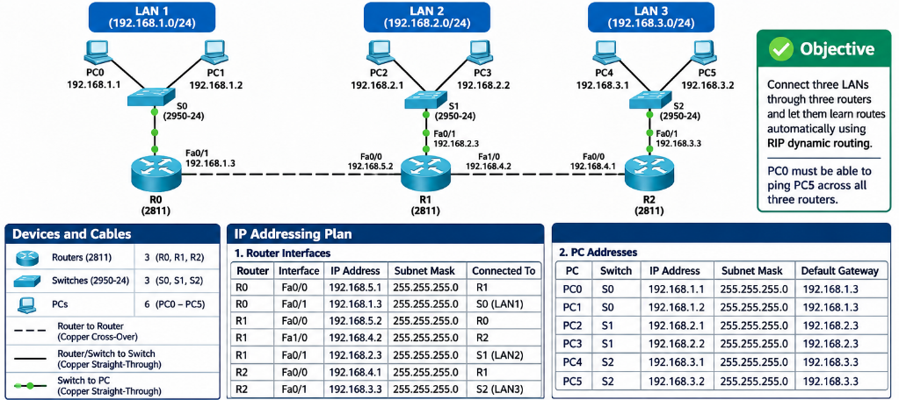
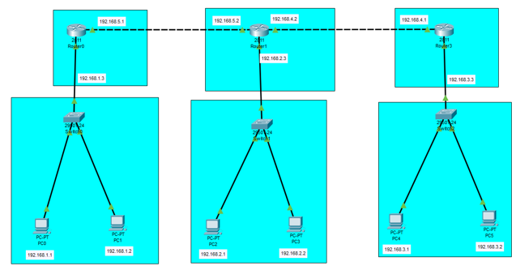
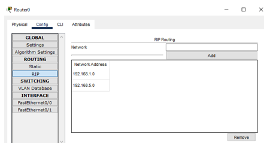
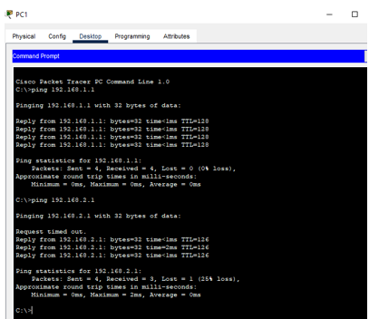

# 🔄 Dynamic Routing (RIP) Lab - Complete Guidance

<p align="center">
  
</p>

<p align="center"><b>3 Routers (2811) · 3 Switches (2950-24) · 6 PCs · Cisco Packet Tracer</b></p>

<p align="center">
  
  
  
  
  
</p>

<p align="center">
  <a href="#-overview">Overview</a> ·
  <a href="#-static-vs-dynamic-routing">Theory</a> ·
  <a href="#-network-topology">Topology</a> ·
  <a href="#-ip-addressing-plan">IP Plan</a> ·
  <a href="#-configuration">Configuration</a> ·
  <a href="#-verification">Verification</a> ·
  <a href="#-ping-tests">Ping</a> ·
  <a href="#-simulation-mode">Simulation</a> ·
  <a href="#-challenges-and-solutions">Challenges</a> ·
  <a href="#-conclusion">Conclusion</a>
</p>

## 📖 Overview

Three LANs are connected through three routers, and the routers learn each other's networks **automatically** with the **RIP** dynamic routing protocol. **No static routes are typed.** At the end, PC0 must be able to ping PC5 across all three routers.


### 🎨 LAN Colours

| LAN | Switch | Network | Router gateway | PCs |
|-----|--------|---------|----------------|-----|
| 🟪 **LAN1** | S0 | 192.168.1.0/24 | 192.168.1.3 (R0) | PC0, PC1 |
| 🟦 **LAN2** | S1 | 192.168.2.0/24 | 192.168.2.3 (R1) | PC2, PC3 |
| 🟩 **LAN3** | S2 | 192.168.3.0/24 | 192.168.3.3 (R2) | PC4, PC5 |

## 🆚 Static vs Dynamic Routing

| Point | Static routing (previous lab) | Dynamic routing (this lab) |
|-------|-------------------------------|----------------------------|
| **How routes are added** | Typed by hand on every router | Learned automatically from neighbours |
| **If a link fails** | Admin must change routes | Routers update their tables by themselves |
| **Best for** | Small, fixed networks | Larger networks that change |
| **Routing table code** | `S` | `R` (RIP) |
| **Administrative distance** | 1 | 120 for RIP |
| **Extra traffic** | None | RIP updates every 30 seconds |

> [!NOTE]
> **How RIP works:** each router announces the networks it knows to its directly connected neighbours. RIP measures distance in **hops** (routers crossed). The best route has the fewest hops, and **16 hops means unreachable**. In the lab you only tell each router which of its own directly connected networks to advertise with the `network` command.

## 🌐 Network Topology

<p align="center">
  
</p>

<p align="center"><i>Figure 1: Designed network in Packet Tracer</i></p>


> [!NOTE]
> The lab sheet calls the right-hand router **Router2**, but Packet Tracer named it **Router3** in the screenshot. They are the same device. This guide uses **R0, R1, R2** (left, middle, right) and **S0, S1, S2** for the switches.

### Devices and Cables

| Item | Quantity | Details |
|------|:--------:|---------|
| Routers | 3 | Model 2811 (R0, R1, R2) |
| Switches | 3 | Model 2950-24 (as in the lab sheet) |
| PCs | 6 | PC0 to PC5, two for each switch |
| Router to router | 2 links | Copper Cross-Over |
| Router to switch | 3 links | Copper Straight-Through |
| Switch to PC | 6 links | Copper Straight-Through |

> [!TIP]
> The lab sheet says to use the **Automatic Wire** option (lightning-bolt cable). Packet Tracer then picks the correct cable type for every connection.

## 🧮 IP Addressing Plan

Every LAN uses mask **255.255.255.0**. The router always takes **.3** in its LAN, and the PCs take **.1** and **.2**.

### Router Interfaces

| Router | Interface | IP address | Subnet mask | Connected to |
|--------|-----------|------------|-------------|--------------|
| R0 (Router0) | Fa0/0 | 192.168.5.1 | 255.255.255.0 | R1 |
| R0 (Router0) | Fa0/1 | 192.168.1.3 | 255.255.255.0 | 🟪 Switch S0 (LAN1) |
| R1 (Router1) | Fa0/0 | 192.168.5.2 | 255.255.255.0 | R0 |
| R1 (Router1) | Fa1/0 (new module) | 192.168.4.2 | 255.255.255.0 | R2 |
| R1 (Router1) | Fa0/1 | 192.168.2.3 | 255.255.255.0 | 🟦 Switch S1 (LAN2) |
| R2 (Router2 / Router3) | Fa0/0 | 192.168.4.1 | 255.255.255.0 | R1 |
| R2 (Router2 / Router3) | Fa0/1 | 192.168.3.3 | 255.255.255.0 | 🟩 Switch S2 (LAN3) |

### PC Addresses

| PC | Switch | IP address | Subnet mask | Default gateway |
|----|--------|------------|-------------|-----------------|
| PC0 | S0 | 192.168.1.1 | 255.255.255.0 | 192.168.1.3 |
| PC1 | S0 | 192.168.1.2 | 255.255.255.0 | 192.168.1.3 |
| PC2 | S1 | 192.168.2.1 | 255.255.255.0 | 192.168.2.3 |
| PC3 | S1 | 192.168.2.2 | 255.255.255.0 | 192.168.2.3 |
| PC4 | S2 | 192.168.3.1 | 255.255.255.0 | 192.168.3.3 |
| PC5 | S2 | 192.168.3.2 | 255.255.255.0 | 192.168.3.3 |

**Networks RIP will advertise:** 192.168.1.0 (LAN1), 192.168.2.0 (LAN2), 192.168.3.0 (LAN3), 192.168.4.0 (R1-R2 link) and 192.168.5.0 (R0-R1 link).

## 🔧 Configuration

### Step 1: Build the Topology

1. Place 3 routers (**2811**), 3 switches (**2950-24**) and 6 PCs
2. On **Router1 (middle) only**: open the Physical tab, turn the power **OFF**, drag the extra module into the free slot, then turn the power **ON**. Router1 needs it because it connects to three devices
3. Use **Automatic Wire** to connect each PC to its switch, each switch to its router, R0 to R1, and R1 to R2
4. Add a text label next to every port and PC with its IP address

> [!IMPORTANT]
> After adding the module, open the **Config** tab of Router1 and read the interface list on the left. Use the new port's name **exactly** as it appears. This guide writes it as `Fa1/0`; if your module shows another name (for example `Ethernet1/0`), use that name in the commands.

### Step 2: Configure the PCs

For each PC: **Desktop** → **IP Configuration** → **Static**, then enter the values from the [PC table](#pc-addresses). The default gateway is the router IP in that PC's LAN.

> [!TIP]
> The three switches need **no configuration** in this lab. All ports are in VLAN 1 by default and work as soon as they are cabled.

### Step 3: Assign IP Addresses on the Routers

**GUI method:** router → **Config** → click the interface → type the IP and mask → tick **Port Status On**. Repeat for every interface.

**CLI method:**

<details open>
<summary><b>Router0 (R0)</b></summary>

```cisco
enable
configure terminal
hostname R0
interface fastEthernet 0/1
 description LAN1 gateway
 ip address 192.168.1.3 255.255.255.0
 no shutdown
 exit
interface fastEthernet 0/0
 description Link to R1
 ip address 192.168.5.1 255.255.255.0
 no shutdown
 exit
```

</details>

<details>
<summary><b>Router1 (R1, middle router)</b></summary>

```cisco
enable
configure terminal
hostname R1
interface fastEthernet 0/1
 description LAN2 gateway
 ip address 192.168.2.3 255.255.255.0
 no shutdown
 exit
interface fastEthernet 0/0
 description Link to R0
 ip address 192.168.5.2 255.255.255.0
 no shutdown
 exit
interface fastEthernet 1/0
 description Link to R2
 ip address 192.168.4.2 255.255.255.0
 no shutdown
 exit
```

</details>

<details>
<summary><b>Router2 (R2, Router3 in the screenshot)</b></summary>

```cisco
enable
configure terminal
hostname R2
interface fastEthernet 0/1
 description LAN3 gateway
 ip address 192.168.3.3 255.255.255.0
 no shutdown
 exit
interface fastEthernet 0/0
 description Link to R1
 ip address 192.168.4.1 255.255.255.0
 no shutdown
 exit
```

</details>

Check that all interfaces are up before moving on:

```cisco
R0# show ip interface brief
```

### Step 4: Configure RIP

On each router, advertise **only the networks directly connected to it**. Never type a network that belongs to another router.

| Router | Networks to add under RIP | Why |
|--------|---------------------------|-----|
| R0 | 192.168.1.0 and 192.168.5.0 | LAN1 and the link to R1 |
| R1 | 192.168.2.0, 192.168.4.0 and 192.168.5.0 | LAN2, link to R2 and link to R0 |
| R2 | 192.168.3.0 and 192.168.4.0 | LAN3 and the link to R1 |

**GUI method:** router → **Config** → **Routing** → **RIP**. Type the network in the Network box and press **Add**.

<p align="center">
  
</p>

<p align="center"><i>Figure 2: RIP networks added on Router0 (192.168.1.0 and 192.168.5.0)</i></p>

**CLI method:**

```cisco
! Router0
router rip
 version 2
 network 192.168.1.0
 network 192.168.5.0
 no auto-summary
 end
copy running-config startup-config

! Router1
router rip
 version 2
 network 192.168.2.0
 network 192.168.4.0
 network 192.168.5.0
 no auto-summary
 end
copy running-config startup-config

! Router2
router rip
 version 2
 network 192.168.3.0
 network 192.168.4.0
 no auto-summary
 end
copy running-config startup-config
```

> [!WARNING]
> The GUI RIP page uses **RIP version 1** by default. It works here because every network is a separate classful 192.168.x.0/24. The CLI commands above use **version 2** (carries the subnet mask, no auto-summary), which is better practice. Use the **same version on all three routers**.

## 🧪 Verification

Wait **30 to 60 seconds** after configuring RIP, because updates are sent every 30 seconds. Then run:

```cisco
R0# show ip route
R0# show ip protocols
R0# show ip rip database
```

**Expected routing table on R0** (`R` = learned by RIP, `C` = directly connected):

```
C    192.168.1.0/24 is directly connected, FastEthernet0/1
R    192.168.2.0/24 [120/1] via 192.168.5.2, FastEthernet0/0
R    192.168.3.0/24 [120/2] via 192.168.5.2, FastEthernet0/0
R    192.168.4.0/24 [120/1] via 192.168.5.2, FastEthernet0/0
C    192.168.5.0/24 is directly connected, FastEthernet0/0
```

The number after the slash is the **hop count**. 192.168.3.0 shows `[120/2]` because it is two routers away from R0.

| Router | Directly connected (C) | Learned by RIP (R) |
|--------|------------------------|--------------------|
| **R0** | 192.168.1.0, 192.168.5.0 | 192.168.2.0 [120/1], 192.168.3.0 [120/2], 192.168.4.0 [120/1] |
| **R1** | 192.168.2.0, 192.168.4.0, 192.168.5.0 | 192.168.1.0 [120/1], 192.168.3.0 [120/1] |
| **R2** | 192.168.3.0, 192.168.4.0 | 192.168.1.0 [120/2], 192.168.2.0 [120/1], 192.168.5.0 [120/1] |

## 📡 Ping Tests

On a PC: **Desktop** → **Command Prompt**. The lab sheet requires **PC0 to PC5**; the other paths prove all LANs are connected.

| Test | From | Command | Routers crossed | Expected TTL |
|------|------|---------|:---------------:|:------------:|
| Same LAN | PC1 | `ping 192.168.1.1` | 0 | 128 |
| LAN1 to LAN2 | PC1 | `ping 192.168.2.1` | 2 | 126 |
| LAN1 to LAN3 (required) | PC0 | `ping 192.168.3.2` | 3 | 125 |
| LAN3 to LAN1 | PC5 | `ping 192.168.1.1` | 3 | 125 |
| LAN2 to LAN3 | PC2 | `ping 192.168.3.1` | 2 | 126 |

### Result: Ping from PC1

<p align="center">
  
</p>

<p align="center"><i>Figure 3: Ping results from PC1 (same LAN TTL 128, then LAN2 TTL 126)</i></p>

```
ping 192.168.1.1  → 4 replies, TTL 128 (same LAN, no routers)       ✅
ping 192.168.2.1  → first packet timed out (ARP), then 3 replies, TTL 126 (2 routers) ✅
```

> [!TIP]
> The first packet to another LAN times out because it is used for ARP. This is normal; ping again for 4 of 4 replies. TTL starts at 128 and each router lowers it by 1, so **TTL 126 = 2 routers** and **TTL 125 = 3 routers**.

> [!NOTE]
> The required PC0 to PC5 test (TTL 125) is not in the screenshots above. Run `ping 192.168.3.2` from PC0 and add its screenshot as `images/Screenshot_4.png`.

## 🎬 Simulation Mode

1. Open the **Simulation** tab (bottom right) or press **Shift + S**
2. Click **Add Simple PDU** (closed envelope icon)
3. Click **PC0**, then **PC5**
4. Press **Play**, or use **Capture / Forward**, and watch the packet travel: PC0 → S0 → R0 → R1 → R2 → S2 → PC5
5. The **Last Status** column must say **Successful**

You can filter events to show only **ICMP** and **RIP** so the RIP updates between routers are visible.

## 🧱 Challenges and Solutions

| Challenge | Cause | Solution |
|-----------|-------|----------|
| Router1 has no free port | A 2811 has only Fa0/0 and Fa0/1 built in | Power off, add the module, power on, then use the new port |
| Interface shows red or down | Port status off, or wrong cable | Tick **Port Status On** (or `no shutdown`); use Automatic Wire |
| Ping to another LAN fails right after setup | RIP has not converged yet | Wait 30 to 60 seconds and check `show ip route` |
| First ping shows Request timed out | ARP is resolving MAC addresses | Ping again; this is normal |
| No `R` lines in the routing table | A `network` command is missing or mistyped | Check `show ip protocols` and add the missing network |
| A router advertises a wrong network | Typed a network that is not directly connected | Remove it with `no network` and add only connected networks |
| PC can ping its router but not other LANs | Wrong default gateway on the PC | Set the gateway to the router IP of its own LAN |
| Router names differ from the sheet | Packet Tracer names the right router Router3 | Use the `hostname` command and text labels |

## 🏁 Conclusion

Three LANs were connected through three routers using the **RIP** dynamic routing protocol. After each router advertised its directly connected networks, all routers learned the remaining networks automatically. A ping from PC0 to PC5 succeeds with a TTL showing three routers crossed, which confirms that dynamic routing works without any static routes.

### ✔️ Final Checklist

- [x] Router1 has the extra module for its third port
- [x] All router interfaces are up/up with the correct IPs
- [x] RIP configured on all three routers with the same version
- [x] Only directly connected networks advertised on each router
- [x] `show ip route` shows `R` lines on every router
- [x] Pings between all LANs succeed with TTL 126 or 125

## 🎓 What I Learned

- Dynamic routing removes the need to type routes on every router
- With RIP you advertise only **directly connected** networks
- RIP counts **hops**, and 16 hops means unreachable
- RIP needs 30 to 60 seconds to converge
- Use the same RIP version on every router, and `no auto-summary` with version 2
- Reading `R` and `C` lines in `show ip route`, and what `[120/2]` means

## 🚀 How to Use This Repository

```bash
git clone https://github.com/your-username/Dynamic-Routing.git
```

1. Rebuild the topology in Packet Tracer
2. Paste the router configurations
3. Wait for RIP to converge and verify with `show ip route`
4. Run the ping tests and the simulation

## 📞 Connect With Me

<p align="center">
  <a href="mailto:your-email@gmail.com"></a>
  <a href="https://www.linkedin.com/in/your-linkedin"></a>
  <a href="https://github.com/your-username"></a>
</p>

## 📄 License

This project is created for **educational purposes** and is open-source.

<h3 align="center">⭐ If you found this helpful, please give it a star!</h3>

<p align="center"><b>Made with 💜 by SANAWAR IMRAN</b></p>

<p align="center"><i>Last Updated: November 2026</i></p>
