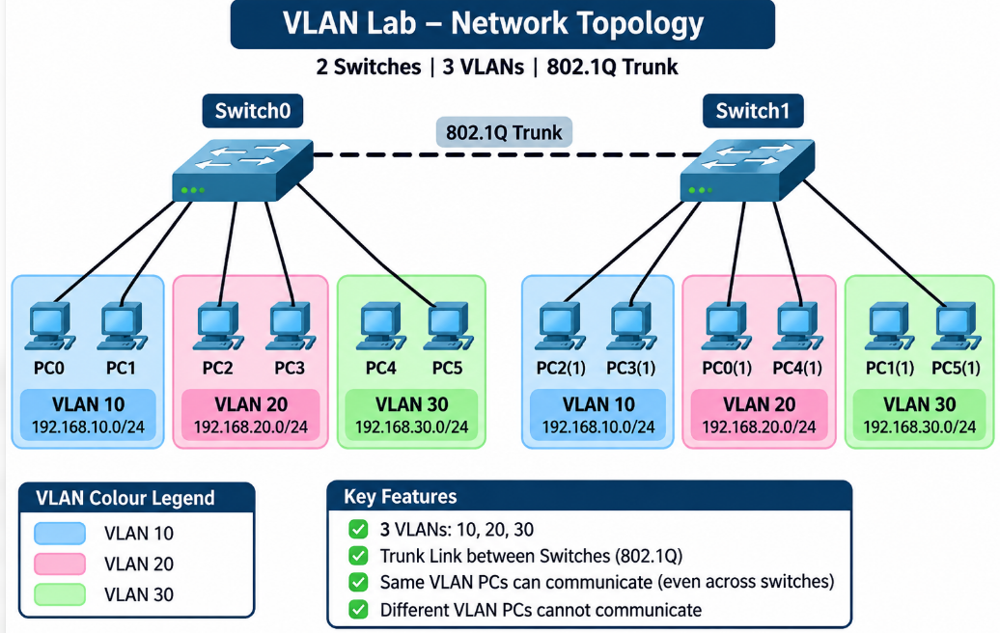
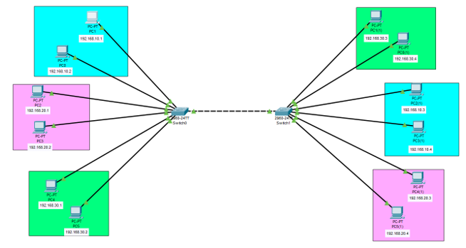
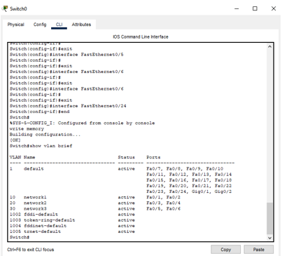
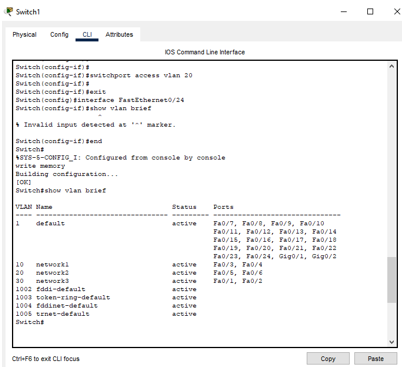
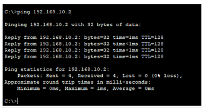
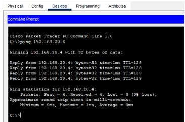
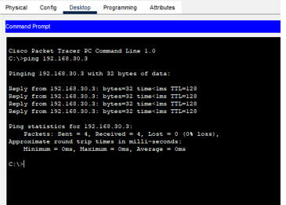

# 🧩 VLAN Lab - Trunking Between Two Switches

<p align="center">
  
</p>

<p align="center"><b>2 Switches (2960-24TT) · 12 PCs · 3 VLANs · 802.1Q Trunk · Cisco Packet Tracer</b></p>

<p align="center">
  
  
  
  
  
</p>

<p align="center">
  <a href="#-overview">Overview</a> |
  <a href="#-theory">Theory</a> |
  <a href="#-network-topology">Topology</a> |
  <a href="#-addressing-and-port-plan">Plan</a> |
  <a href="#-configuration">Configuration</a> |
  <a href="#-verification">Verification</a> |
  <a href="#-ping-tests">Ping Tests</a> |
  <a href="#-viva-questions">Viva</a>
</p>

### 🎯 Objective

Divide two switches into **three VLANs (10, 20 and 30)**, place the PCs in their VLANs, join the switches with a **trunk link**, and prove that:

- ✅ PCs in the **same VLAN** can talk to each other, even across the two switches
- ❌ PCs in **different VLANs** cannot talk to each other

### 🎨 VLAN Colour Key

Colours match the topology figure. Each VLAN has 2 PCs on Switch0 and 2 PCs on Switch1.

| VLAN | Name | Subnet | Colour |
|:----:|------|--------|--------|
| **10** | VLAN10 | 192.168.10.0/24 | 🟦 Blue |
| **20** | VLAN20 | 192.168.20.0/24 | 🌸 Pink |
| **30** | VLAN30 | 192.168.30.0/24 | 🟩 Green |

## 🧠 Theory

### What is a VLAN?

A **VLAN (Virtual LAN)** splits one physical switch into several separate logical networks. PCs in different VLANs cannot talk to each other directly, even if they are plugged into the same switch. Each VLAN is normally one IP subnet. This gives better security, smaller broadcast domains and easier management.

### Access Port vs Trunk Port

| Port type | Carries | Used for | Command |
|-----------|---------|----------|---------|
| **Access** | Traffic of **one** VLAN (no tag) | Switch to PC | `switchport mode access` |
| **Trunk** | Traffic of **many** VLANs, each frame tagged with 802.1Q | Switch to switch (or to a router) | `switchport mode trunk` |

The trunk is what lets VLAN 10 on Switch0 reach VLAN 10 on Switch1. Without it, each switch is isolated and only PCs on the same switch can communicate.

> [!NOTE]
> **Why cross-VLAN ping must fail:** different VLANs are different subnets and different broadcast domains. A router or Layer 3 switch is needed to route between them. This lab has **no router**, so the default gateway is left blank and cross-VLAN pings are expected to fail. That failure is a **correct result**, not an error.

## 🌐 Network Topology

<p align="center">
  
</p>

<p align="center"><i>Figure 1: VLAN topology in Packet Tracer (blue = VLAN 10, pink = VLAN 20, green = VLAN 30)</i></p>

> [!NOTE]
> The Switch1 PCs appear as PC0(1) to PC5(1) in Packet Tracer. You may rename them PC6 to PC11. The two switches are joined by **Fa0/24 on both**.

## 🧮 Addressing and Port Plan

All PCs use mask **255.255.255.0**. The **default gateway is left blank** because there is no inter-VLAN routing.

### Switch0

| Port | PC | VLAN | IP address |
|------|----|:----:|------------|
| Fa0/1 | PC0 | 🟦 10 | 192.168.10.2 |
| Fa0/2 | PC1 | 🟦 10 | 192.168.10.1 |
| Fa0/3 | PC2 | 🌸 20 | 192.168.20.1 |
| Fa0/4 | PC3 | 🌸 20 | 192.168.20.2 |
| Fa0/5 | PC4 | 🟩 30 | 192.168.30.1 |
| Fa0/6 | PC5 | 🟩 30 | 192.168.30.2 |
| Fa0/24 | Trunk to Switch1 | 10, 20, 30 | - |

### Switch1

| Port | PC (name in Packet Tracer) | VLAN | IP address |
|------|----------------------------|:----:|------------|
| Fa0/1 | PC1(1) | 🟩 30 | 192.168.30.3 |
| Fa0/2 | PC0(1) | 🟩 30 | 192.168.30.4 |
| Fa0/3 | PC2(1) | 🟦 10 | 192.168.10.3 |
| Fa0/4 | PC3(1) | 🟦 10 | 192.168.10.4 |
| Fa0/5 | PC4(1) | 🌸 20 | 192.168.20.3 |
| Fa0/6 | PC5(1) | 🌸 20 | 192.168.20.4 |
| Fa0/24 | Trunk to Switch0 | 10, 20, 30 | - |

> [!IMPORTANT]
> The two switches map ports to VLANs **differently**: on Switch0 Fa0/1-2 is VLAN 10, but on Switch1 Fa0/1-2 is VLAN 30. Follow the tables, not the port order.

## 🔧 Configuration

### Step 1: Build the Topology

1. Add two **2960-24TT** switches (Switch0 and Switch1) and **12 PCs**
2. Connect each PC to its switch port with **Copper Straight-Through** cables (see the port tables)
3. Connect **Switch0 Fa0/24** to **Switch1 Fa0/24** with a **Copper Cross-Over** cable (the dashed line). Packet Tracer also accepts a straight cable on 2960 switches because of auto-MDIX
4. Add coloured rectangles and IP labels as in Figure 1

### Step 2: Configure the PCs

For each PC: **Desktop** → **IP Configuration** → **Static**, enter the IP address from the tables and mask `255.255.255.0`. **Leave Default Gateway empty.**

<details>
<summary><b>All 12 PC addresses</b></summary>

| PC | IP address | Mask | Gateway |
|----|------------|------|---------|
| PC0 | 192.168.10.2 | 255.255.255.0 | blank |
| PC1 | 192.168.10.1 | 255.255.255.0 | blank |
| PC2 | 192.168.20.1 | 255.255.255.0 | blank |
| PC3 | 192.168.20.2 | 255.255.255.0 | blank |
| PC4 | 192.168.30.1 | 255.255.255.0 | blank |
| PC5 | 192.168.30.2 | 255.255.255.0 | blank |
| PC1(1) | 192.168.30.3 | 255.255.255.0 | blank |
| PC0(1) | 192.168.30.4 | 255.255.255.0 | blank |
| PC2(1) | 192.168.10.3 | 255.255.255.0 | blank |
| PC3(1) | 192.168.10.4 | 255.255.255.0 | blank |
| PC4(1) | 192.168.20.3 | 255.255.255.0 | blank |
| PC5(1) | 192.168.20.4 | 255.255.255.0 | blank |

</details>

### Step 3: Configure Switch0

One block does the hostname, VLAN creation, access ports and the trunk.

<details open>
<summary><b>🟦🌸🟩 Switch0 commands</b></summary>

```cisco
enable
configure terminal
hostname Switch0
vlan 10
 name VLAN10
vlan 20
 name VLAN20
vlan 30
 name VLAN30
 exit
interface range fastEthernet 0/1 - 2
 switchport mode access
 switchport access vlan 10
 exit
interface range fastEthernet 0/3 - 4
 switchport mode access
 switchport access vlan 20
 exit
interface range fastEthernet 0/5 - 6
 switchport mode access
 switchport access vlan 30
 exit
interface fastEthernet 0/24
 switchport mode trunk
 switchport trunk allowed vlan 10,20,30
 exit
end
write memory
```

</details>

### Step 4: Configure Switch1

Same VLANs, but the ports are grouped differently: **VLAN 30 on Fa0/1-2, VLAN 10 on Fa0/3-4 and VLAN 20 on Fa0/5-6**.

<details open>
<summary><b>🟩🟦🌸 Switch1 commands</b></summary>

```cisco
enable
configure terminal
hostname Switch1
vlan 10
 name VLAN10
vlan 20
 name VLAN20
vlan 30
 name VLAN30
 exit
interface range fastEthernet 0/1 - 2
 switchport mode access
 switchport access vlan 30
 exit
interface range fastEthernet 0/3 - 4
 switchport mode access
 switchport access vlan 10
 exit
interface range fastEthernet 0/5 - 6
 switchport mode access
 switchport access vlan 20
 exit
interface fastEthernet 0/24
 switchport mode trunk
 switchport trunk allowed vlan 10,20,30
 exit
end
write memory
```

</details>

> [!TIP]
> **Trunk command note:** do not type `switchport trunk encapsulation dot1q`. The 2960 in Packet Tracer supports only 802.1Q, so that command is rejected with *Invalid input detected*.

> [!TIP]
> **Typing tip:** `show` commands only work in privileged mode. If you are in interface mode, type `end` first, or put `do` in front (for example `do show vlan brief`).

## 🧪 Verification

Run on **both switches**:

```cisco
show vlan brief
show interfaces trunk
```

### Expected `show vlan brief`

**Switch0:**

```
VLAN Name       Status    Ports
---- ---------- --------- -------------------------------
1    default    active    Fa0/7, Fa0/8, ... Fa0/23, Gig0/1, Gig0/2
10   VLAN10     active    Fa0/1, Fa0/2
20   VLAN20     active    Fa0/3, Fa0/4
30   VLAN30     active    Fa0/5, Fa0/6
```

**Switch1:**

```
10   VLAN10     active    Fa0/3, Fa0/4
20   VLAN20     active    Fa0/5, Fa0/6
30   VLAN30     active    Fa0/1, Fa0/2
```

<p align="center">
  
</p>

<p align="center"><i>Figure 2: show vlan brief on Switch0 (VLAN 10 = Fa0/1-2, VLAN 20 = Fa0/3-4, VLAN 30 = Fa0/5-6)</i></p>

<p align="center">
  
</p>

<p align="center"><i>Figure 3: show vlan brief on Switch1 (VLAN 30 = Fa0/1-2, VLAN 10 = Fa0/3-4, VLAN 20 = Fa0/5-6)</i></p>

### Expected `show interfaces trunk` (both switches)

```
Port    Mode   Encapsulation  Status     Native vlan
Fa0/24  on     802.1q         trunking   1

Port    Vlans allowed on trunk
Fa0/24  10,20,30

Port    Vlans allowed and active in management domain
Fa0/24  10,20,30
```

> [!WARNING]
> **Check the trunk.** In Figures 2 and 3, Fa0/24 is listed under VLAN 1 (default). A working trunk port is **not** listed in `show vlan brief`, so this means Fa0/24 was still an access port when those screenshots were taken. Run `show interfaces trunk` on both switches; if it shows nothing, apply the Fa0/24 commands from Steps 3 and 4. Without the trunk, pings **across** the switches will fail.

## 📡 Ping Tests

On a PC: **Desktop** → **Command Prompt**. Test three things: same VLAN on the same switch, same VLAN across the trunk, and different VLANs.

| # | Test | From | Command | Expected result |
|:-:|------|------|---------|-----------------|
| 1 | Same VLAN, same switch (VLAN10) | PC0 | `ping 192.168.10.1` | ✅ Success, TTL 128 |
| 2 | Same VLAN, same switch (VLAN20) | PC2 | `ping 192.168.20.2` | ✅ Success, TTL 128 |
| 3 | Same VLAN, same switch (VLAN30) | PC4 | `ping 192.168.30.2` | ✅ Success, TTL 128 |
| 4 | Same VLAN, across trunk (VLAN10) | PC0 | `ping 192.168.10.3` | ✅ Success (needs trunk) |
| 5 | Same VLAN, across trunk (VLAN20) | PC2 | `ping 192.168.20.3` | ✅ Success (needs trunk) |
| 6 | Same VLAN, across trunk (VLAN30) | PC4 | `ping 192.168.30.3` | ✅ Success (needs trunk) |
| 7 | Different VLAN, same switch | PC0 | `ping 192.168.20.1` | ❌ Request timed out |
| 8 | Different VLAN, across trunk | PC0 | `ping 192.168.30.3` | ❌ Request timed out |
| 9 | Different VLAN, across trunk | PC2 | `ping 192.168.10.4` | ❌ Request timed out |

TTL is **128 on every successful ping** because no router is crossed. The first ping may lose one packet while ARP finds the MAC address; ping again.

### Results

**VLAN 10:**

<p align="center">
  
</p>

<p align="center"><i>Figure 4: Ping 192.168.10.2, 4 sent, 4 received, 0% loss (VLAN 10)</i></p>

**VLAN 20 (a PC on Switch1):**

<p align="center">
  
</p>

<p align="center"><i>Figure 5: Ping 192.168.20.4, 4 sent, 4 received, 0% loss (VLAN 20)</i></p>

**VLAN 30 (a PC on Switch1):**

<p align="center">
  
</p>

<p align="center"><i>Figure 6: Ping 192.168.30.3, 4 sent, 4 received, 0% loss (VLAN 30)</i></p>

> [!NOTE]
> The failing cross-VLAN pings (tests 7 to 9) and the `show interfaces trunk` output are not in the screenshots above. Capture them and add them as `images/Screenshot_7.png` and `images/Screenshot_8.png`. The source PC name is not visible in the command window, so write it under each ping figure.

## 🔬 Optional: Proof that the Trunk Matters

1. On Switch0 run `interface fastEthernet 0/24`, then `switchport mode access`, then `end`
2. From PC0 run `ping 192.168.10.3`. It now **fails** because VLAN 10 traffic cannot leave Switch0
3. Re-apply `switchport mode trunk` on Fa0/24. The ping **succeeds again**

## 📌 Quick Command Reference

| Purpose | Command |
|---------|---------|
| Create VLAN | `vlan 10` then `name VLAN10` |
| Set access port | `switchport mode access` |
| Put port in VLAN | `switchport access vlan 10` |
| Set trunk port | `switchport mode trunk` |
| Limit VLANs on trunk | `switchport trunk allowed vlan 10,20,30` |
| Show VLANs | `show vlan brief` |
| Show trunks | `show interfaces trunk` |
| Save | `write memory` (or `copy running-config startup-config`) |

## 🧱 Challenges and Solutions

| Challenge | Cause | Solution |
|-----------|-------|----------|
| *Invalid input detected at ^ marker* | A `show` command typed in interface mode, or the trunk encapsulation command on a 2960 | Type `end` first (or use `do show ...`); omit the encapsulation command |
| Ping works inside a switch but not across switches | Trunk missing, or a VLAN missing on one switch | Run `show interfaces trunk`; create the VLANs on both switches |
| A PC cannot reach its neighbour in the same VLAN | PC port in the wrong VLAN, or IP in the wrong subnet | Check `show vlan brief` and the PC IP address |
| Cross-VLAN ping unexpectedly works | Two PCs ended up in the same VLAN, or a router is present | Re-check the port assignment |
| VLAN 1 still shows many ports | Unused ports are in the default VLAN | Normal; only the used ports need to move |
| Trunk link shows red or down | Port shut down or wrong cable | `no shutdown`; use a cross-over (or straight) cable on Fa0/24 |
| Configuration lost after reload | Not saved | Run `write memory` |

## 🎤 Viva Questions

<details>
<summary><b>Click to expand questions and answers</b></summary>

| Question | Answer |
|----------|--------|
| What is a VLAN? | A logical network created inside a switch that separates devices into different broadcast domains. |
| Why use VLANs? | Security, smaller broadcast domains, easier management and grouping by role instead of location. |
| What is a trunk port? | A port that carries traffic of many VLANs between switches, using 802.1Q tags. |
| What is 802.1Q? | The standard that adds a VLAN tag to Ethernet frames on trunk links. |
| Difference between access and trunk? | Access carries one VLAN to an end device; trunk carries many VLANs between network devices. |
| Why did cross-VLAN ping fail? | Different VLANs are different subnets and broadcast domains, and there is no router to connect them. |
| How do you let VLANs talk to each other? | Use a router (router-on-a-stick with sub-interfaces) or a Layer 3 switch. |
| What is the default VLAN? | VLAN 1. All ports start in it. |
| What is the native VLAN? | The VLAN whose frames are sent untagged on a trunk. The default is VLAN 1. |
| What does `show vlan brief` display? | The VLANs and the access ports that belong to each one. Trunk ports are not listed. |

</details>

## 🏁 Conclusion

Two switches were configured with **VLANs 10, 20 and 30**, PCs were placed in their VLANs with access ports, and the switches were joined with an **802.1Q trunk on Fa0/24**. PCs in the same VLAN communicated even across the two switches, while PCs in different VLANs could not communicate because no router was present. This shows that VLANs separate a network logically and that a trunk extends the VLANs across switches.

### ✔️ Final Checklist

- [x] VLANs 10, 20 and 30 created on both switches
- [x] Access ports assigned correctly on each switch
- [x] Fa0/24 configured as a trunk on both switches
- [x] All 12 PCs have static IPs with no gateway
- [x] Same-VLAN pings succeed within a switch and across the trunk
- [x] Cross-VLAN pings fail

## 🎓 What I Learned

- Creating VLANs and assigning access ports on both switches
- Configuring an 802.1Q trunk and limiting the allowed VLANs
- Why same-VLAN traffic crosses the trunk but cross-VLAN traffic does not
- Reading `show vlan brief` and `show interfaces trunk`
- Why inter-VLAN communication needs a router or Layer 3 switch

## 🚀 How to Use This Repository

```bash
git clone https://github.com/your-username/VLAN-Trunk-Lab.git
```

1. Rebuild the topology in Packet Tracer
2. Paste the Switch0 and Switch1 configurations
3. Verify with `show vlan brief` and `show interfaces trunk`
4. Run the nine ping tests

## 📞 Connect With Me

<p align="center">
  <a href="mailto:your-email@gmail.com"></a>
  <a href="https://www.linkedin.com/in/your-linkedin"></a>
  <a href="https://github.com/your-username"></a>
</p>

## 📄 License

This project is created for **educational purposes** and is open-source.

<h3 align="center">⭐ If you found this helpful, please give it a star!</h3>

<p align="center"><b>Made with 💙 by SANAWAR IMRAN</b></p>

<p align="center"><i>Last Updated: November 2026</i></p>
