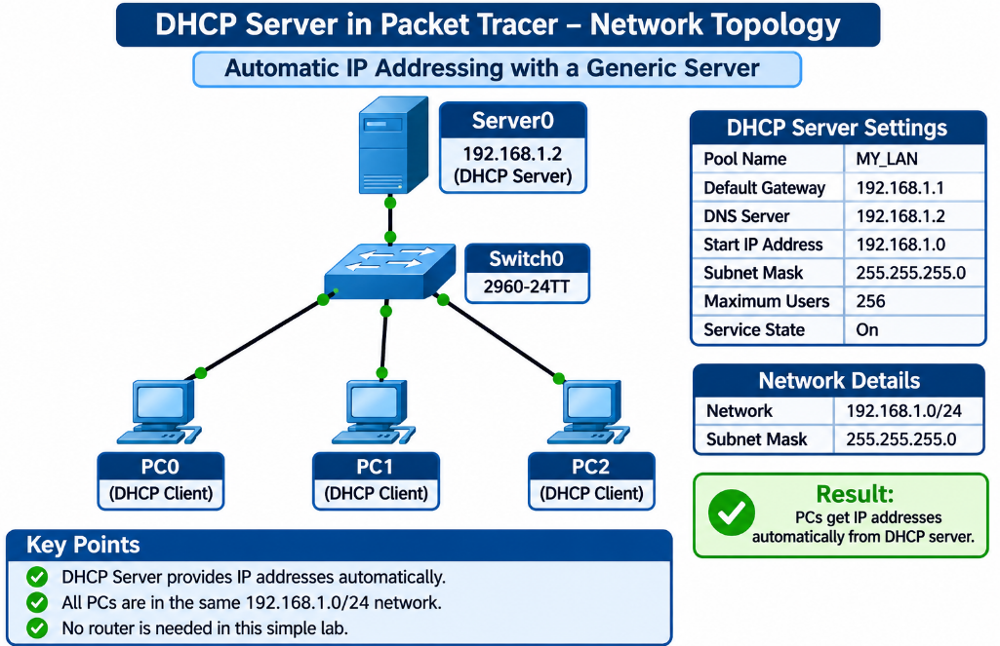
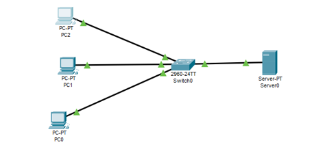
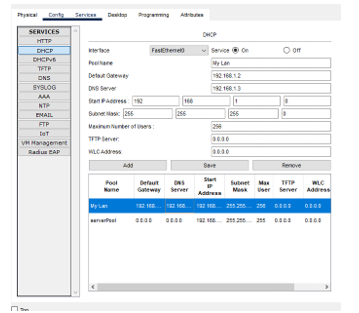
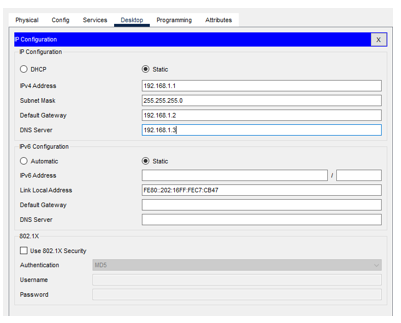
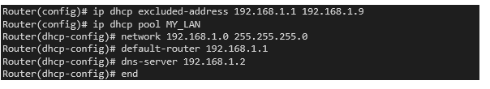

# 📡 DHCP Server in Packet Tracer - Complete Guide

<p align="center">
  
</p>

<p align="center"><b>Automatic IP Addressing with a Generic Server · Network 192.168.1.0/24</b></p>

<p align="center">
  
  
  
</p>

<p align="center">
  <a href="#-what-is-dhcp">What is DHCP</a> |
  <a href="#-lab-overview">Lab Overview</a> |
  <a href="#-configuration">Configuration</a> |
  <a href="#-verification">Verification</a> |
  <a href="#-settings-explained">Settings</a> |
  <a href="#-troubleshooting">Troubleshooting</a> |
  <a href="#-real-world-equivalent-dhcp-on-a-cisco-router">Router DHCP</a> |
  <a href="#-summary-and-checklist">Summary</a>
</p>

> [!NOTE]
> **Who is this for?** Anyone setting up their first DHCP server. You will build a small network, turn a generic server into a DHCP server, and make three PCs configure themselves automatically.

## 📖 What Is DHCP?

The **Dynamic Host Configuration Protocol (DHCP)** gives network settings to devices automatically. Without it, every PC needs its IP address, subnet mask, default gateway and DNS server typed in by hand. With DHCP, a server hands out these settings when a device joins the network.

### Why Use DHCP?

| | Benefit |
|:-:|---------|
| ⏱️ | **Saves time:** no manual setup on every PC |
| 🎯 | **Avoids mistakes:** no duplicate addresses or typing errors |
| 🔁 | **Easy changes:** update the settings once on the server instead of on every device |
| ♻️ | **Addresses are reused:** a leased address returns to the pool when it is no longer needed |

### How a PC Gets Its Address (DORA)

```
PC (client)                                   DHCP Server
    |  1. DISCOVER  "Is there a DHCP server?"       |
    | --------------------------------------------> |
    |  2. OFFER     "Here is 192.168.1.x + settings"|
    | <-------------------------------------------- |
    |  3. REQUEST   "I accept that address"         |
    | --------------------------------------------> |
    |  4. ACKNOWLEDGE "Confirmed, use it for the lease time" |
    | <-------------------------------------------- |
```

| Step | Message | What happens |
|:----:|---------|--------------|
| 1 | **Discover** | The PC broadcasts a request: "Is there a DHCP server?" |
| 2 | **Offer** | The server replies with an available IP address and the network settings |
| 3 | **Request** | The PC answers that it accepts the offered address |
| 4 | **Acknowledge** | The server confirms and the PC starts using the address for the lease time |

### What the Server Hands Out

| Setting | Meaning |
|---------|---------|
| **IP address** | The PC's own address, taken from the pool |
| **Subnet mask** | Tells the PC which addresses are on its own network |
| **Default gateway** | The router address used to reach other networks |
| **DNS server** | The server that turns names into IP addresses |

## 🧰 Lab Overview

One switch, one generic server and three PCs. The server has a **fixed (static)** address and runs the DHCP service. The PCs are set to obtain their settings **automatically**.

<p align="center">
  
</p>

<p align="center"><i>Figure 1: Topology with three PCs and a server connected to Switch0</i></p>

### Devices

| Device | Packet Tracer type | Role |
|--------|--------------------|------|
| **Server0** | Server-PT (generic server) | Static address 192.168.1.2; DHCP server |
| **Switch0** | 2960-24TT | Connects the server and the PCs |
| **PC0, PC1, PC2** | PC-PT | DHCP clients |

### DHCP Parameters

| Parameter | Value | Where it is set |
|-----------|-------|-----------------|
| **Server static IP address** | 192.168.1.2 | Server → Desktop → IP Configuration |
| **Server subnet mask** | 255.255.255.0 | Server → Desktop → IP Configuration |
| **Pool name** | MY_LAN | Server → Services → DHCP |
| **Default gateway** | 192.168.1.1 | Server → Services → DHCP |
| **DNS server** | 192.168.1.2 | Server → Services → DHCP |
| **Start IP address** | 192.168.1.0 | Server → Services → DHCP |
| **Subnet mask** | 255.255.255.0 | Server → Services → DHCP |
| **Maximum number of users** | 256 | Server → Services → DHCP |
| **Service state** | On | Server → Services → DHCP |

> [!TIP]
> There is **no router** in this lab, so nothing actually answers at the gateway address 192.168.1.1. The PCs still receive the setting and can talk to each other and to the server, because they are all on the same network.

## 🔧 Configuration

### Step 1: Build the Topology

1. Place one **Server-PT**, one **2960-24TT** switch and three **PC-PT** devices
2. Use **copper straight-through** cables to connect each PC (FastEthernet0) and the server (FastEthernet0) to a port on Switch0
3. Wait until all link lights turn **green**

### Step 2: Give the Server a Static IP Address

A DHCP server cannot get its own address from DHCP, so it needs a fixed one.

1. Click **Server0** → **Desktop** tab
2. Choose **IP Configuration** and select **Static**
3. Enter the values below and close the window

| Field | Value |
|-------|-------|
| **IPv4 Address** | 192.168.1.2 |
| **Subnet Mask** | 255.255.255.0 |
| **Default Gateway** | 192.168.1.1 (optional) |
| **DNS Server** | 192.168.1.2 |

### Step 3: Configure the DHCP Service

1. Click **Server0** → **Services** tab
2. Select **DHCP** in the left menu
3. Make sure the **Service** option at the top is **On**
4. Fill in the pool settings below
5. Click **Add**, then **Save**. The new pool appears in the list at the bottom

| Field | Value to enter |
|-------|----------------|
| **Pool Name** | MY_LAN |
| **Default Gateway** | 192.168.1.1 |
| **DNS Server** | 192.168.1.2 |
| **Start IP Address** | 192.168.1.0 |
| **Subnet Mask** | 255.255.255.0 |
| **Maximum Number of Users** | 256 |

<p align="center">
  
</p>

<p align="center"><i>Figure 2: DHCP service screen on the server (Services → DHCP)</i></p>

> [!NOTE]
> Packet Tracer already has a default pool called **serverPool** with empty (0.0.0.0) settings. Leave it unused or remove it so only your **MY_LAN** pool hands out addresses.

> [!WARNING]
> The values visible in Figure 2 (pool name "My Lan", gateway 192.168.1.2, DNS 192.168.1.3) do **not** match the table above (MY_LAN, gateway 192.168.1.1, DNS 192.168.1.2). Make the screen match the table and retake the screenshot so the figure and the guide agree.

### Step 4: Set Each PC to Obtain Its Address Automatically

1. Click the PC → **Desktop** tab
2. Choose **IP Configuration**
3. Select **DHCP** instead of Static
4. Wait a moment. The window shows **"DHCP request successful"** and fills in the IP address, subnet mask, default gateway and DNS server
5. Repeat for the other two PCs

<p align="center">
  
</p>

<p align="center"><i>Figure 3: IP Configuration window of a PC (click the DHCP option to switch)</i></p>

> [!WARNING]
> Figure 3 shows the **Static** option selected with a typed address. That is the manual setup, not DHCP. Click **DHCP**, wait for the success message, and retake the screenshot to prove the PC configured itself.

## ✅ Verification

### Check Each PC

After selecting DHCP, each PC should show all four settings filled in by the server. Confirm on the command line:

```
C:\> ipconfig /all
```

| Check | What you should see |
|-------|---------------------|
| **DHCP Enabled** | Yes |
| **IPv4 Address** | An address from the 192.168.1.0/24 network |
| **Subnet Mask** | 255.255.255.0 |
| **Default Gateway** | 192.168.1.1 |
| **DNS Server** | 192.168.1.2 |
| **DHCP Server** | 192.168.1.2 |

> [!WARNING]
> An address beginning with **169.254** means the PC could not reach a DHCP server and gave itself a fallback address. Check the service state, the cables and the server address.

### Test Communication

Write down the three addresses the PCs received, then ping between devices:

| # | From | Ping | Expected |
|:-:|------|------|----------|
| 1 | PC0 | 192.168.1.2 (the server) | 4 replies, 0% loss |
| 2 | PC0 | Address of PC1 | 4 replies, 0% loss |
| 3 | PC1 | Address of PC2 | 4 replies, 0% loss |
| 4 | PC2 | Address of PC0 | 4 replies, 0% loss |

All tests should succeed with **TTL 128**, because the PCs and the server are on the same network and the packets do not cross a router. The first ping may show one "Request timed out" while the device learns the address; repeat the ping.

### Renew an Address

```
C:\> ipconfig /release
C:\> ipconfig /renew
```

**Release** gives the address back to the pool; **renew** asks the server for an address again. This shows DHCP working a second time.

<p align="center">
  
</p>

<p align="center"><i>Figure 4: ipconfig /release and ipconfig /renew on a PC</i></p>

## 🧾 Settings Explained

| Setting | Explanation |
|---------|-------------|
| **Pool name** | A label for the group of addresses. Any name works; this guide uses MY_LAN |
| **Default gateway** | The router address PCs use to leave their own network. Here it is 192.168.1.1 |
| **DNS server** | The address PCs ask to translate names into IP addresses. Here the server itself, 192.168.1.2 |
| **Start IP address** | The first address the server may give out |
| **Subnet mask** | 255.255.255.0 (/24) means addresses 192.168.1.1 to 192.168.1.254 are on the same network |
| **Maximum number of users** | How many addresses the pool can lease. A /24 network has 254 usable hosts, and 256 is the most Packet Tracer allows to be typed |

### Cleaner Pool Design (Optional)

The lab starts the pool at **192.168.1.0**, so it overlaps the addresses already used by the gateway (.1) and the server (.2). In a real network, keep those addresses out of the pool. For example, start the pool at **192.168.1.10** with a maximum of **100 users**. The PCs then receive addresses from .10 upward, and the lower addresses stay free for fixed devices.

## 🩺 Troubleshooting

| Symptom | Likely cause | Fix |
|---------|--------------|-----|
| PC shows 169.254.x.x | No DHCP reply | Turn the DHCP service On, check cables, check the server address |
| "DHCP request failed" | Service off, or pool not saved | Open Services → DHCP, set On, click Add and Save |
| PC still has an old address | PC left on Static | Choose DHCP in IP Configuration |
| Server cannot hand out addresses | Server has no static IP | Set 192.168.1.2 on the server first |
| Wrong gateway or DNS on the PC | Pool values differ from the plan | Edit the pool, click Save, then renew on the PC |
| Link light is red | Wrong cable or port | Use straight-through cables and wait for green |
| Ping fails between PCs | PC has no address yet | Run `ipconfig` and confirm an address was received |

## 🌍 Real-World Equivalent: DHCP on a Cisco Router

A generic server is used in the lab, but many real networks run DHCP on a **router**. The same pool on a Cisco router, with a short range of addresses excluded so they are never handed out:

```cisco
Router(config)# ip dhcp excluded-address 192.168.1.1 192.168.1.9
Router(config)# ip dhcp pool MY_LAN
Router(dhcp-config)# network 192.168.1.0 255.255.255.0
Router(dhcp-config)# default-router 192.168.1.1
Router(dhcp-config)# dns-server 192.168.1.2
Router(dhcp-config)# end
```

<p align="center">
  
</p>

<p align="center"><i>Figure 5: DHCP pool configured on a Cisco router (CLI)</i></p>

## 🏁 Summary and Checklist

A generic server in Packet Tracer was given the static address **192.168.1.2** and configured with a DHCP pool named **MY_LAN**. Three PCs were switched to DHCP and received their address, mask, gateway and DNS automatically.

### ✔️ Final Checklist

- [x] Topology built and all links are green
- [x] Server has the static address 192.168.1.2 / 255.255.255.0
- [x] DHCP service is On and the MY_LAN pool is added and saved
- [x] Pool values match the plan: gateway 192.168.1.1, DNS 192.168.1.2
- [x] All three PCs are set to DHCP and show "DHCP request successful"
- [x] Ping tests between the PCs and the server succeed

## 🎓 What I Learned

- What DHCP does and the four DORA messages
- Why the DHCP server itself needs a static address
- Creating and saving a DHCP pool on a generic server
- Switching a PC from Static to DHCP and reading `ipconfig /all`
- What a 169.254.x.x address means
- The same idea on a Cisco router with `ip dhcp pool` and `excluded-address`

## 🚀 How to Use This Repository

```bash
git clone https://github.com/your-username/DHCP-Server.git
```

1. Rebuild the topology in Packet Tracer
2. Set the static address on the server and create the MY_LAN pool
3. Switch the PCs to DHCP and verify with `ipconfig /all`
4. Run the ping tests and try release / renew

## 📞 Connect With Me

<p align="center">
  <a href="mailto:your-email@gmail.com"></a>
  <a href="https://www.linkedin.com/in/your-linkedin"></a>
  <a href="https://github.com/your-username"></a>
</p>

## 📄 License

This project is created for **educational purposes** and is open-source.

<h3 align="center">⭐ If you found this helpful, please give it a star!</h3>

<p align="center"><b>Made with 🧡 by SANAWAR IMRAN</b></p>

<p align="center"><i>Last Updated: November 2026</i></p>
