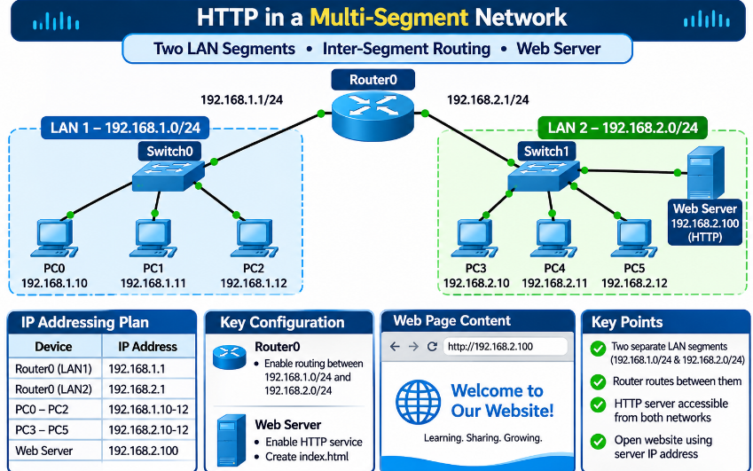
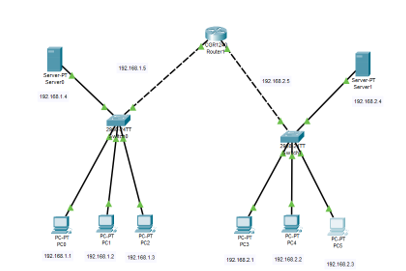
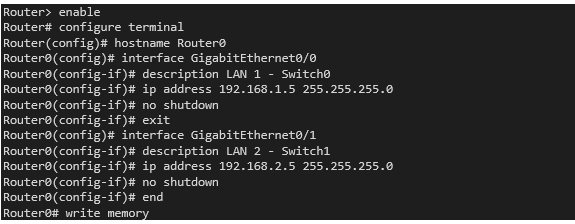
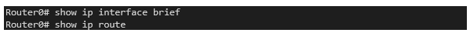
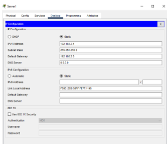
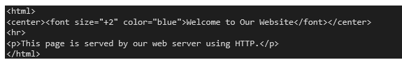
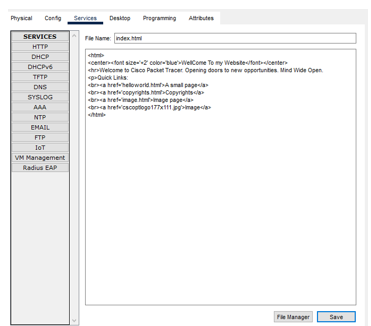
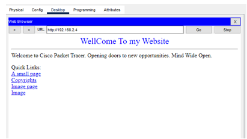

# 🌍 HTTP in a Multi-Segment Network - Complete Guide

<p align="center">
  
</p>

<p align="center"><b>Two LAN Segments · Inter-Segment Routing · Web Server · Cisco Packet Tracer</b></p>

<p align="center">
  
  
  
  
  
</p>

<p align="center">
  <a href="#-task-overview">Task</a> |
  <a href="#-key-concepts">Concepts</a> |
  <a href="#-network-design">Design</a> |
  <a href="#-part-1-network-design-and-segmentation">Part 1</a> |
  <a href="#-part-2-http-server-configuration">Part 2</a> |
  <a href="#-open-the-website-from-any-device">Browser Tests</a> |
  <a href="#-optional-open-the-site-by-name-dns">DNS</a> |
  <a href="#-troubleshooting">Troubleshooting</a> |
  <a href="#-summary-and-checklist">Summary</a>
</p>

> [!NOTE]
> **Who is this for?** Students building their first routed network with a web server. Follow the steps in order and you will finish with two LANs, a router connecting them, and a website that every PC can open.


## 📋 Task Overview

Build a network with **two separate LAN segments joined by a router**, and run a **web server** that every computer on either segment can reach through a web browser.

### Required Devices

| Device | Role |
|--------|------|
| **Router0** | Connects the two LAN segments and routes between them |
| **Switch0** | Connects PC0, PC1 and PC2 (LAN 1) |
| **Switch1** | Connects PC3, PC4 and PC5 (LAN 2) |
| **Web server** | A Server-PT configured as an HTTP server with a static IP address |

### What Has to Be Done

| Part | Requirement |
|:----:|-------------|
| **1 (a)** | Design a network with two LAN segments using the given devices |
| **1 (b)** | Connect the router to both switches |
| **1 (c)** | Give each device an IP address so the two segments are separate (for example 192.168.1.0/24 and 192.168.2.0/24) |
| **1 (d)** | Make sure devices in each segment can communicate, and configure the router for routing between the segments |
| **2 (a)** | Configure the server as an HTTP server |
| **2 (b)** | Create `index.html` showing a "Welcome to Our Website" message |
| **2 (c)** | Give the server a static IP address |
| **2 (d)** | Open the website from any device on either segment by typing the server's IP address in a browser |

## 🔑 Key Concepts

| Term | Meaning |
|------|---------|
| **LAN segment** | A group of devices on one switch and one IP network. Devices in the same segment talk directly |
| **Subnet mask** | 255.255.255.0 (/24): the first three numbers identify the network, the last number identifies the device |
| **Default gateway** | The router address a device uses to reach another network. Without it, a PC can only talk inside its own segment |
| **Inter-segment routing** | The router passes packets between its two networks. Both are directly attached, so no extra routing setup is needed |
| **Static IP address** | An address typed in by hand. Servers need fixed addresses so users always find them at the same place |
| **HTTP** | The protocol web browsers use to fetch web pages from a web server |
| **index.html** | The default page a web server shows when someone visits its address |

> [!TIP]
> **How a PC in LAN 1 reaches a server in LAN 2:** the PC sees the server is on a different network, so it sends the request to its default gateway (the router). The router forwards it into LAN 2. The server replies the same way in reverse.

## 🌐 Network Design

One router sits in the middle. Each side has a switch, three PCs and a server.

<p align="center">
  
</p>

<p align="center"><i>Figure 1: Packet Tracer topology with both LAN segments and the router</i></p>

### The Two Networks

| Segment | Network | Mask | Usable hosts | Broadcast |
|---------|---------|------|--------------|-----------|
| 🟩 **LAN 1** | 192.168.1.0/24 | 255.255.255.0 | .1 to .254 | 192.168.1.255 |
| 🟨 **LAN 2** | 192.168.2.0/24 | 255.255.255.0 | .1 to .254 | 192.168.2.255 |

### IP Addressing Plan

| Device | Segment | IP address | Default gateway | Mask |
|--------|---------|------------|-----------------|------|
| **Router interface 1** | 🟩 LAN 1 | 192.168.1.5 | n/a | /24 |
| **PC0** | 🟩 LAN 1 | 192.168.1.1 | 192.168.1.5 | /24 |
| **PC1** | 🟩 LAN 1 | 192.168.1.2 | 192.168.1.5 | /24 |
| **PC2** | 🟩 LAN 1 | 192.168.1.3 | 192.168.1.5 | /24 |
| **Server0** | 🟩 LAN 1 | 192.168.1.4 | 192.168.1.5 | /24 |
| **Router interface 2** | 🟨 LAN 2 | 192.168.2.5 | n/a | /24 |
| **PC3** | 🟨 LAN 2 | 192.168.2.1 | 192.168.2.5 | /24 |
| **PC4** | 🟨 LAN 2 | 192.168.2.2 | 192.168.2.5 | /24 |
| **PC5** | 🟨 LAN 2 | 192.168.2.3 | 192.168.2.5 | /24 |
| **Server1 (web server)** | 🟨 LAN 2 | 192.168.2.4 | 192.168.2.5 | /24 |

All addresses are unique, lie inside their own network and avoid the network and broadcast addresses. The router takes **.5** in each LAN, and the servers take **.4**, so the PCs keep **.1 to .3**.

> [!IMPORTANT]
> **Which server is the web server?** The task names one web server, Server0. In the lab the website is set up on the server in **LAN 2** (192.168.2.4, shown as Server1), while the LAN 1 server is Server0 at 192.168.1.4. Any server works: configure the one you choose exactly as in Part 2 and use its address in the browser. If your instructor expects the name Server0, rename the web server or configure Server0 as well.

## 🧱 Part 1: Network Design and Segmentation

### 1 (a) Design the Two LAN Segments

1. Add one router, two **2960-24TT** switches, six PCs and the server(s)
2. Name the devices Router0, Switch0, Switch1, PC0 to PC5 and the server(s)
3. Place PC0 to PC2 and a server around Switch0 (LAN 1), and PC3 to PC5 and a server around Switch1 (LAN 2)

### 1 (b) Connect the Router to Both Switches

Use **copper straight-through** cables:

| From | Port | To | Port |
|------|------|----|------|
| **Router0** | GigabitEthernet0/0 (or Fa0/0) | Switch0 | GigabitEthernet0/1 |
| **Router0** | GigabitEthernet0/1 (or Fa0/1) | Switch1 | GigabitEthernet0/1 |
| **Switch0** | Fa0/1 to Fa0/4 | PC0, PC1, PC2, server | FastEthernet0 |
| **Switch1** | Fa0/1 to Fa0/4 | PC3, PC4, PC5, server | FastEthernet0 |

> [!NOTE]
> Port names depend on the router model. Use your own port names wherever Gi0/0 and Gi0/1 appear in this guide. Router-to-switch links should be **straight-through** (solid lines); dashed lines in Packet Tracer mean a crossover cable. The link may still come up because of auto-detection, but the correct cable avoids problems.

### 1 (c) Configure IP Addressing

Set every end device by hand: click the device → **Desktop** → **IP Configuration** → **Static**, then type the values from the addressing plan.

| Field (example: PC0) | Value |
|----------------------|-------|
| **IPv4 Address** | 192.168.1.1 |
| **Subnet Mask** | 255.255.255.0 |
| **Default Gateway** | 192.168.1.5 |

PC3 uses the same layout with address 192.168.2.1 and gateway 192.168.2.5.

> [!WARNING]
> **Do not skip the gateway.** A PC with no default gateway can only talk inside its own segment. Every device in LAN 1 must use **192.168.1.5** and every device in LAN 2 must use **192.168.2.5**.

### 1 (d) Routing Between the Segments

Give each router interface the address the PCs use as their gateway, and turn the interface on. Open **Router0 → CLI**:

```cisco
enable
configure terminal
hostname Router0
interface GigabitEthernet0/0
 description LAN 1 - Switch0
 ip address 192.168.1.5 255.255.255.0
 no shutdown
 exit
interface GigabitEthernet0/1
 description LAN 2 - Switch1
 ip address 192.168.2.5 255.255.255.0
 no shutdown
 end
write memory
```

<p align="center">
  
</p>

<p align="center"><i>Figure 2: Router0 interface configuration in the CLI</i></p>

> [!TIP]
> **Why no routing protocol?** Both networks are directly connected to Router0, so it adds them to its routing table automatically as connected routes. Static routes, RIP or OSPF are not needed with a single router.

### Check the Router

```cisco
Router0# show ip interface brief
Router0# show ip route
```

**Expected:** both interfaces show **up/up** with 192.168.1.5 and 192.168.2.5, and the routing table lists 192.168.1.0/24 and 192.168.2.0/24 as connected (code `C`).

<p align="center">
  
</p>

<p align="center"><i>Figure 3: Router verification command</i></p>

### Check Connectivity

| # | From | Ping | Expected |
|:-:|------|------|----------|
| 1 | PC0 | 192.168.1.2 (PC1) | ✅ Same segment, TTL 128 |
| 2 | PC0 | 192.168.1.5 (router) | ✅ Success |
| 3 | PC0 | 192.168.2.1 (PC3) | ✅ Crosses the router, TTL 127 |
| 4 | PC3 | 192.168.1.3 (PC2) | ✅ Crosses the router, TTL 127 |

The first ping to a new address in another segment may show one "Request timed out" while ARP finishes. Ping again and all four replies arrive.

## 💻 Part 2: HTTP Server Configuration

### 2 (c) Give the Server a Static IP Address

A web server must keep the same address, so set it first. Click the server → **Desktop** → **IP Configuration** → **Static**.

| Field | Value (web server in LAN 2) |
|-------|-----------------------------|
| **IPv4 Address** | 192.168.2.4 |
| **Subnet Mask** | 255.255.255.0 |
| **Default Gateway** | 192.168.2.5 |
| **DNS Server** | Leave empty, or the server's own address if you set up DNS |

<p align="center">
  
</p>

<p align="center"><i>Figure 4: Static IP configuration of the web server</i></p>

### 2 (a) Turn On the HTTP Service

1. Click the server → **Services** tab
2. Select **HTTP** in the left list
3. Make sure HTTP is set to **On** (turn HTTPS on too if you want)
4. The list of files on the server appears, including `index.html`

### 2 (b) Create the index.html Page

1. In **Services → HTTP**, click the edit icon next to `index.html` (or use File Manager and open it)
2. Replace the text with the code below. The heading must read exactly **"Welcome to Our Website"**
3. Click **Save**

```html
<html>
<center><font size="+2" color="blue">Welcome to Our Website</font></center>
<hr>
<p>This page is served by our web server using HTTP.</p>
</html>
```

<p align="center">
  
</p>

<p align="center"><i>Figure 5: The index.html code</i></p>

<p align="center">
  
</p>

<p align="center"><i>Figure 6: Editing index.html in Services → HTTP</i></p>

> [!WARNING]
> The page in the lab screenshot reads **"WellCome To my Website"**. The task asks for **"Welcome to Our Website"**, so use the exact wording above and retake the browser screenshot after saving.

## 🔍 Open the Website From Any Device

On each PC: **Desktop** → **Web Browser**, type the server's address in the URL box and click **Go**.

| Test | Browser on | URL | Expected |
|:----:|------------|-----|----------|
| 1 | PC3 (same LAN as server) | `http://192.168.2.4` | ✅ Welcome page |
| 2 | PC4 | `http://192.168.2.4` | ✅ Welcome page |
| 3 | PC5 | `http://192.168.2.4` | ✅ Welcome page |
| 4 | PC0 (other LAN) | `http://192.168.2.4` | ✅ Welcome page via the router |
| 5 | PC1 | `http://192.168.2.4` | ✅ Welcome page via the router |
| 6 | PC2 | `http://192.168.2.4` | ✅ Welcome page via the router |

<p align="center">
  
</p>

<p align="center"><i>Figure 7: Web browser on a PC showing the page from http://192.168.2.4</i></p>

**Reading the result:** the page appears with the blue heading and text from `index.html`. A PC in the other LAN gets the same page, which proves the router is passing the traffic.

> [!TIP]
> Take one screenshot from a PC in the server's own LAN and one from a PC in the other LAN, with the URL clearly visible in each.

## 🔤 Optional: Open the Site by Name (DNS)

The task works with the IP address alone. For a name such as `www.ourwebsite.com`, use the DNS service on the same server:

1. Click the server → **Services** → **DNS**, set the service to **On**
2. Enter **Name:** `www.ourwebsite.com` and **Address:** `192.168.2.4`, then click **Add**
3. On every PC, set the **DNS Server** in IP Configuration to `192.168.2.4`
4. In the PC web browser, type `http://www.ourwebsite.com` and click **Go**

## 🧯 Troubleshooting

| Symptom | Likely cause | Fix |
|---------|--------------|-----|
| Link light is red or amber | Wrong cable, port shut down, or still starting | Use straight-through cables; `no shutdown` on the router; wait for green |
| A device looks pale in the workspace | The device is powered off | Click it → Physical tab → press the power button |
| PC cannot ping the router | Wrong IP, mask or gateway on the PC | Compare with the addressing plan |
| Ping works inside a LAN but not between LANs | No default gateway on the PC, or router interface down | Set the gateway; run `show ip interface brief` |
| Browser shows "Request Timeout" | HTTP service off, wrong address, or gateway missing | Turn HTTP On, recheck the URL and the gateways |
| Browser shows an old page | `index.html` was not saved | Edit `index.html` again and click Save |
| Name does not open but the IP does | DNS not set up | Follow the DNS section or use the IP address |
| Only the first ping fails | ARP delay | Normal; ping again |

## 🏁 Summary and Checklist

Two LAN segments, **192.168.1.0/24** and **192.168.2.0/24**, were connected through **Router0** using gateway addresses 192.168.1.5 and 192.168.2.5. The web server at **192.168.2.4** serves `index.html` over HTTP, and PCs on both segments can open it by typing its IP address in a browser.

### ✔️ Final Checklist

- [x] Router connects both switches and both interfaces are up
- [x] Every device has a unique address, the right mask and the right gateway
- [x] Pings succeed inside each LAN and between the two LANs
- [x] The web server has a static address and the HTTP service is On
- [x] `index.html` reads "Welcome to Our Website" and is saved
- [x] Web browsers on PCs from both LANs open the page

## 🎓 What I Learned

- Splitting a network into two segments and routing between them with one router
- Why every device needs the correct default gateway
- Directly connected networks need no static routes or routing protocol
- Turning a generic server into an HTTP server and editing `index.html`
- Opening the same website from both LANs, and by name with DNS

## 🚀 How to Use This Repository

```bash
git clone https://github.com/sanawar-imran-securityengineer/HTTP-Server.git
```

1. Rebuild the topology in Packet Tracer
2. Configure Router0 and the PC and server addresses
3. Turn on HTTP and save `index.html`
4. Open `http://192.168.2.4` from a PC in each LAN

## 📞 Connect With Me

<p align="center">
  <a href="mailto:sanawarimran.pk@gmail.com"></a>
  <a href="https://www.linkedin.com/in/sanawarimran"></a>
  <a href="https://github.com/sanawar-imran-securityengineer"></a>
  <a href="https://medium.com/@sanawarimran.pk"></a>
</p>

## 📄 License

This project is created for **educational purposes** and is open-source.

<h3 align="center">⭐ If you found this helpful, please give it a star!</h3>

<p align="center"><b>Made with 💚 by SANAWAR IMRAN</b></p>

<p align="center"><i>Last Updated: November 2026</i></p>
