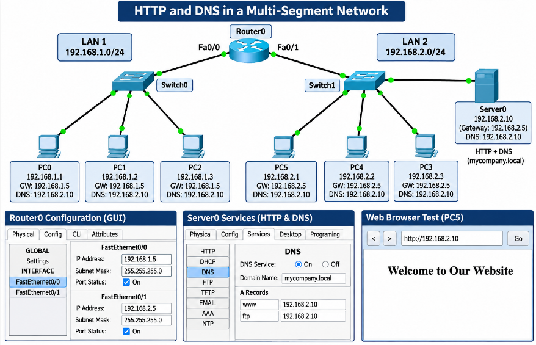
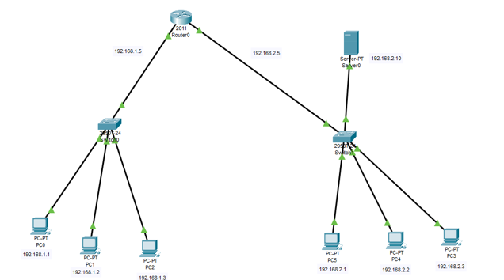
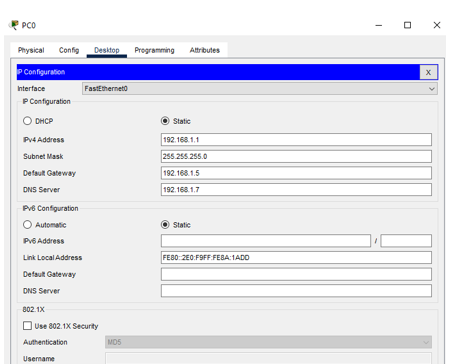
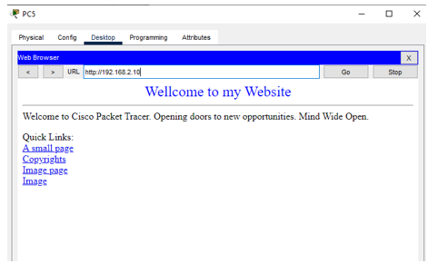
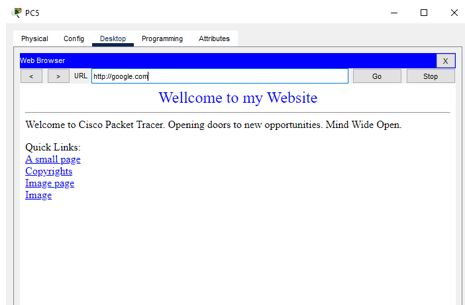

# 🔤 HTTP and DNS Lab - Multi-Segment Network

<p align="center">
  
</p>

<p align="center"><b>Two LAN Segments · One Router · HTTP + DNS on Server0 · Cisco Packet Tracer</b></p>

<p align="center">
  
  
  
  
</p>

<p align="center">
  <a href="#-objective">Objective</a> |
  <a href="#-devices-and-addressing-plan">Addressing</a> |
  <a href="#-part-1-network-design-and-segmentation">Part 1</a> |
  <a href="#-part-2-http-server-configuration">Part 2</a> |
  <a href="#-part-3-dns-server-configuration">Part 3</a> |
  <a href="#-observations-and-corrections">Corrections</a> |
  <a href="#-conclusion">Conclusion</a>
</p>

## 🎯 Objective

A network with **two LAN segments** is built around one router. A **single server** provides web (HTTP), FTP and name resolution (DNS) to the clients on both segments.

- [x] Create two separate LAN segments, **192.168.1.0/24** and **192.168.2.0/24**, joined by Router0
- [x] Configure **Server0** as an HTTP server with a static IP and an `index.html` page
- [x] Configure **Server0** as a DNS server for the domain **mycompany.local**, with A records for the web server and the FTP server
- [x] Point one client in each segment to Server0 as its DNS server and test name resolution

## 🧭 Devices and Addressing Plan

### Devices

| Device | Model | Connected to |
|--------|-------|--------------|
| **Router0** | Cisco 2811 | Switch0 (Fa0/0) and Switch1 (Fa0/1) |
| **Switch0** | 2950-24 | Router0, PC0, PC1, PC2 |
| **Switch1** | 2950-24 | Router0, Server0, PC3, PC4, PC5 |
| **PC0 to PC2** | PC-PT | Switch0 (LAN 1) |
| **PC3 to PC5** | PC-PT | Switch1 (LAN 2) |
| **Server0** | Server-PT | Switch1 (LAN 2) |

### Networks

| Segment | Network | Mask | Default gateway |
|---------|---------|------|-----------------|
| 🟦 **LAN 1** (Switch0) | 192.168.1.0/24 | 255.255.255.0 | 192.168.1.5 (Router0 Fa0/0) |
| 🟩 **LAN 2** (Switch1) | 192.168.2.0/24 | 255.255.255.0 | 192.168.2.5 (Router0 Fa0/1) |

### IP Addresses

| Device | IP address | Mask | Gateway / DNS |
|--------|------------|------|---------------|
| **Router0 Fa0/0** | 192.168.1.5 | 255.255.255.0 | - |
| **Router0 Fa0/1** | 192.168.2.5 | 255.255.255.0 | - |
| 🟦 PC0 | 192.168.1.1 | 255.255.255.0 | GW 192.168.1.5 / DNS 192.168.2.10 |
| 🟦 PC1 | 192.168.1.2 | 255.255.255.0 | GW 192.168.1.5 / DNS 192.168.2.10 |
| 🟦 PC2 | 192.168.1.3 | 255.255.255.0 | GW 192.168.1.5 / DNS 192.168.2.10 |
| 🟩 PC5 | 192.168.2.1 | 255.255.255.0 | GW 192.168.2.5 / DNS 192.168.2.10 |
| 🟩 PC4 | 192.168.2.2 | 255.255.255.0 | GW 192.168.2.5 / DNS 192.168.2.10 |
| 🟩 PC3 | 192.168.2.3 | 255.255.255.0 | GW 192.168.2.5 / DNS 192.168.2.10 |
| 🟪 **Server0** | 192.168.2.10 | 255.255.255.0 | GW 192.168.2.5 / DNS 192.168.2.10 |

## 🧱 Part 1: Network Design and Segmentation

### Topology

Router0 connects to both switches. PC0 to PC2 sit on Switch0 (LAN 1), while PC3 to PC5 and Server0 sit on Switch1 (LAN 2). All links are **copper straight-through** cables, and every link light is green.

<p align="center">
  
</p>

<p align="center"><i>Figure 1: Network topology with IP addresses</i></p>

### Router0 Interface Configuration (GUI)

1. Click **Router0** → **Config** → **INTERFACE** → **FastEthernet0/0**
2. Enter IP address `192.168.1.5`, mask `255.255.255.0`, and tick **Port Status On**
3. Select **FastEthernet0/1**, enter IP address `192.168.2.5`, mask `255.255.255.0`, and tick **Port Status On**

Equivalent IOS commands:

```cisco
interface FastEthernet0/0
 ip address 192.168.1.5 255.255.255.0
 no shutdown
interface FastEthernet0/1
 ip address 192.168.2.5 255.255.255.0
 no shutdown
```

> [!TIP]
> **Inter-segment routing:** both networks are directly connected to Router0, so the router adds a connected route for each one automatically once the interfaces are up. No static route or routing protocol is needed. Clients only need the correct default gateway to reach the other segment.

### Client IP Configuration

On each PC: **Desktop** → **IP Configuration** → **Static**, then enter the values from the addressing table. Example for PC0:

| Field | Value |
|-------|-------|
| **IPv4 Address** | 192.168.1.1 |
| **Subnet Mask** | 255.255.255.0 |
| **Default Gateway** | 192.168.1.5 |
| **DNS Server** | 192.168.2.10 |

<p align="center">
  
</p>

<p align="center"><i>Figure 2: PC0 IP configuration</i></p>

> [!WARNING]
> In Figure 2 the DNS Server field reads **192.168.1.7**. No device has that address. The DNS service runs on Server0 (**192.168.2.10**), so name resolution from PC0 would fail. See [Observations and Corrections](#-observations-and-corrections).

## 🌐 Part 2: HTTP Server Configuration

### Static IP for Server0

Click **Server0** → **Config** → **FastEthernet0**:

| Field | Value |
|-------|-------|
| **IP Configuration** | Static |
| **IPv4 Address** | 192.168.2.10 |
| **Subnet Mask** | 255.255.255.0 |
| **Default Gateway** | 192.168.2.5 |
| **DNS Server** | 192.168.2.10 |

### Enable HTTP and Create index.html

1. Click **Server0** → **Services** → **HTTP** and make sure HTTP is **On**
2. Under **File Manager**, open (or create) `index.html` using **Edit**
3. Replace the content with the page below and save it

```html
<html>
<head><title>Our Website</title></head>
<body>
<center><h1>Welcome to Our Website</h1></center>
</body>
</html>
```

### Test from a Client

On a PC: **Desktop** → **Web Browser** → enter `http://192.168.2.10`. The page must load from **both** segments.

<p align="center">
  
</p>

<p align="center"><i>Figure 3: PC5 (LAN 2) browsing to http://192.168.2.10</i></p>

PC5 in LAN 2 loads the page from Server0 by IP address, so the HTTP service works. To prove access across segments, repeat the test from **PC0 (LAN 1)**.

> [!WARNING]
> The heading in Figure 3 reads **"Wellcome to my Website"**. The lab asks for **"Welcome to Our Website"**, so edit `index.html` as shown above and retake the screenshot.

## 🔤 Part 3: DNS Server Configuration

### Enable the DNS Service

1. Click **Server0** → **Services** → **DNS**
2. Set **DNS Service** to **On**

### Domain mycompany.local and A Records

Packet Tracer has no separate zone screen. The domain `mycompany.local` is created by using it as the **suffix of each record name**. For each record: enter the **Name**, select type **A Record**, type the **Address**, and click **Add**.

| Name | Type | Address |
|------|------|---------|
| `server0.mycompany.local` | A Record | 192.168.2.10 (web and DNS server) |
| `ftp.mycompany.local` | A Record | 192.168.2.10 (FTP service on Server0) |

> [!NOTE]
> The topology has only one server, so the FTP A record also points to Server0, where the FTP service is enabled under **Services → FTP**.

### Point the Clients to the DNS Server

On one PC in each segment (for example **PC0** in LAN 1 and **PC5** in LAN 2): **Desktop** → **IP Configuration** → set **DNS Server** to `192.168.2.10`.

### Test Name Resolution

On the client open **Command Prompt**:

```
ping server0.mycompany.local
ping ftp.mycompany.local
```

Each name must resolve to **192.168.2.10** and the ping must reply. You can also use the name in the browser: `http://server0.mycompany.local`.

<p align="center">
  
</p>

<p align="center"><i>Figure 4: PC5 opening a website by host name (http://google.com)</i></p>

In Figure 4 the name `google.com` loads a page, which shows PC5 asked a DNS server and received an address. This is consistent with an A record for `google.com` having been added on the DNS server for the demonstration. For the required domain, repeat the test with `http://server0.mycompany.local`.

## 🔎 Observations and Corrections

| # | Observation | Fix |
|:-:|-------------|-----|
| 1 | PC0 shows DNS Server **192.168.1.7** (Figure 2). No device has that address | Set the DNS Server on PC0 (and the other LAN 1 PCs) to **192.168.2.10** |
| 2 | The page shows **"Wellcome to my Website"** (Figures 3 and 4) but the task requires **"Welcome to Our Website"** | Edit `index.html` on Server0 → Services → HTTP and use the page above |
| 3 | The task requires the domain **mycompany.local** | Name the A records `server0.mycompany.local` and `ftp.mycompany.local`, then test with those names |

### 📸 Evidence Checklist

| Evidence | Status | Figure |
|----------|:------:|:------:|
| Topology with two LAN segments | ✅ Included | Figure 1 |
| Client IP configuration | ✅ Included (retake with DNS 192.168.2.10) | Figure 2 |
| Browser test by IP from LAN 2 | ✅ Included (retake with correct text) | Figure 3 |
| Name resolved in browser | ✅ Included | Figure 4 |
| Router0 interface IPs (both interfaces) | ⬜ To add | - |
| Server0 static IP (FastEthernet0) | ⬜ To add | - |
| HTTP service and `index.html` content | ⬜ To add | - |
| Browser test by IP from LAN 1 (PC0) | ⬜ To add | - |
| DNS service On and A records | ⬜ To add | - |
| DNS setting on one PC in each LAN | ⬜ To add | - |
| Ping by host name (both LANs) | ⬜ To add | - |

## 🧯 Troubleshooting

| Symptom | Likely cause | Fix |
|---------|--------------|-----|
| Website opens by IP but not by name | DNS Server on the PC is wrong or empty | Set the PC's DNS Server to `192.168.2.10` |
| Name does not resolve | A record missing or misspelled | Check Services → DNS for `server0.mycompany.local` |
| PC in LAN 1 cannot reach Server0 | Missing or wrong default gateway | Use `192.168.1.5` on LAN 1 PCs |
| Browser shows "Request Timeout" | HTTP service off, wrong address or gateway | Turn HTTP On and recheck the URL |
| Browser shows an old page | `index.html` was not saved | Edit `index.html` again and click Save |

## 🏁 Conclusion

Two LAN segments, **192.168.1.0/24** and **192.168.2.0/24**, were connected by **Router0**, which routes between them using its connected networks. **Server0** at **192.168.2.10** provides HTTP, FTP and DNS. PC5 reaches the web server by IP address and by name, so the HTTP and DNS services work.

## 🎓 What I Learned

- Joining two LAN segments with one router and the right default gateways
- Why directly connected networks need no static routes
- Setting a static address on a server and enabling HTTP
- Creating a domain in Packet Tracer DNS by naming A records with a suffix
- Pointing clients to a DNS server and testing resolution by name

## 🚀 How to Use This Repository

```bash
git clone https://github.com/sanawar-imran-securityengineer/HTTP-DNS-Lab.git
```

1. Rebuild the topology in Packet Tracer
2. Configure Router0, Server0 and the clients
3. Enable HTTP and DNS on Server0 and add the A records
4. Test by IP and by name from a PC in each LAN

## 📞 Connect With Me

<p align="center">
  <a href="mailto:sanawarimran.pk@gmail.com"></a>
  <a href="https://www.linkedin.com/in/sanawarimran"></a>
  <a href="https://github.com/sanawar-imran-securityengineer"></a>
  <a href="https://medium.com/@sanawarimran.pk"></a>
</p>

## 📄 License

This project is created for **educational purposes** and is open-source.

<h3 align="center">⭐ If you found this helpful, please give it a star!</h3>

<p align="center"><b>Made with 💜 by SANAWAR IMRAN</b></p>

<p align="center"><i>Last Updated: November 2026</i></p>
