# 📶 Wireless LAN Lab - WLC, Lightweight AP, DHCP and CAPWAP

<p align="center">
  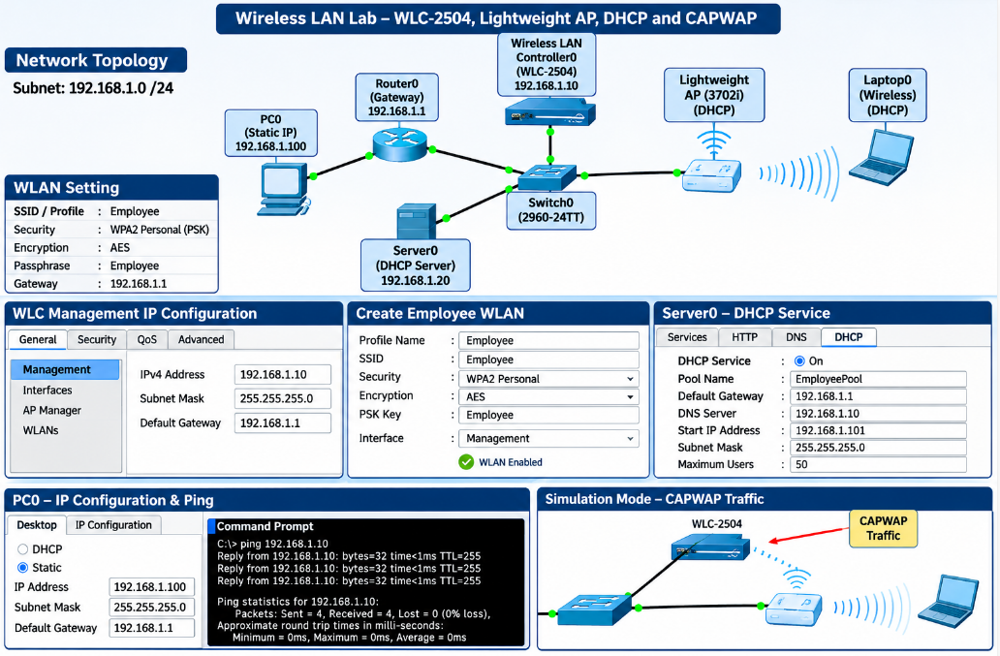
</p>

<p align="center"><b>WLC-2504 · 3702i Lightweight AP · DHCP · WPA2-PSK · CAPWAP · Cisco Packet Tracer</b></p>

<p align="center">
  
  
  
</p>

<p align="center">
  <a href="#-objective">Objective</a> |
  <a href="#-devices-and-addressing">Addressing</a> |
  <a href="#-network-topology">Topology</a> |
  <a href="#-configuration-steps">Configuration</a> |
  <a href="#-capwap-short-answers">CAPWAP</a> |
  <a href="#-observations-and-corrections">Corrections</a> |
  <a href="#-conclusion">Conclusion</a>
</p>

## 🎯 Objective

Build a small wireless network managed by a **wireless LAN controller (WLC)**. A lightweight access point (AP) joins the controller, a wireless laptop connects to the **Employee** WLAN, and a server hands out IP addresses by DHCP.

- [x] Configure the management IP address of the **WLC-2504**
- [x] Configure a wired PC with a static IP and test connectivity
- [x] Set up the WLC through its web GUI and create a **WPA2-PSK WLAN** named Employee
- [x] Configure **Server0** with a static IP and a DHCP pool
- [x] Let the **3702i lightweight AP** get an IP address by DHCP and join the controller
- [x] Connect **Laptop0** wirelessly, verify DHCP, and study **CAPWAP** traffic in Simulation mode

## 🧭 Devices and Addressing

| Device | Model | IP address | Subnet mask |
|--------|-------|------------|-------------|
| **Wireless LAN Controller0** | WLC-2504 | 192.168.1.10 | 255.255.255.0 |
| **Router0** (default gateway) | Cisco 1841 | 192.168.1.1 | 255.255.255.0 |
| **Server0** (DHCP server) | Server-PT | 192.168.1.20 | 255.255.255.0 |
| **PC0** (wired) | PC-PT | 192.168.1.100 | 255.255.255.0 |
| **Light Weight Access Point0** | 3702i | DHCP | DHCP |
| **Laptop0** (wireless) | Laptop-PT | DHCP | DHCP |
| **Switch0** | 2960-24TT | Layer 2 only | - |

### WLAN Settings

| Setting | Value |
|---------|-------|
| **Profile name / SSID** | Employee / Employee |
| **Security** | WPA2 Personal (PSK) with AES encryption |
| **Pre-shared key** | `Employee` (as given in the lab sheet) |
| **Default gateway for clients** | 192.168.1.1 (Router0) |

## 🌐 Network Topology

All devices connect to **Switch0** in a star layout, in one subnet, **192.168.1.0/24**. Laptop0 is not cabled: it connects over Wi-Fi through the access point.

<p align="center">
  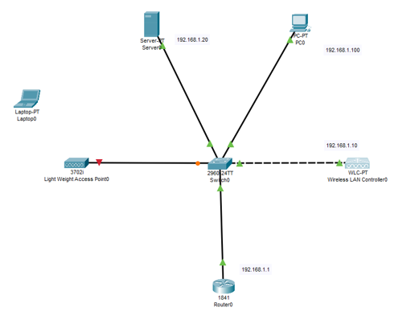
</p>

<p align="center"><i>Figure 1: Initial topology</i></p>

### Cable Connections

| From | To | Cable |
|------|----|-------|
| WLC-2504 Gig1 | Switch0 Fa0/1 | Copper straight-through |
| PC0 Fa0 | Switch0 Fa0/2 | Copper straight-through |
| Light Weight AP Gig0 | Switch0 Fa0/3 | Copper straight-through |
| Server0 Fa0 | Switch0 Fa0/4 | Copper straight-through |
| Router0 Fa0/0 | Switch0 Fa0/5 | Copper straight-through |
| Laptop0 | Wireless (no cable) | Wi-Fi |

> [!NOTE]
> In Figure 1 the AP-to-switch link still shows a red/orange indicator. This is normal right after the AP is powered on and its port is negotiating. The link turns green after a short time.

## 🔧 Configuration Steps

### Step 1: Configure the WLC Management IP

Click the WLC → **Config** tab → **Management** under INTERFACE, enter the values and save.

| Field | Value |
|-------|-------|
| **IPv4 Address** | 192.168.1.10 |
| **Subnet Mask** | 255.255.255.0 |
| **Default Gateway** | 192.168.1.1 |

<p align="center">
  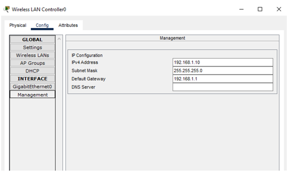
</p>

<p align="center"><i>Figure 2: WLC Management IP configuration</i></p>

### Step 2: Configure PC0 and Test Connectivity

On PC0: **Desktop** → **IP Configuration** → **Static**.

| Field | Value |
|-------|-------|
| **IP Address** | 192.168.1.100 |
| **Subnet Mask** | 255.255.255.0 |
| **Default Gateway** | 192.168.1.1 |

Then open **Command Prompt** and run:

```
ipconfig
ping 192.168.1.100
ping 192.168.1.10
```

<p align="center">
  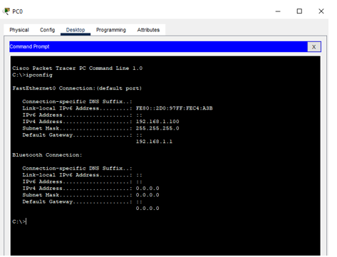
</p>

<p align="center"><i>Figure 3: ipconfig on PC0 (192.168.1.100 / 255.255.255.0 / gateway 192.168.1.1)</i></p>

<p align="center">
  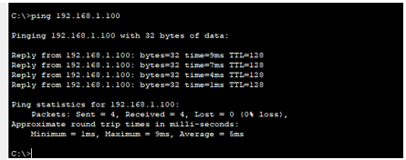
</p>

<p align="center"><i>Figure 4: ping 192.168.1.100 from PC0, 4 of 4 replies (TCP/IP stack and NIC work)</i></p>

<p align="center">
  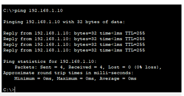
</p>

<p align="center"><i>Figure 5: ping 192.168.1.10 (WLC) from PC0, 4 of 4 replies, TTL 255</i></p>

### Step 3: Open the WLC Web GUI and Run the Initial Setup

On PC0 open the **Web Browser** and go to `http://192.168.1.10`. The controller asks for an **admin account** to be created.

<p align="center">
  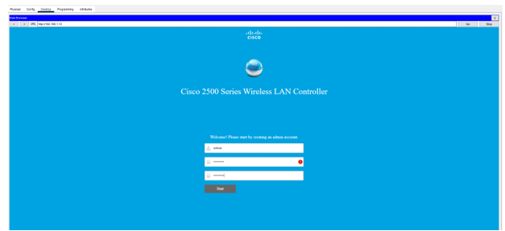
</p>

<p align="center"><i>Figure 6: WLC start page, creating the admin account</i></p>

Setup wizard values:

| Setting | Value |
|---------|-------|
| **System name** | WLC-2504 |
| **Management IP** | 192.168.1.10 |
| **Mask** | 255.255.255.0 |
| **Default gateway** | 192.168.1.1 |
| **Management VLAN ID** | 0 (untagged) |

After the controller restarts, log in again at `https://192.168.1.10`.

<p align="center">
  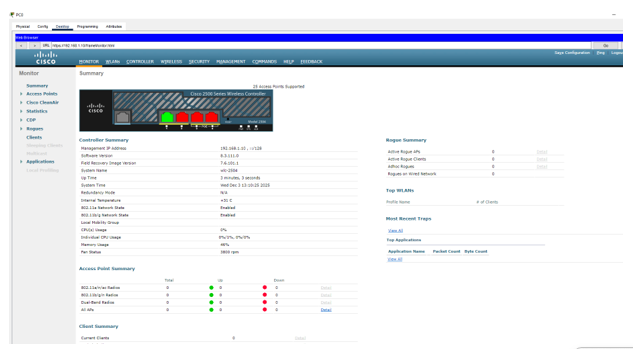
</p>

<p align="center"><i>Figure 7: WLC Monitor → Summary page after login</i></p>

The summary shows management IP 192.168.1.10, system name wlc-2504 and software version 8.3.111.0. The Access Point Summary lists **0 APs** at this point, because the AP had not yet received an IP address and joined the controller.

### Step 4: Create the Employee WLAN

1. In the wizard (or **WLANs → Create New → Go**) enter profile name `Employee` and SSID `Employee`
2. Under **Security** choose **WPA2 Personal**, encryption **AES**, key type **PSK**, passphrase `Employee`
3. Set the interface/VLAN to **management (untagged)**, enable the WLAN, and click **Apply**
4. Open the **WLANs** tab and confirm the profile exists

<p align="center">
  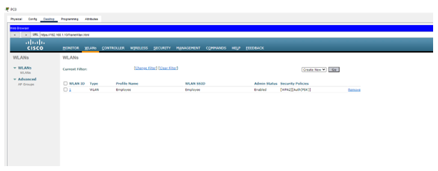
</p>

<p align="center"><i>Figure 8: WLANs page: WLAN ID 1, profile Employee, SSID Employee, Enabled, [WPA2][Auth(PSK)]</i></p>

### Step 5: Configure Server0 IP and the DHCP Service

Click **Server0** → **Config** → **FastEthernet0** and set a static IP: **192.168.1.20 / 255.255.255.0**.

<p align="center">
  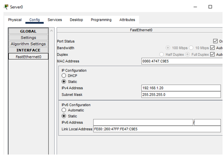
</p>

<p align="center"><i>Figure 9: Server0 FastEthernet0 IP configuration</i></p>

Then open **Services → DHCP**, turn the service **On** for FastEthernet0, and create the pool.

| DHCP field | Recommended value |
|------------|-------------------|
| **Service** | On (FastEthernet0) |
| **Pool name** | pool1 |
| **Default gateway** | 192.168.1.1 |
| **DNS server** | 192.168.1.1 |
| **Start IP address** | **192.168.1.101** |
| **Subnet mask** | 255.255.255.0 |
| **Maximum number of users** | 100 |

<p align="center">
  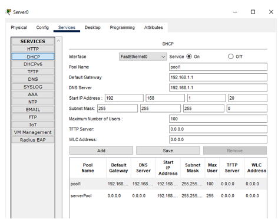
</p>

<p align="center"><i>Figure 10: Server0 DHCP service and pool</i></p>

> [!WARNING]
> The pool in Figure 10 starts at **192.168.1.20**, not **192.168.1.101** as the lab sheet asks. With 100 users it covers .20 to .119, which includes the server itself (.20) and PC0 (.100) and can cause address conflicts. Start at **192.168.1.101** (range .101 to .200) and retake the screenshot. See [Observations and Corrections](#-observations-and-corrections).

### Step 6: AP Gets an IP Address by DHCP

1. Click the **3702i AP** → **Config** → **GigabitEthernet0** and select **DHCP** (not Static)
2. If no address appears, toggle Static to DHCP again, or turn the interface off and on, then wait 10 to 20 seconds
3. Note the IP address and mask of GigabitEthernet0
4. On the WLC web GUI open **WIRELESS → Access Points** and confirm the AP is listed with its IP address

### Step 7: Configure Laptop0 for Wi-Fi

1. Open **Laptop0 → Physical**, power the laptop **off**, remove the Ethernet module, insert the **Linksys WPC300N** Wi-Fi module, and power it **on**
2. Open **Config → Wireless0** and enter:

| Field | Value |
|-------|-------|
| **SSID** | Employee |
| **Authentication** | WPA2-PSK |
| **PSK pass phrase** | Employee |
| **Encryption type** | AES |
| **IP configuration** | DHCP |

<p align="center">
  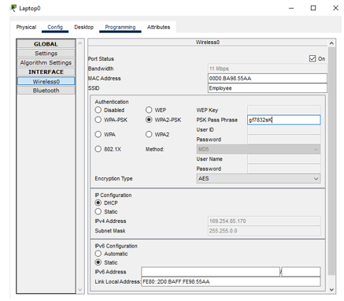
</p>

<p align="center"><i>Figure 11: Laptop0 Wireless0 configuration (SSID Employee, WPA2-PSK, AES, DHCP)</i></p>

> [!WARNING]
> Figure 11 shows the laptop with **169.254.85.170 / 255.255.0.0**, an automatic private (APIPA) address. It had no DHCP lease when the screenshot was taken, and the PSK typed in the field is not the key `Employee`. The key on the laptop must match the WLAN key exactly.

### Step 8: Verify the Laptop

On Laptop0 open **Command Prompt**, run `ipconfig /all`, then ping the DHCP server:

```
ipconfig /all
ping 192.168.1.20
```

<p align="center">
  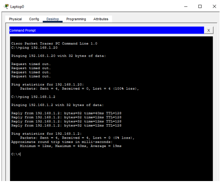
</p>

<p align="center"><i>Figure 12: Ping tests from Laptop0</i></p>

In Figure 12 the ping to 192.168.1.20 **timed out** (4 of 4 lost), which agrees with the missing DHCP lease. A ping to 192.168.1.2 on the same subnet received 4 of 4 replies (TTL 128, average 19 ms). That address is not in the addressing plan, so check which device answered.

### Step 9: CAPWAP Capture in Simulation Mode

1. Switch Packet Tracer to **Simulation** mode
2. On Laptop0 Command Prompt ping `192.168.1.100` (PC0)
3. Set the event list filter to **All events** or **UDP / CAPWAP** only, then step through the capture
4. Click a packet between the AP and the WLC, open **Inspect** (PDU details) and view the decoded Ethernet frame. Find the **UDP** header and the **CAPWAP** entry inside it, then take the screenshot

## 📡 CAPWAP Short Answers

| Question | Answer |
|----------|--------|
| **What is CAPWAP?** | Control And Provisioning of Wireless Access Points. The tunnel protocol a lightweight AP uses to talk to its wireless LAN controller |
| **Which UDP ports does it use?** | **UDP 5246** for CAPWAP control messages and **UDP 5247** for CAPWAP data |
| **What does the control tunnel do?** | The AP discovers and joins the WLC, receives its configuration (SSID, security), and is monitored and managed through it |
| **What path does Laptop0 traffic take to PC0?** | Laptop0 sends the frame over Wi-Fi to the AP. The AP wraps it in a CAPWAP data packet (UDP 5247) and sends it through Switch0 to the WLC at 192.168.1.10. The WLC removes the CAPWAP header and forwards the original frame through the switch to PC0 |
| **Why use a controller?** | Central management of many APs, consistent security policy, and easy roaming for clients |

## 🔎 Observations and Corrections

| # | Observation | Fix |
|:-:|-------------|-----|
| 1 | **DHCP pool overlaps fixed addresses.** The pool starts at .20 with 100 users (.20 to .119), covering the server (.20) and PC0 (.100) | In Server0 → Services → DHCP set **Start IP Address 192.168.1.101**, maximum users **100**, then **Save** |
| 2 | **Laptop has an APIPA address** (169.254.85.170) and the typed PSK is not `Employee` | Enter the same PSK as the WLAN (`Employee`), confirm AES and WPA2-PSK, then toggle IP configuration from Static to DHCP. Wait about a minute after changing WLAN settings |
| 3 | **Ping to the DHCP server failed** (Figure 12) | Once the laptop is associated and has a 192.168.1.x address, the ping to 192.168.1.20 should succeed |
| 4 | **AP must join the controller.** Figure 7 shows 0 APs and the AP link in Figure 1 was not yet green | Power cycle the AP or toggle Static/DHCP on GigabitEthernet0. The AP must appear under WIRELESS → Access Points before a client can see the Employee SSID |

### ✔️ Checklist Before Re-Testing

- [ ] Switch ports to the WLC, AP, PC0, Server0 and Router0 all show green
- [ ] The DHCP pool starts at 192.168.1.101 and does not overlap fixed addresses
- [ ] The AP has a DHCP address and is listed on the WLC
- [ ] The laptop PSK matches the WLAN PSK, and the WLAN is Enabled
- [ ] The laptop has a 192.168.1.x address, and `ping 192.168.1.20` succeeds

### 📸 Evidence Checklist

| No. | Screenshot | Status | Figure |
|:---:|------------|:------:|:------:|
| 1 | Initial topology | ✅ Included | Figure 1 |
| 2 | WLC management IP | ✅ Included | Figure 2 |
| 3a | PC0 ipconfig | ✅ Included | Figure 3 |
| 3b | PC0 ping 192.168.1.100 | ✅ Included | Figure 4 |
| 3c | PC0 ping 192.168.1.10 | ✅ Included | Figure 5 |
| 4 | WLC WLANs page (Employee) | ✅ Included | Figure 8 |
| 5 | WLC Layer 2 security (WPA2/AES/PSK) | ⬜ To add | - |
| 6a | Server0 Fa0 IP | ✅ Included | Figure 9 |
| 6b | Server0 DHCP settings | ✅ Included (retake with .101) | Figure 10 |
| 7 | AP Gi0 IP (DHCP) | ⬜ To add | - |
| 8 | WLC Access Points list | ⬜ To add | - |
| 9 | Laptop0 Wireless0 config | ✅ Included (retake after DHCP works) | Figure 11 |
| 10a | Laptop `ipconfig /all` | ⬜ To add | - |
| 10b | Laptop ping 192.168.1.20 | ✅ Included (retake after fix) | Figure 12 |
| 11 | Simulation CAPWAP decode | ⬜ To add | - |

## 🧯 Troubleshooting

| Symptom | Likely cause | Fix |
|---------|--------------|-----|
| Laptop does not see the Employee SSID | AP has not joined the WLC | Check WIRELESS → Access Points; give the AP a DHCP address |
| Laptop shows 169.254.x.x | Not associated, or no DHCP lease | Match the PSK, enable the WLAN, switch IP configuration to DHCP |
| AP gets no address | DHCP service off or AP on Static | Turn DHCP On for FastEthernet0 and set the AP to DHCP |
| Ping to the server fails from the laptop | No 192.168.1.x address yet | Fix DHCP and association first |
| Address conflict | Pool overlaps fixed devices | Start the pool at 192.168.1.101 |
| AP link stays red/orange | Port still negotiating | Wait a short time for it to turn green |

## 🏁 Conclusion

The wireless LAN design with the **WLC-2504**, a **3702i lightweight AP**, **Server0** and **Router0** was configured on the 192.168.1.0/24 network. The WLC management IP, the static IP of PC0 and the **Employee WPA2-PSK WLAN** were set up and verified, and PC0 can reach both itself and the controller. The DHCP pool, the laptop key and the AP join still need the corrections above before the laptop gets a DHCP address and reaches the server. After those fixes, the CAPWAP capture shows wireless client traffic carried between the AP and the controller in UDP tunnels on ports **5246** and **5247**.

## 🎓 What I Learned

- Configuring a WLC management interface and its web GUI
- Creating a WPA2-PSK WLAN and why the client key must match exactly
- How a lightweight AP gets a DHCP address and joins a controller
- Keeping the DHCP pool away from fixed addresses
- What 169.254.x.x (APIPA) means
- How CAPWAP carries control (UDP 5246) and data (UDP 5247) between the AP and WLC

## 🚀 How to Use This Repository

```bash
git clone https://github.com/sanawar-imran-securityengineer/Wireless-LAN-Lab.git
```

1. Rebuild the topology in Packet Tracer
2. Configure the WLC, PC0 and Server0
3. Create the Employee WLAN and let the AP join
4. Connect Laptop0 and capture CAPWAP in Simulation mode

## 📞 Connect With Me

<p align="center">
  <a href="mailto:sanawarimran.pk@gmail.com"></a>
  <a href="https://www.linkedin.com/in/sanawarimran"></a>
  <a href="https://github.com/sanawar-imran-securityengineer"></a>
  <a href="https://medium.com/@sanawarimran.pk"></a>
</p>

## 📄 License

This project is created for **educational purposes** and is open-source.

<h3 align="center">⭐ If you found this helpful, please give it a star!</h3>

<p align="center"><b>Made with 💛 by SANAWAR IMRAN</b></p>

<p align="center"><i>Last Updated: November 2026</i></p>
