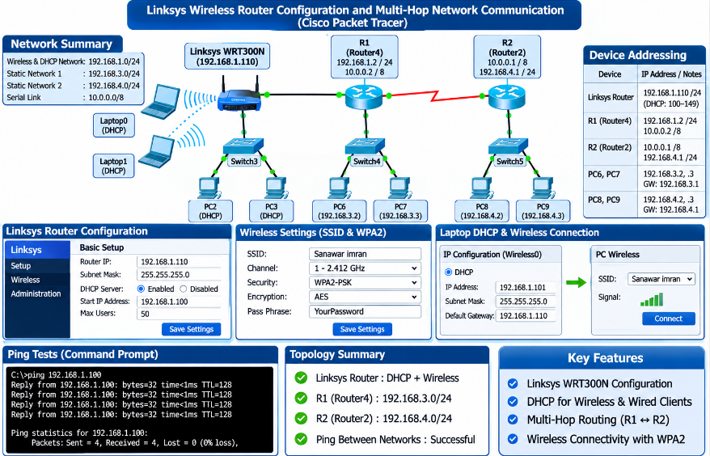
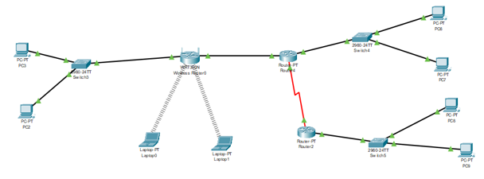
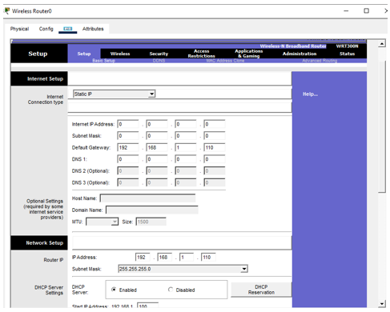
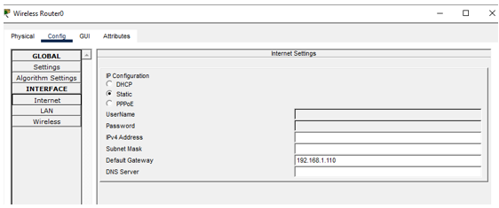
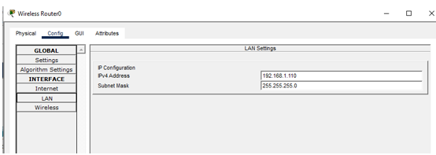
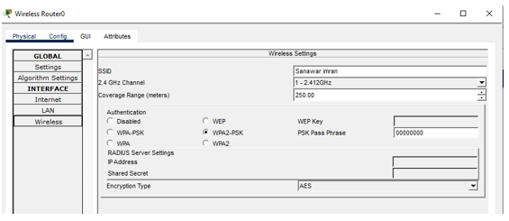
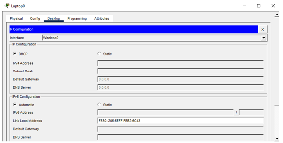
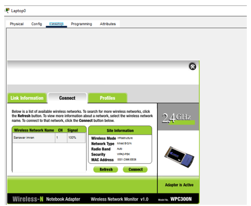
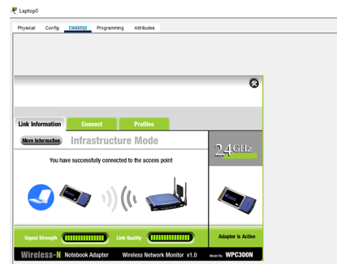
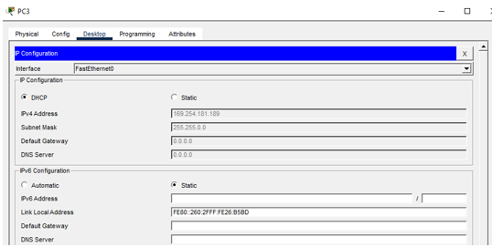

# 📡 Linksys Wireless Router Configuration and Multi-Hop Network

<p align="center">
  
</p>

<p align="center"><b>Linksys WRT300N · Wired + Wireless DHCP · Serial Link · Static Routing · Cisco Packet Tracer</b></p>

<p align="center">
  
  
  
  
</p>

<p align="center">
  <a href="#-objective">Objective</a> |
  <a href="#-network-design-and-addressing">Addressing</a> |
  <a href="#-network-topology">Topology</a> |
  <a href="#-phase-1-linksys-wireless-router">Phase 1</a> |
  <a href="#-phase-2-wired-dhcp-network">Phase 2</a> |
  <a href="#-phase-3-routers-and-static-routing">Phase 3</a> |
  <a href="#-connectivity-tests">Tests</a> |
  <a href="#-observations-and-corrections">Corrections</a> |
  <a href="#-conclusion">Conclusion</a>
</p>

## 🎯 Objective

A mixed **wired and wireless** network. A Linksys wireless router serves wireless laptops and a wired DHCP network. Two wired static networks sit behind two routers that are joined by a **serial link**. Static routes let every network reach every other network.

| Phase | Goal |
|:-----:|------|
| **1** | Configure the Linksys router (IP address, DHCP range, SSID, admin password, WPA2 key) and connect two laptops by DHCP |
| **2** | Connect Switch3 with two PCs to the Linksys router and obtain their addresses by DHCP |
| **3** | Build two static wired networks behind R1 and R2, join the routers with a serial cable, and set up routing |
| **Test** | Demonstrate ping tests between the different networks |

## 🧭 Network Design and Addressing

### Networks

| Network | Address | Devices |
|---------|---------|---------|
| 🟦 **Wired and wireless DHCP network** | 192.168.1.0/24 | Linksys router, Laptop0, Laptop1, PC2, PC3, R1 (Router4) link |
| 🟩 **Wired static network ONE** | 192.168.3.0/24 | R1 (Router4), Switch4, PC6, PC7 |
| 🟨 **Wired static network TWO** | 192.168.4.0/24 | R2 (Router2), Switch5, PC8, PC9 |
| 🟥 **Serial link R1 to R2** | 10.0.0.0/8 | R2 = 10.0.0.1, R1 = 10.0.0.2 |

### Device Addresses

| Device | IP address | Notes |
|--------|------------|-------|
| **Linksys router (LAN)** | 192.168.1.110 /24 | Administrative IP |
| **Linksys DHCP range** | starts at 192.168.1.100 | Up to 50 users, 192.168.1.100 to 192.168.1.149 |
| **Laptop0, Laptop1** | DHCP | Wireless, gateway 192.168.1.110 |
| **PC2, PC3** | DHCP | Wired on Switch3, gateway 192.168.1.110 |
| **R1 (Router4), Linksys side** | 192.168.1.2 /24 | Outside the DHCP range |
| **R1 (Router4), Switch4 side** | 192.168.3.1 /24 | Gateway of network ONE |
| **R1 serial** | 10.0.0.2 /8 | Link to R2 |
| **R2 (Router2) serial** | 10.0.0.1 /8 | Link to R1 |
| **R2 (Router2), Switch5 side** | 192.168.4.1 /24 | Gateway of network TWO |
| **PC6, PC7** | 192.168.3.2, 192.168.3.3 | Static, mask 255.255.255.0, gateway 192.168.3.1 |
| **PC8, PC9** | 192.168.4.2, 192.168.4.3 | Static, mask 255.255.255.0, gateway 192.168.4.1 |

> [!NOTE]
> The Linksys address and DHCP start come from the lab screenshots. The R1 address and the static network ranges follow the sample table in the task sheet. Adjust them if your assigned ID uses a different range.

## 🌐 Network Topology

Switch3 and the two laptops connect to the Linksys router. **Router4 (R1)** connects the Linksys router, Switch4 and the serial link. **Router2 (R2)** connects the serial link and Switch5.

<p align="center">
  
</p>

<p align="center"><i>Figure 1: Complete network topology</i></p>

| Device | Role | Connected to |
|--------|------|--------------|
| **Wireless Router0 (WRT300N)** | Wireless router and DHCP server | Switch3, Router4, Laptop0, Laptop1 (wireless) |
| **Switch3** | Wired DHCP network switch | PC2, PC3, Linksys router |
| **Router4** | R1 | Linksys router, Switch4, Router2 (serial) |
| **Switch4** | Wired static network ONE | PC6, PC7, Router4 |
| **Router2** | R2 | Router4 (serial), Switch5 |
| **Switch5** | Wired static network TWO | PC8, PC9, Router2 |

## 📶 Phase 1: Linksys Wireless Router

### Router IP, DHCP and Internet Settings

1. Click **Wireless Router0** → **GUI** tab. The **Basic Setup** page opens
2. Under **Network Setup** set Router IP to `192.168.1.110` and subnet mask `255.255.255.0`
3. Under **DHCP Server Settings** choose **Enabled**, set Start IP Address to `192.168.1.100` and maximum number of users to `50`
4. Scroll down and click **Save Settings**

<p align="center">
  
</p>

<p align="center"><i>Figure 2: Linksys GUI, Basic Setup page (router IP and DHCP server)</i></p>

The same settings can be checked on the **Config** tab:

<p align="center">
  
</p>

<p align="center"><i>Figure 3: Config → Internet settings (static)</i></p>

<p align="center">
  
</p>

<p align="center"><i>Figure 4: Config → LAN settings (192.168.1.110 / 255.255.255.0)</i></p>

### Administrator Login

In the GUI open **Administration → Management**. Keep the user name `admin` (the default), enter a new password of your own choice, and save.

### Wireless Settings: SSID and WPA2 Key

Open **Config → Wireless** (or **GUI → Wireless**):

| Setting | Value |
|---------|-------|
| **SSID** | Sanawar imran (the task asks for a name based on the last name) |
| **2.4 GHz channel** | 1 - 2.412 GHz |
| **Authentication** | WPA2-PSK |
| **Encryption type** | AES |
| **PSK pass phrase** | Chosen by the student |

<p align="center">
  
</p>

<p align="center"><i>Figure 5: Linksys wireless settings (SSID, WPA2-PSK, AES)</i></p>

### Laptop DHCP Configuration

On each laptop: **Desktop** → **IP Configuration**, choose the **Wireless0** interface and select **DHCP**. A **Linksys WPC300N** wireless module must be installed in the laptop (power off, replace the Ethernet module, power on).

<p align="center">
  
</p>

<p align="center"><i>Figure 6: Laptop0 IP Configuration set to DHCP (Wireless0)</i></p>

### Connect the Laptop to the Wireless Router

Open **Desktop → PC Wireless**. On the **Connect** tab the SSID appears. Select it, click **Connect**, and enter the WPA2 key when asked.

<p align="center">
  
</p>

<p align="center"><i>Figure 7: Wireless network list on Laptop0 (SSID on channel 1, 100% signal, WPA2-PSK)</i></p>

<p align="center">
  
</p>

<p align="center"><i>Figure 8: Laptop0 connected: "You have successfully connected to the access point"</i></p>

After connecting, confirm with `ipconfig` that the laptop received an address from **192.168.1.100 to 192.168.1.149** with gateway **192.168.1.110**. Then open the **Web Browser** and enter `http://192.168.1.110` to reach the Linksys router page.

## 🔌 Phase 2: Wired DHCP Network

1. Add **Switch3** and connect it to a **LAN port** of the Linksys router with a straight-through cable
2. Connect **PC2** and **PC3** to Switch3
3. On each PC: **Desktop** → **IP Configuration** → select **DHCP**

<p align="center">
  
</p>

<p align="center"><i>Figure 9: PC3 IP Configuration set to DHCP</i></p>

> [!WARNING]
> Figure 9 shows **169.254.181.189 / 255.255.0.0**, an automatic private address. That means no lease from the Linksys router had been received yet. See [Observations and Corrections](#-observations-and-corrections).

Once the PCs hold addresses such as 192.168.1.101 and 192.168.1.102, test with ping between PC2 and PC3, and from a PC to a wireless laptop.

## 🧱 Phase 3: Routers and Static Routing

### Router Interfaces

Click each router → **Config** → select the interface, enter the address and mask, and tick **Port Status On**. On the serial link, the **DCE** side also needs a **clock rate** (for example 64000).

| Router | Interface (connects to) | IP address | Mask |
|--------|-------------------------|------------|------|
| **R1 (Router4)** | Fa0/0 (Linksys router) | 192.168.1.2 | 255.255.255.0 |
| **R1 (Router4)** | Fa1/0 (Switch4) | 192.168.3.1 | 255.255.255.0 |
| **R1 (Router4)** | Serial2/0 (R2) | 10.0.0.2 | 255.0.0.0 |
| **R2 (Router2)** | Serial2/0 (R1) | 10.0.0.1 | 255.0.0.0 |
| **R2 (Router2)** | Fa0/0 (Switch5) | 192.168.4.1 | 255.255.255.0 |

> [!NOTE]
> Interface names depend on the modules in your routers. Use the names shown in your own Packet Tracer file.

### Static PC Addresses

| PC | IP address | Mask | Default gateway |
|----|------------|------|-----------------|
| 🟩 PC6 | 192.168.3.2 | 255.255.255.0 | 192.168.3.1 |
| 🟩 PC7 | 192.168.3.3 | 255.255.255.0 | 192.168.3.1 |
| 🟨 PC8 | 192.168.4.2 | 255.255.255.0 | 192.168.4.1 |
| 🟨 PC9 | 192.168.4.3 | 255.255.255.0 | 192.168.4.1 |

### Static Routes

Open each router → **Config → ROUTING → Static**, enter Network, Mask and Next Hop, and click **Add**.

**R1 (Router4):**

| Destination network | Mask | Next hop |
|---------------------|------|----------|
| 192.168.4.0 | 255.255.255.0 | 10.0.0.1 |

**R2 (Router2):**

| Destination network | Mask | Next hop |
|---------------------|------|----------|
| 192.168.3.0 | 255.255.255.0 | 10.0.0.2 |
| 192.168.1.0 | 255.255.255.0 | 10.0.0.2 |

**Linksys router:** it must also know how to reach the two static networks. Open **GUI → Setup → Advanced Routing** and add one entry for each, with the next hop being R1 on the shared link:

| Destination network | Mask | Gateway | Interface |
|---------------------|------|---------|-----------|
| 192.168.3.0 | 255.255.255.0 | 192.168.1.2 | LAN & Wireless |
| 192.168.4.0 | 255.255.255.0 | 192.168.1.2 | LAN & Wireless |

Equivalent IOS commands on the two routers:

```cisco
! R1
ip route 192.168.4.0 255.255.255.0 10.0.0.1

! R2
ip route 192.168.3.0 255.255.255.0 10.0.0.2
ip route 192.168.1.0 255.255.255.0 10.0.0.2
```

## 📡 Connectivity Tests

Run each test from the PC **Desktop → Command Prompt** with `ping` and the destination address. All four must show **4 replies and 0% loss**.

| Test | From | To | Expected result |
|:----:|------|----|-----------------|
| **(a)** | 🟨 Static network TWO (PC8) | 🟩 Static network ONE (PC6) | ✅ Replies, 0% loss |
| **(b)** | 🟩 Static network ONE (PC6) | 🟦 Wireless DHCP network (Laptop0) | ✅ Replies, 0% loss |
| **(c)** | 🟦 Wired DHCP network (PC3) | 🟦 Wireless DHCP network (Laptop0) | ✅ Replies, 0% loss |
| **(d)** | 🟦 Wired DHCP network (PC3) | 🟨 Static network TWO (PC8) | ✅ Replies, 0% loss |

> [!NOTE]
> The ping screenshots for tests (a) to (d) are not included yet. Add one screenshot for each test.

## 🔎 Observations and Corrections

| # | Observation | Fix |
|:-:|-------------|-----|
| 1 | **No DHCP address on PC3 and Laptop0.** PC3 shows 169.254.181.189 (Figure 9) and the IPv4 fields of Laptop0 are empty (Figure 6). The laptop does connect to the wireless network (Figure 8), so the wireless link works | Make sure the DHCP server on the Linksys router is **Enabled and saved**, wait about a minute, then switch the PC or laptop from Static back to DHCP to renew. Confirm with `ipconfig` that an address in 192.168.1.100 to 192.168.1.149 appears |
| 2 | **Default gateway on the Linksys router.** Figures 2 and 3 show it as 192.168.1.110, the router's own address. A router cannot use itself as next hop | Set the gateway to **R1 (192.168.1.2)** and add the two static routes in Advanced Routing. Without them, tests (b) and (c) cannot return traffic to the static networks |
| 3 | **Assigned address range.** The task sheet gives a range per student ID, but the screenshots use 192.168.1.110 with DHCP from 192.168.1.100 | Check which row your ID uses and change the addresses if needed |
| 4 | **SSID name.** The task asks for an SSID based on the last name. The screenshots use "Sanawar imran" | A name such as "Imran" would match the instruction more closely |

### 📸 Evidence Checklist

| Required evidence | Status | Figure |
|-------------------|:------:|:------:|
| Topology | ✅ Included | Figure 1 |
| Linksys router IP and DHCP range | ✅ Included | Figures 2 to 4 |
| SSID and WPA2 key | ✅ Included | Figure 5 |
| Laptop connected to the SSID | ✅ Included | Figures 7 and 8 |
| Laptop0 DHCP configuration | ✅ Included (retake after DHCP works) | Figure 6 |
| PC3 DHCP configuration | ✅ Included (retake after DHCP works) | Figure 9 |
| Admin password change | ⬜ To add | - |
| Laptop0 and Laptop1 DHCP addresses (`ipconfig`) | ⬜ To add | - |
| Web page of the Linksys router (`http://192.168.1.110`) | ⬜ To add | - |
| PC2 and PC3 DHCP addresses, ping between them | ⬜ To add | - |
| Router interface settings and static routes | ⬜ To add | - |
| Static PC IP configuration (PC6 to PC9) | ⬜ To add | - |
| Ping tests (a) to (d) | ⬜ To add | - |

## 🧯 Troubleshooting

| Symptom | Likely cause | Fix |
|---------|--------------|-----|
| PC or laptop shows 169.254.x.x | No DHCP lease | Enable DHCP on the Linksys router, save, wait, then renew |
| Laptop does not connect | SSID or WPA2 key mismatch | Re-enter the key exactly as set on the router |
| Wireless/DHCP clients cannot reach static networks | Linksys has no routes to 192.168.3.0 and 192.168.4.0 | Add them in Advanced Routing with gateway 192.168.1.2 |
| Ping works one way only | A router is missing a return route | Add the missing static route on R1, R2 or Linksys |
| Serial link is down | No clock rate on the DCE side | Set a clock rate such as 64000 |

## 🏁 Conclusion

The **Linksys WRT300N** was configured with the router address **192.168.1.110**, a DHCP range starting at **192.168.1.100**, the SSID "Sanawar imran" and **WPA2-PSK with AES**, and Laptop0 connected to it successfully. The wired DHCP network, the two static networks and the serial link were planned with static routes on R1, R2 and the Linksys router. DHCP leases still need to be confirmed. Once those fixes and the remaining screenshots are in place, the four ping tests demonstrate communication across all networks.

## 🎓 What I Learned

- Configuring a Linksys wireless router: IP, DHCP, SSID, WPA2-PSK and admin password
- Connecting wireless laptops and wired PCs to the same DHCP network
- Joining routers with a serial link and setting a clock rate on the DCE side
- Why a router needs routes for every network, including the Linksys router itself
- Why a router cannot use its own address as the next hop
- What 169.254.x.x (APIPA) means

## 🚀 How to Use This Repository

```bash
git clone https://github.com/sanawar-imran-securityengineer/Linksys-Wireless-Router-Lab.git
```

1. Rebuild the topology in Packet Tracer
2. Configure the Linksys router, then the laptops and wired DHCP PCs
3. Configure R1, R2, the static PCs and all static routes
4. Run the four ping tests

## 📞 Connect With Me

<p align="center">
  <a href="mailto:sanawarimran.pk@gmail.com"></a>
  <a href="https://www.linkedin.com/in/sanawarimran"></a>
  <a href="https://github.com/sanawar-imran-securityengineer"></a>
  <a href="https://medium.com/@sanawarimran.pk"></a>
</p>

## 📄 License

This project is created for **educational purposes** and is open-source.

<h3 align="center">⭐ If you found this helpful, please give it a star!</h3>

<p align="center"><b>Made with ❤️ by SANAWAR IMRAN</b></p>

<p align="center"><i>Last Updated: November 2026</i></p>
