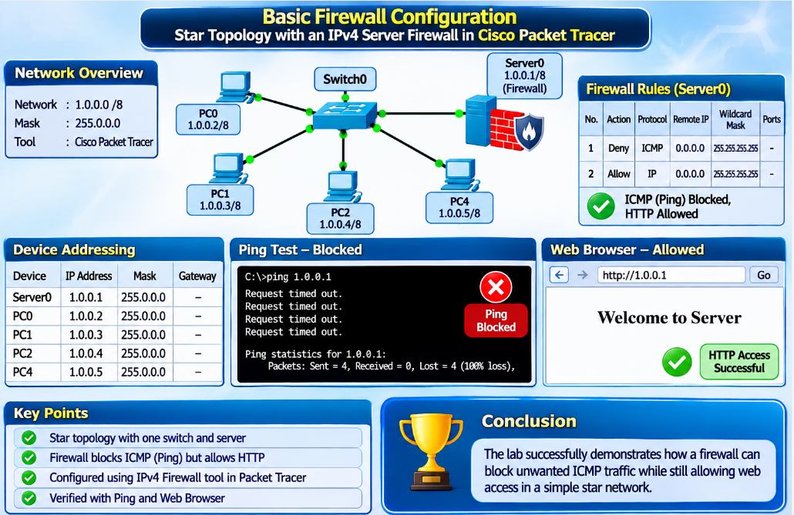
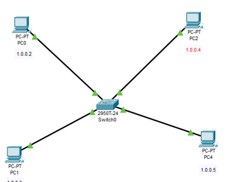
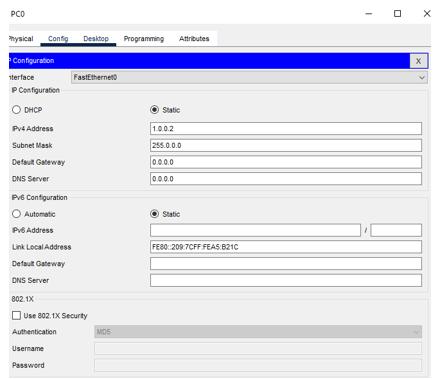
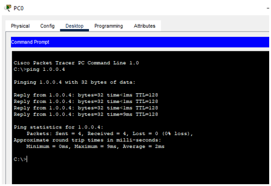
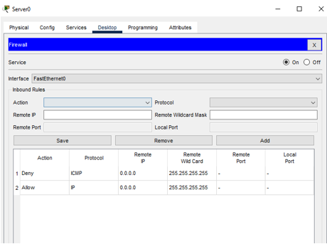
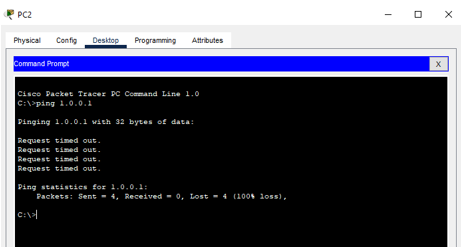
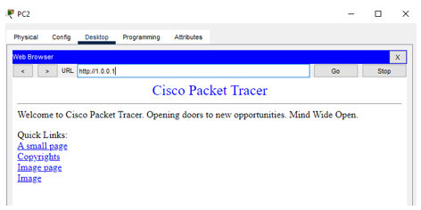

# 🛡️ Basic Firewall Configuration - Star Topology with an IPv4 Server Firewall

<p align="center">
  
</p>

<p align="center"><b>Block Ping (ICMP) · Allow Web (HTTP) · Star Topology · Cisco Packet Tracer</b></p>

<p align="center">
  
  
  
</p>

<p align="center">
  <a href="#-objective">Objective</a> |
  <a href="#-background">Background</a> |
  <a href="#-network-design">Design</a> |
  <a href="#-configuration-steps">Configuration</a> |
  <a href="#-verification">Verification</a> |
  <a href="#-firewall-task-for-the-pcs">PC Firewalls</a> |
  <a href="#-review-questions">Review Questions</a> |
  <a href="#-conclusion">Conclusion</a>
</p>

## 🎯 Objective

Build a small **star network** in Packet Tracer and use the built-in **IPv4 firewall of a server** to block ping (ICMP) while still allowing web access (HTTP).

- [x] Develop a star topology with one switch, PCs and a server
- [x] Configure the PCs and the server with IPv4 addresses and a subnet mask
- [x] Configure the firewall on **Server0** to **deny ICMP** and **allow all other IP traffic**
- [x] Verify the result with ping and with the web browser

## 🧠 Background

### What Is a Firewall?

A firewall is a hardware or software security device that monitors incoming and outgoing traffic and decides what to do with it according to a set of rules. It acts as a **barrier** between a secure internal network and untrusted networks such as the Internet.

| Action | Meaning |
|--------|---------|
| 🟩 **Accept (Allow)** | The traffic is permitted |
| 🟧 **Reject** | The traffic is blocked and the sender receives an "unreachable" error |
| 🟥 **Drop** | The traffic is blocked and the sender gets **no reply at all** |

> [!TIP]
> A simple comparison is a **traffic officer**: both monitor a flow (data or vehicles), apply rules, and decide in real time what may pass.

### IPv4 and IPv6

| Feature | IPv4 | IPv6 |
|---------|------|------|
| **Address size** | 32 bits | 128 bits |
| **Example** | 192.168.1.1 | 2001:0db8::1 |
| **Capacity** | About 4.3 billion addresses | Almost unlimited |
| **Use** | Older, still the most widely used | Newer, designed for the future (phones, IoT) |

This lab uses the **IPv4 firewall** tool of Packet Tracer.

## 🧭 Network Design

### Devices

| Device | Model | Quantity / Role |
|--------|-------|-----------------|
| **PC** | PC-PT | Client computers |
| **Server** | Server-PT (Server0) | 1, protected by the firewall |
| **Switch** | 2950T-24 (Switch0) | 1, centre of the star |

### IP Addressing

All devices are in the same network, **1.0.0.0**, and use the Class A mask **255.0.0.0**. No gateway is needed because there is no router.

| Device | IPv4 address | Subnet mask | Gateway |
|--------|--------------|-------------|---------|
| 🟪 **Server0** | 1.0.0.1 | 255.0.0.0 | Not needed |
| 🟦 **PC0** | 1.0.0.2 | 255.0.0.0 | Not needed |
| 🟦 **PC1** | 1.0.0.3 | 255.0.0.0 | Not needed |
| 🟦 **PC2** | 1.0.0.4 | 255.0.0.0 | Not needed |
| 🟦 **PC4** (extra PC in the screenshot) | 1.0.0.5 | 255.0.0.0 | Not needed |

## 🔧 Configuration Steps

### Step 1: Build the Star Topology

1. Open Cisco Packet Tracer and sign in to the NetAcad account
2. Add the PCs, Server0 and Switch0 to the workspace
3. Click the **Connections** (lightning bolt) icon and choose **Automatically Choose Connection Type**
4. Click each device, then Switch0, so that every device connects to the switch. The ports are picked automatically
5. Wait until all link lights turn **green**

<p align="center">
  
</p>

<p align="center"><i>Figure 1: Star topology with Switch0 at the centre</i></p>

### Step 2: Configure IPv4 Addresses

**Method 1, graphical:** click the device → **Desktop** → **IP Configuration** → **Static**, type the IPv4 address, press **Enter** so the subnet mask `255.0.0.0` fills in, and close the window.

**Method 2, command line:** **Desktop** → **Command Prompt**:

```
C:\> ipconfig 1.0.0.3 255.0.0.0
```

<p align="center">
  
</p>

<p align="center"><i>Figure 2: PC0 IP configuration (static 1.0.0.2 / 255.0.0.0)</i></p>

Repeat for Server0 and every other PC with the addresses in the table.

### Step 3: Test Connectivity Before the Firewall

From PC0 open **Command Prompt** and ping another PC:

```
ping 1.0.0.4
```

<p align="center">
  
</p>

<p align="center"><i>Figure 3: ping 1.0.0.4 from PC0 succeeds (4 of 4 replies, 0% loss, TTL 128)</i></p>

The network and addressing work. No firewall is active on these PCs yet.

### Step 4: Configure the Firewall on Server0

1. Click **Server0** → **Desktop** tab → **Firewall (IPv4)** tool
2. Set **Service** to **On**
3. **Rule 1:** Action = **Deny**, Protocol = **ICMP**, Remote IP = `0.0.0.0`, Remote Wildcard Mask = `255.255.255.255`. Click **Add**
4. **Rule 2:** Action = **Allow**, Protocol = **IP**, Remote IP = `0.0.0.0`, Remote Wildcard Mask = `255.255.255.255`. Click **Add**
5. Check that both rules appear in the table, then close the window

| No. | Action | Protocol | Remote IP | Wildcard mask | Ports |
|:---:|--------|----------|-----------|---------------|-------|
| 1 | 🟥 **Deny** | ICMP | 0.0.0.0 | 255.255.255.255 | - |
| 2 | 🟩 **Allow** | IP | 0.0.0.0 | 255.255.255.255 | - |

<p align="center">
  
</p>

<p align="center"><i>Figure 4: Server0 firewall with Service On and the two inbound rules</i></p>

Remote IP `0.0.0.0` with wildcard mask `255.255.255.255` means **any address**.

> [!IMPORTANT]
> **Why the order matters:** the firewall checks rules **from the top**. A ping is ICMP, so it matches rule 1 and is denied. Web traffic (HTTP over TCP) does not match rule 1, so it is accepted by rule 2. If the two rules were swapped, "Allow IP" would match everything first and the ping would not be blocked.

```
Packet arrives at Server0
        |
        v
Rule 1: Deny ICMP?   --- yes (ping) ---> DROPPED (no reply, 100% loss)
        | no
        v
Rule 2: Allow IP?    --- yes (HTTP) ---> ACCEPTED (web page loads)
```

## 🧪 Verification

### Ping to the Server Is Blocked

On **PC2** open **Command Prompt** and run:

```
ping 1.0.0.1
```

<p align="center">
  
</p>

<p align="center"><i>Figure 5: ping 1.0.0.1 from PC2 is blocked by the firewall (4 sent, 0 received, 100% loss)</i></p>

The firewall silently discards the ICMP packets, so this is the **expected result**.

### Web Access to the Server Works

On PC2: **Desktop** → **Web Browser** → enter `http://1.0.0.1`.

<p align="center">
  
</p>

<p align="center"><i>Figure 6: PC2 opens the Server0 web page at http://1.0.0.1</i></p>

The default Packet Tracer web page loads, so HTTP is allowed by rule 2. Finally save the network as **BASIC FIREWALL CONFIGURATION** (**File → Save**).

### Results Summary

| Test | Result | Reason |
|------|:------:|--------|
| `ping 1.0.0.4` from PC0 (before firewall) | ✅ Success | No firewall rule on PC2 |
| `ping 1.0.0.1` from PC2 | ❌ Blocked (100% loss) | Rule 1 denies ICMP |
| `http://1.0.0.1` from PC2 | ✅ Page loads | Rule 2 allows IP, including TCP/HTTP |

## 💻 Firewall Task for the PCs

The lab also asks for firewalls on **all PCs**, using the same process and the same remote IP and wildcard settings. Open each PC → **Desktop** → **Firewall (IPv4)**, turn the service **On**, and add the **Deny ICMP** rule followed by the **Allow IP** rule.

After this, a ping from **any PC to any other PC fails**, while web access to the server still works.

> [!NOTE]
> Add a screenshot of at least one PC firewall to show this.

## ❓ Review Questions

<details>
<summary><b>Click to expand the 10 review questions and answers</b></summary>

**1. Why is it important to close all windows after configuring a firewall?**
Closing the window finishes the edit and makes sure no half-entered rule is left. In Packet Tracer a rule takes effect once Add or Save is clicked, so closing is a good habit to confirm that nothing is left unsaved.

**2. What steps would you take to save a network configuration?**
Finish all changes, check them, then use File → Save (Ctrl+S) and give the file a name, for example BASIC FIREWALL CONFIGURATION. On routers and switches the running configuration is also saved with `copy running-config startup-config`.

**3. How does a firewall contribute to network security?**
It filters incoming and outgoing traffic against rules, blocks unauthorized access, and reduces exposure to scans, malware and attacks.

**4. What might happen if you forget to save your firewall configuration?**
The changes can be lost when the file or device restarts, which leaves the system unprotected or running old rules that do not match the intended security policy.

**5. Can you list some common features of a basic firewall?**
Traffic filtering, port and protocol blocking, IP allow and deny lists, logging, NAT support, and simple rule-based access control.

**6. Why might you need to close all windows after making changes to a network configuration?**
To make sure the configuration tool has completed its updates, to avoid conflicts between open windows, and to confirm that no unsaved settings remain.

**7. What are the potential risks of not having a firewall configured?**
Unauthorized access, malware infection, data breaches, network scanning and a greater chance of attack from outside.

**8. What are some signs that your firewall is not configured correctly?**
Needed services stop working, websites or servers cannot be reached, many unexpected alerts appear, or logs show denied traffic that should have been allowed (or allowed traffic that should have been blocked).

**9. What is the difference between a basic and an advanced firewall configuration?**
A basic firewall uses simple rules on addresses, protocols and ports. An advanced firewall adds deep packet inspection, intrusion detection and prevention, application-layer filtering and dynamic security policies.

**10. How can you verify that your firewall configuration has been saved successfully?**
Reopen the firewall tool and check that the rules are still listed. Then run a test, such as a ping that should be blocked and a web page that should load, to confirm the expected behavior.

</details>

## 🔎 Observations

> [!NOTE]
> - Figure 1 shows PC0, PC1, PC2 and PC4 but **not Server0**, while Figures 4 to 6 use Server0 at 1.0.0.1. For a consistent report, take a topology screenshot that includes Server0.
> - The firewall was shown only on Server0. The firewall task for the PCs needs its own screenshot.
> - The Action and Protocol boxes in Figure 4 are empty. This is normal after a rule has been added, because the form clears itself.

## 🧯 Troubleshooting

| Symptom | Likely cause | Fix |
|---------|--------------|-----|
| Ping to the server still works | Firewall service is Off, or rules are in the wrong order | Turn Service On; keep Deny ICMP above Allow IP |
| Web page does not load | Allow IP rule missing, or the HTTP service is off | Add rule 2 and turn HTTP On under Services |
| Ping between PCs fails before any firewall | Wrong address or mask | Recheck `1.0.0.x` and `255.0.0.0` on each device |
| Rules disappeared | Not saved, or file reopened without saving | Save with File → Save and recheck the firewall tool |
| Link light is red | Cable not connected to the switch | Reconnect and wait for green |

## 🏁 Conclusion

A star network with addresses in **1.0.0.0/8** was built and its connectivity was confirmed with a successful ping between PCs. The IPv4 firewall on **Server0** was set with a **Deny ICMP** rule followed by an **Allow IP** rule. As a result, ping to the server timed out with 100% loss, while the web page at `http://1.0.0.1` loaded. This shows how an **ordered firewall rule list** can block one type of traffic and still allow the services that are needed.

## 🎓 What I Learned

- What a firewall does and the three actions: accept, reject and drop
- The difference between IPv4 and IPv6
- Setting static IPv4 addresses with the GUI and with the `ipconfig` command
- Building firewall rules with a wildcard mask, and why **rule order matters**
- Verifying a firewall with a blocked ping and an allowed web page

## 🚀 How to Use This Repository

```bash
git clone https://github.com/sanawar-imran-securityengineer/Basic-Firewall-Lab.git
```

1. Rebuild the star topology in Packet Tracer
2. Set the 1.0.0.x addresses with mask 255.0.0.0
3. Add the Deny ICMP and Allow IP rules on Server0
4. Test with ping and the web browser

## 📞 Connect With Me

<p align="center">
  <a href="mailto:sanawarimran.pk@gmail.com"></a>
  <a href="https://www.linkedin.com/in/sanawarimran"></a>
  <a href="https://github.com/sanawar-imran-securityengineer"></a>
  <a href="https://medium.com/@sanawarimran.pk"></a>
</p>

## 📄 License

This project is created for **educational purposes** and is open-source.

<h3 align="center">⭐ If you found this helpful, please give it a star!</h3>

<p align="center"><b>Made with 🛡️ by SANAWAR IMRAN</b></p>

<p align="center"><i>Last Updated: November 2026</i></p>
