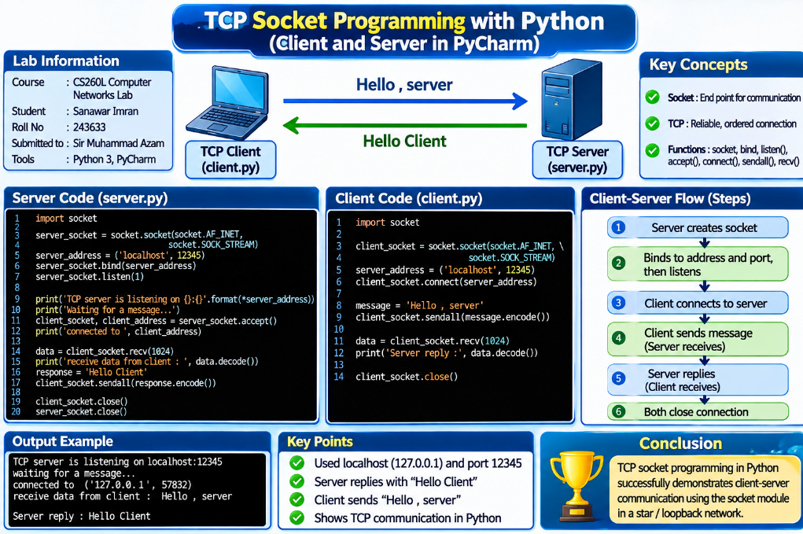
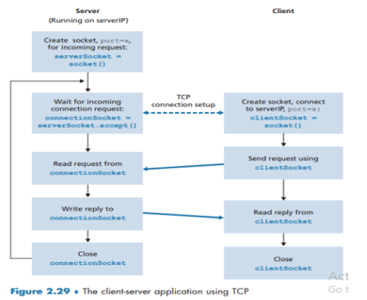
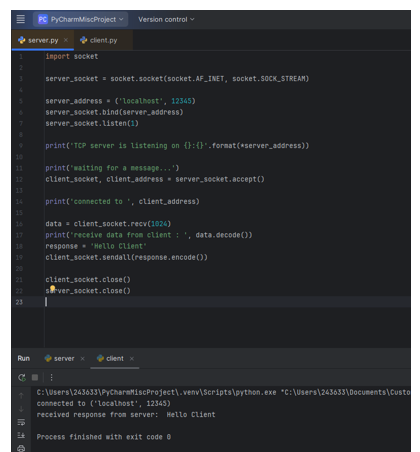
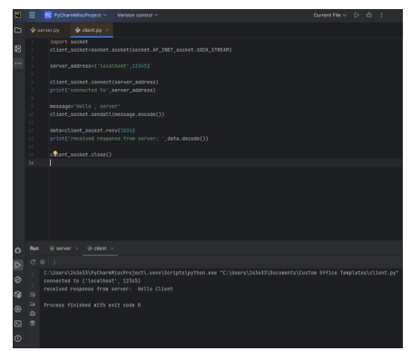

# 🔌 TCP Socket Programming in Python - Client and Server

<p align="center">
  
</p>

<p align="center"><b>Python 3 · TCP Client and Server · PyCharm · localhost:12345</b></p>

<p align="center">
  
  
  
  
  
</p>

<p align="center">
  <a href="#-objective">Objective</a> |
  <a href="#-theory">Theory</a> |
  <a href="#-the-client-server-flow">Flow</a> |
  <a href="#-setup">Setup</a> |
  <a href="#-server-code-serverpy">Server</a> |
  <a href="#-client-code-clientpy">Client</a> |
  <a href="#-how-to-run">Run</a> |
  <a href="#-common-errors-and-fixes">Errors</a> |
  <a href="#-optional-improvements">Improvements</a> |
  <a href="#-viva-questions">Viva</a>
</p>

## 🎯 Objective

Write two small Python programs, a **TCP server** and a **TCP client**, and run them on the same computer so that:

1. The client connects to the server
2. The client sends the message **"Hello , server"**
3. The server replies with **"Hello Client"**

The lab shows how the socket calls in **Figure 2.29** of the textbook map to real code.

## 🧠 Theory

### What Is a Socket?

A socket is **one end of a two-way communication link** between two programs on a network. A program writes bytes into its socket and the network delivers them to the socket of the other program. A socket is identified by an **IP address and a port number**.

### Why TCP?

| TCP property | Meaning |
|--------------|---------|
| **Connection-oriented** | A connection is set up first (three-way handshake) and closed at the end |
| **Reliable** | Lost data is sent again; nothing is missing at the receiver |
| **Ordered** | Bytes arrive in the same order they were sent |
| **Byte stream** | No message boundaries; the program reads bytes, not packets |
| **In Python** | Created with `socket.SOCK_STREAM` (UDP uses `SOCK_DGRAM`) |

### Socket Functions Used in This Lab

| Function | Used by | Purpose |
|----------|:-------:|---------|
| `socket.socket(AF_INET, SOCK_STREAM)` | Both | Create a TCP socket using IPv4 |
| `bind((host, port))` | Server | Attach the socket to an address and port |
| `listen(n)` | Server | Start waiting for connections; n is the queue length |
| `accept()` | Server | Wait for a client and return a new socket plus the client address |
| `connect((host, port))` | Client | Start the TCP connection to the server |
| `sendall(bytes)` | Both | Send all the bytes; the text must be encoded first |
| `recv(1024)` | Both | Receive up to 1024 bytes |
| `close()` | Both | Close the socket and free the resources |

### Addresses Used

- **`localhost`** is a name for this same computer. It resolves to the IPv4 address **127.0.0.1**
- **`12345`** is the port the server listens on. The client must use the same number. Ports 1024 to 65535 are free for user programs
- Both programs run on one computer, so no real network cable is used. The data goes through the **loopback interface**

## 🔁 The Client-Server Flow

The server is started **first** and waits. The client then connects, sends a request, reads the reply and closes. The server then closes the connection.

<p align="center">
  
</p>

<p align="center"><i>Figure 1: The client-server application using TCP (Figure 2.29 of the lab sheet)</i></p>

```
        SERVER                                    CLIENT
   create socket                              create socket
   bind() + listen()                                |
   accept()  ... waiting ...                        |
        |  <------------ connect() --------------- |   (connection setup)
        |  <---- "Hello , server" (sendall) ------ |   (request)
   recv() -> print                                  |
        |  ----- "Hello Client" (sendall) -------> |   (reply)
        |                                      recv() -> print
   close()                                      close()
```

Each box of the diagram maps to a line of code:

| Step | Server side | Client side |
|------|-------------|-------------|
| **1. Create socket** | `server_socket = socket.socket(...)` | `client_socket = socket.socket(...)` |
| **2. Prepare** | `bind(server_address)` and `listen(1)` | (nothing; the server must already be running) |
| **3. Connection setup** | `client_socket, client_address = server_socket.accept()` | `client_socket.connect(server_address)` |
| **4. Request** | `data = client_socket.recv(1024)` | `client_socket.sendall(message.encode())` |
| **5. Reply** | `client_socket.sendall(response.encode())` | `data = client_socket.recv(1024)` |
| **6. Close** | `client_socket.close()` and `server_socket.close()` | `client_socket.close()` |

> [!NOTE]
> The diagram calls the socket returned by `accept()` **"connectionSocket"**. In this code it is named `client_socket` on the server side. The two names mean the same thing: the socket used to talk to that one client.

## 🧰 Setup

1. Install **Python 3** from python.org (tick **"Add Python to PATH"**) and install **PyCharm Community Edition**
2. In PyCharm create a new project, for example `PyCharmMiscProject`
3. Create two files in the same project: `server.py` and `client.py` (right click the project → **New** → **Python File**)
4. Paste the code from the next two sections into the matching files and save them

> [!TIP]
> No extra library is required. The `socket` module comes with Python.

## 📤 Server Code (server.py)

```python
import socket

# Create a TCP socket
server_socket = socket.socket(socket.AF_INET, socket.SOCK_STREAM)

# Bind to address and port, then listen
server_address = ('localhost', 12345)
server_socket.bind(server_address)
server_socket.listen(1)

print('TCP server is listening on {}:{}'.format(*server_address))

# Wait for a client
print('waiting for a message...')
client_socket, client_address = server_socket.accept()
print('connected to ', client_address)

# Receive and reply
data = client_socket.recv(1024)
print('receive data from client : ', data.decode())
response = 'Hello Client'
client_socket.sendall(response.encode())

# Close
client_socket.close()
server_socket.close()
```

### Explanation

| Code | What it does |
|------|--------------|
| `import socket` | Loads Python's socket module so network functions can be used |
| `socket.socket(socket.AF_INET, socket.SOCK_STREAM)` | Creates a TCP socket. `AF_INET` means IPv4, `SOCK_STREAM` means TCP |
| `server_address = ('localhost', 12345)` | Address and port the server will use, stored as a tuple |
| `server_socket.bind(server_address)` | Attaches the socket to this address and port |
| `server_socket.listen(1)` | Puts the socket in listening mode. At most 1 waiting connection is queued |
| `print('TCP server is listening on {}:{}'.format(*server_address))` | Shows the address. The `*` unpacks the tuple into the two `{}` places |
| `server_socket.accept()` | **Blocks** (waits) until a client connects, then returns a new socket and the client's address |
| `data = client_socket.recv(1024)` | Reads up to 1024 bytes sent by the client |
| `data.decode()` | Turns the received bytes into a normal string so it can be printed |
| `client_socket.sendall(response.encode())` | Turns the string into bytes and sends all of them back to the client |
| `client_socket.close()` and `server_socket.close()` | Closes the client connection and the listening socket |

<p align="center">
  
</p>

<p align="center"><i>Figure 2: server.py in PyCharm</i></p>

## 📥 Client Code (client.py)

```python
import socket

client_socket = socket.socket(socket.AF_INET, socket.SOCK_STREAM)

server_address = ('localhost', 12345)

client_socket.connect(server_address)
print('connected to', server_address)

message = 'Hello , server'
client_socket.sendall(message.encode())

data = client_socket.recv(1024)
print('received response from server: ', data.decode())

client_socket.close()
```

### Explanation

| Code | What it does |
|------|--------------|
| `socket.socket(socket.AF_INET, socket.SOCK_STREAM)` | Creates a TCP socket for the client |
| `server_address = ('localhost', 12345)` | The address and port of the server. They must match the server exactly |
| `client_socket.connect(server_address)` | Starts the TCP connection (three-way handshake). It fails if the server is not running |
| `message = 'Hello , server'` | The text to send |
| `client_socket.sendall(message.encode())` | Sockets send bytes, so `encode()` converts the text to bytes first |
| `data = client_socket.recv(1024)` | Waits for the reply from the server |
| `data.decode()` | Converts the reply bytes back to text |
| `client_socket.close()` | Ends the connection and frees the socket |

<p align="center">
  
</p>

<p align="center"><i>Figure 3: client.py and its output in PyCharm</i></p>

## 🚀 How to Run

> [!IMPORTANT]
> **Golden rule:** always start the **server first**, then the client. The server must already be waiting when the client tries to connect.

### In PyCharm

1. Open `server.py` and click **Run** (the green triangle). A Run tab named "server" opens and shows that it is listening and waiting
2. Open `client.py` and click **Run**. A second Run tab named "client" opens
3. Switch between the "server" and "client" tabs at the bottom of PyCharm and take a screenshot of each one

### From the Command Line (Alternative)

Open two terminals in the folder that has the files.

```bash
# Terminal 1
python server.py

# Terminal 2
python client.py
```

### Expected Output

**Server console:**

```
TCP server is listening on localhost:12345
waiting for a message...
connected to  ('127.0.0.1', 48448)
receive data from client :  Hello , server
```

**Client console:**

```
connected to ('localhost', 12345)
received response from server:  Hello Client
```

The number `48448` is the temporary port the operating system gave to the client. It is **different on every run**, so your number will not match. The client output ends with `Process finished with exit code 0`, which means the program ended without error. After the client finishes, the server also ends.

## 🌐 What Happens on the Network

| # | Event | Where |
|:-:|-------|-------|
| 1 | Server calls `bind()`, `listen()` and then `accept()`; it now waits | Server |
| 2 | Client calls `connect()`; a **SYN** packet is sent | Client → server |
| 3 | Server replies with **SYN-ACK** | Server → client |
| 4 | Client sends **ACK**; the connection is established and `accept()` returns | Client → server |
| 5 | Client sends "Hello , server" as bytes | Client → server |
| 6 | Server prints it and sends "Hello Client" | Server → client |
| 7 | Both sides call `close()`; **FIN** packets end the connection | Both |

> [!TIP]
> Optional: to see these packets, install **Wireshark** with **Npcap**, capture on the **"Adapter for loopback traffic capture"**, and use the display filter `tcp.port == 12345`.

## 🧯 Common Errors and Fixes

| Error | Cause | Fix |
|-------|-------|-----|
| `ConnectionRefusedError (WinError 10061)` | Client started before the server, or the server already finished | Run `server.py` first and wait for the "waiting" message |
| `OSError: Address already in use (WinError 10048)` | An old server is still running, or the port is in the TIME_WAIT state | Stop the old run (red square in PyCharm), wait a minute, or change the port in both files |
| Client waits forever | Server is not replying, or the ports do not match | Check that both files use 12345 and that the server has `sendall()` |
| `TypeError: a bytes-like object is required` | Text was sent without `encode()` | Use `message.encode()` when sending |
| Output looks like `b'Hello'` | Received bytes were printed without `decode()` | Use `data.decode()` |
| Nothing happens when Run is clicked | PyCharm runs the file that is currently open | Check the file tab before clicking Run |
| Firewall popup or blocked connection | Windows asks permission for Python | Click **Allow access** (private networks) |

## 🔄 Optional Improvements

The basic server serves **one client** and then stops. In Figure 1, the server has an arrow that goes back to "wait for incoming connection request": a real server **loops** and serves many clients one after the other. This version does that (tested with two clients one after another):

```python
import socket

server_socket = socket.socket(socket.AF_INET, socket.SOCK_STREAM)
server_socket.setsockopt(socket.SOL_SOCKET, socket.SO_REUSEADDR, 1)
server_socket.bind(('localhost', 12345))
server_socket.listen(5)

print('TCP server is listening on localhost:12345 (press Ctrl+C to stop)')

try:
    while True:
        client_socket, client_address = server_socket.accept()
        print('connected to', client_address)
        with client_socket:
            data = client_socket.recv(1024)
            if not data:
                continue
            print('received from client:', data.decode())
            client_socket.sendall('Hello Client'.encode())
        print('connection closed')
except KeyboardInterrupt:
    print('server stopped')
finally:
    server_socket.close()
```

| Change | Why |
|--------|-----|
| `while True` | The server accepts client after client |
| `SO_REUSEADDR` | Avoids the "Address already in use" error after a restart |
| `with client_socket:` | Closes each client socket automatically |
| `Ctrl+C` handling | Stops the server cleanly |
| `listen(5)` | Allows 5 waiting clients |

> [!NOTE]
> **To use two different computers:** on the server change `'localhost'` to `'0.0.0.0'` in `bind()`; on the client change `'localhost'` to the server computer's IPv4 address (check it with `ipconfig`). Both computers must be on the same network and the firewall must allow port 12345.

## 🎤 Viva Questions

<details>
<summary><b>Click to expand questions and answers</b></summary>

| Question | Answer |
|----------|--------|
| What is a socket? | One end of a communication link between two programs, identified by an IP address and a port |
| Difference between TCP and UDP? | TCP is connection-oriented, reliable and ordered. UDP is connectionless, faster and has no delivery guarantee |
| What does `SOCK_STREAM` mean? | It selects a TCP byte-stream socket. UDP uses `SOCK_DGRAM` |
| What does `AF_INET` mean? | The IPv4 address family |
| What does `bind()` do? | Attaches the server socket to an IP address and a port |
| What does `listen(1)` do? | Makes the socket wait for connections and allows 1 pending connection in the queue |
| What does `accept()` return? | A new socket for that client and the client's address |
| Why `encode()` and `decode()`? | The network carries bytes, not Python strings. `encode` converts text to bytes and `decode` converts bytes to text |
| Difference between `send()` and `sendall()`? | `send()` may send only part of the data. `sendall()` keeps sending until all the data is sent |
| Why must the server run first? | `connect()` fails with "connection refused" if no server is listening on that port |
| Which side picks its port number? | The server uses a fixed port (12345). The operating system gives the client a temporary one |

</details>

## 📸 Evidence Checklist

| Evidence | Status | Figure |
|----------|:------:|:------:|
| `server.py` code in PyCharm | ✅ Included | Figure 2 |
| `client.py` code in PyCharm | ✅ Included | Figure 3 |
| Client Run tab showing "Hello Client" and exit code 0 | ✅ Included | Figure 3 |
| Server Run tab showing "listening", "waiting", "connected to" and the received message | ⬜ To add | - |
| Optional: Wireshark capture or the looping server | ⬜ Optional | - |

> [!NOTE]
> The current screenshots show the **client output only**. Add the Run tab of the **server** as well, so the report proves both sides of the connection.

## 🏁 Conclusion

A TCP server and client were written in Python using the `socket` module. The server created a socket, bound it to `localhost:12345`, listened, and accepted the client's connection. The client connected, sent **"Hello , server"**, and received **"Hello Client"**. Both sides then closed their sockets. The output matched the flow in Figure 2.29, which confirms that the TCP communication works correctly.

## 🎓 What I Learned

- What a socket is and how TCP differs from UDP
- The order of socket calls: `bind` → `listen` → `accept` on the server and `connect` on the client
- Why text must be `encode()`d before sending and `decode()`d after receiving
- Why the server must be started first
- How a looping server with `SO_REUSEADDR` can serve many clients

## 🚀 How to Use This Repository

```bash
git clone https://github.com/sanawar-imran-securityengineer/TCP-Socket-Programming.git
cd TCP-Socket-Programming
python server.py
```

Then, in a second terminal:

```bash
python client.py
```

## 📞 Connect With Me

<p align="center">
  <a href="mailto:sanawarimran.pk@gmail.com"></a>
  <a href="https://www.linkedin.com/in/sanawarimran"></a>
  <a href="https://github.com/sanawar-imran-securityengineer"></a>
  <a href="https://medium.com/@sanawarimran.pk"></a>
</p>

## 📄 License

This project is created for **educational purposes** and is open-source.

<h3 align="center">⭐ If you found this helpful, please give it a star!</h3>

<p align="center"><b>Made with 💚 by SANAWAR IMRAN</b></p>

<p align="center"><i>Last Updated: November 2026</i></p>
