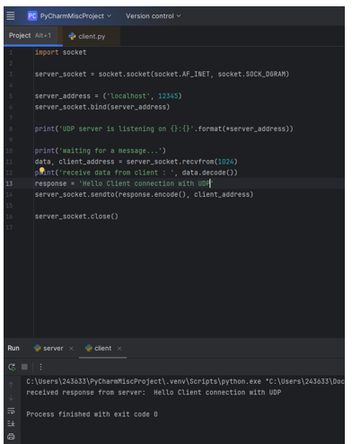
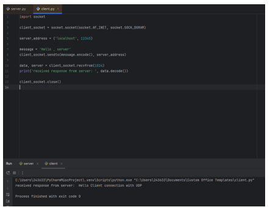

# 📨 UDP Socket Programming in Python - Client and Server

<p align="center">
  
</p>

<p align="center"><b>Python 3 · UDP Client and Server · Datagrams · PyCharm · localhost:12345</b></p>

<p align="center">
  
  
  
  
  
</p>

<p align="center">
  <a href="#-objective">Objective</a> |
  <a href="#-theory">Theory</a> |
  <a href="#-flow-of-communication">Flow</a> |
  <a href="#-setup">Setup</a> |
  <a href="#-server-code-serverpy">Server</a> |
  <a href="#-client-code-clientpy">Client</a> |
  <a href="#-how-to-run">Run</a> |
  <a href="#-does-udp-really-lose-data">Data Loss</a> |
  <a href="#-optional-improvements">Improvements</a> |
  <a href="#-viva-questions">Viva</a>
</p>


## 🎯 Objective

Write a **UDP server** and a **UDP client** in Python and run them on the same computer.

1. The client sends the message **"Hello , server"**
2. The server replies with **"Hello Client connection with UDP"**

The lab shows how UDP differs from the TCP lab: there is **no connection set-up**, and data travels as **separate datagrams**.

## 🧠 Theory

### What Is UDP?

**UDP (User Datagram Protocol)** is a transport protocol that sends independent packets called **datagrams**. It does not create a connection first, does not guarantee delivery, and does not guarantee order. In exchange it is simple and fast, which is why it is used for **DNS, video calls, online games and streaming**.

### TCP vs UDP

| Point | 🟦 TCP (previous lab) | 🟪 UDP (this lab) |
|-------|----------------------|-------------------|
| **Connection** | Connection-oriented (three-way handshake) | Connectionless; just send |
| **Reliability** | Reliable; lost data is resent | Not reliable; lost datagrams are not resent |
| **Order** | Delivered in order | May arrive out of order |
| **Data unit** | Byte stream | Separate datagrams with boundaries kept |
| **Python socket type** | `SOCK_STREAM` | `SOCK_DGRAM` |
| **Server calls** | `bind`, `listen`, `accept`, `recv`, `sendall` | `bind`, `recvfrom`, `sendto` (no listen or accept) |
| **Client calls** | `connect`, `sendall`, `recv` | `sendto`, `recvfrom` (no connect) |
| **Speed** | Slower (more overhead) | Faster (less overhead) |

### Socket Functions Used in This Lab

| Function | Used by | Purpose |
|----------|:-------:|---------|
| `socket.socket(AF_INET, SOCK_DGRAM)` | Both | Create a UDP socket using IPv4 |
| `bind((host, port))` | Server | Attach the socket to an address and port so datagrams can arrive |
| `sendto(bytes, address)` | Both | Send one datagram to the given address |
| `recvfrom(1024)` | Both | Wait for one datagram; returns the data and the sender's address |
| `close()` | Both | Close the socket and free the resources |

> [!IMPORTANT]
> **Key idea:** UDP has no connection, so the socket does not remember who it is talking to. The address must be given **every time** with `sendto()`, and `recvfrom()` tells the receiver **who sent** the datagram. This is how the server knows where to send its reply.

## 🔀 Flow of Communication

```
        SERVER                                      CLIENT
   create UDP socket                           create UDP socket
   bind(('localhost', 12345))                  (no bind: the OS picks a port)
   recvfrom()  ... waiting ...                        |
        |  <------- sendto("Hello , server") ------- |   (request)
   gets data + client_address                         |
        |  --- sendto("Hello Client connection with UDP") --> |   (reply)
        |                                      recvfrom() -> print
   close()                                       close()
```

| Step | Server side | Client side |
|:----:|-------------|-------------|
| **1. Create socket** | `socket.socket(AF_INET, SOCK_DGRAM)` | `socket.socket(AF_INET, SOCK_DGRAM)` |
| **2. Prepare** | `bind(('localhost', 12345))` | (no bind needed; the OS picks a port) |
| **3. Wait** | `data, client_address = recvfrom(1024)` | - |
| **4. Send request** | - | `sendto(message.encode(), server_address)` |
| **5. Receive request** | `recvfrom` returns the data and the client address | - |
| **6. Send reply** | `sendto(response.encode(), client_address)` | - |
| **7. Receive reply** | - | `data, server = recvfrom(1024)` |
| **8. Close** | `server_socket.close()` | `client_socket.close()` |

> [!NOTE]
> There is **no "connection setup" step**. Compare this with the TCP lab, where `accept()` and `connect()` were needed.

## 🧰 Setup

1. Use the same PyCharm project as in the TCP lab, or create a new one
2. Create `server.py` and `client.py`. If they are already used for TCP, keep the TCP versions in a different folder or rename them so they are not overwritten
3. Paste the code from the next two sections into the matching files and save

> [!TIP]
> No extra library is required. The `socket` module comes with Python.

## 📤 Server Code (server.py)

```python
import socket

server_socket = socket.socket(socket.AF_INET, socket.SOCK_DGRAM)

server_address = ('localhost', 12345)
server_socket.bind(server_address)

print('UDP server is listening on {}:{}'.format(*server_address))

print('waiting for a message...')
data, client_address = server_socket.recvfrom(1024)
print('receive data from client : ', data.decode())
response = 'Hello Client connection with UDP'
server_socket.sendto(response.encode(), client_address)

server_socket.close()
```

### Explanation

| Code | What it does |
|------|--------------|
| `import socket` | Loads the socket module |
| `socket.socket(socket.AF_INET, socket.SOCK_DGRAM)` | Creates a UDP socket. `AF_INET` is IPv4, `SOCK_DGRAM` is UDP |
| `server_address = ('localhost', 12345)` | Address and port for the server |
| `server_socket.bind(server_address)` | Attaches the socket to that address and port. Without `bind` the client could not reach the server |
| `print('UDP server is listening on {}:{}'.format(*server_address))` | Shows where the server is waiting |
| `data, client_address = server_socket.recvfrom(1024)` | Waits for one datagram of up to 1024 bytes and also gets the sender's address |
| `data.decode()` | Converts the received bytes into text |
| `server_socket.sendto(response.encode(), client_address)` | Sends the reply as one datagram back to the address the request came from |
| `server_socket.close()` | Closes the socket |

<p align="center">
  
</p>

<p align="center"><i>Figure 1: server.py in PyCharm</i></p>

> [!NOTE]
> This server handles **one message and then closes**. That is fine for the lab. The lab sheet's version puts the receive and send part inside `while True` so the server keeps answering. That version is in [Optional Improvements](#-optional-improvements).

## 📥 Client Code (client.py)

```python
import socket

client_socket = socket.socket(socket.AF_INET, socket.SOCK_DGRAM)

server_address = ('localhost', 12345)

message = 'Hello , server'
client_socket.sendto(message.encode(), server_address)

data, server = client_socket.recvfrom(1024)
print('received response from server: ', data.decode())

client_socket.close()
```

### Explanation

| Code | What it does |
|------|--------------|
| `socket.socket(socket.AF_INET, socket.SOCK_DGRAM)` | Creates a UDP socket |
| `server_address = ('localhost', 12345)` | Where the datagram will be sent. Must match the server |
| `message = 'Hello , server'` | The text to send |
| `client_socket.sendto(message.encode(), server_address)` | Converts the text to bytes and sends one datagram. No `connect()` is needed |
| `data, server = client_socket.recvfrom(1024)` | Waits for the reply. The second value is the address of the sender |
| `data.decode()` | Converts the reply bytes back to text |
| `client_socket.close()` | Closes the socket |

<p align="center">
  
</p>

<p align="center"><i>Figure 2: client.py and its output in PyCharm</i></p>

## 🚀 How to Run

> [!WARNING]
> **Golden rule:** start the **server first**, then the client. UDP does **not** warn you if nobody is listening: the client simply waits for a reply that never comes.

### In PyCharm

1. Open `server.py` and click **Run**. The "server" Run tab shows that it is listening and waiting
2. Open `client.py` and click **Run**. A second Run tab named "client" opens
3. Take a screenshot of the client tab and of the server tab

### From the Command Line (Alternative)

```bash
# Terminal 1
python server.py

# Terminal 2
python client.py
```

### Expected Output

**Server console:**

```
UDP server is listening on localhost:12345
waiting for a message...
receive data from client :  Hello , server
```

**Client console:**

```
received response from server:  Hello Client connection with UDP
```

The client output ends with `Process finished with exit code 0`, which means the program ended without errors.

> [!NOTE]
> **Difference from TCP:** in the TCP lab the output had a "connected to" line because `accept()` and `connect()` create a connection. In UDP there is no connection, so there is **no such line**.

## 🧯 Common Errors and Fixes

| Problem | Cause | Fix |
|---------|-------|-----|
| Client runs forever with no output | Server is not running, or the ports do not match. UDP gives no error | Start `server.py` first; check both files use 12345; use a timeout (see below) |
| `ConnectionResetError (WinError 10054)` on Windows | Client sent to a port where nobody listens and Windows reported it | Start the server first |
| `OSError: Address already in use (WinError 10048)` | An older server is still running on the same port | Stop the old run (red square) and run again, or change the port in both files |
| `TypeError: a bytes-like object is required` | Text sent without `encode()` | Use `message.encode()` |
| Output looks like `b'Hello'` | Printed bytes without `decode()` | Use `data.decode()` |
| Wrong file runs | PyCharm runs the file that is open | Check the file tab before clicking Run |
| Windows Firewall popup | Python needs network permission | Click **Allow access** |

## 📉 Does UDP Really Lose Data?

On localhost the datagram almost never gets lost, so the program looks as reliable as TCP. On a **real network**, routers can drop datagrams when they are busy, and UDP will **not resend** them. The application itself must decide what to do. A common method is a **timeout**: wait for a reply for a few seconds and then try again or report an error.

## 🔄 Optional Improvements

### Server That Keeps Running (as in the Lab Sheet)

Uses `while True` so it can answer many clients (tested with two clients one after the other):

```python
import socket

server_socket = socket.socket(socket.AF_INET, socket.SOCK_DGRAM)
server_socket.bind(('localhost', 12345))
print('UDP server is listening on localhost:12345 (press Ctrl+C to stop)')

try:
    while True:
        data, client_address = server_socket.recvfrom(1024)
        print('Received data from {}: {}'.format(client_address, data.decode()))
        response = 'Hello Client connection with UDP'
        server_socket.sendto(response.encode(), client_address)
except KeyboardInterrupt:
    print('server stopped')
finally:
    server_socket.close()
```

The loop is infinite, so `close()` is never reached in the sheet version. Here **Ctrl+C** stops it and the `finally` block closes the socket.

### Client With a Timeout

Waits at most 3 seconds. If the server is not running it prints a message instead of hanging (tested with the server turned off):

```python
import socket

client_socket = socket.socket(socket.AF_INET, socket.SOCK_DGRAM)
client_socket.settimeout(3)          # wait at most 3 seconds for a reply

server_address = ('localhost', 12345)
client_socket.sendto('Hello , server'.encode(), server_address)

try:
    data, server = client_socket.recvfrom(1024)
    print('received response from {}: {}'.format(server, data.decode()))
except socket.timeout:
    print('No reply: the server is not running or the packet was lost')
finally:
    client_socket.close()
```

> [!TIP]
> **To use two computers:** in the server use `'0.0.0.0'` instead of `'localhost'` in `bind()`; in the client use the server computer's IPv4 address (find it with `ipconfig`). Both computers must be on the same network, and the firewall must allow **UDP port 12345**.

## 🎤 Viva Questions

<details>
<summary><b>Click to expand questions and answers</b></summary>

| Question | Answer |
|----------|--------|
| What is UDP? | A connectionless transport protocol that sends independent datagrams without guaranteeing delivery or order |
| Why is UDP called connectionless? | No handshake is done before sending. The sender just sends the datagram |
| What does `SOCK_DGRAM` mean? | It selects a UDP (datagram) socket. TCP uses `SOCK_STREAM` |
| Why are `listen()` and `accept()` not used in UDP? | There is no connection to wait for or accept. The server just waits for datagrams with `recvfrom()` |
| Why does the client not call `connect()`? | No connection is needed; the address is given in every `sendto()` |
| What does `recvfrom()` return? | The data and the address of the sender |
| How does the server know where to reply? | `recvfrom()` returns `client_address`, which is used in `sendto()` |
| Why `encode()` and `decode()`? | Sockets carry bytes, not strings |
| Which port does the client use? | The operating system gives it a temporary port automatically |
| Name some uses of UDP | DNS, video and voice calls, online games, live streaming |
| Is UDP faster than TCP? Why? | Yes, because it has no handshake, no acknowledgements and no retransmission |

</details>

## 📸 Evidence Checklist

| Evidence | Status | Figure |
|----------|:------:|:------:|
| `server.py` code in PyCharm | ✅ Included | Figure 1 |
| `client.py` code and output in PyCharm | ✅ Included | Figure 2 |
| Server Run tab showing "listening", "waiting" and the received message | ⬜ To add | - |
| Optional: the looping server answering two clients | ⬜ Optional | - |

> [!NOTE]
> The current screenshots show the **client output only**. Add the server Run tab too, so both sides of the communication are shown.

## 🏁 Conclusion

A UDP server and client were written in Python using `SOCK_DGRAM` sockets. The server bound to `localhost:12345` and waited with `recvfrom()`. The client sent **"Hello , server"** with `sendto()` and received **"Hello Client connection with UDP"**. **No connection was created at any point**, which is the main difference from TCP. The program ran successfully with exit code 0.

## 🎓 What I Learned

- What UDP is and how it differs from TCP
- Why UDP uses `sendto()` and `recvfrom()` instead of `connect()`, `listen()` and `accept()`
- How the server learns the client's address from `recvfrom()`
- Why UDP gives no error when nobody is listening, and how a timeout helps
- Why `encode()` and `decode()` are needed

## 🚀 How to Use This Repository

```bash
git clone https://github.com/sanawar-imran-securityengineer/UDP-Socket-Programming.git
cd UDP-Socket-Programming
python server.py
```

Then, in a second terminal:

```bash
python client.py
```

## 📞 Connect With Me

<p align="center">
  <a href="mailto:sanawarimran.pk@gmail.com"></a>
  <a href="https://www.linkedin.com/in/sanawarimran"></a>
  <a href="https://github.com/sanawar-imran-securityengineer"></a>
  <a href="https://medium.com/@sanawarimran.pk"></a>
</p>

## 📄 License

This project is created for **educational purposes** and is open-source.

<h3 align="center">⭐ If you found this helpful, please give it a star!</h3>

<p align="center"><b>Made with 💜 by SANAWAR IMRAN</b></p>

<p align="center"><i>Last Updated: November 2026</i></p>
