<p align="center">
  
</p>

<p align="center">
  
</p>

<p align="center">
  <a href="https://github.com/sanawar-imran-securityengineer">
    
  </a>
</p>

<p align="center">
  
  
  
  
  
</p>

<p align="center">
  
  
  
  
  
  
</p>

<p align="center"><b>13 hands-on labs · 6 CCNA domains · 13 extra parts covering all of computer networks · protocols, techniques, configurations and cheat sheets in one place</b></p>

<p align="center"></p>

## 📑 Table of Contents

<table>
<tr>
<td valign="top">

**Start here**
- [📖 About This Repository](#-about-this-repository)
- [🧭 Learning Roadmap](#-learning-roadmap)
- [📚 Lab Index](#-lab-index)
- [🏢 Enterprise Network Architecture](#-enterprise-network-architecture)

**Theory by CCNA domain**
- [🌐 Domain 1: Network Fundamentals](#-domain-1-network-fundamentals)
- [🔀 Domain 2: Network Access](#-domain-2-network-access)
- [🚦 Domain 3: IP Connectivity](#-domain-3-ip-connectivity)

</td>
<td valign="top">

**More theory**
- [🧩 Domain 4: IP Services](#-domain-4-ip-services)
- [🔐 Domain 5: Security Fundamentals](#-domain-5-security-fundamentals)
- [🤖 Domain 6: Automation and Programmability](#-domain-6-automation-and-programmability)
- [🌍 WAN Technologies](#-wan-technologies)
- [🔌 Socket Programming (TCP vs UDP)](#-socket-programming-tcp-vs-udp)

</td>
<td valign="top">

**Practice and reference**
- [🧪 Troubleshooting](#-troubleshooting)
- [🧰 Cisco IOS CLI Essentials](#-cisco-ios-cli-essentials)
- [📋 Cheat Sheets](#-cheat-sheets)
- [🔤 Glossary](#-glossary)
- [🎓 CCNA Exam Blueprint](#-ccna-exam-blueprint)
- [📞 Connect With Me](#-connect-with-me)

</td>
</tr>
</table>

<table>
<tr>
<td valign="top">

**🌌 Beyond CCNA: all of computer networks**
- [🔭 B1 Network Types and Models](#-b1-network-types-and-models)
- [📡 B2 Physical Layer and Data Transmission](#-b2-physical-layer-and-data-transmission)
- [🔗 B3 Data Link Layer in Depth](#-b3-data-link-layer-in-depth)
- [🧭 B4 Network Layer in Depth](#-b4-network-layer-in-depth)
- [🚚 B5 Transport Layer in Depth](#-b5-transport-layer-in-depth)

</td>
<td valign="top">

**&nbsp;**
- [🌍 B6 Application Layer Protocols](#-b6-application-layer-protocols)
- [🔒 B7 Cryptography and Network Security](#-b7-cryptography-and-network-security)
- [📶 B8 Wireless, Mobile and IoT](#-b8-wireless-mobile-and-iot)
- [🚀 B9 Modern Networking](#-b9-modern-networking)
- [📈 B10 Network Performance and Formulas](#-b10-network-performance-and-formulas)

</td>
<td valign="top">

**&nbsp;**
- [🔧 B11 Network Tools and Linux Networking](#-b11-network-tools-and-linux-networking)
- [📊 B12 Network Management and Monitoring](#-b12-network-management-and-monitoring)
- [🧱 B13 Design, Standards and Careers](#-b13-design-standards-and-careers)
- [📜 Master Protocol Table](#-master-protocol-table)

</td>
</tr>
</table>

## 📖 About This Repository

This repository collects my **networking labs and notes** for the **CCNA** and enterprise networking: every lab was built and tested in **Cisco Packet Tracer** (plus two Python socket labs), and each lab has its own folder with a detailed README, configurations, screenshots and troubleshooting tables.

> [!TIP]
> This is not only a CCNA lab repository. After the CCNA domains, the **Beyond CCNA** part (B1 to B13) covers computer networks as a whole: physical layer, error control, TCP internals, BGP, cryptography, TLS, 5G, cloud and data-centre networking, tools, performance formulas, standards and careers.

> [!NOTE]
> **Author:** Sanawar Imran, BS Cybersecurity student at Air University, Multan Campus (Roll No. 243633).
> **Goal:** build a strong networking foundation for a career in security operations.

### 🎨 Colour Code Used in This Repository

| Colour | Domain / Topic | Used for |
|:------:|----------------|----------|
| 🟦 **Blue** | Network Fundamentals | Models, addressing, subnetting, TCP/UDP |
| 🟩 **Green** | Network Access | Switching, VLANs, STP, wireless access |
| 🟧 **Orange** | IP Connectivity | Static and dynamic routing |
| 🟪 **Purple** | IP Services | DHCP, DNS, NAT, NTP, SNMP, Syslog |
| 🟥 **Red** | Security Fundamentals | ACLs, firewalls, AAA, VPN, Layer 2 security |
| 🟨 **Yellow** | Automation and Programmability | APIs, JSON, controllers, Python |
| ⬛ **Dark** | Troubleshooting and CLI | Commands, methodology, cheat sheets |

## 🧭 Learning Roadmap

Follow the labs in this order: each one builds on the one before it.

```mermaid
flowchart LR
    A["Subnetting<br/>VLSM"]:::d1 --> B["Switching<br/>VLAN + Trunk"]:::d2
    B --> C["Routing<br/>Static + RIP"]:::d3
    C --> D["IP Services<br/>DHCP + DNS + HTTP"]:::d4
    D --> E["Wireless<br/>WLC + Linksys"]:::d2
    E --> F["Security<br/>Firewall"]:::d5
    F --> G["Programming<br/>TCP + UDP Sockets"]:::d6
    classDef d1 fill:#dbeafe,stroke:#2563eb,color:#000
    classDef d2 fill:#dcfce7,stroke:#16a34a,color:#000
    classDef d3 fill:#ffedd5,stroke:#ea580c,color:#000
    classDef d4 fill:#f3e8ff,stroke:#9333ea,color:#000
    classDef d5 fill:#fee2e2,stroke:#dc2626,color:#000
    classDef d6 fill:#fef9c3,stroke:#ca8a04,color:#000
```

## 📚 Lab Index

> [!IMPORTANT]
> Each lab folder has its own `README.md` with the topology, IP plan, full configuration, verification, screenshots and troubleshooting. Click a lab name to open it.

| # | Lab | Domain | Key technologies | What it proves |
|:-:|-----|:------:|------------------|----------------|
| 1 | [**VLSM Subnetting**](./Lab%2001-IP-Subnetting) | 🟦 D1 | VLSM, /26 /27 /28, router connected routes | 3 subnets (50, 25, 10 hosts) from 192.168.10.0/24 |
| 2 | [**VLAN Segmentation (2 switches)**](./VLAN-Segmentation) | 🟩 D2 | VLAN 10/20/30, 802.1Q trunk, MAC table | Same-VLAN ping works across the trunk, cross-VLAN fails |
| 3 | [**VLAN Lab with Trunk**](./VLAN-Trunk-Lab) | 🟩 D2 | 12 PCs, access ports, trunk allowed VLANs | VLAN isolation with `show vlan brief` and `show interfaces trunk` |
| 4 | [**Static Routing**](./Static-Routing) | 🟧 D3 | 3 routers, 3 LANs, next-hop routes | All PCs reach all PCs using only static routes |
| 5 | [**Dynamic Routing (RIP)**](./Dynamic-Routing) | 🟧 D3 | RIP v2, hop count, `network` command | Routers learn routes automatically (`R` lines) |
| 6 | [**DHCP Server**](./DHCP-Server) | 🟪 D4 | DORA, pools, lease, release/renew | PCs configure themselves automatically |
| 7 | [**HTTP in a Multi-Segment Network**](./HTTP-Server) | 🟪 D4 | HTTP server, `index.html`, inter-LAN routing | A website reachable from both LANs |
| 8 | [**HTTP and DNS Lab**](./HTTP-DNS-Lab) | 🟪 D4 | DNS A records, `mycompany.local`, name resolution | Names resolve to the server through the router |
| 9 | [**Wireless LAN Lab (WLC)**](./Wireless-LAN-Lab) | 🟩 D2 / 🟥 D5 | WLC-2504, 3702i AP, CAPWAP, WPA2-PSK | A lightweight AP joins the controller, laptop gets DHCP |
| 10 | [**Linksys Wireless Router Lab**](./Linksys-Wireless-Router-Lab) | 🟩 D2 / 🟧 D3 | WRT300N, SSID, WPA2, serial link, static routes | Wired + wireless DHCP network with multi-hop routing |
| 11 | [**Basic Firewall Configuration**](./Basic-Firewall-Lab) | 🟥 D5 | IPv4 firewall, Deny ICMP, Allow IP, rule order | Ping blocked while HTTP still works |
| 12 | [**TCP Socket Programming**](./TCP-Socket-Programming) | 🟦 D1 | Python, `SOCK_STREAM`, three-way handshake | Reliable client-server communication |
| 13 | [**UDP Socket Programming**](./UDP-Socket-Programming) | 🟦 D1 | Python, `SOCK_DGRAM`, datagrams | Connectionless communication, no handshake |

<details>
<summary><b>📁 Repository structure</b></summary>

```
CCNA-Enterprise-Networks/
├── README.md                        (this file)
├── Lab 01-IP-Subnetting/
│   └── images/ai.png                (cover image used at the top)
├── VLAN-Segmentation/
├── VLAN-Trunk-Lab/
├── Static-Routing/
├── Dynamic-Routing/
├── DHCP-Server/
├── HTTP-Server/
├── HTTP-DNS-Lab/
├── Wireless-LAN-Lab/
├── Linksys-Wireless-Router-Lab/
├── Basic-Firewall-Lab/
├── TCP-Socket-Programming/
└── UDP-Socket-Programming/
    └── each folder: README.md + images/
```

</details>

## 🏢 Enterprise Network Architecture

A real enterprise network is built in **layers**. Each lab in this repository practises one part of this picture.

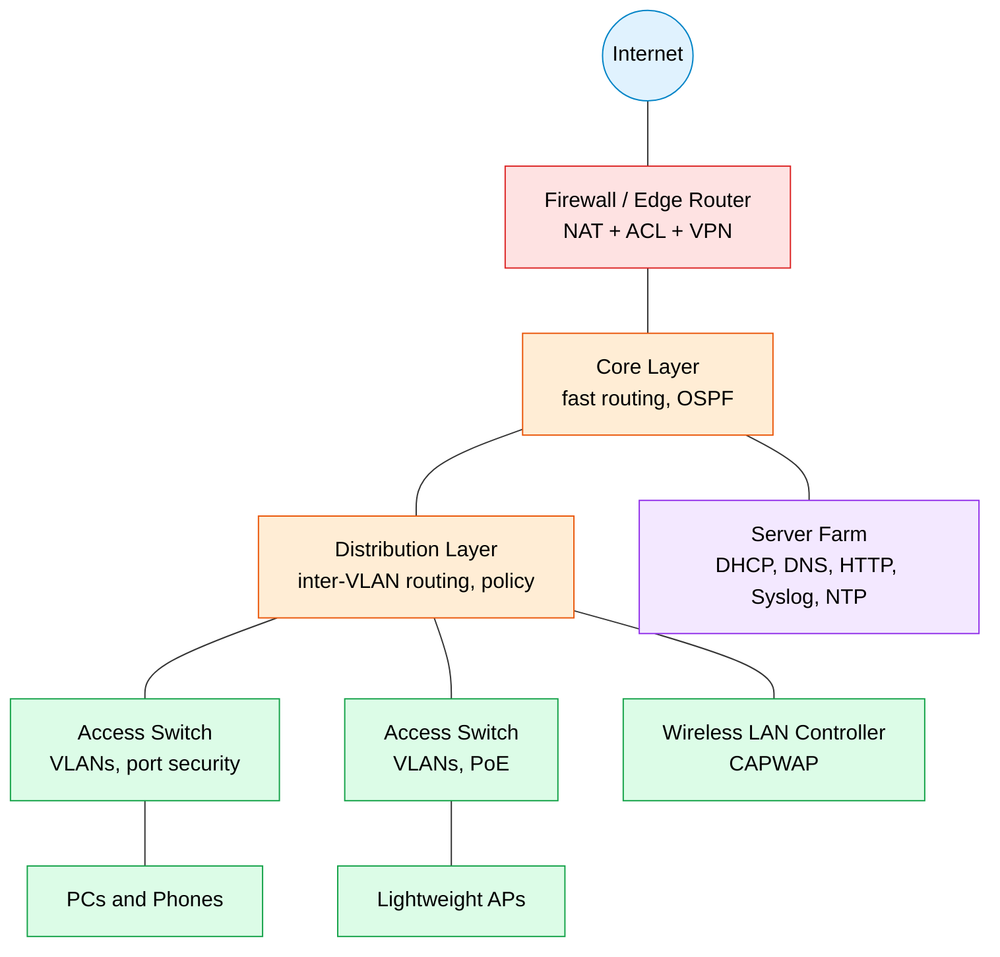

### Hierarchical Design Layers

| Layer | Job | Typical devices | Lab in this repo |
|-------|-----|-----------------|------------------|
| 🟩 **Access** | Connects end devices; VLANs, port security, PoE | Layer 2 switches, APs | VLAN labs, Wireless labs |
| 🟧 **Distribution** | Aggregates access switches; inter-VLAN routing, ACLs, policy | Layer 3 switches, routers | Static / Dynamic Routing |
| 🟦 **Core** | High-speed backbone, fast and reliable transport | Layer 3 switches, routers | Static / Dynamic Routing |
| 🟥 **Edge** | Connects to the Internet and WAN; NAT, firewall, VPN | Routers, firewalls | Basic Firewall |
| 🟪 **Services** | Hosts network services | Servers | DHCP, DNS, HTTP labs |

### Common Network Architectures

| Architecture | Description | Best for |
|--------------|-------------|----------|
| **2-tier (collapsed core)** | Core and distribution combined into one layer | Small and medium campuses |
| **3-tier** | Separate access, distribution and core layers | Large campuses |
| **Spine-leaf** | Every leaf switch connects to every spine switch | Data centres (low, predictable latency) |
| **SOHO** | One small router or wireless router | Home and small office (Linksys lab) |
| **WAN** | Connects remote sites over a provider network | Branch offices |
| **Cloud** | Services run in a provider's data centre (IaaS, PaaS, SaaS) | Flexible, on-demand workloads |

### Network Device Roles

| Device | Layer | Role | Forwards based on |
|--------|:-----:|------|-------------------|
| **Hub** | 1 | Repeats bits to all ports (one collision domain) | Nothing |
| **Switch** | 2 | Forwards frames, one collision domain per port | Destination MAC |
| **Layer 3 switch** | 2 / 3 | Switching plus inter-VLAN routing | MAC and IP |
| **Router** | 3 | Connects networks, separates broadcast domains | Destination IP |
| **Firewall** | 3 - 7 | Filters traffic by policy (stateful, NGFW) | IP, port, application |
| **IPS** | 3 - 7 | Detects and blocks attacks inline | Signatures, behaviour |
| **Access point** | 1 / 2 | Bridges Wi-Fi to Ethernet | MAC |
| **WLC** | 2 / 3 | Centrally manages lightweight APs | CAPWAP control |
| **Endpoint / server** | 1 - 7 | Source and destination of traffic | n/a |

### Network Topologies

| Topology | Description | Pros | Cons |
|----------|-------------|------|------|
| **Star** | All devices connect to a central switch | Easy to manage, one failure is isolated | Switch is a single point of failure |
| **Bus** | One shared cable | Cheap | One break stops all (legacy) |
| **Ring** | Each device connects to two neighbours | Predictable | Break can stop ring (legacy) |
| **Full mesh** | Every node connects to every other | Maximum redundancy | Very costly: n(n-1)/2 links |
| **Partial mesh** | Some redundant links | Balance of cost and resilience | More complex than star |
| **Hub and spoke** | Branches connect to a central site | Simple WAN design | Hub is critical |

<p align="center"></p>

## 🌐 Domain 1: Network Fundamentals

> 🟦 **Related labs:** [VLSM Subnetting](./Lab%2001-IP-Subnetting) · [TCP Sockets](./TCP-Socket-Programming) · [UDP Sockets](./UDP-Socket-Programming)

### OSI Model vs TCP/IP Model

| OSI layer | TCP/IP layer | PDU | Key protocols and standards | Devices / media |
|-----------|--------------|-----|-----------------------------|-----------------|
| **7 Application** | Application | Data | HTTP, HTTPS, FTP, SMTP, DNS, DHCP, SSH, SNMP | Servers, firewalls (NGFW) |
| **6 Presentation** | Application | Data | TLS/SSL, JPEG, ASCII, encryption | - |
| **5 Session** | Application | Data | NetBIOS, RPC, session control | - |
| **4 Transport** | Transport | Segment (TCP) / Datagram (UDP) | TCP, UDP, ports | Firewalls |
| **3 Network** | Internet | Packet | IPv4, IPv6, ICMP, OSPF, ARP (L2/L3) | Routers, Layer 3 switches |
| **2 Data Link** | Network Access | Frame | Ethernet, 802.1Q, STP, PPP, MAC | Switches, bridges, APs |
| **1 Physical** | Network Access | Bits | Copper, fibre, radio, hubs | Cables, hubs, repeaters |

> [!TIP]
> **Memory aid (top to bottom):** *All People Seem To Need Data Processing*. **Encapsulation** adds a header at each layer going down; **de-encapsulation** removes them going up.

### Encapsulation at a Glance

```
Application data                         "GET /index.html"
   + TCP header (ports, seq)         -->  SEGMENT
   + IP header (src/dst IP)          -->  PACKET
   + Ethernet header + FCS trailer   -->  FRAME
   converted to signals              -->  BITS on the wire
```

### TCP vs UDP

| Feature | 🟦 TCP | 🟪 UDP |
|---------|--------|--------|
| **Connection** | Connection-oriented (three-way handshake) | Connectionless |
| **Reliability** | Acknowledgements, retransmission | None |
| **Ordering** | Sequence numbers keep order | No ordering |
| **Flow control** | Windowing | None |
| **Header size** | 20 bytes minimum | 8 bytes |
| **Used for** | Web, email, file transfer, SSH | DNS, DHCP, VoIP, video, TFTP, SNMP |

**TCP three-way handshake:**

```
Client                      Server
  | ---- SYN ------------>   |
  | <--- SYN + ACK -------   |
  | ---- ACK ------------>   |   connection established
```

### Well-Known Ports

| Port | Protocol | Transport | Port | Protocol | Transport |
|:----:|----------|:---------:|:----:|----------|:---------:|
| 20/21 | FTP (data/control) | TCP | 123 | NTP | UDP |
| 22 | SSH | TCP | 143 | IMAP | TCP |
| 23 | Telnet | TCP | 161/162 | SNMP (query/trap) | UDP |
| 25 | SMTP | TCP | 179 | BGP | TCP |
| 49 | TACACS+ | TCP | 389 | LDAP | TCP |
| 53 | DNS | UDP/TCP | 443 | HTTPS | TCP |
| 67/68 | DHCP (server/client) | UDP | 514 | Syslog | UDP |
| 69 | TFTP | UDP | 1812/1813 | RADIUS (auth/acct) | UDP |
| 80 | HTTP | TCP | 3389 | RDP | TCP |
| 110 | POP3 | TCP | 5246/5247 | CAPWAP (control/data) | UDP |

### Cables, Media and Interfaces

| Medium | Details |
|--------|---------|
| **UTP copper** | Cat5e (1 Gbps), Cat6 (up to 10 Gbps short runs); 100 m maximum |
| **Straight-through** | Unlike devices: PC to switch, switch to router |
| **Crossover** | Like devices: switch to switch, router to router, PC to PC (modern ports use auto-MDIX) |
| **Console / rollover** | Management access to a router or switch |
| **Fibre** | Single-mode (long distance, laser) and multimode (short distance, LED); immune to EMI |
| **PoE** | 802.3af (15.4 W), 802.3at (30 W), 802.3bt (60 W / 100 W) for phones, APs, cameras |
| **Serial (WAN)** | DCE side sets the **clock rate**; default encapsulation HDLC |

**Interface problems:** collisions and late collisions (duplex mismatch), CRC errors (bad cable or noise), runts and giants (framing problems).

### IPv4 Addressing

| Class | First octet | Default mask | Notes |
|:-----:|:-----------:|:------------:|-------|
| **A** | 1 - 126 | 255.0.0.0 (/8) | Large networks |
| **B** | 128 - 191 | 255.255.0.0 (/16) | Medium networks |
| **C** | 192 - 223 | 255.255.255.0 (/24) | Small networks |
| **D** | 224 - 239 | n/a | Multicast |
| **E** | 240 - 255 | n/a | Experimental |

| Special range | Purpose |
|---------------|---------|
| **10.0.0.0/8, 172.16.0.0/12, 192.168.0.0/16** | Private (RFC 1918), not routed on the Internet |
| **127.0.0.0/8** | Loopback (`127.0.0.1` is the local host) |
| **169.254.0.0/16** | APIPA: self-assigned when DHCP fails (seen in the DHCP and Wireless labs) |
| **224.0.0.0/4** | Multicast (OSPF uses 224.0.0.5 and 224.0.0.6, RIPv2 uses 224.0.0.9) |
| **255.255.255.255** | Limited broadcast |

### Subnetting Method (Magic Number)

```
1. Find the interesting octet (the one where the mask is not 255 or 0)
2. Block size (magic number) = 256 - mask value in that octet
3. Subnets start at 0 and increase by the block size
4. Broadcast = next subnet - 1
5. Usable hosts = first address + 1 ... broadcast - 1  (2^h - 2 hosts)

Example: 192.168.10.0/26  ->  mask 255.255.255.192
   block size = 256 - 192 = 64
   subnets: .0  .64  .128  .192
   subnet .0 : hosts .1 - .62, broadcast .63
```

**VLSM** (used in the [VLSM lab](./Lab%2001-IP-Subnetting)): sort subnets from **largest to smallest**, give each the **smallest block that fits**, and place the blocks one after another so nothing overlaps.

### IPv6 Essentials

| Topic | Details |
|-------|---------|
| **Size** | 128 bits, written as 8 groups of 4 hex digits |
| **Shortening** | Drop leading zeros in a group; replace **one** run of all-zero groups with `::` |
| **Global unicast** | `2000::/3` (Internet-routable) |
| **Link-local** | `FE80::/10` (one link only, auto-generated) |
| **Unique local** | `FC00::/7` (private, like RFC 1918) |
| **Multicast** | `FF00::/8` (replaces broadcast) |
| **Loopback / unspecified** | `::1/128` and `::/128` |
| **Address assignment** | Static, **SLAAC** (router advertisements), DHCPv6 (stateful or stateless) |
| **EUI-64** | Build the interface ID from the MAC: split, insert `FFFE`, flip the 7th bit |
| **NDP** | Neighbour Discovery (NS, NA, RS, RA) replaces ARP |

```cisco
ipv6 unicast-routing
interface GigabitEthernet0/0
 ipv6 address 2001:db8:1::1/64
 no shutdown
```

### Other Fundamentals

| Topic | Key points |
|-------|------------|
| **ARP** | Maps an IPv4 address to a MAC address on the local network |
| **ICMP** | Error and diagnostic messages (`ping`, `traceroute`); the firewall lab blocks it |
| **Ethernet frame** | Preamble, destination MAC, source MAC, type, data, FCS |
| **MTU** | 1500 bytes for standard Ethernet |
| **Virtualisation** | Virtual machines, containers; hypervisor type 1 (bare metal) and type 2 (hosted) |
| **Cloud models** | IaaS, PaaS, SaaS; public, private, hybrid cloud |

### Collision Domain vs Broadcast Domain

| Device | Collision domains | Broadcast domains |
|--------|-------------------|-------------------|
| **Hub** | One for all ports | One |
| **Switch** | One per port | One per VLAN |
| **Router** | One per interface | One per interface |

### Binary Conversion Quick Table

| Bit value | 128 | 64 | 32 | 16 | 8 | 4 | 2 | 1 |
|-----------|:---:|:--:|:--:|:--:|:-:|:-:|:-:|:-:|
| **Example 192** | 1 | 1 | 0 | 0 | 0 | 0 | 0 | 0 |
| **Example 168** | 1 | 0 | 1 | 0 | 1 | 0 | 0 | 0 |
| **Example 10** | 0 | 0 | 0 | 0 | 1 | 0 | 1 | 0 |

### Packet Journey: PC1 pings a server in another network

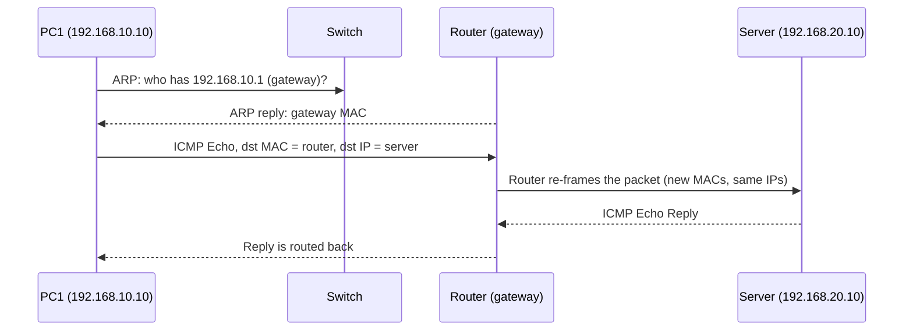

<p align="center"></p>

## 🔀 Domain 2: Network Access

> 🟩 **Related labs:** [VLAN Segmentation](./VLAN-Segmentation) · [VLAN Trunk Lab](./VLAN-Trunk-Lab) · [Wireless LAN Lab](./Wireless-LAN-Lab) · [Linksys Wireless Router Lab](./Linksys-Wireless-Router-Lab)

### How a Switch Works

| Function | What happens |
|----------|--------------|
| **Learning** | Records the **source MAC** and port of every frame in the MAC address table |
| **Flooding** | Unknown unicast, broadcast and multicast frames go out of all ports except the incoming one |
| **Forwarding** | Known destination MAC: the frame goes out of one port only |
| **Filtering** | Frames for a host on the same port are not forwarded |
| **Loop avoidance** | Spanning Tree Protocol blocks redundant paths |

```cisco
show mac address-table
show interfaces status
show interfaces trunk
```

### VLANs

A VLAN splits one physical switch into several **logical broadcast domains**. Each VLAN is normally one IP subnet; devices in different VLANs need a **Layer 3 device** to communicate.

| VLAN type | Purpose |
|-----------|---------|
| **Default (VLAN 1)** | All ports start here |
| **Data** | User traffic |
| **Voice** | IP phones (separate from data) |
| **Native** | Untagged traffic on a trunk (default VLAN 1, best practice: change it) |
| **Management** | Switch management IP (SVI) |

```cisco
vlan 10
 name SALES
interface range fastEthernet 0/1 - 5
 switchport mode access
 switchport access vlan 10
interface fastEthernet 0/24
 switchport mode trunk
 switchport trunk allowed vlan 10,20,30
 switchport trunk native vlan 99
```

> [!NOTE]
> Older switches also need `switchport trunk encapsulation dot1q` first. The 2960 supports only 802.1Q, so the command is rejected (see the [VLAN Trunk Lab](./VLAN-Trunk-Lab)).

| Port type | Carries | Used for |
|-----------|---------|----------|
| **Access** | One VLAN, untagged | Switch to PC |
| **Trunk** | Many VLANs, tagged with **802.1Q** | Switch to switch, switch to router |

### Inter-VLAN Routing

| Method | How it works | Notes |
|--------|--------------|-------|
| **Router-on-a-stick** | One router link as a trunk with **sub-interfaces**, one per VLAN | Simple, single link can be a bottleneck |
| **Layer 3 switch (SVI)** | A virtual interface per VLAN on a multilayer switch | Fast, standard in campuses |
| **Separate router interface per VLAN** | One physical link per VLAN | Does not scale |

```cisco
! Router-on-a-stick
interface GigabitEthernet0/0.10
 encapsulation dot1Q 10
 ip address 192.168.10.1 255.255.255.0
interface GigabitEthernet0/0.20
 encapsulation dot1Q 20
 ip address 192.168.20.1 255.255.255.0
interface GigabitEthernet0/0
 no shutdown

! Layer 3 switch with SVIs
ip routing
interface vlan 10
 ip address 192.168.10.1 255.255.255.0
 no shutdown
```

### Spanning Tree Protocol (STP)

STP prevents **Layer 2 loops** (broadcast storms, MAC table instability) by blocking redundant links.

| Item | Details |
|------|---------|
| **Root bridge election** | Lowest **Bridge ID** (priority, default 32768, plus VLAN ID, plus MAC) |
| **Port roles** | Root port (best path to root), designated port (forwarding on a segment), alternate/blocked port |
| **PVST+** | Classic per-VLAN STP, slow convergence (about 30 to 50 s) |
| **Rapid PVST+ (RSTP)** | Fast convergence; states: discarding, learning, forwarding |
| **Typical path costs** | 10 Mb/s = 100 · 100 Mb/s = 19 · 1 Gb/s = 4 · 10 Gb/s = 2 |

```cisco
spanning-tree mode rapid-pvst
spanning-tree vlan 1 root primary
interface fastEthernet 0/1
 spanning-tree portfast
 spanning-tree bpduguard enable
show spanning-tree
```

> [!WARNING]
> **PortFast** is for ports connected to end devices only. **BPDU Guard** shuts the port down if a switch is plugged in by mistake.

### EtherChannel (Link Aggregation)

Bundles several physical links into **one logical link** for more bandwidth and redundancy; STP treats the bundle as one link.

| Protocol | Modes |
|----------|-------|
| **LACP** (open standard, 802.3ad) | `active`, `passive` |
| **PAgP** (Cisco) | `desirable`, `auto` |
| **Static** | `on` |

```cisco
interface range gigabitEthernet 0/1 - 2
 channel-group 1 mode active
interface port-channel 1
 switchport mode trunk
show etherchannel summary
```

### Layer 2 Discovery

| Protocol | Vendor | Command |
|----------|--------|---------|
| **CDP** | Cisco proprietary | `show cdp neighbors detail` |
| **LLDP** | Open standard | `lldp run`, `show lldp neighbors` |

### Wireless LANs

| Standard | Name | Band | Max rate (theoretical) |
|----------|------|------|------------------------|
| 802.11b | - | 2.4 GHz | 11 Mb/s |
| 802.11a | - | 5 GHz | 54 Mb/s |
| 802.11g | - | 2.4 GHz | 54 Mb/s |
| 802.11n | Wi-Fi 4 | 2.4 / 5 GHz | 600 Mb/s |
| 802.11ac | Wi-Fi 5 | 5 GHz | about 6.9 Gb/s |
| 802.11ax | Wi-Fi 6 / 6E | 2.4 / 5 (/ 6) GHz | about 9.6 Gb/s |
| 802.11be | Wi-Fi 7 | 2.4 / 5 / 6 GHz | 30+ Gb/s |

| Topic | Details |
|-------|---------|
| **Non-overlapping 2.4 GHz channels** | 1, 6 and 11 |
| **SSID / BSSID** | Network name / AP MAC address |
| **AP architectures** | **Autonomous** (each AP configured alone), **lightweight** (controlled by a WLC through **CAPWAP**), **cloud-based** |
| **CAPWAP** | UDP **5246** (control) and **5247** (data) between AP and WLC |
| **AP modes** | Local, FlexConnect, monitor, sniffer, bridge |
| **Why a WLC?** | Central management, consistent policy, roaming |
| **Security** | WEP (broken), WPA (TKIP), **WPA2** (AES-CCMP, PSK or 802.1X), **WPA3** (SAE, stronger) |

```
Laptop ~~Wi-Fi~~> Lightweight AP ==CAPWAP tunnel==> Switch ==> WLC ==> wired network
```

### Wireless Controller (WLC) Essentials

| Topic | Details |
|-------|---------|
| **WLC ports** | Service port (out-of-band management), distribution system ports (data to the wired network), console, redundancy port |
| **Interfaces** | Management, AP-manager, virtual, dynamic (one per WLAN/VLAN), service |
| **WLAN settings** | SSID, security, VLAN/interface mapping, QoS profile |
| **Roaming** | Layer 2 roaming (same subnet) and Layer 3 roaming (tunnelled between controllers) |
| **Wi-Fi access (client side)** | Scan, authenticate, associate, then DHCP |
| **Common mistakes** | Wrong mask on the AP VLAN, no DHCP option 43, SSID mismatch, PSK typo |

| Wireless security | Encryption | Authentication | Verdict |
|-------------------|------------|----------------|---------|
| **Open** | None | None | Never for production |
| **WEP** | RC4 | Shared key | Broken |
| **WPA** | TKIP | PSK or 802.1X | Legacy |
| **WPA2** | AES-CCMP | PSK (Personal) or 802.1X (Enterprise) | Standard |
| **WPA3** | AES-GCMP | SAE (Personal) or 802.1X (Enterprise) | Best |

### VLAN Support Protocols

| Protocol | Purpose | Best practice |
|----------|---------|---------------|
| **DTP** | Negotiates trunking automatically (`dynamic auto`, `dynamic desirable`) | Disable: `switchport nonegotiate` |
| **VTP** | Propagates the VLAN database (server, client, transparent) | Use transparent mode or avoid it |
| **802.1Q** | Adds a 4-byte tag with the VLAN ID (12 bits: 1 - 4094) | Always use it on trunks |
| **Voice VLAN** | Separates phone traffic from data | `switchport voice vlan 150` |

### Switch Port States and Roles (RSTP)

| State | Learns MACs | Forwards frames |
|-------|:-----------:|:---------------:|
| **Discarding** | No | No |
| **Learning** | Yes | No |
| **Forwarding** | Yes | Yes |

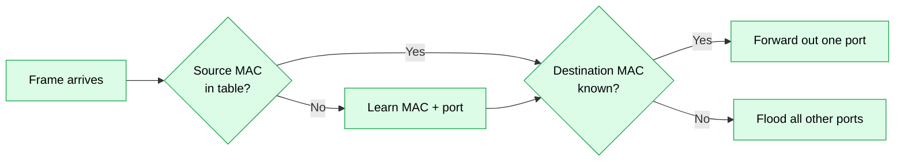

<p align="center"></p>

## 🚦 Domain 3: IP Connectivity

> 🟧 **Related labs:** [Static Routing](./Static-Routing) · [Dynamic Routing (RIP)](./Dynamic-Routing) · [Linksys Wireless Router Lab](./Linksys-Wireless-Router-Lab) · [HTTP Server](./HTTP-Server)

### How a Router Decides

1. Receives a frame and strips the Layer 2 header.
2. Looks at the **destination IP** and searches the routing table.
3. Picks the route with the **longest prefix match** (most specific mask).
4. If several routes have the same prefix, the lowest **administrative distance** wins; then the lowest **metric**.
5. Re-encapsulates the packet in a new frame (new MAC addresses, same IP addresses) and forwards it.

### Routing Table Codes

| Code | Meaning |
|:----:|---------|
| **C** | Directly connected network |
| **L** | Local interface address (/32) |
| **S** | Static route |
| **S\*** | Static default route |
| **R** | RIP |
| **O** | OSPF |
| **D** | EIGRP |
| **B** | BGP |

### Administrative Distance (Trust Level)

| Source | AD | Source | AD |
|--------|:--:|--------|:--:|
| Connected | 0 | OSPF | 110 |
| Static | 1 | IS-IS | 115 |
| eBGP | 20 | RIP | 120 |
| EIGRP (internal) | 90 | iBGP | 200 |

### Static Routing

| Type | Command | Use |
|------|---------|-----|
| **Network route** | `ip route 192.168.20.0 255.255.255.0 10.0.0.2` | Reach one remote LAN |
| **Default route** | `ip route 0.0.0.0 0.0.0.0 10.0.0.2` | Gateway of last resort (Internet) |
| **Host route** | `ip route 192.168.20.10 255.255.255.255 10.0.0.2` | One single host |
| **Floating static** | `ip route 0.0.0.0 0.0.0.0 10.0.1.2 150` | Backup with higher AD |
| **Exit-interface** | `ip route 192.168.20.0 255.255.255.0 serial0/0/0` | Point-to-point links |

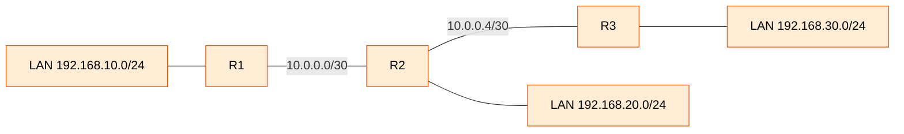

### Dynamic Routing Protocols

| Protocol | Type | Metric | AD | Notes |
|----------|------|--------|:--:|-------|
| **RIP v2** | Distance vector | Hop count (max 15) | 120 | Simple, updates every 30 s, multicast 224.0.0.9 |
| **EIGRP** | Advanced distance vector (Cisco) | Bandwidth + delay | 90 | Fast convergence |
| **OSPF** | Link state (open standard) | Cost (bandwidth) | 110 | Areas, scalable, multicast 224.0.0.5 / .6 |
| **IS-IS** | Link state | Cost | 115 | Service provider networks |
| **BGP** | Path vector | Path attributes | 20 / 200 | Between autonomous systems (Internet) |

| Term | Meaning |
|------|---------|
| **IGP / EGP** | Inside one organisation (RIP, EIGRP, OSPF) / between organisations (BGP) |
| **Convergence** | All routers agree on the topology |
| **Passive interface** | Stops sending updates on a LAN port |
| **Auto-summary** | RIP v1 behaviour; disable with `no auto-summary` in v2 |

```cisco
! RIP v2 (as in the Dynamic Routing lab)
router rip
 version 2
 no auto-summary
 network 192.168.10.0
 network 10.0.0.0
 passive-interface GigabitEthernet0/0
show ip route
show ip protocols
```

### OSPF Essentials

| Topic | Details |
|-------|---------|
| **Area 0** | Backbone; every other area connects to it |
| **Router ID** | Manual, else highest loopback IP, else highest active interface IP |
| **Hello / dead timers** | 10 s / 40 s on broadcast links (30 s / 120 s on non-broadcast) |
| **Cost** | Reference bandwidth (100 Mb/s by default) divided by interface bandwidth |
| **DR / BDR** | Elected on multi-access Ethernet (priority, then highest router ID); `ip ospf priority 0` = never |
| **Neighbour states** | Down, Init, 2-Way, ExStart, Exchange, Loading, Full |
| **Network types** | Broadcast (Ethernet), point-to-point (serial) |
| **Packets** | Hello, DBD, LSR, LSU, LSAck |

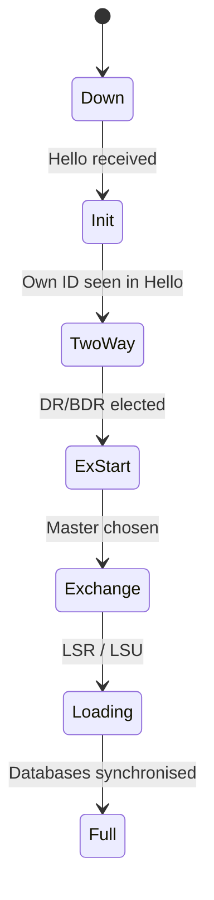

```cisco
router ospf 1
 router-id 1.1.1.1
 network 192.168.10.0 0.0.0.255 area 0
 network 10.0.0.0 0.0.0.3 area 0
 passive-interface GigabitEthernet0/0
 auto-cost reference-bandwidth 1000
interface GigabitEthernet0/1
 ip ospf priority 100
show ip ospf neighbor
show ip ospf interface brief
show ip route ospf
```

### First-Hop Redundancy (FHRP)

| Protocol | Standard | Notes |
|----------|----------|-------|
| **HSRP** | Cisco | Active / standby, virtual IP, multicast 224.0.0.2 |
| **VRRP** | Open (IEEE/IETF) | Master / backup |
| **GLBP** | Cisco | Load balances across gateways |

### IPv6 Routing and Others

| Topic | Command or note |
|-------|-----------------|
| **Enable routing** | `ipv6 unicast-routing` |
| **Static route** | `ipv6 route 2001:db8:2::/64 2001:db8:12::2` |
| **Default route** | `ipv6 route ::/0 2001:db8:12::2` |
| **OSPFv3** | `ipv6 router ospf 1`, then `ipv6 ospf 1 area 0` on interfaces |
| **Link-local next hop** | Needs the exit interface as well |

<p align="center"></p>

## 🧩 Domain 4: IP Services

> 🟪 **Related labs:** [DHCP Server](./DHCP-Server) · [HTTP Server](./HTTP-Server) · [HTTP and DNS Lab](./HTTP-DNS-Lab)

### DHCP

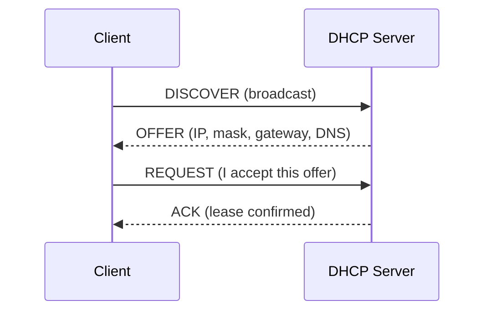

| Item | Details |
|------|---------|
| **Ports** | UDP 67 (server), UDP 68 (client) |
| **Lease** | Time the client may use the address; renews at 50% (T1) |
| **Relay agent** | `ip helper-address` forwards broadcasts to a server on another network |
| **APIPA** | 169.254.x.x when no DHCP server answers |
| **Client commands** | Windows `ipconfig /release`, `ipconfig /renew`; Packet Tracer PC: DHCP radio button |

```cisco
ip dhcp excluded-address 192.168.10.1 192.168.10.9
ip dhcp pool LAN10
 network 192.168.10.0 255.255.255.0
 default-router 192.168.10.1
 dns-server 8.8.8.8
interface GigabitEthernet0/0
 ip helper-address 10.0.0.10
show ip dhcp binding
show ip dhcp pool
```

### DNS

| Record | Purpose | Example |
|--------|---------|---------|
| **A** | Name to IPv4 | `www.mycompany.local -> 192.168.20.10` |
| **AAAA** | Name to IPv6 | `www -> 2001:db8::10` |
| **CNAME** | Alias | `web -> www` |
| **MX** | Mail server | `mail.mycompany.local` |
| **NS** | Authoritative name server | `ns1.mycompany.local` |
| **PTR** | IP to name (reverse) | `10.20.168.192.in-addr.arpa` |

Resolution order: local cache and hosts file, configured DNS server, root, TLD (`.com`), authoritative server. DNS uses **UDP 53** (queries) and **TCP 53** (zone transfers, big replies).

```cisco
! Router as a DNS client
ip domain-lookup
ip name-server 192.168.20.10
ip domain-name mycompany.local
```

### NAT and PAT

| Term | Meaning |
|------|---------|
| **Inside local** | Private address of an inside host |
| **Inside global** | Public address that represents the inside host |
| **Outside global** | Public address of the destination |
| **Static NAT** | One-to-one fixed mapping (publish a server) |
| **Dynamic NAT** | Pool of public addresses, first come first served |
| **PAT (overload)** | Many private hosts share one public IP using different ports |

```cisco
interface GigabitEthernet0/0
 ip nat inside
interface GigabitEthernet0/1
 ip nat outside
access-list 1 permit 192.168.10.0 0.0.0.255
ip nat inside source list 1 interface GigabitEthernet0/1 overload
ip nat inside source static 192.168.20.10 203.0.113.10
show ip nat translations
show ip nat statistics
```

### NTP, SNMP and Syslog

| Service | Port | Purpose | Key commands |
|---------|:----:|---------|--------------|
| **NTP** | UDP 123 | Synchronised clocks (stratum 0 = clock source, lower stratum = better) | `ntp server 10.0.0.5`, `show ntp status` |
| **SNMP** | UDP 161 / 162 | Monitoring: manager polls agents (GET, SET) and receives traps; data stored in a **MIB** identified by OIDs | `snmp-server community`, `snmp-server host` |
| **Syslog** | UDP 514 | Central log collection | `logging host 10.0.0.20`, `logging trap informational` |

| SNMP version | Security |
|--------------|----------|
| v1 | Community string, no encryption |
| v2c | Community string, bulk operations |
| v3 | Authentication and encryption (use this) |

| Syslog level | Name | Mnemonic |
|:------------:|------|----------|
| 0 | Emergency | **E**very |
| 1 | Alert | **A**wesome |
| 2 | Critical | **C**isco |
| 3 | Error | **E**ngineer |
| 4 | Warning | **W**ill |
| 5 | Notice | **N**eed |
| 6 | Informational | **I**ce |
| 7 | Debug | **D**ay |

### QoS (Quality of Service)

| Concept | Details |
|---------|---------|
| **Why** | Voice and video need low delay, low jitter, low loss |
| **Classification and marking** | CoS (Layer 2), DSCP (Layer 3): **EF (46)** voice, AF classes for video and data, **CS** classes, default 0 |
| **Queuing** | FIFO, WFQ, CBWFQ, **LLQ** (strict priority for voice) |
| **Policing** | Drops traffic above the rate |
| **Shaping** | Buffers and delays traffic above the rate |
| **Congestion avoidance** | WRED drops packets early so TCP slows down |
| **PHB** | Per-hop behaviour: how each router treats a marked packet |

### Remote Access and File Transfer

| Protocol | Port | Notes |
|----------|:----:|-------|
| **SSH** | TCP 22 | Encrypted remote CLI (use instead of Telnet) |
| **Telnet** | TCP 23 | Clear text, avoid |
| **HTTP / HTTPS** | 80 / 443 | Web and device GUIs |
| **FTP** | 20 / 21 | Reliable file transfer, clear text |
| **TFTP** | UDP 69 | Simple, used for IOS images and config backup |
| **SFTP / FTPS** | 22 / 990 | Secure file transfer |

```cisco
copy running-config tftp:
copy tftp: flash:
```

### Web Server in Packet Tracer (from the labs)

| Step | Action |
|:----:|--------|
| 1 | Server, Services tab, HTTP: turn it **On** |
| 2 | Edit `index.html` |
| 3 | Give the server a static IP and gateway |
| 4 | Browse from a PC: `http://192.168.20.10` or the DNS name |
| 5 | If it fails, check routes, gateway, DNS record |

<p align="center"></p>

## 🔐 Domain 5: Security Fundamentals

> 🟥 **Related labs:** [Basic Firewall](./Basic-Firewall-Lab) · [Wireless LAN Lab](./Wireless-LAN-Lab) · [Linksys Wireless Router Lab](./Linksys-Wireless-Router-Lab)

### Security Concepts

| Concept | Meaning |
|---------|---------|
| **CIA triad** | **Confidentiality** (only authorised read), **Integrity** (not altered), **Availability** (always reachable) |
| **Threat** | Anything that can cause harm |
| **Vulnerability** | A weakness that a threat can use |
| **Exploit** | The method that uses a vulnerability |
| **Risk** | Likelihood multiplied by impact |
| **Defence in depth** | Many layers: physical, network, host, application, user |
| **Zero trust** | Never trust, always verify |
| **AAA** | Authentication, Authorisation, Accounting |

### Common Attacks and Defences

| Attack | What it does | Defence |
|--------|--------------|---------|
| **Reconnaissance** | Scans and probes (ping sweep, port scan) | Firewall, IPS, hide services |
| **DoS / DDoS** | Overloads a target | Rate limiting, scrubbing, redundancy |
| **IP / MAC spoofing** | Fakes an address | ACLs, port security, DAI |
| **ARP poisoning** | Fake ARP replies redirect traffic | Dynamic ARP Inspection |
| **MITM** | Sits between two hosts | Encryption (TLS, SSH), DAI |
| **DHCP starvation / rogue DHCP** | Exhausts the pool or hands out bad settings | DHCP snooping |
| **VLAN hopping** | Switch spoofing or double tagging | Disable DTP, change native VLAN, unused ports off |
| **MAC flooding (CAM overflow)** | Fills the MAC table | Port security |
| **Malware** | Virus, worm, trojan, ransomware | Endpoint protection, patches |
| **Phishing / social engineering** | Tricks people | Training, MFA |
| **Password attacks** | Brute force, dictionary | Strong passwords, MFA, lockout |

### Access Control Lists (ACLs)

| Type | Numbers | Matches | Placement |
|------|---------|---------|-----------|
| **Standard** | 1 - 99, 1300 - 1999 | Source IP only | **Close to the destination** |
| **Extended** | 100 - 199, 2000 - 2699 | Source, destination, protocol, port | **Close to the source** |
| **Named** | Names | Either type, editable by line | Recommended |

Rules: processed **top to bottom**, first match wins, an **implicit deny any** is at the end, and one ACL per interface, per direction, per protocol. **Wildcard mask** = inverse of the subnet mask (255.255.255.0 becomes 0.0.0.255).

```cisco
ip access-list extended BLOCK-PING
 deny icmp 192.168.10.0 0.0.0.255 192.168.20.0 0.0.0.255
 permit tcp any host 192.168.20.10 eq 80
 permit ip any any
interface GigabitEthernet0/0
 ip access-group BLOCK-PING in
show access-lists
show ip interface GigabitEthernet0/0
```

### Firewalls

| Type | How it works |
|------|--------------|
| **Packet filter (stateless)** | Checks each packet alone against rules |
| **Stateful firewall** | Tracks connections; return traffic is allowed automatically |
| **NGFW** | Adds application awareness, IPS, URL filtering, malware protection |
| **Zones** | Inside (trusted), outside (untrusted), DMZ (public servers) |

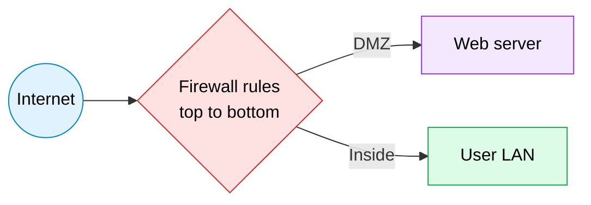

> [!TIP]
> In the [Basic Firewall lab](./Basic-Firewall-Lab), **rule order** decides everything: *Deny ICMP* must come **before** *Allow IP*, otherwise ping is permitted by the broader rule.

### Layer 2 Security

| Feature | Protects against | Commands |
|---------|------------------|----------|
| **Port security** | MAC flooding, unknown devices | `switchport port-security`, `maximum 2`, `mac-address sticky`, `violation shutdown` |
| **DHCP snooping** | Rogue DHCP | `ip dhcp snooping`, `ip dhcp snooping vlan 10`, `ip dhcp snooping trust` |
| **Dynamic ARP Inspection** | ARP poisoning | `ip arp inspection vlan 10` |
| **BPDU Guard / Root Guard** | STP attacks | `spanning-tree bpduguard enable` |
| **Unused ports** | Unauthorised access | `shutdown`, move to a black-hole VLAN |

| Violation mode | Frames dropped | Log | Port shut down |
|----------------|:--------------:|:---:|:--------------:|
| **protect** | Yes | No | No |
| **restrict** | Yes | Yes | No |
| **shutdown** (default) | Yes | Yes | Yes (err-disabled) |

```cisco
interface fastEthernet 0/1
 switchport mode access
 switchport port-security
 switchport port-security maximum 2
 switchport port-security mac-address sticky
 switchport port-security violation restrict
show port-security interface fastEthernet 0/1
```

### AAA: RADIUS vs TACACS+

| Feature | RADIUS | TACACS+ |
|---------|--------|---------|
| **Standard** | Open | Cisco |
| **Transport** | UDP 1812/1813 | TCP 49 |
| **Encryption** | Password only | Entire packet |
| **AAA** | Combines authentication and authorisation | Separates all three |
| **Typical use** | Network access (Wi-Fi, VPN, 802.1X) | Device administration |

### VPNs

| Type | Description |
|------|-------------|
| **Site-to-site** | Router/firewall connects two networks over the Internet |
| **Remote access** | One user connects to the corporate network (client or SSL/TLS) |
| **IPsec** | Encrypts and authenticates IP packets (IKE, ESP, AH); modes: tunnel, transport |
| **GRE** | Simple tunnel, no encryption (combine with IPsec) |

### Device Hardening and Passwords

```cisco
hostname R1
enable secret StrongPass#1
service password-encryption
security passwords min-length 10
banner motd # Authorised access only #
username admin secret AdminPass#1
ip domain-name mycompany.local
crypto key generate rsa modulus 2048
ip ssh version 2
line vty 0 4
 login local
 transport input ssh
 exec-timeout 5 0
login block-for 120 attempts 3 within 60
line console 0
 password ConsolePass#1
 login
```

| Best practice | Why |
|---------------|-----|
| Use `enable secret` (hashed), not `enable password` | Hash instead of a weak cipher |
| SSH instead of Telnet | Encrypted management |
| Change defaults, disable unused services | Smaller attack surface |
| Keep IOS updated | Patches known flaws |
| Use MFA and strong passwords | Stops credential attacks |

### Security Programs

| Program | Aim |
|---------|-----|
| **User awareness** | Teach people about phishing and passwords |
| **Training** | Role-based security skills |
| **Physical access control** | Locks, badges, cameras |
| **Biometrics, MFA** | Something you know, have, are |

<p align="center"></p>

## 🤖 Domain 6: Automation and Programmability

> 🟨 **Related labs:** [TCP Socket Programming](./TCP-Socket-Programming) · [UDP Socket Programming](./UDP-Socket-Programming)

### Why Automate?

| Manual (CLI box by box) | Automated |
|-------------------------|-----------|
| Slow, typo-prone, drift between devices | Fast, repeatable, consistent |
| Hard to audit | Version control and testing |

### SDN: Three Planes

| Plane | Job | Example |
|-------|-----|---------|
| **Management** | Configure and monitor | SSH, SNMP, NETCONF |
| **Control** | Decide where traffic goes | OSPF, STP, ARP |
| **Data (forwarding)** | Move packets | Switching and routing hardware |

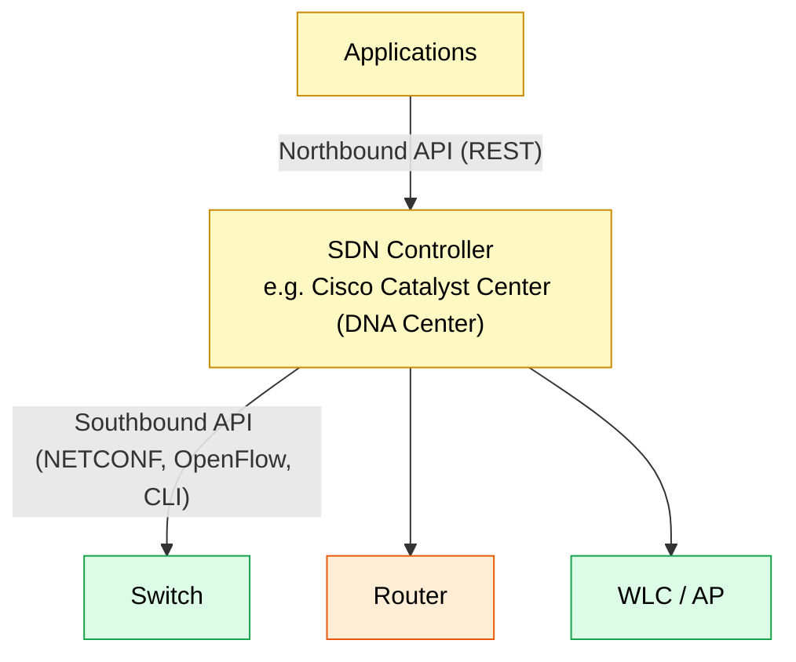

| Architecture | Idea |
|--------------|------|
| **Traditional** | Each device has its own control plane |
| **Controller-based** | Central control plane, devices forward |
| **Underlay** | Physical network that provides IP reachability |
| **Overlay** | Virtual tunnels (VXLAN) on top of the underlay |
| **Fabric** | Underlay + overlay managed as one system (Cisco SD-Access) |

### REST APIs

| HTTP verb | CRUD | Action |
|-----------|------|--------|
| **POST** | Create | Add a resource |
| **GET** | Read | Retrieve a resource |
| **PUT / PATCH** | Update | Replace / modify a resource |
| **DELETE** | Delete | Remove a resource |

| Status | Meaning |
|:------:|---------|
| 200 | OK |
| 201 | Created |
| 204 | No content |
| 400 | Bad request |
| 401 | Unauthorised |
| 403 | Forbidden |
| 404 | Not found |
| 500 | Server error |

REST is **stateless**, uses a URI, headers (authentication, content type), a body (JSON or XML) and returns a status code.

### Data Formats

```json
{
  "device": "R1",
  "interfaces": [
    { "name": "GigabitEthernet0/0", "ip": "192.168.10.1", "status": "up" },
    { "name": "GigabitEthernet0/1", "ip": "10.0.0.1", "status": "up" }
  ]
}
```

| Format | Look | Notes |
|--------|------|-------|
| **JSON** | `{ "key": "value" }` | Most common for REST |
| **XML** | `<key>value</key>` | Used by NETCONF |
| **YAML** | `key: value` | Ansible, human friendly |

### Configuration Management and Protocols

| Tool / protocol | Notes |
|-----------------|-------|
| **Ansible** | Agentless, YAML playbooks, push, SSH |
| **Puppet** | Agent-based, pull, manifests (Ruby DSL) |
| **Chef** | Agent-based, pull, recipes (Ruby) |
| **Terraform** | Infrastructure as code (provisioning) |
| **NETCONF** | XML over SSH (port 830), configures devices |
| **RESTCONF** | REST over HTTPS for YANG data |
| **YANG** | Data modelling language for config and state |

### AI and Machine Learning in Networking

| Type | Use |
|------|-----|
| **Predictive AI** | Predicts failures, capacity needs, anomalies |
| **Generative AI** | Creates configs, summaries, documentation |
| **Machine learning** | Learns normal behaviour to detect threats |

### Python Example: Query a Device by REST

```python
import requests

url = "https://192.168.10.1/restconf/data/ietf-interfaces:interfaces"
headers = {"Accept": "application/yang-data+json"}
response = requests.get(url, headers=headers, auth=("admin", "AdminPass#1"), verify=False)

print(response.status_code)
print(response.json())
```

<p align="center"></p>

## 🌍 WAN Technologies

> 🟦 **Related lab:** [Linksys Wireless Router Lab](./Linksys-Wireless-Router-Lab) (serial link between two routers)

| WAN type | Description | Typical use |
|----------|-------------|-------------|
| **Leased line** | Dedicated point-to-point circuit | Critical sites |
| **MPLS** | Provider labels packets, private WAN | Enterprise branches |
| **Metro Ethernet** | Ethernet service across a city | Campus and branch links |
| **Broadband** | DSL, cable, fibre (FTTH) | Small offices, home |
| **Cellular (4G / 5G)** | Mobile data | Backup links |
| **Internet VPN** | IPsec over the Internet | Cheap secure connectivity |
| **SD-WAN** | Controller steers traffic across many links | Modern branch design |

| Concept | Details |
|---------|---------|
| **CE / PE / P** | Customer edge, provider edge, provider core router |
| **DCE / DTE** | Provider side with clock / customer side |
| **Encapsulation** | HDLC (Cisco default), PPP (authentication with PAP or CHAP) |
| **GRE** | Tunnels between sites |
| **Cloud access** | Direct connect, VPN to the cloud provider |

```cisco
interface serial0/0/0
 ip address 10.0.0.1 255.255.255.252
 clock rate 64000      ! DCE side only
 encapsulation ppp
 no shutdown
show controllers serial 0/0/0
```

<p align="center"></p>

## 🔌 Socket Programming (TCP vs UDP)

> 🟦 **Related labs:** [TCP Socket Programming](./TCP-Socket-Programming) · [UDP Socket Programming](./UDP-Socket-Programming)

A **socket** = IP address + port + protocol. Programs talk to the network through sockets.

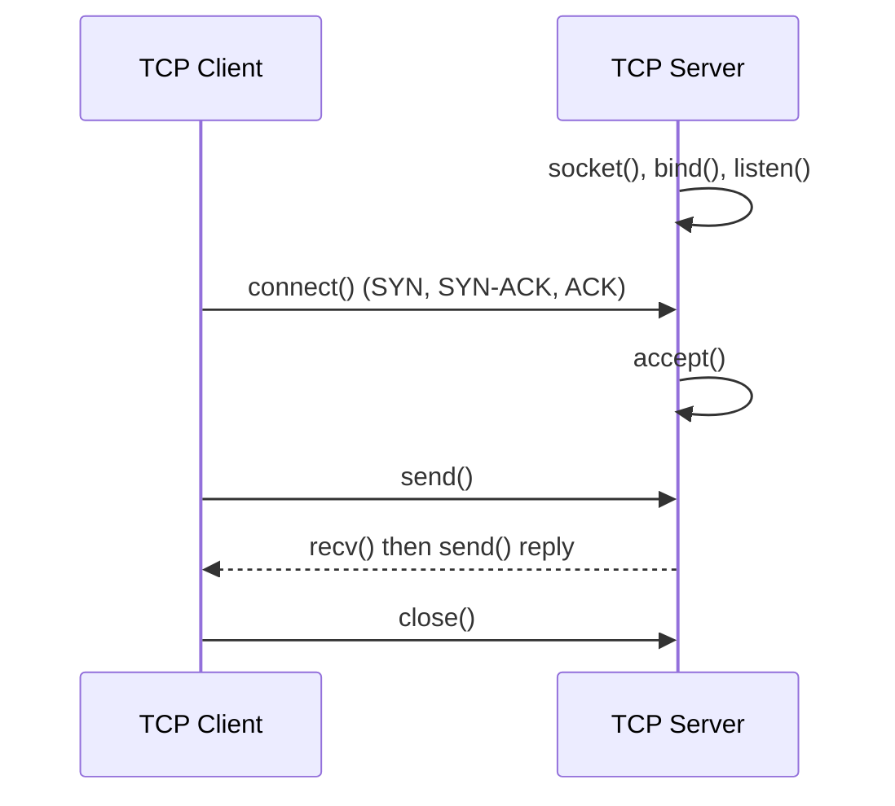

### TCP Server and Client (`SOCK_STREAM`)

```python
# tcp_server.py
import socket
server = socket.socket(socket.AF_INET, socket.SOCK_STREAM)
server.bind(("0.0.0.0", 5000))
server.listen(1)
conn, addr = server.accept()
print("Connected:", addr)
data = conn.recv(1024).decode()
conn.send(f"Server got: {data}".encode())
conn.close()
```

```python
# tcp_client.py
import socket
client = socket.socket(socket.AF_INET, socket.SOCK_STREAM)
client.connect(("127.0.0.1", 5000))
client.send("Hello server".encode())
print(client.recv(1024).decode())
client.close()
```

### UDP Server and Client (`SOCK_DGRAM`)

```python
# udp_server.py
import socket
server = socket.socket(socket.AF_INET, socket.SOCK_DGRAM)
server.bind(("0.0.0.0", 6000))
data, addr = server.recvfrom(1024)
print("From", addr, data.decode())
server.sendto(b"Server got it", addr)
```

```python
# udp_client.py
import socket
client = socket.socket(socket.AF_INET, socket.SOCK_DGRAM)
client.sendto(b"Hello server", ("127.0.0.1", 6000))
print(client.recvfrom(1024)[0].decode())
```

| Feature | TCP socket | UDP socket |
|---------|------------|------------|
| **Type** | `SOCK_STREAM` | `SOCK_DGRAM` |
| **Setup** | `listen`, `accept`, `connect` | None, just `sendto` |
| **Methods** | `send`, `recv` | `sendto`, `recvfrom` |
| **Delivery** | Guaranteed, ordered | Best effort |
| **Speed** | Slower (overhead) | Faster |
| **Best for** | Chat, files, web | Streaming, DNS, games |

<p align="center"></p>

## 🧪 Troubleshooting

### Methodology

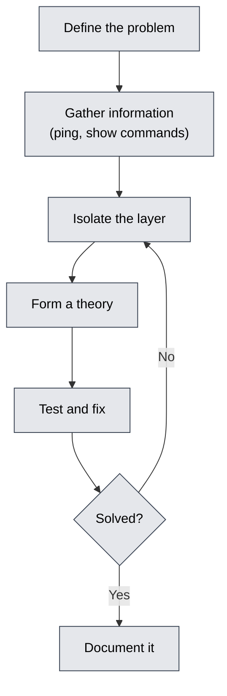

| Approach | Idea |
|----------|------|
| **Bottom-up** | Start at Layer 1 and move up (cable, interface, IP, app) |
| **Top-down** | Start at the application and move down |
| **Divide and conquer** | Start in the middle (ping), move up or down |

### Symptom to Fix

| Symptom | Likely cause | Check and fix |
|---------|--------------|---------------|
| Interface down / down | Cable, wrong port | Cable type, `no shutdown` |
| Up / down (line protocol) | Encapsulation or clock mismatch | `show controllers`, set `clock rate`, same encapsulation |
| Same VLAN cannot ping | Wrong VLAN on port, trunk missing VLAN | `show vlan brief`, `show interfaces trunk` |
| Cross-VLAN fails | No Layer 3 device | Router-on-a-stick or SVI |
| Ping works one way | Missing return route | `show ip route` on both sides |
| 169.254.x.x address | DHCP unreachable | Pool, gateway, `ip helper-address`, cable |
| Name does not resolve | DNS record or server IP wrong | Check A record, DNS setting on PC |
| Website not loading | HTTP service off or route missing | Server HTTP on, ping server IP first |
| Wireless connects, no IP | DHCP on wrong VLAN | WLAN to VLAN mapping, DHCP scope |
| AP does not join WLC | No IP, wrong VLAN, no WLC address | AP DHCP, option 43, CAPWAP reachability |
| Ping blocked, web works | ICMP deny rule (intended in firewall lab) | Verify rule order |
| Slow, collisions | Duplex mismatch | `show interfaces`, set speed and duplex |
| Err-disabled port | Port security violation or BPDU Guard | Remove cause, `shutdown` then `no shutdown` |

### Per-Lab Quick Checks

| Lab | First things to verify |
|-----|------------------------|
| VLSM | No overlap, correct masks, gateway in the same subnet |
| VLAN labs | Port VLAN, trunk allowed list, native VLAN match |
| Static routing | Route on every router, correct next hop, both directions |
| RIP | Same version, all `network` statements, no `auto-summary` |
| DHCP | Excluded range, pool network, default gateway, helper address |
| HTTP / DNS | Service On, server IP static, A record name and IP |
| Wireless | SSID, PSK, VLAN mapping, AP joined |
| Firewall | Rule order, direction, deny before allow |
| Sockets | Same IP and port, server started first (TCP), firewall off |

### Core Commands

| Goal | Command |
|------|---------|
| Reachability | `ping`, `traceroute` (Windows `tracert`) |
| Interface status | `show ip interface brief`, `show interfaces` |
| Routes | `show ip route`, `show ip protocols` |
| Layer 2 | `show mac address-table`, `show vlan brief`, `show spanning-tree` |
| Services | `show ip dhcp binding`, `show ip nat translations` |
| Config | `show running-config`, `show startup-config` |
| Live events | `debug ip packet` (use carefully), then `undebug all` |

### Extended Ping and Windows Tools

| Tool | Use |
|------|-----|
| `ping 192.168.10.1` | Test gateway |
| `ipconfig /all` | IP, mask, gateway, DNS, MAC |
| `arp -a` | ARP cache |
| `nslookup www.mycompany.local` | Test DNS |
| `tracert 8.8.8.8` | Path and hop count |
| `netstat -an` | Open ports and connections |

<p align="center"></p>

## 🧰 Cisco IOS CLI Essentials

### Modes

| Mode | Prompt | Enter with | Leave with |
|------|--------|-----------|-----------|
| **User EXEC** | `R1>` | Login | `exit` |
| **Privileged EXEC** | `R1#` | `enable` | `disable` |
| **Global config** | `R1(config)#` | `configure terminal` | `end` / `exit` |
| **Interface** | `R1(config-if)#` | `interface g0/0` | `exit` |
| **Line** | `R1(config-line)#` | `line vty 0 4` | `exit` |
| **Router** | `R1(config-router)#` | `router ospf 1` | `exit` |

### Handy Shortcuts

| Key / command | Result |
|---------------|--------|
| `?` | Context help |
| `Tab` | Complete a command |
| `Ctrl + C` / `Ctrl + Z` | Cancel / return to privileged EXEC |
| `Ctrl + Shift + 6` | Break a running command |
| `no` | Undo a command |
| `show run \| include ip route` | Filter output (`begin`, `section`, `exclude`) |

### Starter Configuration

```cisco
enable
configure terminal
hostname R1
no ip domain-lookup
interface GigabitEthernet0/0
 description LAN to Sales
 ip address 192.168.10.1 255.255.255.0
 no shutdown
interface GigabitEthernet0/1
 description Link to R2
 ip address 10.0.0.1 255.255.255.252
 no shutdown
end
copy running-config startup-config
```

### Switch Management IP

```cisco
interface vlan 1
 ip address 192.168.10.2 255.255.255.0
 no shutdown
ip default-gateway 192.168.10.1
```

### Files and Recovery

| Task | Command |
|------|---------|
| Save | `copy running-config startup-config` (or `write memory`) |
| Back up | `copy running-config tftp:` |
| Erase config | `erase startup-config` then `reload` |
| Delete VLANs (switch) | `delete flash:vlan.dat` |
| Show version / hardware | `show version`, `show flash:` |
| Password recovery | ROMMON, change the configuration register (`0x2142`), reload, copy startup to running, set new password, restore `0x2102` |

<p align="center"></p>

## 📋 Cheat Sheets

### Subnet Mask Table

| CIDR | Mask | Block size | Hosts per subnet | Subnets in a /24 |
|:----:|------|:----------:|:----------------:|:----------------:|
| /24 | 255.255.255.0 | 256 | 254 | 1 |
| /25 | 255.255.255.128 | 128 | 126 | 2 |
| /26 | 255.255.255.192 | 64 | 62 | 4 |
| /27 | 255.255.255.224 | 32 | 30 | 8 |
| /28 | 255.255.255.240 | 16 | 14 | 16 |
| /29 | 255.255.255.248 | 8 | 6 | 32 |
| /30 | 255.255.255.252 | 4 | 2 | 64 |
| /31 | 255.255.255.254 | 2 | point-to-point | 128 |
| /32 | 255.255.255.255 | 1 | single host | - |

### VLSM Plan from the Lab (192.168.10.0/24)

| LAN | Hosts needed | Prefix | Network | Usable range | Broadcast |
|-----|:------------:|:------:|---------|--------------|-----------|
| LAN A | 50 | /26 | 192.168.10.0 | .1 - .62 | .63 |
| LAN B | 25 | /27 | 192.168.10.64 | .65 - .94 | .95 |
| LAN C | 10 | /28 | 192.168.10.96 | .97 - .110 | .111 |

### Wildcard Masks

| Subnet mask | Wildcard |
|-------------|----------|
| 255.255.255.255 | 0.0.0.0 (host) |
| 255.255.255.0 | 0.0.0.255 |
| 255.255.255.192 | 0.0.0.63 |
| 255.255.255.240 | 0.0.0.15 |
| 0.0.0.0 | 255.255.255.255 (any) |

### Protocol at a Glance

| Need | Protocol | Port / number |
|------|----------|---------------|
| Web | HTTP / HTTPS | TCP 80 / 443 |
| Name lookup | DNS | UDP/TCP 53 |
| Auto IP | DHCP | UDP 67 / 68 |
| Clock | NTP | UDP 123 |
| Monitoring | SNMP | UDP 161 / 162 |
| Logs | Syslog | UDP 514 |
| Remote CLI | SSH | TCP 22 |
| Link redundancy | STP | BPDU (multicast) |
| Neighbour info | CDP / LLDP | Layer 2 |
| Dynamic routing | RIP / OSPF / EIGRP | UDP 520 / IP 89 / IP 88 |
| Wireless control | CAPWAP | UDP 5246 / 5247 |

### Which Technology Solves Which Problem

| Problem | Solution |
|---------|----------|
| Too many broadcasts | VLANs |
| Layer 2 loop | STP / RSTP |
| Need more bandwidth between switches | EtherChannel |
| VLANs must talk | Inter-VLAN routing |
| Manual IP setup | DHCP |
| Names instead of IPs | DNS |
| Not enough public IPs | NAT / PAT |
| Gateway failure | HSRP / VRRP |
| Unwanted traffic | ACL / firewall |
| Unauthorised device on a port | Port security |
| Secure remote link | IPsec VPN |
| Manage many devices | Controller, automation |

### Exam Day Command Memory

```
VLAN        vlan 10 | switchport access vlan 10 | switchport mode trunk
Routing     ip route | router ospf | show ip route
Services    ip dhcp pool | ip nat inside source | ntp server
Security    access-list | port-security | enable secret | ssh
Verify      show ip int brief | show vlan brief | show run
```

<p align="center"></p>

## 🔤 Glossary

| Term | Meaning |
|------|---------|
| **ACL** | Access Control List: rules that permit or deny traffic |
| **AD** | Administrative distance: trust of a routing source |
| **AP** | Access point |
| **ARP** | Address Resolution Protocol |
| **BPDU** | Bridge Protocol Data Unit (STP message) |
| **CAPWAP** | Protocol between lightweight AP and WLC |
| **CDP** | Cisco Discovery Protocol |
| **CIDR** | Classless Inter-Domain Routing (/prefix notation) |
| **DHCP** | Dynamic Host Configuration Protocol |
| **DNS** | Domain Name System |
| **DORA** | Discover, Offer, Request, Acknowledge |
| **DTP** | Dynamic Trunking Protocol |
| **EIGRP** | Enhanced Interior Gateway Routing Protocol |
| **FHRP** | First Hop Redundancy Protocol |
| **HSRP** | Hot Standby Router Protocol |
| **ICMP** | Internet Control Message Protocol |
| **IPS** | Intrusion Prevention System |
| **LACP** | Link Aggregation Control Protocol |
| **MAC** | Media Access Control (hardware address) |
| **NAT / PAT** | Network Address Translation / Port Address Translation |
| **NDP** | Neighbour Discovery Protocol (IPv6) |
| **NTP** | Network Time Protocol |
| **OSPF** | Open Shortest Path First |
| **PoE** | Power over Ethernet |
| **QoS** | Quality of Service |
| **RADIUS / TACACS+** | AAA protocols |
| **RIP** | Routing Information Protocol |
| **SDN** | Software-Defined Networking |
| **SLAAC** | Stateless Address Autoconfiguration |
| **SNMP** | Simple Network Management Protocol |
| **SSID** | Wireless network name |
| **STP / RSTP** | Spanning Tree / Rapid Spanning Tree |
| **SVI** | Switch Virtual Interface |
| **Trunk** | Link that carries many VLANs |
| **VLAN / VLSM** | Virtual LAN / Variable Length Subnet Mask |
| **VPN** | Virtual Private Network |
| **WLC** | Wireless LAN Controller |

<p align="center"></p>

## 🎓 CCNA Exam Blueprint

| Domain | Weight | Colour | Covered in this repo by |
|--------|:------:|:------:|-------------------------|
| **1. Network Fundamentals** | 20% | 🟦 | Labs 1, 12, 13 |
| **2. Network Access** | 20% | 🟩 | Labs 2, 3, 9, 10 |
| **3. IP Connectivity** | 25% | 🟧 | Labs 4, 5, 10 |
| **4. IP Services** | 10% | 🟪 | Labs 6, 7, 8 |
| **5. Security Fundamentals** | 15% | 🟥 | Labs 9, 11 |
| **6. Automation and Programmability** | 10% | 🟨 | Labs 12, 13 and the theory above |

### Study Plan

| Week | Focus |
|:----:|-------|
| 1 | OSI, TCP/IP, subnetting practice every day |
| 2 | Switching, VLANs, trunks, STP |
| 3 | Static routing, OSPF |
| 4 | DHCP, DNS, NAT, NTP, SNMP, Syslog |
| 5 | ACLs, port security, AAA, VPN, wireless |
| 6 | Automation, APIs, JSON, then full mock exams |

> [!TIP]
> Do every lab **twice**: once with the guide, once from memory. Then break it on purpose and fix it.

### Next Steps After This Repository

| Idea | Why |
|------|-----|
| Add OSPF, EtherChannel, NAT and ACL labs | Cover the remaining blueprint topics |
| Learn Linux and Wireshark | Packet-level understanding |
| Move on to CyberOps / Security+ | Matches the security operations goal |

<p align="center"></p>

# 🌌 Beyond CCNA: Complete Computer Networks Reference

> [!IMPORTANT]
> The sections above follow the CCNA blueprint and the labs. The sections below cover **computer networks as a whole subject**: theory from a university course, protocols used on the real Internet, security and cryptography, modern cloud and data-centre networking, tools and career paths.

| # | Part | Topics |
|:-:|------|--------|
| B1 | [Network Types and Models](#-b1-network-types-and-models) | LAN, MAN, WAN, client-server, P2P, switching techniques |
| B2 | [Physical Layer and Data Transmission](#-b2-physical-layer-and-data-transmission) | Signals, encoding, multiplexing, media, impairments |
| B3 | [Data Link Layer in Depth](#-b3-data-link-layer-in-depth) | Framing, error control, flow control, MAC protocols |
| B4 | [Network Layer in Depth](#-b4-network-layer-in-depth) | IPv4/IPv6 headers, fragmentation, routing algorithms, BGP, multicast |
| B5 | [Transport Layer in Depth](#-b5-transport-layer-in-depth) | TCP header, states, congestion control, QUIC, SCTP |
| B6 | [Application Layer Protocols](#-b6-application-layer-protocols) | HTTP, email, FTP, SSH, VoIP, MQTT, CDN |
| B7 | [Cryptography and Network Security](#-b7-cryptography-and-network-security) | AES, RSA, hashing, TLS, PKI, IDS, SIEM |
| B8 | [Wireless, Mobile and IoT](#-b8-wireless-mobile-and-iot) | Cellular 2G to 5G, Bluetooth, Zigbee, LoRa, satellite |
| B9 | [Modern Networking](#-b9-modern-networking) | Cloud, data centre, VXLAN, NFV, containers, SD-WAN, edge |
| B10 | [Network Performance and Formulas](#-b10-network-performance-and-formulas) | Bandwidth, delay, throughput, BDP, Shannon |
| B11 | [Network Tools and Linux Networking](#-b11-network-tools-and-linux-networking) | Wireshark, nmap, tcpdump, iperf, ip, ss, dig, curl |
| B12 | [Network Management and Monitoring](#-b12-network-management-and-monitoring) | NetFlow, telemetry, monitoring tools, ITIL, SLAs |
| B13 | [Design, Standards and Careers](#-b13-design-standards-and-careers) | Design, standards bodies, RFCs, history, certifications |
| ★ | [Master Protocol Table](#-master-protocol-table) | Every important protocol by layer |

<p align="center"></p>

## 🔭 B1 Network Types and Models

### By Geographic Size

| Type | Full name | Range | Example |
|------|-----------|-------|---------|
| **PAN** | Personal Area Network | A few metres | Bluetooth earbuds, phone hotspot |
| **LAN** | Local Area Network | Room to campus | Office Ethernet, Wi-Fi |
| **CAN** | Campus Area Network | Several buildings | University network |
| **MAN** | Metropolitan Area Network | City | Cable TV, city fibre ring |
| **WAN** | Wide Area Network | Country or world | The Internet, MPLS |
| **SAN** | Storage Area Network | Data centre | Fibre Channel, iSCSI |
| **VPN** | Virtual Private Network | Over the Internet | Remote office link |

### Network Models and Roles

| Model | How it works | Example |
|-------|--------------|---------|
| **Client-server** | Clients request, central servers respond | Web, email, databases |
| **Peer-to-peer (P2P)** | Every node is both client and server | BitTorrent, blockchain |
| **Hybrid** | Central index, direct transfer | Early file-sharing, some VoIP |
| **Intranet** | Private network using Internet technology | Company portal |
| **Extranet** | Intranet shared with partners | Supplier portal |

### Switching Techniques

| Technique | Idea | Pros | Cons | Example |
|-----------|------|------|------|---------|
| **Circuit switching** | Dedicated path for the whole call | Constant delay, no reordering | Wastes capacity, setup time | Old telephone network |
| **Packet switching (datagram)** | Each packet routed on its own | Efficient, resilient | Delay variation, reordering | IP / Internet |
| **Virtual circuit** | Path set up first, packets follow it | Ordered, QoS easier | Setup needed | MPLS, ATM, Frame Relay |
| **Message switching** | Whole message stored and forwarded | Simple | High delay | Early telegraph and email relays |

### Types of Communication

| Type | Meaning | Example |
|------|---------|---------|
| **Unicast** | One to one | Web browsing |
| **Broadcast** | One to all on the segment | ARP, DHCP Discover |
| **Multicast** | One to a group | IPTV, OSPF hellos |
| **Anycast** | One to the nearest of a group | DNS root servers, CDNs |
| **Simplex / half duplex / full duplex** | One way / alternate / both ways at once | TV / walkie-talkie / modern Ethernet |

<p align="center"></p>

## 📡 B2 Physical Layer and Data Transmission

### Signals and Encoding

| Topic | Details |
|-------|---------|
| **Analog vs digital** | Continuous waveform vs discrete levels (0 and 1) |
| **Bandwidth** | Range of frequencies (Hz) or maximum bit rate (bit/s) |
| **Line coding** | NRZ, NRZI, Manchester (Ethernet 10 Mb/s), 4B/5B, 8B/10B, PAM-4 (high speed) |
| **Modulation** | ASK (amplitude), FSK (frequency), PSK (phase), QAM (amplitude + phase, used in Wi-Fi, cable, LTE) |
| **Baud vs bit rate** | Bit rate = baud rate x bits per symbol |
| **Sampling** | Nyquist: sample at least 2 x highest frequency (PCM voice: 8000 samples/s x 8 bits = 64 kb/s) |

### Multiplexing

| Technique | Shares the medium by | Example |
|-----------|----------------------|---------|
| **FDM** | Frequency bands | Radio, cable TV |
| **TDM** | Time slots (synchronous), statistical TDM (on demand) | T1/E1 lines |
| **WDM / DWDM** | Colours (wavelengths) of light on one fibre | Backbone fibre, many Tb/s |
| **CDMA** | Unique codes | 3G cellular |
| **OFDM / OFDMA** | Many orthogonal sub-carriers | Wi-Fi 5/6, 4G, 5G |

### Transmission Media

| Medium | Speed (typical) | Distance | Notes |
|--------|-----------------|----------|-------|
| **Twisted pair (UTP/STP)** | Up to 10 Gb/s | 100 m | Twists reduce crosstalk |
| **Coaxial** | Hundreds of Mb/s | Hundreds of m | Cable TV, older Ethernet |
| **Multimode fibre** | 10 - 100 Gb/s | Up to about 550 m | LED or VCSEL |
| **Single-mode fibre** | Tb/s with DWDM | Tens to thousands of km | Laser |
| **Radio (microwave)** | Mb/s - Gb/s | Line of sight | Point-to-point links |
| **Satellite** | Mb/s - hundreds of Mb/s | Global | GEO about 600 ms RTT, LEO about 20 - 40 ms |
| **Infrared** | Low | Very short | Remote controls |

| Cable category | Max speed | Max frequency |
|----------------|-----------|---------------|
| Cat5e | 1 Gb/s | 100 MHz |
| Cat6 | 10 Gb/s (55 m) | 250 MHz |
| Cat6a | 10 Gb/s (100 m) | 500 MHz |
| Cat7 / Cat8 | 10 Gb/s / 25 - 40 Gb/s | 600 MHz / 2 GHz |

### Ethernet Standards

| Standard | Name | Medium | Speed |
|----------|------|--------|-------|
| 10BASE-T | Ethernet | UTP | 10 Mb/s |
| 100BASE-TX | Fast Ethernet | UTP | 100 Mb/s |
| 1000BASE-T | Gigabit | UTP | 1 Gb/s |
| 1000BASE-LX / SX | Gigabit fibre | SMF / MMF | 1 Gb/s |
| 10GBASE-T / SR / LR | 10 Gigabit | UTP / MMF / SMF | 10 Gb/s |
| 25 / 40 / 100 / 400 GbE | Data-centre Ethernet | Fibre, DAC | 25 - 400 Gb/s |

### Transmission Impairments

| Impairment | Cause | Fix |
|------------|-------|-----|
| **Attenuation** | Signal weakens with distance | Repeaters, amplifiers |
| **Noise** | Thermal, EMI, crosstalk | Shielding, twisted pairs, fibre |
| **Distortion** | Different frequencies travel at different speeds | Equalisation |
| **Dispersion** | Light pulse spreads in fibre | Single-mode, dispersion compensation |
| **Interference** | Other radio sources | Channel planning, 5 GHz / 6 GHz |

<p align="center"></p>

## 🔗 B3 Data Link Layer in Depth

### Framing

| Method | Idea |
|--------|------|
| **Character count** | Length field at the start |
| **Flag bytes + byte stuffing** | Start/end flag; escape inside data (PPP) |
| **Flag bits + bit stuffing** | `01111110` flag; insert 0 after five 1s (HDLC) |
| **Physical coding violations** | Special signal patterns mark frame limits |

### Ethernet Frame (IEEE 802.3 / Ethernet II)

```
| Preamble 7B | SFD 1B | Dest MAC 6B | Src MAC 6B | Type/Len 2B | Data 46-1500B | FCS 4B |
```

| Field | Meaning |
|-------|---------|
| **Minimum / maximum frame** | 64 B / 1518 B (1522 B with VLAN tag) |
| **EtherType** | 0x0800 IPv4, 0x86DD IPv6, 0x0806 ARP, 0x8100 802.1Q |
| **Jumbo frame** | Up to about 9000 B in data centres |
| **MAC address** | 48 bits: 24-bit OUI (vendor) + 24-bit device ID |

### Error Detection and Correction

| Method | How | Strength |
|--------|-----|----------|
| **Parity bit** | One extra bit (even or odd) | Detects odd number of bit errors |
| **Checksum** | Sum of words, complemented | Used in IP, TCP, UDP |
| **CRC** | Polynomial division, remainder appended | Very strong, used in Ethernet (CRC-32) |
| **Hamming code** | Several parity bits at power-of-2 positions | Corrects 1-bit errors |
| **FEC** | Extra redundancy lets the receiver repair errors | Wireless, satellite, optical |
| **ARQ** | Retransmit when error detected | TCP, Wi-Fi |

### Flow Control and ARQ

| Protocol | Window | Behaviour on loss |
|----------|--------|-------------------|
| **Stop-and-wait** | 1 frame | Wait for ACK, retransmit after timeout |
| **Go-Back-N** | Sender window N, receiver 1 | Resends the lost frame and everything after |
| **Selective Repeat** | Both windows N | Resends only the lost frame |
| **Sliding window** | General idea behind all of the above | Keeps the pipe full |

### Medium Access Control (MAC) Protocols

| Protocol | Idea | Used in |
|----------|------|---------|
| **Pure ALOHA** | Send any time; collision means retry | Early radio; efficiency 18% |
| **Slotted ALOHA** | Send only at slot start | Efficiency 37% |
| **CSMA/CD** | Listen, send, detect collision, back off | Shared (half-duplex) Ethernet |
| **CSMA/CA** | Listen, avoid collision with random back-off, RTS/CTS optional | Wi-Fi (802.11) |
| **Token passing** | Only the token holder sends | Token Ring, FDDI |
| **TDMA / FDMA / CDMA** | Channel partitioning | Cellular systems |
| **Polling** | A controller asks each station | Bluetooth, some industrial networks |

> [!NOTE]
> Modern switched, full-duplex Ethernet has **no collisions**, so CSMA/CD is not used any more; CSMA/CA is still needed because Wi-Fi is half duplex and shared.

### Data Link Protocols and Services

| Protocol | Purpose |
|----------|---------|
| **PPP** | Point-to-point links, authentication (PAP, CHAP), compression, multilink |
| **PPPoE** | PPP over Ethernet, common for DSL |
| **HDLC** | Bit-oriented link protocol (Cisco variant is default on serial) |
| **Frame Relay / ATM / X.25** | Older WAN technologies (legacy) |
| **MPLS** | Label switching between Layer 2 and Layer 3 |
| **Ethernet OAM, LACP, LLDP** | Link management and discovery |

### Bridges and Switches: Learning Algorithm

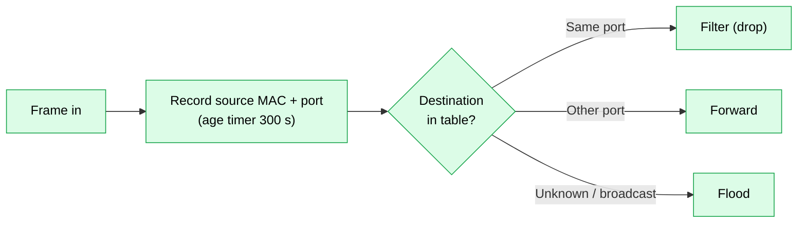

<p align="center"></p>

## 🧭 B4 Network Layer in Depth

### IPv4 Header

| Field | Size | Purpose |
|-------|:----:|---------|
| Version | 4 bits | 4 |
| IHL | 4 bits | Header length (min 20 bytes) |
| DSCP / ECN | 8 bits | QoS marking and congestion notification |
| Total length | 16 bits | Packet size |
| Identification, Flags, Fragment offset | 16 + 3 + 13 bits | Fragmentation |
| **TTL** | 8 bits | Hop limit, reduced by 1 per router, prevents loops |
| **Protocol** | 8 bits | 1 ICMP, 6 TCP, 17 UDP, 47 GRE, 50 ESP, 89 OSPF |
| Header checksum | 16 bits | Header error check |
| Source / destination address | 32 + 32 bits | Addresses |
| Options | variable | Rare |

### IPv6 Header

| Field | Purpose |
|-------|---------|
| Version, Traffic class, Flow label | QoS and flow identification |
| Payload length | Data size |
| **Next header** | Replaces the protocol field; also chains extension headers |
| **Hop limit** | Replaces TTL |
| Source / destination | 128 bits each (fixed 40-byte header, no checksum, no router fragmentation) |

### Fragmentation and MTU

| Item | Details |
|------|---------|
| **MTU** | Largest payload per link (1500 bytes Ethernet) |
| **IPv4 fragmentation** | Router may split a packet; destination reassembles; DF bit forbids it |
| **Path MTU Discovery** | Sender uses DF and ICMP "fragmentation needed" to find the smallest MTU |
| **IPv6** | Only the source may fragment |
| **MSS** | TCP maximum segment size, usually MTU - 40 |

### ICMP Messages

| Type | Meaning | Used by |
|:----:|---------|---------|
| 0 / 8 | Echo reply / echo request | `ping` |
| 3 | Destination unreachable (net, host, port, fragmentation needed) | Routers, hosts |
| 5 | Redirect | Better gateway hint |
| 11 | Time exceeded (TTL = 0) | `traceroute` |
| 12 | Parameter problem | Header errors |

### Routing Algorithms

| Algorithm | Type | Used by | Idea |
|-----------|------|---------|------|
| **Bellman-Ford** | Distance vector | RIP | Each router shares its distance table with neighbours |
| **Dijkstra (SPF)** | Link state | OSPF, IS-IS | Each router has the full map and computes shortest paths |
| **DUAL** | Advanced distance vector | EIGRP | Loop-free backup (feasible successor) |
| **Path vector** | Policy based | BGP | List of AS numbers prevents loops |

| Problem | Fix (distance vector) |
|---------|-----------------------|
| **Count to infinity** | Maximum metric (RIP 16), split horizon, route poisoning, hold-down timers |
| **Slow convergence** | Triggered updates |

### BGP in More Detail

| Topic | Details |
|-------|---------|
| **AS** | Autonomous system with an ASN (public 1 - 64495, private 64512 - 65534) |
| **eBGP / iBGP** | Between ASes / inside one AS |
| **Transport** | TCP 179 |
| **Messages** | OPEN, UPDATE, KEEPALIVE, NOTIFICATION |
| **Attributes** | AS_PATH, NEXT_HOP, LOCAL_PREF, MED, WEIGHT (Cisco), ORIGIN |
| **Path choice (short)** | Highest weight, highest local preference, shortest AS path, lowest origin, lowest MED |
| **Risks** | Route hijack, route leaks (mitigated by RPKI, filtering) |
| **Peering types** | Transit (paid), peering (exchange of traffic), IXP (exchange point) |

### Multicast

| Topic | Details |
|-------|---------|
| **Addresses** | IPv4 224.0.0.0/4; IPv6 FF00::/8 |
| **IGMP** | Hosts join groups (IGMPv2/v3); **IGMP snooping** on switches limits flooding |
| **PIM** | Multicast routing: dense mode, sparse mode (rendezvous point) |
| **Use** | IPTV, stock feeds, routing protocols |

### Addressing Techniques

| Technique | Meaning |
|-----------|---------|
| **CIDR** | Prefix notation instead of classes; allows aggregation |
| **Supernetting / summarisation** | Combine routes (e.g. 192.168.0.0/24 - 192.168.3.0/24 into 192.168.0.0/22) |
| **VLSM** | Different masks inside one network (VLSM lab) |
| **Private + NAT** | Saves public addresses; NAT64 and 464XLAT help IPv6-only networks |
| **IPv6 transition** | Dual stack, tunnelling (6to4, ISATAP, GRE), translation (NAT64 + DNS64) |
| **Mobile IP** | Home agent and care-of address keep a device reachable while roaming |

### Control Plane vs Data Plane (Router Internals)

| Part | Job |
|------|-----|
| **RIB** | All learned routes |
| **FIB** | Best routes in hardware for forwarding |
| **CEF** | Cisco's fast forwarding using FIB + adjacency table |
| **Process / fast / CEF switching** | Software path to hardware path (slow to fast) |

<p align="center"></p>

## 🚚 B5 Transport Layer in Depth

### TCP Header and Flags

| Field | Purpose |
|-------|---------|
| Source / destination port | 16 bits each |
| Sequence / acknowledgement number | Ordering and reliability |
| Header length, window size | Flow control (receiver window) |
| Checksum, urgent pointer | Integrity |
| **Flags** | **SYN** open, **ACK** acknowledge, **FIN** close politely, **RST** abort, **PSH** push, **URG** urgent, ECE / CWR congestion signals |

### TCP Connection Life Cycle

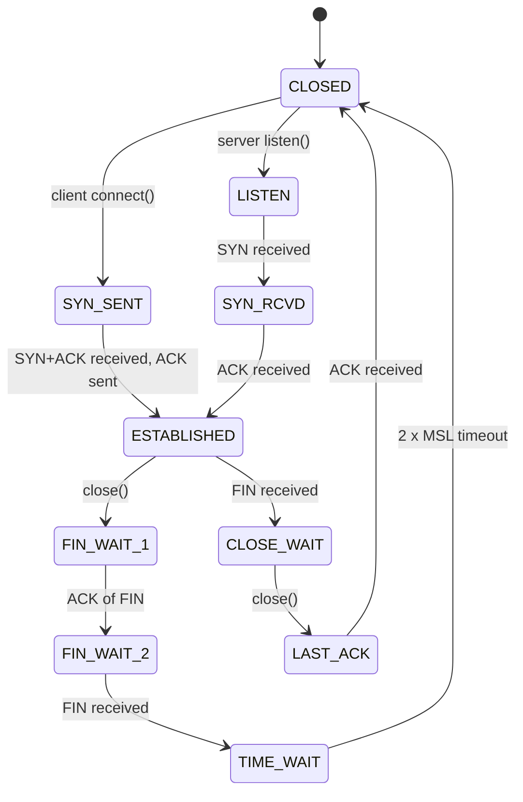

Connection close uses **four steps**: FIN, ACK, FIN, ACK (or three if combined). A **SYN flood** attack fills the half-open (SYN_RCVD) queue; **SYN cookies** defend against it.

### TCP Reliability and Timers

| Mechanism | How |
|-----------|-----|
| **Cumulative ACK** | ACK number = next byte expected |
| **Retransmission timeout (RTO)** | Based on smoothed RTT and variance |
| **Fast retransmit** | Three duplicate ACKs trigger a resend before timeout |
| **SACK** | Selective acknowledgements of out-of-order blocks |
| **Nagle / delayed ACK** | Reduce small packets |
| **Keepalive** | Probes idle connections |
| **Window scaling** | Allows windows larger than 64 KB |

### TCP Congestion Control

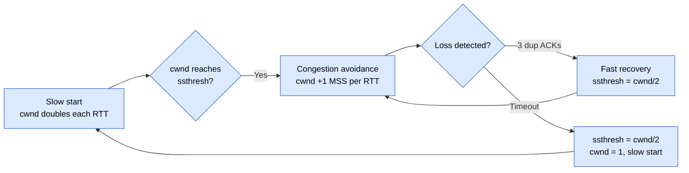

| Variant | Notes |
|---------|-------|
| **Tahoe** | Always back to slow start on loss |
| **Reno** | Adds fast recovery |
| **CUBIC** | Default on Linux, good for high bandwidth-delay paths |
| **BBR** | Google, model-based on bandwidth and RTT, not loss |
| **ECN** | Routers mark packets instead of dropping |

### Transport Protocols Compared

| Protocol | Reliable | Ordered | Connection | Notes |
|----------|:--------:|:-------:|:----------:|-------|
| **TCP** | Yes | Yes | Yes | Web, email, SSH |
| **UDP** | No | No | No | DNS, VoIP, games |
| **QUIC** | Yes | Per stream | Yes (over UDP) | HTTP/3, built-in TLS 1.3, faster setup, no head-of-line blocking |
| **SCTP** | Yes | Optional | Yes | Multi-streaming, multi-homing (telecom signalling) |
| **DCCP** | No | No | Yes | Congestion control without reliability |
| **MPTCP** | Yes | Yes | Yes | One connection over several paths (phones: Wi-Fi + cellular) |

### Ports and Sockets

| Range | Name |
|-------|------|
| 0 - 1023 | Well-known |
| 1024 - 49151 | Registered |
| 49152 - 65535 | Dynamic / ephemeral |

A connection is identified by the **5-tuple**: source IP, source port, destination IP, destination port, protocol.

<p align="center"></p>

## 🌍 B6 Application Layer Protocols

### HTTP in Detail

| Topic | Details |
|-------|---------|
| **Request** | Method, URL, version, headers, optional body |
| **Methods** | GET, POST, PUT, PATCH, DELETE, HEAD, OPTIONS |
| **Status classes** | 1xx info, 2xx success, 3xx redirect, 4xx client error, 5xx server error |
| **Common headers** | Host, User-Agent, Accept, Content-Type, Cookie, Authorization, Cache-Control |
| **Cookies and sessions** | Server sets `Set-Cookie`; browser returns it; keeps state over stateless HTTP |
| **Caching** | `ETag`, `Last-Modified`, `Cache-Control`, proxy and browser caches |
| **HTTPS** | HTTP inside TLS (port 443) |

| Version | Transport | Key change |
|---------|-----------|------------|
| **HTTP/1.0** | TCP | One request per connection |
| **HTTP/1.1** | TCP | Persistent connections, pipelining, Host header |
| **HTTP/2** | TCP + TLS | Binary, multiplexing, header compression |
| **HTTP/3** | QUIC (UDP) | No TCP head-of-line blocking, faster handshake |

### Email

| Protocol | Port | Role |
|----------|:----:|------|
| **SMTP** | 25 (relay), 587 (submission), 465 (SMTPS) | Send and relay mail |
| **POP3** | 110 / 995 | Download mail, usually remove it from the server |
| **IMAP** | 143 / 993 | Keep mail on server, sync folders |
| **MIME** | - | Attachments and non-ASCII text |
| **SPF, DKIM, DMARC** | DNS records | Fight spoofing and phishing |

### FTP, Remote Access and Others

| Protocol | Details |
|----------|---------|
| **FTP** | Control on 21, data on 20 (active) or random port (passive); clear text |
| **SFTP** | File transfer over SSH (port 22) |
| **SCP** | Copy over SSH |
| **Telnet** | Clear-text remote shell (obsolete) |
| **SSH** | Encrypted shell, tunnels, key authentication |
| **RDP / VNC** | Graphical remote desktop (3389 / 5900) |
| **NFS / SMB (CIFS)** | File sharing (Linux / Windows) |
| **LDAP / Active Directory** | Directory services (389, 636 secure) |
| **Kerberos** | Ticket-based authentication (UDP/TCP 88) |

### DNS in Detail

| Topic | Details |
|-------|---------|
| **Hierarchy** | Root (.) then TLD (.com, .pk) then domain then host |
| **Resolver types** | Recursive resolver (ISP, 8.8.8.8) and authoritative server |
| **Query types** | Recursive and iterative |
| **TTL** | How long a record may be cached |
| **Security** | DNSSEC (signatures), DoT (853), DoH (443) |
| **Attacks** | Cache poisoning, DNS tunnelling, amplification DDoS |

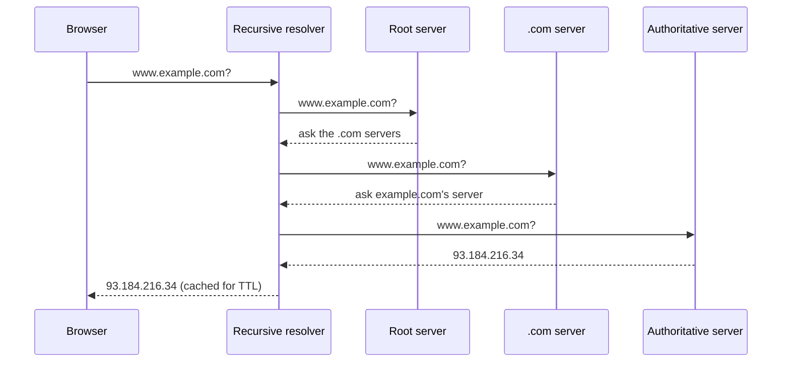

### Real-Time and Voice/Video

| Protocol | Role |
|----------|------|
| **SIP** | Sets up, modifies and ends VoIP calls (5060 / 5061) |
| **RTP / RTCP** | Carry voice and video, report quality (UDP) |
| **H.323** | Older call-control suite |
| **WebRTC** | Browser real-time audio, video, data |
| **Codecs** | G.711 (64 kb/s), G.729 (8 kb/s), Opus, H.264, H.265, AV1 |
| **VoIP targets** | One-way delay below 150 ms, jitter below 30 ms, loss below 1% |

### Web, API and IoT Protocols

| Protocol | Use |
|----------|-----|
| **WebSocket** | Persistent two-way channel over one TCP connection |
| **gRPC** | Fast RPC over HTTP/2 with Protocol Buffers |
| **GraphQL** | Client chooses exactly what data it wants |
| **MQTT** | Lightweight publish/subscribe for IoT (1883 / 8883) |
| **CoAP** | REST-like protocol for tiny devices (UDP 5683) |
| **AMQP** | Enterprise message queues (RabbitMQ) |
| **Modbus, DNP3, OPC UA** | Industrial control (SCADA) |

### CDN, Proxies and Load Balancers

| Component | Job |
|-----------|-----|
| **CDN** | Caches content near users (Cloudflare, Akamai) |
| **Forward proxy** | Clients go through it (filtering, caching) |
| **Reverse proxy** | Sits in front of servers (TLS offload, caching) |
| **Load balancer** | Spreads traffic: round robin, least connections, hash; Layer 4 or Layer 7 |
| **WAF** | Web application firewall against SQL injection, XSS |

<p align="center"></p>

## 🔒 B7 Cryptography and Network Security

### Cryptography Basics

| Type | Algorithms | Notes |
|------|------------|-------|
| **Symmetric** | AES (128/192/256), ChaCha20, 3DES (legacy) | One shared key, fast, bulk data |
| **Asymmetric** | RSA, ECC (ECDSA, ECDH), Diffie-Hellman | Key pair (public + private), key exchange, signatures |
| **Hash** | SHA-256, SHA-3, (MD5 and SHA-1 are broken) | Fixed-size fingerprint, one way |
| **MAC / HMAC** | HMAC-SHA256 | Integrity + authenticity with a shared key |
| **Digital signature** | RSA, ECDSA, EdDSA | Sign with private key, verify with public key |
| **Cipher modes** | CBC, CTR, **GCM** (authenticated) | Use authenticated encryption |
| **Key exchange** | (EC)DH | Two parties agree on a secret in public |
| **Post-quantum** | Kyber (ML-KEM), Dilithium (ML-DSA) | Designed to resist quantum computers |

| Goal | Tool |
|------|------|
| Confidentiality | Encryption |
| Integrity | Hash, HMAC |
| Authentication | Certificates, signatures, passwords, MFA |
| Non-repudiation | Digital signatures |
| Availability | Redundancy, DDoS protection |

### PKI and Certificates

| Item | Meaning |
|------|---------|
| **CA** | Certificate Authority that signs certificates |
| **X.509 certificate** | Public key + identity + signature |
| **Chain of trust** | Server cert, intermediate CA, root CA (in the OS trust store) |
| **CSR** | Request sent to a CA |
| **CRL / OCSP** | Check whether a certificate is revoked |
| **Let's Encrypt** | Free automated CA |

### TLS 1.3 Handshake (simplified)

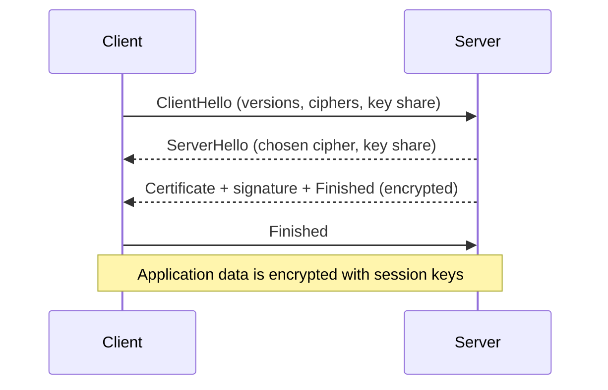

### IPsec in Detail

| Part | Details |
|------|---------|
| **AH** | Authentication only (protocol 51) |
| **ESP** | Encryption + authentication (protocol 50) |
| **IKE phase 1** | Builds a secure management channel (UDP 500 / 4500 NAT-T) |
| **IKE phase 2** | Builds the IPsec tunnels for data |
| **Modes** | Transport (host to host) and tunnel (gateway to gateway) |
| **SSL / TLS VPN** | Browser or client over TLS, easier through firewalls |
| **WireGuard** | Modern, small, fast VPN (UDP) |

### Authentication Technologies

| Technology | Notes |
|------------|-------|
| **802.1X** | Port-based network access control (supplicant, authenticator, RADIUS server) |
| **EAP types** | EAP-TLS (certificates), PEAP, EAP-FAST |
| **MFA** | Something you know, have, are (password, token, biometrics) |
| **SSO / SAML / OAuth 2.0 / OpenID Connect** | Federated login and delegated access |
| **NAC** | Network Access Control checks device health (Cisco ISE) |

### Defensive Technologies

| Technology | Purpose |
|------------|---------|
| **IDS** | Detects (passive, alert only) |
| **IPS** | Detects and blocks (inline) |
| **HIDS / NIDS** | On a host / on the network |
| **SIEM** | Collects and correlates logs (Splunk, Wazuh, ELK, QRadar) |
| **SOAR** | Automates incident response playbooks |
| **EDR / XDR** | Endpoint (and cross-layer) detection and response |
| **Honeypot** | Decoy system to study attackers |
| **DLP** | Prevents data leakage |
| **Network segmentation / microsegmentation** | Limits lateral movement |
| **Bastion host / jump server** | Controlled admin access |
| **DMZ** | Public servers between two firewalls |
| **Sandboxing** | Run suspicious files safely |

### Attacks in More Depth

| Attack | Details |
|--------|---------|
| **DDoS types** | Volumetric (UDP flood, DNS/NTP amplification), protocol (SYN flood), application (HTTP flood) |
| **XSS / SQL injection / CSRF** | Web application attacks (see OWASP Top 10) |
| **Replay** | Captured valid messages are resent |
| **Session hijacking** | Stolen cookie or token |
| **SSL stripping** | Downgrades HTTPS to HTTP (HSTS defends) |
| **Evil twin / rogue AP** | Fake Wi-Fi network |
| **Deauthentication** | Wi-Fi management-frame attack (802.11w protects) |
| **Pass-the-hash, Kerberoasting** | Windows credential attacks |
| **BGP hijack, DNS hijack** | Redirect traffic at routing or naming level |
| **Ransomware, botnets, APTs** | Malware and persistent threat actors |
| **Supply chain attack** | Compromise through trusted software or vendors |

### Security Frameworks and Models

| Framework | Use |
|-----------|-----|
| **NIST CSF** | Identify, Protect, Detect, Respond, Recover (+ Govern in v2) |
| **ISO/IEC 27001** | Information security management system |
| **MITRE ATT&CK** | Catalogue of attacker tactics and techniques |
| **Cyber Kill Chain** | Recon, weaponise, deliver, exploit, install, command and control, act |
| **CIS Controls / Benchmarks** | Practical hardening guidance |
| **OWASP Top 10** | Web application risks |
| **PCI DSS, GDPR, HIPAA** | Compliance and privacy rules |
| **Zero Trust (NIST 800-207)** | Verify every request, least privilege |

### Incident Response Phases

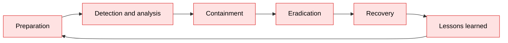

<p align="center"></p>

## 📶 B8 Wireless, Mobile and IoT

### Cellular Generations

| Gen | Era | Technology | Data | Notes |
|-----|-----|------------|------|-------|
| **1G** | 1980s | AMPS (analog) | Voice only | |
| **2G** | 1990s | GSM, CDMA | SMS, 9.6 - 236 kb/s (EDGE) | Digital voice |
| **3G** | 2000s | UMTS, HSPA | Up to tens of Mb/s | Mobile Internet |
| **4G** | 2010s | LTE, LTE-Advanced | 100 Mb/s - 1 Gb/s | All-IP, OFDMA |
| **5G** | 2020s | NR, sub-6 GHz and mmWave | Up to several Gb/s | Low latency, network slicing, massive IoT |

| 5G use case | Meaning |
|-------------|---------|
| **eMBB** | Enhanced mobile broadband |
| **URLLC** | Ultra-reliable low latency (industry, cars) |
| **mMTC** | Massive machine-type communication (sensors) |

| Mobile network part | Role |
|---------------------|------|
| **UE** | User equipment (phone) |
| **RAN** (eNodeB / gNodeB) | Radio access |
| **Core** (EPC / 5GC) | Authentication, mobility, routing to the Internet |
| **Handover** | Moving a call between cells without dropping it |

### Short-Range and Low-Power Wireless

| Technology | Range | Rate | Use |
|------------|:-----:|------|-----|
| **Bluetooth Classic / BLE** | 10 - 100 m | 1 - 3 Mb/s / up to 2 Mb/s | Audio, wearables, beacons |
| **Zigbee (802.15.4)** | 10 - 100 m | 250 kb/s | Smart home, mesh |
| **Z-Wave** | 30 m | 100 kb/s | Home automation |
| **Thread / Matter** | Home | Low | New smart-home standards |
| **NFC** | 4 cm | 424 kb/s | Payments, tags |
| **RFID** | cm - m | n/a | Tracking, access cards |
| **LoRa / LoRaWAN** | km | 0.3 - 50 kb/s | Long-range sensors |
| **NB-IoT / LTE-M** | Cellular | kb/s - Mb/s | Metering, trackers |
| **Wi-Fi HaLow (802.11ah)** | 1 km | Low | Long-range IoT |
| **Satellite (GEO, MEO, LEO)** | Global | Mb/s | Remote areas (Starlink, OneWeb) |

### Wi-Fi in More Depth

| Topic | Details |
|-------|---------|
| **MAC access** | CSMA/CA with ACKs; RTS/CTS for hidden nodes |
| **Frame types** | Management (beacon, probe, auth, assoc), control (RTS, CTS, ACK), data |
| **Modes** | Infrastructure (BSS / ESS) and ad hoc (IBSS) |
| **MIMO / MU-MIMO** | Several antennas / several clients at once |
| **Beamforming** | Focus the signal toward the client |
| **Channel widths** | 20, 40, 80, 160 (and 320 in Wi-Fi 7) MHz |
| **Site survey** | Heat map, coverage, overlap (15 - 20 % cell overlap), interference |
| **Mesh and roaming** | 802.11k / v / r fast handover |

### IoT Architecture

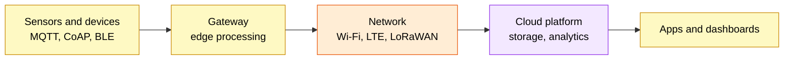

| IoT security issue | Fix |
|--------------------|-----|
| Default passwords | Force change, unique credentials |
| No updates | Signed firmware, update channel |
| Flat network | Separate IoT VLAN and ACLs |
| Weak protocols | TLS for MQTT, device certificates |

<p align="center"></p>

## 🚀 B9 Modern Networking

### Data-Centre Design

| Topic | Details |
|-------|---------|
| **Spine-leaf** | Every leaf connects to every spine; equal-cost multipath (ECMP); east-west traffic friendly |
| **Top of rack (ToR)** | Switch in each rack connects servers |
| **VXLAN** | Layer 2 over Layer 3 tunnel (UDP 4789), 24-bit VNI (16 million segments) |
| **EVPN** | BGP control plane for VXLAN |
| **Storage networks** | Fibre Channel, iSCSI, NVMe over Fabrics, FCoE |
| **RDMA / RoCE / InfiniBand** | Very low-latency transfers (AI, HPC) |
| **Lossless Ethernet** | PFC, ECN, DCB for storage and RoCE |
| **East-west vs north-south** | Server-to-server vs in/out of the data centre |

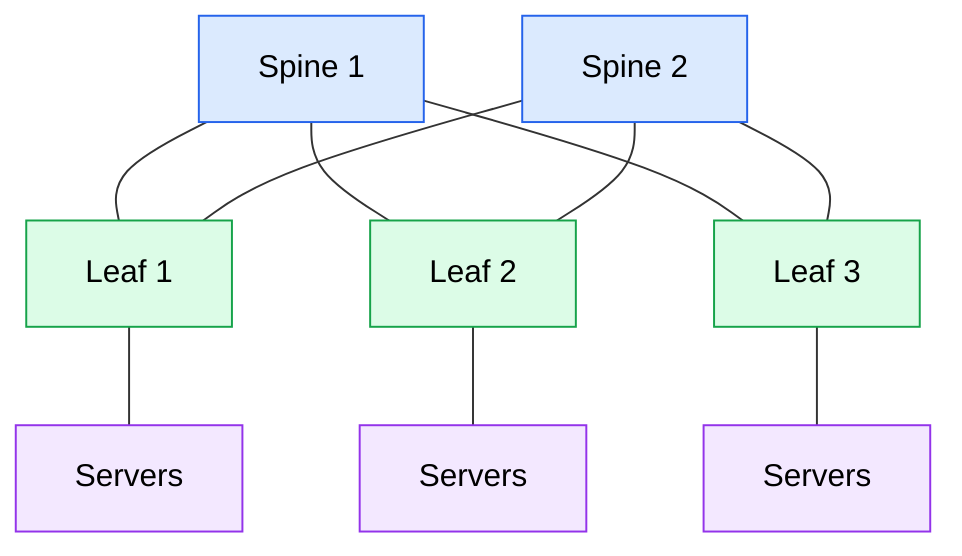

### Virtualisation and Containers

| Topic | Details |
|-------|---------|
| **Hypervisor** | Type 1 (ESXi, KVM, Hyper-V) and type 2 (VirtualBox, VMware Workstation) |
| **Virtual switch** | Software switch inside the host (Open vSwitch, vSwitch) |
| **NFV** | Network functions (router, firewall, load balancer) as software |
| **Docker networking** | bridge, host, none, overlay |
| **Kubernetes networking** | Every pod gets an IP; Services, Ingress, CNI plugins (Calico, Cilium, Flannel), NetworkPolicy |
| **Service mesh** | Istio, Linkerd: mTLS, traffic control between microservices |
| **Network namespaces** | Linux isolation of network stacks |

### Cloud Networking (AWS, Azure, GCP)

| Concept | AWS name | Azure name |
|---------|----------|------------|
| **Virtual network** | VPC | VNet |
| **Subnets** | Public / private subnets | Subnets |
| **Instance firewall** | Security group (stateful) | NSG |
| **Subnet firewall** | Network ACL (stateless) | NSG |
| **Internet access** | Internet gateway, NAT gateway | NAT gateway |
| **Private link to service** | VPC endpoint / PrivateLink | Private Endpoint |
| **Site VPN** | Site-to-Site VPN | VPN Gateway |
| **Dedicated link** | Direct Connect | ExpressRoute |
| **VPC interconnect** | Peering, Transit Gateway | VNet peering, Virtual WAN |
| **Load balancing** | ELB (ALB, NLB) | Load Balancer, App Gateway |
| **DNS** | Route 53 | Azure DNS |
| **CDN** | CloudFront | Front Door / CDN |

| Cloud model | You manage | Provider manages |
|-------------|------------|------------------|
| **IaaS** | OS, apps, data | Hardware, virtualisation |
| **PaaS** | Apps, data | OS and runtime |
| **SaaS** | Your data and users | Everything else |

### SD-WAN, SASE and Zero Trust

| Technology | Idea |
|------------|------|
| **SD-WAN** | Central policy steers traffic over MPLS, broadband and LTE by application and link quality |
| **SASE** | SD-WAN + cloud security (SWG, CASB, ZTNA, FWaaS) delivered as a service |
| **ZTNA** | Per-application access instead of full-network VPN |
| **CASB / SWG** | Control SaaS use / secure web gateway |

### SDN, NFV and Intent-Based Networking

| Technology | Notes |
|------------|-------|
| **OpenFlow** | Early SDN southbound protocol (match-action flow tables) |
| **P4** | Programmable data plane language |
| **OpenDaylight, ONOS** | Open-source SDN controllers |
| **Cisco Catalyst Center, Meraki** | Controller and cloud-managed networks |
| **Intent-based networking** | Say what you want; software translates, deploys and verifies |
| **Network digital twin** | Simulate changes before production |
| **NetDevOps / CI-CD for networks** | Git, tests, automated deployment |

### Edge and Emerging Technologies

| Technology | Notes |
|------------|-------|
| **Edge / fog computing** | Process data close to users or devices |
| **Network slicing** | Several virtual networks on one 5G infrastructure |
| **Private 5G** | Dedicated cellular network for a campus or factory |
| **Wi-Fi 7, 6 GHz** | More capacity and lower latency |
| **Li-Fi** | Data over visible light |
| **Quantum networking / QKD** | Key distribution using quantum physics |
| **Blockchain networks** | Distributed ledger over P2P overlay |
| **AIOps** | AI for monitoring, anomaly detection, root-cause analysis |
| **IPv6-only networks** | Growing, with NAT64 |
| **Segment Routing (SR-MPLS, SRv6)** | Source-routed paths encoded in the packet |

<p align="center"></p>

## 📈 B10 Network Performance and Formulas

### Key Metrics

| Metric | Meaning |
|--------|---------|
| **Bandwidth** | Maximum capacity of a link (bit/s) |
| **Throughput** | Actual data rate achieved |
| **Goodput** | Useful application data only (no headers, no retransmissions) |
| **Latency** | Time for data to travel (one way) |
| **RTT** | Round-trip time |
| **Jitter** | Variation of delay |
| **Packet loss** | Percentage of lost packets |
| **Availability** | Uptime, e.g. 99.999% ("five nines") = about 5 minutes of downtime per year |

| Availability | Downtime per year |
|:------------:|-------------------|
| 99% | About 3.65 days |
| 99.9% | About 8.8 hours |
| 99.99% | About 52 minutes |
| 99.999% | About 5 minutes |

### Delay Components

```
Total delay = Processing + Queuing + Transmission + Propagation
Transmission delay = Packet size (bits) / Link rate (bit/s)
Propagation delay  = Distance / Propagation speed   (about 2 x 10^8 m/s in fibre or copper)
```

| Example | Calculation |
|---------|-------------|
| Send 1500 B (12 000 bits) on a 100 Mb/s link | 12 000 / 100 000 000 = **0.12 ms** |
| 2000 km of fibre | 2 000 000 / 200 000 000 = **10 ms** one way |
| File of 100 MB on 50 Mb/s | 800 Mbit / 50 Mb/s = **16 s** (ideal) |

### Important Formulas

| Name | Formula | Meaning |
|------|---------|---------|
| **Bandwidth-delay product** | BDP = bandwidth x RTT | Bits "in flight"; best TCP window size |
| **Nyquist (noiseless)** | C = 2 x B x log2(L) | Max rate with B Hz and L signal levels |
| **Shannon (noisy)** | C = B x log2(1 + S/N) | Max rate with signal-to-noise ratio |
| **Utilisation (stop-and-wait)** | U = Tt / (Tt + 2Tp) | Efficiency of one frame at a time |
| **Sliding-window efficiency** | U = N x Tt / (Tt + 2Tp) (max 1) | Window of N frames |
| **Pure ALOHA throughput** | S = G x e^(-2G), max 0.184 | Shared channel |
| **Slotted ALOHA** | S = G x e^(-G), max 0.368 | |
| **Hamming bits** | 2^r >= m + r + 1 | Parity bits r for m data bits |
| **Number of hosts** | 2^h - 2 | Usable hosts in a subnet |
| **Mesh links** | n(n-1) / 2 | Full mesh of n nodes |
| **Decibel** | dB = 10 x log10(P2 / P1) | Gain or loss |
| **EIRP / path loss** | FSPL grows with distance and frequency | Link budget planning |

### Queuing and Traffic Management

| Concept | Details |
|---------|---------|
| **Bufferbloat** | Large buffers add delay; fix with AQM (CoDel, FQ-CoDel) |
| **Traffic shaping** | Smooth bursts using a token or leaky bucket |
| **Rate limiting / policing** | Hard cap on a flow |
| **Fair queuing** | Fair share per flow |
| **ECMP** | Equal-cost multipath load sharing by hash |
| **Link aggregation hash** | Source/destination MAC, IP, port |

<p align="center"></p>

## 🔧 B11 Network Tools and Linux Networking

### Analysis and Security Tools

| Tool | Purpose | Example |
|------|---------|---------|
| **Wireshark** | Packet capture and analysis (GUI) | Filters: `ip.addr == 192.168.10.1`, `tcp.port == 80`, `dns` |
| **tcpdump** | Command-line capture | `tcpdump -i eth0 port 53` |
| **Nmap** | Host and port discovery, service detection | `nmap -sV -p 1-1000 192.168.10.0/24` |
| **Netcat (nc)** | TCP/UDP Swiss-army tool | `nc -lvp 4444` |
| **iperf3** | Bandwidth testing | `iperf3 -s` then `iperf3 -c server` |
| **mtr** | Traceroute + ping combined | `mtr 8.8.8.8` |
| **Wireshark/tshark, Zeek, Suricata, Snort** | Traffic analysis and IDS/IPS | |
| **Metasploit, Burp Suite, Nessus, OpenVAS** | Penetration testing and vulnerability scanning (authorised use only) | |
| **Packet Tracer, GNS3, EVE-NG, Cisco CML, Containerlab** | Network simulation and emulation | |
| **Scapy** | Craft and send packets in Python | |

> [!WARNING]
> Scan and test **only networks you own or have written permission to test**.

### Linux Network Commands

| Task | Old command | Modern command |
|------|-------------|----------------|
| Show IP addresses | `ifconfig` | `ip addr show` |
| Show routes | `route -n` | `ip route show` |
| Add a route | `route add` | `ip route add 10.0.0.0/24 via 192.168.1.1` |
| Show ARP table | `arp -a` | `ip neigh show` |
| Show sockets | `netstat -tulpn` | `ss -tulpn` |
| Link up/down | `ifconfig eth0 up` | `ip link set eth0 up` |
| DNS lookup | `nslookup` | `dig example.com`, `host example.com` |
| HTTP test | - | `curl -I https://example.com` |
| Trace route | `traceroute` | `traceroute` / `mtr` |
| Firewall | `iptables` | `nft` (nftables), `ufw` |
| Wi-Fi | `iwconfig` | `iw dev`, `nmcli` |
| Hostname resolution file | - | `/etc/hosts`, `/etc/resolv.conf` |
| Enable forwarding | - | `sysctl -w net.ipv4.ip_forward=1` |

```bash
# Quick troubleshooting flow on Linux
ip addr show                 # do I have an IP?
ip route show                # do I have a gateway?
ping -c 3 192.168.10.1       # can I reach the gateway?
ping -c 3 8.8.8.8            # can I reach the Internet by IP?
dig example.com              # does DNS work?
curl -I https://example.com  # does the web service answer?
ss -tulpn                    # which services are listening?
```

### Windows Network Commands

| Task | Command |
|------|---------|
| IP details | `ipconfig /all` |
| Flush DNS | `ipconfig /flushdns` |
| Routes | `route print` |
| Trace | `tracert`, `pathping` |
| Sockets | `netstat -ano` |
| DNS | `nslookup`, `Resolve-DnsName` |
| Test port | `Test-NetConnection host -Port 443` |
| Firewall | `netsh advfirewall`, Windows Defender Firewall |

### Useful Wireshark Display Filters

| Goal | Filter |
|------|--------|
| One host | `ip.addr == 192.168.10.10` |
| TCP handshake | `tcp.flags.syn == 1` |
| HTTP requests | `http.request` |
| DNS only | `dns` |
| ICMP | `icmp` |
| DHCP | `bootp` or `dhcp` |
| TCP problems | `tcp.analysis.flags` |
| TLS handshake | `tls.handshake` |

### Simple Python Networking Utilities

```python
# Port scanner for YOUR OWN lab hosts
import socket

def scan(host, ports):
    for port in ports:
        s = socket.socket(socket.AF_INET, socket.SOCK_STREAM)
        s.settimeout(0.5)
        if s.connect_ex((host, port)) == 0:
            print(f"Port {port} is open")
        s.close()

scan("192.168.10.1", [22, 23, 80, 443])
```

```python
# Resolve a name and fetch a page
import socket, urllib.request
print(socket.gethostbyname("example.com"))
print(urllib.request.urlopen("https://example.com").status)
```

<p align="center"></p>

## 📊 B12 Network Management and Monitoring

### FCAPS Model (ISO)

| Letter | Area | Examples |
|:------:|------|----------|
| **F** | Fault | Alarms, outage detection |
| **C** | Configuration | Backups, change management |
| **A** | Accounting | Usage and billing |
| **P** | Performance | Utilisation, latency |
| **S** | Security | Access control, auditing |

### Monitoring Technologies

| Technology | What it gives |
|------------|---------------|
| **SNMP polling and traps** | Interface counters, CPU, temperature, alarms |
| **NetFlow / IPFIX / sFlow** | Who talks to whom (flow records, top talkers) |
| **Syslog** | Event logs |
| **Streaming telemetry (gNMI, gRPC)** | High-frequency push data from devices |
| **Packet capture / SPAN / TAP** | Deep traffic analysis |
| **IP SLA** | Synthetic probes (delay, jitter, loss) |
| **Ping / traceroute monitors** | Reachability and path |
| **Port mirroring (SPAN)** | Copy traffic to an analyser: `monitor session 1 source interface g0/1` |

| Tool | Type |
|------|------|
| **Zabbix, Nagios, PRTG, LibreNMS, SolarWinds** | NMS (network monitoring systems) |
| **Prometheus + Grafana** | Metrics and dashboards |
| **ELK / OpenSearch, Graylog, Splunk** | Log analytics |
| **Cisco Catalyst Center, Meraki Dashboard, ThousandEyes** | Vendor and path-visibility platforms |
| **Ansible, NAPALM, Netmiko, Nornir** | Automation libraries |

### Operations and Processes

| Topic | Details |
|-------|---------|
| **Baseline** | Record normal behaviour to spot abnormal behaviour |
| **Change management** | Plan, approve, test, back out plan |
| **Backups** | Config backup to TFTP/SFTP/Git |
| **Documentation** | Topology diagrams, IP plan, VLAN table, cable labels |
| **ITIL** | Service management: incident, problem, change, configuration |
| **SLA / SLO / SLI** | Agreement, objective, indicator for service quality |
| **MTBF / MTTR** | Mean time between failures / to repair |
| **RTO / RPO** | Time to recover / acceptable data loss |
| **Disaster recovery** | Hot, warm and cold sites |

<p align="center"></p>

## 🧱 B13 Design, Standards and Careers

### Network Design Process

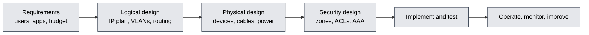

| Design principle | Meaning |
|------------------|---------|
| **Scalability** | Grow without redesign |
| **Availability / redundancy** | No single point of failure (dual links, dual devices, FHRP) |
| **Security by design** | Segmentation, least privilege |
| **Manageability** | Standard configs, automation |
| **Performance** | Right-sized links, oversubscription ratios (access 20:1, distribution 4:1) |
| **Cost** | CAPEX and OPEX balance |
| **Modularity** | Clear blocks (campus, data centre, WAN edge) |

### Standards Bodies

| Body | Known for |
|------|-----------|
| **IEEE** | 802.3 Ethernet, 802.11 Wi-Fi, 802.1Q VLAN, 802.1X, 802.15 PAN |
| **IETF** | RFCs for Internet protocols (TCP, IP, HTTP, DNS, BGP) |
| **ISO / IEC** | OSI model, ISO 27001 |
| **ITU-T** | Telecom standards (G.711, H.323, xDSL) |
| **ICANN / IANA** | Domain names, IP address and port assignment |
| **RIRs** | APNIC (Asia-Pacific, including Pakistan), ARIN, RIPE NCC, LACNIC, AFRINIC |
| **W3C** | Web standards (HTML, CSS) |
| **3GPP** | Mobile network standards |
| **Wi-Fi Alliance, Bluetooth SIG** | Certification of wireless products |
| **NIST** | US security and cryptography standards |

### Important RFCs

| RFC | Topic |
|:---:|-------|
| 791 | IPv4 |
| 792 | ICMP |
| 793 | TCP (updated by 9293) |
| 768 | UDP |
| 826 | ARP |
| 1918 | Private addresses |
| 2131 | DHCP |
| 2328 | OSPFv2 |
| 2460 / 8200 | IPv6 |
| 2616 / 9110 | HTTP |
| 4271 | BGP-4 |
| 4301 | IPsec architecture |
| 5246 / 8446 | TLS 1.2 / 1.3 |
| 7230 series | HTTP/1.1 messaging |
| 9000 | QUIC |

### Timeline of Networking

| Year | Milestone |
|:----:|-----------|
| 1969 | ARPANET connects its first nodes |
| 1973 | Ethernet invented at Xerox PARC |
| 1981 | IPv4 and TCP/IP standardised |
| 1983 | ARPANET switches to TCP/IP; DNS (1983-84) |
| 1989 | World Wide Web proposed (Tim Berners-Lee) |
| 1991 | First web page; Linux begins |
| 1997 | 802.11 Wi-Fi standard published |
| 1998 | IPv6 specified |
| 2007 | iPhone, mobile Internet era |
| 2009 | OpenFlow / SDN gains momentum |
| 2015 | HTTP/2 standardised |
| 2019 | First 5G launches |
| 2022 | HTTP/3 and QUIC standardised |
| 2024 onward | Wi-Fi 7, AI-driven networking, post-quantum cryptography |

### Certifications and Career Paths

| Path | Certifications | Roles |
|------|----------------|-------|
| **Networking** | CompTIA Network+, Cisco CCNA, CCNP, CCIE, Juniper JNCIA, Huawei HCIA | Network engineer, NOC engineer |
| **Security** | CompTIA Security+, Cisco CyberOps, CEH, CISSP, OSCP, GIAC | SOC analyst, security engineer, pentester |
| **Cloud** | AWS Solutions Architect / Advanced Networking, Azure AZ-700, GCP Network Engineer | Cloud network engineer |
| **Wireless** | CWNA, CWSP | Wireless engineer |
| **Automation** | Cisco DevNet Associate / Professional, Red Hat Ansible, Python | NetDevOps engineer |
| **Linux and systems** | Linux+, RHCSA | Systems and network administrator |

### Suggested Learning Order After CCNA

| Step | Topic |
|:----:|-------|
| 1 | Wireshark: read every protocol from the labs at packet level |
| 2 | Linux networking and Python scripting |
| 3 | Network+ / Security+ concepts |
| 4 | OSPF, EIGRP, BGP, EtherChannel, NAT and ACL labs (CCNP-level) |
| 5 | Cloud networking (VPC) and containers |
| 6 | SOC tools: SIEM, IDS, threat hunting (matches your security operations goal) |

<p align="center"></p>

## 📜 Master Protocol Table

| Layer | Protocols |
|-------|-----------|
| **Application (7 - 5)** | HTTP/1.1/2/3, HTTPS, FTP, SFTP, TFTP, SMTP, POP3, IMAP, DNS, DHCP, DHCPv6, NTP, SNMP, Syslog, SSH, Telnet, RDP, VNC, LDAP, Kerberos, RADIUS, TACACS+, SIP, RTP, RTCP, SMB, NFS, MQTT, CoAP, AMQP, WebSocket, gRPC, XMPP, NETCONF, RESTCONF, BGP (over TCP), TLS/SSL |
| **Transport (4)** | TCP, UDP, QUIC, SCTP, DCCP, MPTCP |
| **Network (3)** | IPv4, IPv6, ICMP, ICMPv6, IGMP, ARP/NDP, OSPF, EIGRP, IS-IS, RIP, BGP, PIM, IPsec (AH, ESP), GRE, VRRP, HSRP, GLBP, MPLS, LISP, VXLAN (overlay) |
| **Data link (2)** | Ethernet (802.3), Wi-Fi (802.11), 802.1Q, 802.1X, 802.1D/w/s STP, LACP (802.3ad), LLDP, CDP, PPP, PPPoE, HDLC, Frame Relay, ATM, Bluetooth, Zigbee (802.15.4), PoE (802.3af/at/bt) |
| **Physical (1)** | UTP, coaxial, fibre (SMF/MMF), radio, DSL, DOCSIS, SONET/SDH, DWDM, USB, optical transceivers (SFP, QSFP) |

<p align="center"></p>

## 📞 Connect With Me

<p align="center">
  <a href="https://github.com/sanawar-imran-securityengineer"></a>
</p>

<p align="center"><b>Sanawar Imran</b> · BS Cybersecurity, Air University, Multan Campus<br>Networking · Security Operations · CCNA</p>

> [!NOTE]
> This repository is for **educational use**. If it helped you, give it a ⭐ and share it.

<p align="center">
  
</p>
